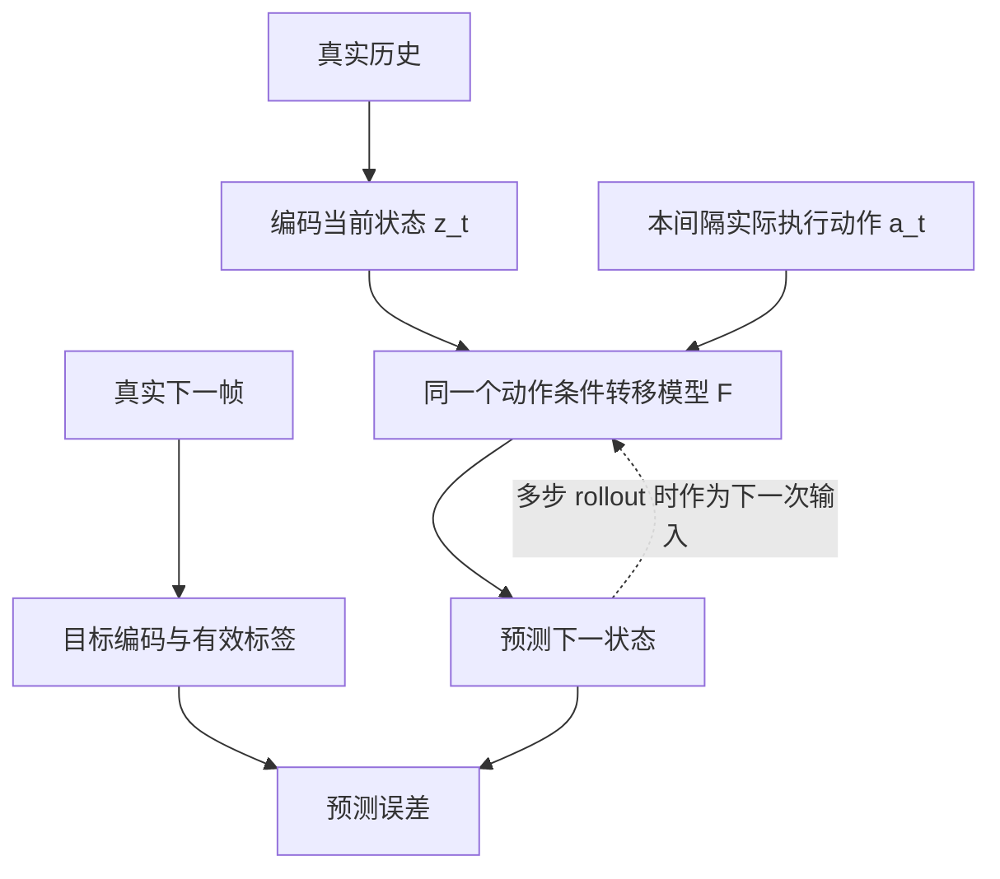
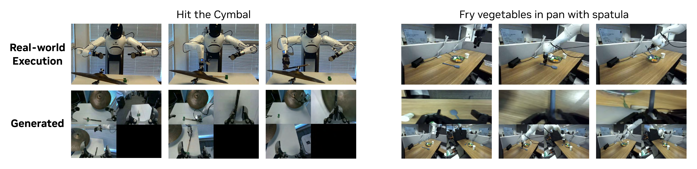

# 动作条件视频世界模型，从一条抓取轨迹到训练目标

机械臂准备提起桌边的玻璃杯。候选动作有快速提起和缓慢提起，图像里两者的起点相同，但接触与滑落后果可能不同。我们希望学习的模型接收过去的观察和指定动作，预测这次动作之后会发生什么。本文沿这一个任务构造训练样本，解释时间、张量、目标和评测如何接起来。

仓库的 [world-model-mini-chain](../assets/examples/world-model-mini-chain/eval_mini_chain.py) 是手工数据的评测示例。它能复算 token 数、候选选择与风险误差，**没有视频张量、训练器或模型 checkpoint**。下面的设计解释真实训练还要补齐哪些环节；文中的小型数值程序会训练一维动力学，用来直接检查动作条件的作用。

## 先确定一条动作到底覆盖哪段未来

设控制器每 0.1 秒接收一次动作，动作包含末端三维位移、旋转增量与夹爪命令。位移单位、旋转表示、坐标系及饱和限制必须由控制器约定。世界模型应学习实际执行动作的后果，因此日志需同时保留策略提议和控制器执行值；两者不一致时不能只存提议。

把当前时刻记为 $t$，历史图像覆盖 $t-4$ 秒到 $t$，预测未来 1.6 秒。10 Hz 下，这个窗口需要 16 个动作间隔。每个训练样本应能回答，图像 $o_{t+1}$ 是在哪一个动作持续区间之后采集的。若相机有固定延迟，匹配依据应是采集时间，而非视频文件写入时间。

现有 [`training-config.yaml`](../assets/examples/world-model-mini-chain/training-config.yaml) 同时写了 `rollout_horizon_seconds: 1.6`、`control_rate_hz: 10` 和 `8_step_delta_ee_pose_gripper_chunk`。八步只覆盖 0.8 秒。真实实现可以提供两个 chunk、把预测窗口缩短，或明确剩余动作由什么策略补齐；不能默默让模型预测未知控制输入之后的唯一未来。该 YAML 目前只是设计示意，评测脚本不会读取它。

对于有遮挡的玻璃杯，4 秒历史也不保证状态完整。摩擦系数可能没有被观测到，夹紧程度可能只有力传感器能辨认。因此目标通常是条件分布，或带有可检验误差的条件预测。

\[
p_\theta(o_{t+1:t+16},e_{t+1:t+16}\mid o_{\le t},a_{t:t+15},g).
\]

$g$ 是拿起玻璃杯的任务条件，$e$ 可以包含接触、滑落和完成等事件。它们需要有独立标签来源，不能让同一模型先猜事件，再把自己的猜测当监督真值。

## 把时间窗口变成模型能够读取的样本

假设先取三路相机各八帧历史，每个相机每帧经 encoder 和 resampler 得到 64 个、维数 256 的 token。一个 batch 可以组织成下表。这些形状是教学设计，并非现有 fixture 已保存的张量。

| 张量 | 形状 | 它包含的信息 |
| --- | --- | --- |
| `history_tokens` | `[B, 3, 8, 64, 256]` | 相机、时间和空间位置都可识别的历史 |
| `actions` | `[B, 16, 7]` | 实际控制接口下的连续动作 |
| `future_targets` | `[B, 16, D]` | 各预测时刻的目标表征 |
| `future_valid` | `[B, 16]` | 该时刻是否有有效观测与标签 |
| `slip_targets` | `[B, 16]` | 指定窗口中滑落事件的监督 |

三路相机 token 不能只拼成无身份的序列。模型需要知道哪一路相机、哪一帧、何种标定，否则同一个物体在不同视角的移动会被误读。Resampler 的工作是把一帧许多 patch 映射为少量表示；token 数下降只证明表示更短，是否保留了杯沿与手指接触，还需要任务检验。

设历史编码成 $z_t$，最简单的动作条件递推为

\[
\hat z_{t+k+1}=F_\theta(\hat z_{t+k},a_{t+k},g),\qquad \hat z_t=z_t.
\]

训练时，可以给每一步输入真实编码状态来学一步转移，也可以从 $z_t$ 连续使用自己的预测来学多步 rollout。前者容易优化，却没有直接经历多步误差积累；后者更接近使用方式，但早期预测误差会改变后续输入。两者的损失和评测应分别报告。



实线展示一步训练的输入和目标。虚线展示多步 rollout 怎样回用自己的预测。真实下一帧可以生成监督标签，但在本文的条件预测设定中，不应偷偷进入当前状态分支。

## 先在一维模型中检查动作有没有真的被使用

把杯子一维位置作为状态，构造 $x'=x+0.8a$。模型只学一个参数 $b$，预测 $\hat x'=x+ba$。若完全忽略动作，等于固定 $b=0$，不论快慢推都预测杯子不动。均方损失及其梯度为

\[
L(b)=\frac1N\sum_i(x_i+ba_i-x'_i)^2,\qquad
\frac{\mathrm dL}{\mathrm db}=\frac2N\sum_i a_i(x_i+ba_i-x'_i).
\]

下面的 NumPy 程序完成样本、训练、动作对照与多步预测，可以单独运行。

```python
import numpy as np

x = np.array([0., 0., 1., 1., -1., -1.])
a = np.array([-1., 1., -1., 1., -0.5, 0.5])
x_next = x + 0.8 * a
b = 0.0
before = np.mean((x + b * a - x_next) ** 2)
for _ in range(100):
    error = x + b * a - x_next
    b -= 0.2 * 2.0 * np.mean(error * a)
after = np.mean((x + b * a - x_next) ** 2)

def rollout(start, actions):
    states = []
    for action in actions:
        start = start + b * action
        states.append(start)
    return np.array(states)

print(f"b={b:.6f}, mse={before:.4f} -> {after:.4e}")
print("positive", rollout(0.0, [1.0, 1.0]))
print("negative", rollout(0.0, [-1.0, -1.0]))
assert np.isclose(b, 0.8)
assert np.allclose(rollout(0.0, [1.0, 1.0]), [0.8, 1.6])
```

这里动作改变预测方向，是因为训练数据中动作与位移的关系提供了监督。仅增加一个“不同动作的 latent 必须离得远”的损失并不能保证这种关系正确。模型可以让背景特征大幅变化，甚至交换正负动作的后果，同样满足距离足够大的要求。真实世界中的反事实检查还必须比较变化的方向、任务变量和独立结果。

这个一维程序假设状态完全可见、动力学线性、数据无噪声。视频模型要处理的隐藏摩擦、多视角、随机后果和接触突变都没有在其中得到验证。它的用途是把条件输入、梯度与预测联系清楚。

## 视频表征和事件标签分别约束什么

未来表征可来自一个目标编码器 $E_{\bar\theta}$。一种基本目标为

\[
L_z=\frac{\sum_{i,k}m_{ik}\|\hat z_{i,k}-\operatorname{sg}(E_{\bar\theta}(o_{i,k}))\|^2}
{\sum_{i,k}m_{ik}},
\]

其中 $m$ 为有效时刻 mask，`sg` 表示目标分支停止梯度。使用缓慢更新的 teacher 只是某些表示学习方法的一部分，单有 stop-gradient 并不构成通用防塌缩保证。若 encoder 把所有画面都映射成常数，预测损失也可能很小，但无法区分快慢抓取。

滑落概率 $p_{ik}$ 可以用二元交叉熵拟合标签 $y_{ik}$。需要先定义它是“下一间隔滑落概率”，还是“未来 1.6 秒至少滑落一次的概率”。后者的多个时间窗口会重叠，不能把它们当独立单步事件随意相加。任务成功和安全违反也不是同一个标签，抓错杯子可能不碰撞，却仍未完成目标。

组合 $L=L_z+\lambda_eL_e$ 时，$\lambda_e$ 调节两个数值尺度下的优化权重。它不自动代表某种安全保证。修改标签频率、平均维度或有效 token 数后，即使权重没变，实际梯度比例也可能变化。

{ width="860" }

<small>图源：[DreamZero](https://arxiv.org/abs/2602.15922)，联合视频与动作示意图。论文展示联合建模的一种设计；本文的条件预测器、线性算例与手工 fixture 并未实现这套模型。</small>

如果还要同时生成动作，就从条件分布 $p(o'\mid o,a)$ 扩展到世界与动作的联合建模。这会改变训练数据、因子分解和调用接口，详见 [WM、WAM、VAM 与动作条件](wm-wam-vam-and-action-conditioned-modeling.md)。不能仅因为数据中有动作就声称已经实现联合策略。

## 训练时看到未来，部署时怎样避免泄漏

真实未来可以出现在监督目标一侧，却不能作为一个未声明的输入流入当前决策。对于自回归预测，后一步可读取已经生成的前一步；对于扩散预测，未来位置可以承载带噪变量，训练和推理必须遵守同一条件约定。双向去噪未来变量本身不等于看到了干净真值，是否泄漏要追踪数据路径，不能简单规定所有未来 token 永远只能 causal。

把多条 episode 打包时，attention mask 还必须隔离不同 episode。否则一条轨迹可以读取另一条的未来或任务标签，得到部署时不存在的信息。评测也应按 episode 或场景切分，不能让同次抓取的相邻帧跨越训练与测试。

模型训练完成后，先固定同一真实历史比较快抓和慢抓，再让实际规划器选择并执行短前缀，接收新观察。训练 loss、动作条件响应和闭环成功分别对应不同层证据。仓库当前 fixture 能展示后两层应如何记账，却没有产生这些模型预测。复算过程见[评测报告](world-model-efficient-training-experiment-report.md)，完整系统的数据流见[VLA 到世界模型](vla-world-model-full-chain-case.md)。

进一步读真实方法时，可以对照 [MWM](https://arxiv.org/abs/2206.14244) 的表征/动力学分工、[V-JEPA 2](https://arxiv.org/abs/2506.09985) 的动作条件预测与规划，以及 [PlaNet](https://arxiv.org/abs/1811.04551) 的历史状态推断。每一条路线都要回到同样的问题，模型在预测时究竟已知什么，损失用了什么真值，使用者又根据哪个输出改变了动作。

## 模型和实验依据

动作条件建模的参照来自 [PlaNet](https://arxiv.org/abs/1811.04551)、[MWM](https://arxiv.org/abs/2206.14244) 和 [V-JEPA 2](https://arxiv.org/abs/2506.09985)，联合视频动作的图示对照 [DreamZero](https://arxiv.org/abs/2602.15922)。杯子、快抓/慢抓、10 Hz、1.6 秒和线性动力学训练程序是本站构造的教学链路；仓库 fixture 没有视频张量、真实机器人 checkpoint 或动作成功率。

沿 `state_id`、动作时间戳和 episode 边界回放一条样本，分别检查 teacher-forced 一步、多步 free-running、动作交换和 planner 读出。只有四项都能独立回答，才可以把“动作条件世界模型”写成可用接口。
