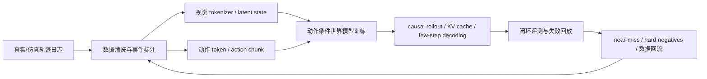
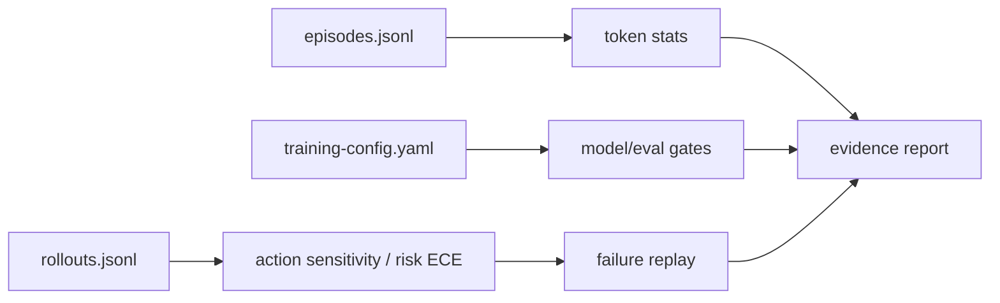

# 动作条件视频世界模型端到端训练案例

这页用一个具体案例把全站主线串起来：**训练一个面向机器人桌面操作的动作条件视频世界模型**。目标不是追求最完整的工业方案，而是给读者一条可复盘的技术链路：从数据、视觉状态、动作接口，到训练系统、rollout 推理、量化和闭环评测。


## 任务设定

假设我们要训练一个模型，用于桌面机器人任务：

```text
输入：最近 N 帧 RGB-D / wrist camera / proprioception / language goal / action history
输出：未来 H 步视频 latent、风险信号、可恢复性标签、可选动作候选
用途：给 VLA policy、planner 或数据引擎判断“如果执行这个动作 chunk，接下来会怎样”
```

这个模型不是普通视频生成器。它必须满足四个条件：

1. **动作敏感**：同一历史下换动作，未来应合理分叉。
2. **长时一致**：物体身份、位置、遮挡和接触状态不能几秒后重置。
3. **可被消费**：输出要服务 policy、planner、risk module 或数据引擎。
4. **训练可承受**：视频 token、真实交互、GPU 显存和验证预算不能无限增长。

## 总体链路



这条链路要同时优化七类成本：真实交互成本、视觉 token 成本、动作条件成本、长序列训练成本、数值和显存成本、rollout 推理成本、闭环验证成本。

{ width="860" }

<small>图源：`World Action Models are Zero-shot Policies`，Figure 2。原论文图意：DreamZero 同时生成未来视频和动作，强调动作预测与生成视频在未见任务上保持对齐。本站读法：这张图说明动作条件世界模型不能只预测“未来画面”，还要让动作、未来状态和执行结果互相约束；下面的 mini-chain 就按这个思路把 episode、rollout、risk 和失败 replay 接起来。</small>

## 硬证据模块：一个可复算 mini-chain

为了避免这页只停留在“设计蓝图”，这里放一个最小可复算 fixture。它不是生产模型结果，也不伪装成论文 benchmark；它的作用是把本页要求的证据链变成可运行格式：数据样例、token 统计、训练配置、rollout 输出、失败 replay 和验收指标都能从同一组文件算出来。

```text
files/assets/examples/world-model-mini-chain/
  episodes.jsonl
  rollouts.jsonl
  training-config.yaml
  eval_mini_chain.py
```

运行：

```bash
python3 files/assets/examples/world-model-mini-chain/eval_mini_chain.py
```

当前 fixture 输出：

| Metric | Value |
| --- | ---: |
| episodes | 4 |
| raw_patch_tokens | 82368 |
| compressed_state_tokens | 12292 |
| compression_ratio | 6.70x |
| action_sensitivity_pass | 3/4 |
| top1_safe_success_agreement | 2/4 |
| risk_ece_3bin | 0.103 |

这条小链路覆盖的是“证据格式”，不是声称模型已经可用。它让读者能看到一条世界模型实验最小应该长什么样：



| 证据项 | 这个 fixture 里怎么体现 | 真实实验要替换成什么 |
| --- | --- | --- |
| 本页解决哪项成本 | raw patch token 到 compressed state token 的 `6.70x` 压缩账 | 真实 tokenizer / resampler 的统计直方图和训练 step time |
| 最小可复算例子 | 4 条 episode、12 条候选 rollout、一个无依赖评测脚本 | 固定数据切分、固定 checkpoint、固定 eval seed |
| 失败案例 | `wm_mini_003` 低估 fast grasp 滑落，`wm_mini_004` 把遮挡目标误判成可抓 | 失败视频、模型预测、真实结果、人工标签和重放日志 |
| 论文或日志证据 | 当前只是文档 fixture，证据等级是 reproducible toy log | 论文 benchmark、ablation、系统吞吐或真实闭环日志 |
| 反例和适用边界 | 4 条样本太小，不能说明泛化；没有真实训练和硬件延迟 | 扩到任务桶、环境桶、机器人桶和硬件桶 |
| 验收指标 | action sensitivity、top-1 safe success、risk ECE、failure replay | 加上闭环成功率、恢复率、cost per success、P95/P99 latency |

两个失败 replay 是这条链路里最值得看的部分：

| episode | top_candidate | predicted_risk | predicted_success | actual_event | 含义 |
| --- | --- | ---: | ---: | --- | --- |
| `wm_mini_003` | `fast_grasp` | 0.20 | 0.80 | `slip` | 风险头低估快速抓取导致滑落，说明不能只看成功概率 |
| `wm_mini_004` | `grasp_visible_decoy` | 0.16 | 0.76 | `wrong_target` | 遮挡后对象身份漂移，说明视觉 memory 和多相机对齐要进评测 |

如果这是真实实验，当前结果不能通过发布门禁：`top1_safe_success_agreement=2/4` 太低，说明模型排序会选错动作；`action_sensitivity_pass=3/4` 暴露遮挡任务中动作分叉不够；虽然 `risk_ece_3bin=0.103` 看起来可接受，但它被小样本掩盖，必须按 hard-negative 桶单独看。这个反例很重要：一个平均风险校准数不错的模型，仍可能在关键失败桶里不可用。

## 数据 schema：先保证动作和后果能对齐

数据不要只存视频和动作值。一个可训练的动作条件世界模型，至少需要：

| 字段 | 例子 | 为什么重要 |
| --- | --- | --- |
| 观测 | multi-view RGB、depth、wrist camera、proprioception | 建立当前状态和遮挡记忆 |
| 动作 | end-effector delta、gripper、base velocity、action chunk | 让未来预测对动作条件敏感 |
| 任务 | language goal、subtask、object id | 判断未来是否朝目标推进 |
| 事件 | grasped、dropped、collision、contact、done | 给风险和恢复建监督 |
| 失败标签 | near-miss、recoverable failure、irrecoverable failure | 数据引擎优先回流高价值片段 |
| 系统日志 | latency、controller reject、human takeover | 区分模型错、控制错和系统错 |

如果动作时间戳和视频帧没有对齐，模型会学到“动作大概和未来有关”，但很难学到准确因果。对高效训练来说，**对齐质量比数据量更先决定上限**。

## 数据分桶：不要随机采样全部视频

世界模型训练最容易浪费在低信息片段上。建议按任务价值分桶：

| 桶 | 采样策略 | 训练价值 |
| --- | --- | --- |
| 成功稳定轨迹 | 保留主分布，但不过采 | 让模型知道正常动态 |
| 成功但过程不稳 | 提高采样权重 | 学会边界状态和恢复空间 |
| near-miss | 高权重采样 | 学风险、接触和动作敏感性 |
| 可恢复失败 | 高权重采样 | 学恢复策略和错误传播起点 |
| 不可恢复失败 | 门禁采样 | 学安全边界和终止信号 |
| 人工接管 | 单独标注 | 学“不该自主执行”的区域 |

这一步直接对应 [世界模型数据引擎](data-engines-and-self-improvement.md)：高效训练不是“更多数据”，而是“当前模型最缺的高价值数据”。

## 视觉表示：先压 token，再谈大模型

原始视频 token 太贵。一个桌面操作任务如果用 4 个相机、16 帧、每帧几百个 patch，很快会把 attention、显存和通信压垮。更现实的路线是：

1. 用视觉 encoder / video tokenizer 得到 latent。
2. 用连接器或 resampler 只保留任务相关 token。
3. 对关键对象、接触区域、gripper 附近区域提高保真。
4. 把长期状态放进结构化 memory，而不是无限加帧。

| 视觉信息 | 保留策略 |
| --- | --- |
| 目标物、夹爪、接触点 | 高优先级 token 或 crop latent |
| 背景、桌面纹理 | 低频压缩或丢弃 |
| 遮挡前物体位置 | 进入工作记忆 |
| 多相机几何关系 | 通过 calibration / pose token 显式给出 |

判断视觉 tokenizer 是否合格，不只看 VQA，而要看动作相关能力：抓取点、接触边界、左右/前后、遮挡后的物体持久性，以及同一动作在不同相机下是否可对齐。

## 动作接口：动作太细和太粗都会浪费

动作接口决定训练序列长度和可控性。常见选择：

| 动作形式 | 适用场景 | 成本与风险 |
| --- | --- | --- |
| 单步连续动作 | 高频控制、低层反馈强 | 序列长，模型容易抖 |
| action chunk | 桌面抓取、开关抽屉、放置 | 降低决策频率，但错误会持续多个 step |
| 离散 action token | 复用 Transformer 训练框架 | 有量化误差，需要控制器平滑 |
| latent skill | 长时程任务和规划 | 难解释，安全边界更难写 |

对动作条件世界模型，一个实用起点是：**用 action chunk 做主条件，用低层控制器保证可执行性，用真实执行反馈刷新状态**。这样既能减少 token 数，又不至于让动作语义太粗。

## 训练目标：不要只预测像素

如果训练目标只要求未来视频好看，模型很容易学到平均未来。更稳的目标组合是：

\[
\mathcal{L}
=
\lambda_v \mathcal{L}_{\text{video-latent}}
+ \lambda_a \mathcal{L}_{\text{action-sensitivity}}
+ \lambda_e \mathcal{L}_{\text{event}}
+ \lambda_r \mathcal{L}_{\text{risk}}
+ \lambda_c \mathcal{L}_{\text{consistency}}
\]


| 目标 | 作用 |
| --- | --- |
| video latent prediction | 学未来观测和时序动态 |
| action contrast / sensitivity | 强迫不同动作产生可区分未来 |
| event prediction | 预测 grasp、drop、collision、done 等关键事件 |
| risk / uncertainty | 给 planner 和安全层使用 |
| temporal consistency | 约束对象身份、位置和状态跨帧保持 |

最关键的是 action sensitivity。可以构造同一历史下的动作对照：真实动作、扰动动作、保守动作、专家修正动作。模型不仅要预测未来，还要让未来差异能解释动作差异。

## 长序列训练：把 mask、packing 和通信提前设计好

桌面操作看似短，但真实训练会很长：多相机、多帧、语言、动作、事件、memory token 和未来 latent 都在同一条序列里。高效训练要先设计序列结构：

| 组件 | 典型可见性 |
| --- | --- |
| 历史观测 token | 可被未来预测读取 |
| 未来视频 latent | 训练时可用 denoising / masked prediction，推理时必须 causal |
| action chunk | 可被对应未来窗口读取 |
| language / subtask | 全局可见 |
| memory token | 按任务阶段读取 |
| 不同样本 packed 在一起 | 必须用 block mask 隔离 |

如果使用 patch-and-pack、block-causal mask 或 variable-length trajectory，attention 负载会很不均衡。这时 [MagiAttention](../paper-deep-dives/foundations/magiattention.md) 这类方法的价值就出现了：它不是“再快一点 attention”，而是解决异构 mask 下的负载均衡和通信冗余。

## 数值与显存：低比特要保护敏感模块

世界模型训练中，低比特策略不能照搬纯 LLM：

| 模块 | 精度建议 | 原因 |
| --- | --- | --- |
| 大型线性层 / MLP | BF16 -> FP8 / FP4 QAT 逐步尝试 | 主要省权重、激活和带宽 |
| attention 主路径 | FP8 或专项 QAT 后再低比特 | softmax、重算和长序列误差会放大 |
| vision connector / action head | 保守精度 | 坐标、抓取点和动作平滑对误差敏感 |
| risk / safety head | 保守精度 | 误差可能导致风险低估 |
| KV cache rollout | 可按任务桶量化 | 长 horizon 时显存收益明显，但要验一致性 |

低比特验收不能只看 loss。至少要看：动作敏感性、长时一致性、事件预测、风险校准、闭环成功率和失败恢复率。图像看起来差不多，不代表世界模型可用。

## Rollout 推理：从离线生成变成可交互系统

训练时可以看完整片段，部署时不行。部署需要：

1. causal attention，不能读取未来。
2. KV cache，降低连续 rollout 成本。
3. action chunk streaming，执行一段动作后刷新真实观测。
4. few-step diffusion / consistency / DMD 蒸馏，降低每个未来窗口的采样步数。
5. 分桶调度，让短闭环任务不被长视频 rollout 拖住。

端到端时延可以粗略拆成：

\[
T_{\text{loop}}
=
T_{\text{observe}}
+ T_{\text{encode}}
+ T_{\text{rollout}}
+ T_{\text{policy/risk}}
+ T_{\text{control}}
\]


这行式子表示一次闭环的总时延 \(T_{\text{loop}}\) 可以拆成观测、编码、rollout、策略/风险判断和控制执行五段。每个 \(T_{\text{...}}\) 都是一个可单独 profile 的耗时，不应只看模型 forward 时间。

世界模型如果让 \(T_{\text{rollout}}\) 太大，即使预测准，也进不了实时闭环。因此 rollout 效率要和 [推理成本建模](../inference/cost-modeling-and-slo-design.md) 一起看。

## 评测：不要用好看视频代替闭环证据

最小评测集应覆盖：

| 指标 | 问题 |
| --- | --- |
| action sensitivity | 换动作后未来是否合理分叉 |
| temporal consistency | 物体、空间和状态是否跨帧保持 |
| event accuracy | 抓取、掉落、碰撞、完成是否预测正确 |
| risk calibration | 高风险动作是否被低估 |
| recovery usefulness | 预测是否帮助 policy 修正失败 |
| cost per successful rollout | 每个成功 rollout 消耗多少 GPU / 真实交互 |

其中 `cost per successful rollout` 很重要。一个模型如果让每次预测更贵，却没有提升闭环成功率，就不算高效训练路线的成功。

## 一个可执行里程碑

| 阶段 | 目标 | 验收 |
| --- | --- | --- |
| M0 数据对齐 | 视频、动作、事件、任务标签时间对齐 | 随机抽样回放能解释动作后果 |
| M1 视觉状态 | video latent 支持物体持久性和接触区域 | 遮挡、抓取点、左右/前后专项评测 |
| M2 动作条件 | 同历史不同动作产生不同未来 | action sensitivity 显著高于无动作 baseline |
| M3 长序列训练 | 支持 packed trajectory 和 block-causal mask | step time、显存、通信无异常拖尾 |
| M4 低成本 rollout | causal + KV + 少步生成 | 延迟进入闭环预算 |
| M5 数据回流 | near-miss 和失败样本自动成桶 | 回流后目标 bucket 成功率提升 |

这条路线的关键不在于每一步都用最先进模型，而在于每一步都有可验证的效率贡献。

## 常见反例

| 看起来合理的做法 | 为什么可能错 |
| --- | --- |
| 先把视频模型做得很大 | 如果动作条件弱，只会得到更贵的平均未来 |
| 全部视频帧都进上下文 | 长序列成本爆炸，且大量背景 token 没有决策价值 |
| 只看 FVD / VBench | 视频质量不能证明对 policy 有用 |
| 低比特全模型统一压 | 视觉连接器、动作头和风险头可能被误差放大 |
| 合成 rollout 直接回流 | 容易形成模型自我强化的数据污染 |

一个好用的动作条件视频世界模型，不是“生成最漂亮的未来”，而是用可承受成本预测出足够影响决策的未来差异。
