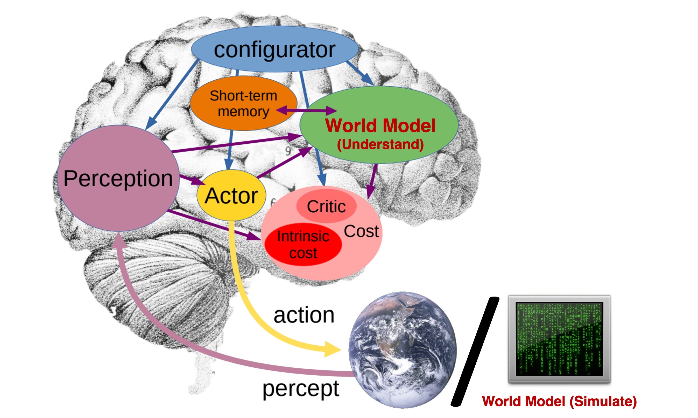
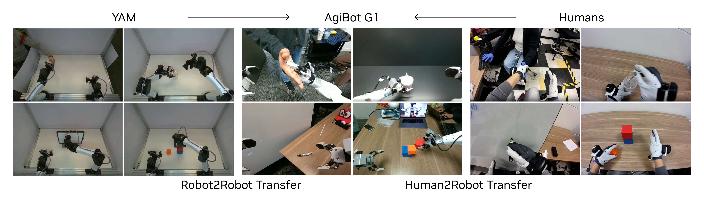

# 机器人与自动驾驶中的世界模型

世界模型最有吸引力的落地场景，正是那些真实试错昂贵、长时规划重要、环境部分可观测且安全约束严格的系统。机器人与自动驾驶同时满足这几个条件，因此它们也是世界模型从“研究概念”走向“工程工具”的主战场。

不过，这两个领域虽然都适合世界模型，却并不相同。机器人更强调接触、操控、技能组合和低层闭环；自动驾驶更强调多主体交互、地图结构、交通规则和极低容错率。理解这种共性与差异，才能看清 `WM`、`WAM`、`VAM` 各自更适合落在哪些系统层。

!!! note "初学者先抓住"

    世界模型在机器人和自动驾驶里的核心价值，是先在模型内部推演“如果我这么做，世界会怎样变化”。它不是单纯预测未来视频，而是服务规划、风险判断、失败恢复和数据采集决策。

!!! example "有趣例子：先在脑中试一遍"

    人拿杯子前会预想手碰到杯沿会不会打翻，司机变道前会预想旁车会不会加速。世界模型就是让机器也能在真实动作前做这种内部试演。

{ width="860" }

<small>图源：[Towards Video World Models](https://www.xunhuang.me/blogs/world_model.html)，Figure 1。原论文图意：把 internal world model、external world simulation model 和 action-aware simulation 的关系放在同一张图里，说明世界模型既可以服务内部决策，也可以服务外部可视化仿真。</small>

!!! note "图解：机器人和自动驾驶要先分清世界模型落在哪"
    如果模型只在 agent 内部输出 latent、reward、risk，它更像决策模块的一部分；如果模型生成可观察未来视频或场景，它更像外部模拟器；如果动作会改变未来分支，它才真正接近可用于规划的 action-aware world model。机器人和自动驾驶常常需要三者组合，而不是押注单一路线。

## 1. 为什么机器人和自动驾驶特别需要世界模型

### 1.1 试错成本高

互联网产品里的错误往往是“推荐不理想”；机器人和自动驾驶里的错误可能是摔坏杯子、撞到货架、压坏物体、急刹追尾甚至人员风险。真实交互昂贵，因此人们希望尽量把试错放到内部模拟里先做一遍。

### 1.2 长时依赖强

很多任务不是一步反应就能完成。机器人做“打开抽屉取出勺子再关上”，要跨越接近、接触、拉开、识别、抓取、回收多个阶段；自动驾驶做“匝道并线进入主路”，要连续预测周边车辆未来意图、空隙变化和自车速度匹配。没有长时推演，只靠当前帧做反应，策略很容易陷入局部最优。

### 1.3 部分可观测与遮挡普遍存在

机器人常被机械臂、容器、工具和目标物相互遮挡；自动驾驶则存在大车遮挡、路口视野不完整、雨雾干扰、摄像头炫光、行人被停靠车辆挡住等情况。世界模型的一个核心价值，是利用历史和动作信息维持 belief state，而不是把“当前没看到”简单等同于“不存在”。

### 1.4 环境会被自己的动作反向改变

这两个系统都不是纯观察任务。机器人伸手会推动物体，自动驾驶变道会触发其他车辆减速、加速或让行。也就是说，动作不只是“对环境做出响应”，动作本身还会重写之后的环境分布。这恰好是世界模型最擅长刻画的地方：

$$
p_\theta(o_{t+1:t+H} \mid o_{\le t}, a_{t:t+H-1}, g).
$$

这里的关键不是预测“自然会发生什么”，而是预测“在我做出这串动作之后，世界会怎样演化”。

### 1.5 上线必须同时满足实时性和安全性

很多研究原型在离线评测上表现不错，但一到真实部署就会暴露问题：推理太慢、rollout 太短、不确定性不可用、动作接口不稳定、异常场景不会回退。机器人和自动驾驶都要求模型不仅“会预测”，还要在严格时间预算内完成推理，对危险区域给出保守信号，并且能被现有规划器、控制器和安全监控系统接住。遇到分布外区域时，它应该优先触发回退，而不是继续幻觉式 rollout。

## 2. 应用层的统一问题表述

从工程角度看，机器人和自动驾驶都可以写成“历史观测 + 当前目标 + 候选动作 -> 未来世界”的问题。设观测为 \(o_t\)，隐状态为 \(s_t\)，动作 \(a_t\)，任务条件 \(g\)，则一个更统一的应用形式可以写成：

$$
p_\theta(s_{t+1}, o_{t+1}, r_t, c_t \mid s_t, o_t, a_t, g),
$$

其中：

\(o_t\) 可以是图像、点云、状态向量、地图切片、雷达或语言上下文；\(s_t\) 是 belief state 或 latent state；\(r_t\) 表示任务收益、成功度或进度；\(c_t\) 表示风险、约束违反或终止信号。

如果做长时 rollout，则目标往往变成：

$$
\max_{a_{t:t+H-1}}
\mathbb{E}\left[
\sum_{h=0}^{H-1}\gamma^h r_{t+h}
- \lambda \sum_{h=0}^{H-1} c_{t+h}
\right].
$$

这说明世界模型在应用里往往不只是“预测器”。它同时像状态摘要器、长时前瞻器、风险评估器和候选动作评分器，也会在数据引擎里承担反事实生成的角色。

### 2.1 机器人与自动驾驶的共性

二者都要根据历史整合部分可观测信息，对动作后果做多步推演，并在高价值、低容错场景中面对长尾分布和边界条件。工程上，它们也都很少是纯学习系统，而是学习模型、规则模块、控制器和安全监控拼起来的混合系统。

### 2.2 机器人与自动驾驶的关键差异

真正影响系统设计的差异主要有五类。

#### 动作空间不同

机器人动作通常是连续关节、末端位姿、抓取开合、技能参数或离散 skill token；自动驾驶动作更常表现为轨迹、曲率、加速度、目标车道或规划意图。前者贴近接触控制，后者贴近多主体轨迹协调。

#### 时间尺度不同

机器人上层决策可能按 2Hz 到 10Hz 更新，但低层伺服闭环往往在 20Hz 到 200Hz 甚至更高；自动驾驶规划层通常在 5Hz 到 20Hz 左右，同时要和预测、定位、控制形成稳定流水线。世界模型落在哪一层，直接决定它能承担什么职责。

#### 关键难点不同

机器人最难的是接触、摩擦、卡住、遮挡和长尾物体属性；自动驾驶最难的是交互多模态、道路拓扑、规则约束和稀有危险场景。

#### 数据来源不同

机器人真实数据贵，且数据量经常不大、分布不均匀；自动驾驶日志可非常海量，但标签昂贵、长尾场景稀疏、质量控制复杂。于是前者更重样本效率和迁移，后者更重数据筛选和覆盖。

#### 安全闭环不同

机器人常见的安全回退包括减速、悬停、重新观测、切换 teleop 或人工接管；自动驾驶则更依赖规则规划器、保守 fallback policy、紧急制动和 shadow mode 验证。世界模型必须能嵌入各自的安全架构，而不是试图取代它。

## 3. `WM / WAM / VAM` 在应用中的分工

`WM / WAM / VAM` 更适合看成应用导向的阅读谱系，而不是严格排他的标准分类。真正的问题是：你想让模型主要承担哪一类职责？

### 3.1 `WM`：更像“环境演化与风险前瞻器”

经典 `WM` 更关注：

$$
p_\theta(s_{t+1:t+H} \mid s_t, a_{t:t+H-1})
\quad \text{或} \quad
p_\theta(o_{t+1:t+H} \mid o_{\le t}, a_{t:t+H-1}).
$$

它最适合承担 latent planning、候选动作 reranking、value / risk 辅助估计、imagined rollouts 和失败反事实分析。在机器人里，`WM` 常落在隐状态规划、技能切换和恢复策略分析上；在自动驾驶里，`WM` 常落在多主体未来预测、风险评分和候选轨迹筛选上。

### 3.2 `WAM`：更像“世界与动作联合生成器”

`WAM` 的一个典型直觉是：动作序列和世界演化本来就强耦合，不如放在同一模型里学。其形式更接近：

$$
p_\theta(o_{t+1:t+H}, a_{t:t+H-1} \mid o_{\le t}, g).
$$

它更适合端到端动作序列生成、世界与动作共同 rollout、高层 goal-conditioned 行为生成，以及基于联合序列的 imitation 或 planning-as-generation。在机器人里，这类方法适合把视觉、语言、动作和未来结果统一到一个序列里；在自动驾驶里，则适合把 ego 规划与周边环境演化更紧耦合地共同建模。

### 3.3 `VAM`：更像“视频先验驱动的动作模型”

`VAM` 往往从强视频建模能力出发，把视频 latent 和动作建模绑在一起。它适合从互联网视频或大规模驾驶视频中吸收运动先验，再利用时空连续性理解接触、遮挡和操作过程。它不一定每次都显式解码整段未来视频，但希望 latent 里保留视频级动态信息。机器人中的 `VAM` 常用于视觉操作、模仿学习、长视频技能学习；自动驾驶中的 `VAM` 则更适合从海量车载视频中吸收运动与交互先验，再下游服务规划或行为预测。

### 3.4 实际选型时该怎么理解

一个简单经验是：想提高规划评分和风险前瞻，优先看 `WM`；想把动作和未来共同生成，优先看 `WAM`；已经有强视频模型、希望把动态先验变成动作能力时，再看 `VAM`。如果系统安全要求极高，先把它们作为辅助模块接入，而不是直接闭环接管。

## 4. 机器人中的应用细化

{ width="920" }

<small>图源：[DreamZero](../paper-deep-dives/embodied-ai/dreamzero.md)，Figure 11。原论文图意：展示 World-Action Model 在不同 robot embodiment 和任务设置中的迁移表现。</small>

!!! note "图解：机器人应用最难的是跨 embodiment 和动作接口"
    同一个“抓取/放置”语义，在不同机器人上会变成不同相机视角、不同关节维度、不同夹爪几何和不同控制频率。世界模型如果只学视频外观，很难跨机器人迁移；如果它同时对齐本体状态、动作表示和未来结果，才更接近可复用的机器人策略底座。

### 4.1 隐空间规划

Dreamer 一类方法的核心思想是：不必在像素空间里穷举未来，而是在隐状态空间里进行 imagined rollout。设机器人隐藏状态为 \(s_t\)，动作序列为 \(a_{t:t+H-1}\)，则规划目标可写成

$$
\max_{a_{t:t+H-1}}
\mathbb{E}
\left[
\sum_{h=0}^{H-1}\gamma^h r(s_{t+h}, a_{t+h})
\right],
$$

**其中状态转移由世界模型给出**：

$$
s_{t+h+1} \sim p_\theta(s_{t+h+1}\mid s_{t+h}, a_{t+h}).
$$

这种做法适合连续控制、样本效率要求高的任务，如抓取、推动、门把操作、装配对位、抽屉开合等。

### 4.2 候选动作的前瞻评估

在桌面机器人里，策略常会提出多个候选动作，例如从左侧抓杯子、从杯柄抓、先推再抓、先移开遮挡物再抓。世界模型可以对每个候选动作 rollout 若干步，同时估计成功概率、碰撞风险、接触后物体稳定性、末端姿态可达性，以及是否会破坏后续子任务。

这相当于机器人在执行前先“脑补”一下：如果我这样伸手，杯子会不会被碰翻？夹爪会不会撞到托盘边缘？抓起来之后还有没有角度把它塞进目标盒子？

### 4.3 接触前瞻为什么特别关键

机器人和很多纯视频任务的最大差别在于：最关键的状态变化往往发生在接触瞬间。接触前后的动力学是高度非线性且不连续的，常见难点包括：

1. 摩擦系数未知；
2. 物体会滑落、弹开或卡住；
3. 柔性物体会变形；
4. 工具与环境会产生复杂约束；
5. 观测中只能看到接触前，接触后的后果要靠模型想象。

因此机器人应用里的优秀世界模型，往往不只是“未来图像生成器”，而更像“接触结果猜测器”和“失败风险解释器”。

### 4.4 长时技能链与子任务切换

很多机器人任务不是一步完成，而是技能链拼接：

1. 观察并定位；
2. 接近目标；
3. 建立接触；
4. 操作对象；
5. 恢复姿态；
6. 进入下一技能。

世界模型的价值在于，它可以为每个阶段提供“是否适合切换”的判断。例如在“把红色杯子放进左边盒子，再关上盖子”的任务里，系统不应只关心当前抓起是否成功，还要问：当前抓取姿态会不会影响后续放置角度？盒盖当前是否被杯子挡住？如果先放杯子再关盖失败率更高，是否应该先调整盒子姿态？

### 4.5 移动操作与导航结合

在移动操作机器人里，世界模型需要同时处理底盘移动和手臂操作。此时任务已经不只是局部接触，而变成：

1. 全局路径是否能到目标区域；
2. 到达后观察视角是否足够；
3. 机械臂在该基座姿态下是否有可达解；
4. 在狭窄空间操作时是否会碰撞柜门、桌角或人。

这类系统更适合分层使用世界模型：高层负责场景与子目标前瞻，低层负责局部技能与接触控制。

### 4.6 数据合成与失败回放

真实失败数据通常稀缺，因为系统会尽量避免失败，但失败样本又恰恰最有价值。世界模型可以在已知状态附近生成多种可能未来，用于：

1. 扩充训练集中的边界情况；
2. 分析失败轨迹中哪一步开始偏离；
3. 离线比较不同恢复策略；
4. 为人工标注提供候选反事实；
5. 生成“快成功但还差一点”的课程样本。

例如开抽屉任务失败后，可以让模型从“夹爪接近把手但尚未接触”的状态出发，模拟不同接近角度与力度组合，从而定位问题更可能来自视觉定位偏差、抓取时序问题，还是接触控制误差。

### 4.7 与 `VLA` 的结合

近年来 `VLA` 更像一个统一的大脑接口，把图像、语言和动作对齐起来；世界模型则像内部仿真器。二者可以有多种结合方式：`VLA` 先产出高层动作计划，再由世界模型做可行性筛选；世界模型也可以预测未来状态，让 `VLA` 根据 imagined future 生成修正动作；更进一步，世界模型还能提供未来一致性、阶段标注和风险标签，或者让 `WAM / VAM` 直接把视觉、语言、动作和未来放进一个统一序列里学习。

这类组合的关键不是“谁替代谁”，而是怎样让高层语义和低层物理前瞻形成闭环。

### 4.8 机器人场景中的核心难点

机器人应用的难点主要来自接触动力学、视角变化、自遮挡、长尾物体属性和真实数据稀缺。透明、反光、柔性对象尤其容易让 rollout 偏乐观；低层控制频率又很高，世界模型很难直接闭环接管。真实部署还会叠加机械误差、标定误差和延迟，覆盖不足常常比模型规模更致命。

## 5. 自动驾驶中的应用细化

### 5.1 多主体行为预测

驾驶本质上是交互系统。世界模型可以同时建模自车、周围车辆、行人、骑行者、道路拓扑和交通信号，从而预测多主体未来分布。设整体环境状态为 \(s_t\)，参与者集为 \(\mathcal{A}\)，则未来可写成

$$
p(s_{t+1:t+H}\mid s_t, a_t^{\text{ego}}, \mathcal{A}),
$$

其中自车动作 \(a_t^{\text{ego}}\) 会影响周围参与者的行为，这正是世界模型优于单纯轨迹预测器的地方。它不只是问“别人会怎么走”，而是问“在我采取这条动作方案时，别人会如何响应”。

### 5.2 规划前瞻与风险评估

自动驾驶规划器通常要评估多个候选轨迹。世界模型可以为每条候选轨迹预测周围车辆响应、潜在碰撞概率、舒适性变化、任务效率和规则违反风险，例如是否压线、闯红灯或占用错误车道。

在概率框架下，可以最小化

$$
\mathcal{J}(\tau)
=
\mathbb{E}[C_{\text{progress}}(\tau)]
+ \lambda_1 \mathbb{E}[C_{\text{comfort}}(\tau)]
+ \lambda_2 \mathbb{P}(\text{collision}\mid \tau)
+ \lambda_3 \mathbb{P}(\text{rule-violation}\mid \tau),
$$

其中 \(\tau\) 为候选轨迹。世界模型提供的，正是交互项和风险项的前瞻估计。

### 5.3 地图、规则与几何约束

和机器人桌面操作相比，自动驾驶更强地依赖结构先验。很多未来不能只靠视觉纹理判断，还必须结合车道拓扑、可通行区域、路口优先权、交通灯与标志、施工和临时封闭信息。

这意味着驾驶世界模型往往需要多模态输入，而不是单纯视频序列。否则模型可能生成“视觉很合理、规则却违法”的未来。

### 5.4 稀有危险场景生成

真实路测很难覆盖所有 corner cases。世界模型可以从已有危险片段扩展出相似但不同的场景，做“如果自车更早减速 0.5 秒会怎样”的反事实分析，也可以支持 scenario augmentation、near-miss 重放和 shadow mode 的高风险样本筛选。

例如在一段“电动车突然横穿”的历史轨迹上，可以生成不同横穿速度、不同遮挡、不同雨夜光照和不同 ego 制动时机的变体，供评估与训练使用。

### 5.5 模拟器加速与 offline RL

高保真交通模拟器成本高、搭建慢，且难完全覆盖真实人类行为。世界模型可以作为轻量级数据驱动模拟器，用来快速评估规划策略、支持 offline RL 的 imagined rollouts、补充人类交互模式，并对规划器版本做离线回放对比。不过它更适合作为难例筛查层，而不是唯一真相来源。

不过必须强调，这种学习型模拟器不适合完全替代高保真规则仿真，更适合作为中间层、筛选层或数据增强层。

### 5.6 `WM / WAM / VAM` 在驾驶里的不同落点

在自动驾驶里，`WM` 更适合作为多主体未来预测器、风险模型和轨迹评分器；`WAM` 更适合把 ego action 和环境未来联合生成，用于统一规划或 planning-as-generation；`VAM` 则更适合从海量视频中学习运动先验，再把视频 latent 迁移到动作或规划模块。

如果系统希望稳妥上线，常见顺序是先把 `WM` 接成候选轨迹评分器，再逐渐尝试 `WAM` 风格的统一建模，最后才考虑更强的端到端控制闭环。

### 5.7 自动驾驶场景中的核心难点

自动驾驶的难点在于交互分布极其多模态，平均化未来会掩盖关键风险分支；长尾危险事件稀少，训练中最重要的数据往往最少；地图与规则条件又很强，传感器异步、标定和融合误差都会污染 rollout。上线时还必须满足严格实时性，评价也更看重最坏情况和人工接管率，而不是平均指标。

## 6. 典型系统架构

### 6.1 世界模型作为 planner 的前端评分器

这是最保守也最容易落地的接法。策略或规划器先产生候选动作，世界模型只负责估计若干未来结果，不直接控制车辆或机械臂。典型评分可写作：

$$
\text{Score}(a_{t:t+H-1})
=
\mathbb{E}\left[
\sum_{h=0}^{H-1}\gamma^h r_{t+h}
\right]
- \lambda \cdot \text{Risk}(a_{t:t+H-1}).
$$

优点是接入现有系统更容易，世界模型错误不会直接变成控制命令，可以先在 shadow mode 验证增益；出问题时，也更容易定位是模型问题还是控制问题。

### 6.2 世界模型与策略联合训练

这种方式更激进，训练目标可写成

$$
\mathcal{L}
=
\mathcal{L}_{\text{wm}}
+ \alpha \mathcal{L}_{\text{policy}}
+ \beta \mathcal{L}_{\text{value}}
+ \eta \mathcal{L}_{\text{risk}}.
$$

它的好处是模型更任务导向，world latent 更可能保留真正对决策有用的信息；坏处是训练更难稳定，错误也更容易耦合传播。

### 6.3 双层系统：高层想象，低层闭环控制

在机器人中尤其常见。高层世界模型负责子目标选择、候选技能评分、长时序计划和恢复建议；低层控制器负责 10ms 到 50ms 级别的伺服闭环、接触顺应和轨迹跟踪。这样可以避免让学习型模型直接承担所有连续控制细节。

**自动驾驶中也存在对应分层**：高层做意图与轨迹评估，中低层做轨迹跟踪、横纵向控制和安全约束执行。

### 6.4 世界模型嵌入安全壳而不是取代安全壳

成熟系统里，世界模型通常被放进一个更大的安全壳内部。这个安全壳可能包括规则约束、碰撞检查器、可达性或控制屏障函数、人工接管、紧急停止、不确定性门控，以及传统 planner 的 fallback。

因此一个工程上靠谱的世界模型，不是“最强的单模型”，而是“最能与安全壳协同工作的模型”。

### 6.5 数据与部署的双闭环

应用系统中，训练和部署通常是双闭环的：线上系统产生日志，世界模型筛选高价值片段，数据引擎做失败回流和近失误挖掘，新模型先离线评测，再进入 shadow mode，最后才进入小流量或有限真实部署。

这意味着应用页讨论世界模型，不能只看单次训练效果，还要看它是否适合进入持续迭代闭环。

## 7. 机器人与自动驾驶的部署约束

### 7.1 实时性预算

机器人和自动驾驶都不允许世界模型无限制“多想一会儿”。工程上通常要在很小的预算内平衡编码延迟、rollout 长度、采样条数、风险头计算、解码或可视化成本。

这也是为什么很多系统宁可在 latent 空间中 rollout，也不愿每次都完整解码高分辨率未来视频。

### 7.2 传感器同步与标定

世界模型很容易把传感器误差当作环境动态来学。机器人里的相机外参漂移、抓手延迟、深度噪声，自动驾驶里的多相机时间偏移、激光雷达-相机标定误差、定位漂移，都会污染训练分布。很多 rollout 漂移问题，根源不是模型架构，而是数据链路不干净。

### 7.3 数据覆盖与不确定性门控

应用系统必须明确处理数据覆盖边界。更现实的设计不是要求世界模型永远正确，而是让它在熟悉区域尽量有用，在陌生区域尽量保守，把高不确定性显式暴露给上层系统，并允许规则和人工接管在关键时刻覆盖模型建议。

### 7.4 离线指标和在线收益并不等价

许多世界模型在重建、`NLL`、视频质量或一步预测上表现很好，但真实上线收益并不稳定。根本原因是：部署系统关心的是决策是否更安全、更稳定、更省数据，而不是单一生成指标。应用评测必须回到闭环任务，看成功率、碰撞或接管、数据采样效率、恢复能力和长尾发现是否真的改善。

## 8. 两个更具体的系统例子

### 8.1 家务机器人收纳

任务是“把桌上的餐具收进抽屉”。高层上需要识别餐具类别、决定收纳顺序、判断抽屉是否打开；低层上要完成抓取、放置和避碰。世界模型的价值在于提前估计收纳顺序对空间占用的影响，在勺子被盘子遮挡时维持位置估计，判断当前抓取姿态是否会妨碍后续放置，并在失败后回溯前几步状态变化，帮助恢复策略选择。

在这个系统里，`WM` 适合做技能前瞻与恢复分析；`WAM` 可以进一步把子任务动作序列和未来状态统一建模；如果已有大规模人类收纳视频与机器人演示数据，`VAM` 还可能提供更强的操作动态先验。

### 8.2 城市道路并线

任务是从匝道并入主路。世界模型要同时考虑后方来车速度、侧后方盲区、前方主路拥堵、车辆礼让概率、道路几何和自车加速度约束。好的世界模型不只是预测未来轨迹，还能告诉规划器：现在强行并线可能迫使后车急刹；稍等 1.2 秒可能出现更安全空隙；轻微减速会让交互分布更可控；如果地图结构显示即将进入实线禁变区域，即使视觉上看似可并线，也应提前放弃。

在这种系统里，`WM` 先作为轨迹评分器最现实；`WAM` 则适合统一 ego 轨迹和环境响应；`VAM` 可以利用大规模车载视频预训练时空动态表示，再迁移到行为预测或规划模块。

## 9. 落地建议

### 9.1 从辅助模块开始，而不是一上来端到端接管

把世界模型先用作评分器、风险估计器、数据增强器或离线分析器，通常比直接闭环控制更现实。这样更容易验证它到底带来了什么真实收益。

### 9.2 保留任务相关中间监督

只用像素重建训练世界模型，很容易学到“像但无用”的表示。机器人场景可加入接触事件、成功标签、末端位姿、夹爪状态；驾驶场景可加入碰撞、超车、车道占用、信号灯状态、红灯违法和人工接管标签。

### 9.3 先在 shadow mode 证明价值

上线前应让世界模型在真实日志流中做“旁路推理”，验证它是否真的能改善候选排序、风险预警和长尾发现，而不是只在离线数据集上有好看的分数。

### 9.4 imagined data 要有门禁

imagined rollouts 很有价值，但不能无限制直接拿来训练闭环策略。更稳妥的顺序是先做离线分析和错误定位，再用于候选动作 reranking、值函数或风险模型 warmup，最后才考虑直接影响主策略训练。

### 9.5 把回退策略设计成一等公民

世界模型真正适合工程落地，不是因为它总能对，而是因为它在不确定时能把控制权交回更可靠的模块。机器人和自动驾驶都一样，真正成熟的系统从来不是单模型独自工作，而是学习模型、规则系统、传统控制器和安全机制共同形成闭环。

## 10. 阶段性小结

世界模型在机器人和自动驾驶中的价值，不只是替代仿真器或生成未来画面，而是把“昂贵真实试错”的一部分迁移到内部想象空间中完成。对于机器人，它主要帮助长时操作、技能切换、失败恢复和接触前瞻；对于自动驾驶，它主要帮助多主体交互预测、风险评估、轨迹筛选和危险场景扩增。

如果用 `WM / WAM / VAM` 来看应用分工，可以粗略理解为：`WM` 更适合作为环境演化与风险前瞻器，`WAM` 更适合作为世界-动作联合生成器，`VAM` 更适合作为视频先验驱动的动作建模器。

但无论哪条路线，真正决定能否落地的，都不是论文里的生成质量，而是它能否在实时预算、安全壳、数据闭环和线上评测中稳定创造价值。

## 11. 一个更现实的部署标准

很多团队最终会用很朴素的标准来判断世界模型是否值得保留在系统里：它是否降低了高价值失败，是否提升恢复能力，是否让数据采集更聚焦，是否让风险预警更早更准，以及是否没有把系统复杂度推到不可维护。

### 11.1 为什么这是现实标准

因为在机器人和驾驶里，世界模型从来不是唯一模块。  
它必须和感知、规划、控制、规则、安全壳、人工接管和数据飞轮一起证明自己的价值。

## 12. 小结

在机器人与自动驾驶里，世界模型不是为了替代所有传统模块，而是为了在最昂贵、最危险、最难覆盖的那部分未来推断上提供杠杆。真正有价值的系统，不是让世界模型单独看起来最强，而是让它作为中间层，把预测、规划、恢复、风险和数据闭环更紧地连起来。

## 实践补充与检查

### 把 **机器人与自动驾驶中的世界模型** 放回闭环系统里讨论

VLM、VLA、具身与世界模型类页面，最大的风险不是内容太少，而是内容只停留在“模型结构”和“离线指标”层。真正扎实的页面，必须把方法放回 **任务接口、数据制度、动作/工具链、风险治理和上线边界** 里讨论。围绕 **机器人与自动驾驶中的世界模型**，更有价值的写法不是单纯列方法，而是明确说明它在闭环系统里到底负责哪一段能力。

更具体地说，把机器人和驾驶中的世界模型落点、差异和工程权衡展开。只有把这些接口真正讲明白，读者才会知道：某一条路线到底是在提升理解、提升决策、提升执行恢复、提升数据回流效率，还是只是在离线表征上更强。对这类系统而言，接口不清楚，比方法不够新更容易误导决策。

### 从离线能力到闭环能力的递进关系

围绕 **机器人与自动驾驶中的世界模型**，更稳妥的分析方式是把能力分成三层：

1. **离线表征层**：模型是否真的提取到了任务相关信息；
2. **策略与计划层**：模型是否能基于这些信息做出正确下一步，而不是只是生成“看起来像对的输出”；
3. **闭环与恢复层**：当环境、界面、用户或机器人状态变化后，系统是否还能稳定继续。

很多页面容易把第一层和第二层混在一起，仿佛离线分数高就等于闭环更强。事实上，真实系统里最难也最贵的往往是第三层。无论是屏幕代理、VLA、世界模型还是具身部署，真正的差距经常出现在：模型是否能在失败后恢复、是否能在风险边界前收手、是否能在高价值任务上保持一致性，而不是单次离线预测是否好看。

### 更容易被忽略的失败与误判

这类主题里，最常见的误判通常包括：把静态评测当成闭环能力；把高保真生成误当成高价值决策；把多模态数据量增加误当成接口设计已经合理；把实机或线上失败都归因于“模型还不够大”。这些误判共同指向一点：**没有把任务链条拆开验收**。

因此，更扎实的内容应当把失败模式写细：哪些问题来自观测不全，哪些来自接口不稳，哪些来自动作粒度设计不对，哪些来自回流数据抓错重点，哪些来自评测桶没有覆盖真正高价值风险场景。只有这些被写透，读者才会真正理解为什么同一个模型结构，在论文和系统里会呈现出完全不同的表现。

### 更像系统手册的验收方式

对 **机器人与自动驾驶中的世界模型**，推荐把验收至少写成四层：

1. **表征验收**：是否看懂、对齐对不对、关键状态是否保留；
2. **决策验收**：下一步动作、工具选择、计划输出是否可靠；
3. **闭环验收**：失败恢复、风险抑制、长任务稳定性是否成立；
4. **运营验收**：是否能被 replay、shadow、回流、灰度和审计系统接住。

页面只要把这四层真正写实，**机器人与自动驾驶中的世界模型** 就会从“方向介绍页”变成“设计和落地都能用的页”。

### 和相邻页面的接口要怎么看

对 **机器人与自动驾驶中的世界模型**，更扎实的扩写重点不是再堆概念，而是把 机器人、驾驶、仿真和部署体系的接口 真正讲清楚。因为这类系统天然跨页：数据页讲输入资产，方法页讲模型能力，评测页讲证据，部署页讲风险。若页面之间的接口没写出来，读者很容易看完每一页仍然不知道系统是怎么连起来的。

### 一条更实用的落地顺序

把 **机器人与自动驾驶中的世界模型** 用到真实系统时，更稳的顺序通常是：先把任务接口和风险边界写清，再决定模型和数据方案；再做离线验证、回放和小规模闭环；最后才进入更大规模的部署或实机阶段。很多返工其实都源于顺序反了：先把模型训出来，后来才发现动作接口、回退逻辑或评测桶根本没准备好。

### 还值得继续深挖的问题

围绕 **机器人与自动驾驶中的世界模型**，下一轮最值得继续加厚的，往往是这些内容：失败恢复怎么真正进入主逻辑；哪些高价值样本最值得回流；哪些闭环指标才真正决定可用性；以及一旦线上或实机表现和离线不一致，应该优先怀疑数据、接口、执行层还是评测口径。把这些补充写厚，页面就会更像系统设计手册而不只是综述页。
