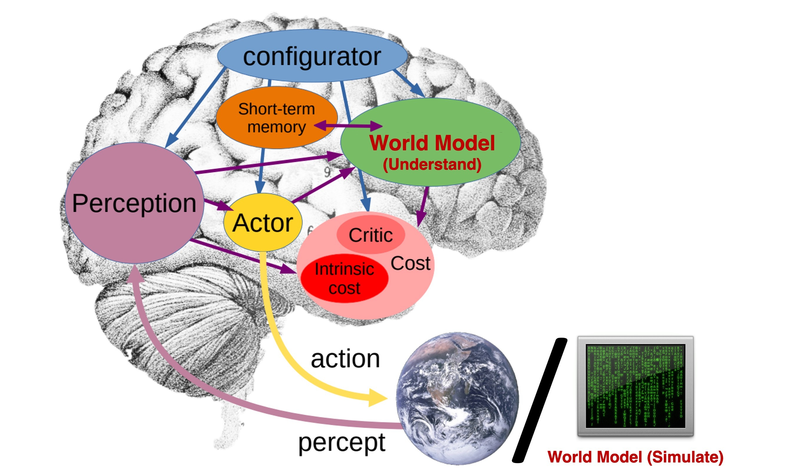
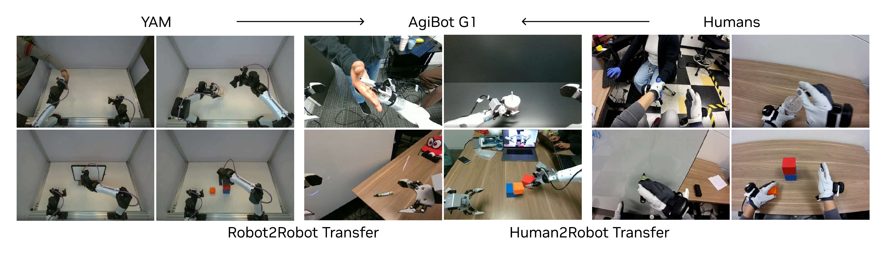

# 机器人与自动驾驶怎样使用世界模型

机械臂准备提起玻璃杯，汽车准备并入旁边车道。两个系统都要比较动作后果，但“状态”“动作”“风险”在两种任务中对应完全不同的东西。可以共用概率写法，不能共用未经检查的变量含义。实际接口必须回到具体身体、传感器和环境。

我们先沿抓杯子说明模型怎样参与决策，再把同样的问题迁移到并线。下文的场景和数值用于解释机制，不是某个产品的实验结果。

## 抓杯子时，未来不仅是杯子的位置

机器人观察多相机图像、关节和夹爪反馈，目标是把指定杯子放稳。候选动作包含快抓、慢抓和先重新观察。未来要预测目标身份、接触、位姿、滑落与完成条件。杯子离桌面更高可能表示成功提起，也可能表示快要从指间掉下；单一位置指标不足以定义好结果。

历史中的动作也帮助解释观察。夹爪发出合拢命令后没有相应关节变化，可能接触到物体或受限；只有图像无法完全区分。状态 $z_t$ 因而可以总结观察和已执行动作，未来模型再接收候选动作。

\[
p_\theta(z_{t+1:t+H},e_{t+1:t+H}\mid z_t,a_{t:t+H-1},g).
\]

这里 $e$ 表示明确命名的事件，例如滑落，不能用同一个符号同时代表 continuation、碰撞和成功。不同标签的正负含义一旦混淆，规划器就可能把失败概率当继续概率累乘。

{ width="860" }

<small>图源：[Towards Video World Models](https://www.xunhuang.me/blogs/world_model.html)，Figure 1。模型可以在内部状态中预测，也可以生成外部可见模拟；是否解码视频取决于消费方需要。</small>

如果 planner 只需要比较候选风险与目标距离，未必每次都要解码高分辨率视频；调试和人审可能需要视频解释。两种消费方式可以共存，成本应分别计量。

## 机器人动作的身体约束进入了模型边界

以末端位移为动作时，控制器还要完成逆运动学与关节轨迹。一个视觉上合理的位移可能不可达、会自碰撞，或者需要超过力矩限制。若世界模型不预测这些细节，应由独立控制与约束模块提供边界，并让模型看到实际执行结果。

跨机器人迁移尤其依赖这个接口。七维数值在两台机器人上可能表示不同坐标、归一化范围或夹爪语义。共享视频先验可以帮助识别杯子与运动，但动作后果仍需对齐。

{ width="920" }

<small>图源：[DreamZero](https://arxiv.org/abs/2602.15922)，Figure 11 跨 embodiment 实验。图中结果属于原论文机器人与任务设置，不能直接推出任意身体之间安全迁移。</small>

动作块长度还决定反馈。10 Hz 下预测八步覆盖 0.8 秒，若全部执行再观察，接触突变可能发生在中间。只执行两步后更新状态，能更早纠正，也带来更频繁推理和 chunk 接续问题。具体取舍必须结合执行器与对象动态。

## 并线时，他人的未来会回应自车动作

现在把任务换成匝道并线。状态需要包含道路拓扑、自车速度、相邻车辆状态与遮挡。动作可以是加速度和曲率，也可以是供低层控制跟踪的候选轨迹。模型要预测自车后果和周围车辆反应。

若旁车在看到自车进入车道后减速，预测模型应区分“自车等待”和“自车并入”两个条件。只延续日志中的旁车轨迹，再把任意自车轨迹叠上去，会遗漏交互；反过来，总假设旁车让行，又会系统性低估风险。

可将其他车辆未来记为 $y$，比较 $p_\theta(y\mid h,a^{\mathrm{ego}})$。同一自车动作下仍可能有让行和不让行多个分支，因此规划不能把一种平均轨迹当作唯一未来。平均轨迹甚至可能落在两条都不走的中间位置。

教学例子中，旁车距离可用空间边界 12 m、相对接近速度 4 m/s，匀速一维近似给出 3 秒达到该边界。若自车动作让相对速度变化，这个数就要重算。真实并线还涉及纵横向几何、车辆尺寸和响应，不能把 $d/v$ 当作完整安全判定。

## 重建能回答位置，动力学还要回答变化

驾驶日志中的多视角重建可以提供道路和物体在某一时刻的几何。把相机移动到一个新位置渲染，回答的是“从这里看会是什么样”。输入自车新动作并预测旁车反应，回答的是另一项关于时间和交互的问题。

同样，机器人重建杯子三维形状有助于可达和碰撞检查，却不能单独给出摩擦与滑落概率。几何、动力学和策略在实际系统中可能由不同组件实现。把它们全部叫世界模型，不会让缺少的关系自动出现。

对于被大车遮挡的行人，模型可以保持位置与速度的不确定分布，而非把当前不可见当作不存在。动作选择也可包含改善观察，例如减速获得更多可见区域。这个信息价值需要和时间、交通规则与执行风险共同考虑。

## 公式可以相同，验收条件不能混用

| 设计问题 | 抓杯子 | 并线 |
| --- | --- | --- |
| 动作后果的关键变量 | 接触、夹持、目标身份 | 相对运动、道路占用、他车响应 |
| 不能直接观测的量 | 摩擦、接触力、遮挡姿态 | 驾驶意图、遮挡参与者 |
| 反馈怎样修正 | 重观测、减速、重抓或停止 | 重规划、调整速度、保持车道 |
| 独立结果 | 放置稳定性、滑落、接管 | 任务完成、冲突、干预与轨迹约束 |

表格用于对照接口，不能把具体控制频率或安全架构概括成领域常数。不同硬件、任务和系统分层会有不同时间预算。

评测应先在各自条件下比较模型是否改变候选动作的判断，再在闭环中检查真实后果。机器人成功不能只取某个末帧，驾驶成功不能只看视觉平滑；人类接管与 fallback 需要单独计数。相关方法原理见 [PlaNet](https://arxiv.org/abs/1811.04551) 与 [V-JEPA 2](https://arxiv.org/abs/2506.09985)，具体诊断见[世界模型评测](evaluation-and-failure-modes.md)。

## 把一次比较写成实验合同

同一个世界模型可以接在 planner 前面，也可以只用来生成训练数据。两种用法的验收点不同，最好在实验开始前写下来。

| 用法 | 固定输入 | 需要记录 | 不能从结果推出什么 |
| --- | --- | --- | --- |
| 候选动作筛选 | 初始观测、候选动作、规划时限 | 预测风险、实际后果、误报和漏报 | 预测准确不等于控制安全 |
| 反事实 rollout | 场景状态、条件、生成器版本 | rollout 长度、分支条件、筛选规则、独立验证 | 画面逼真不等于动力学正确 |
| 策略训练模拟器 | 训练种子、奖励、动作接口 | 训练/验证分布、仿真步数、迁移协议 | 仿真分数提升不等于实机提升 |
| 观察或风险模型 | 传感器历史、缺失模式 | 置信度、延迟、遮挡桶、人工接管 | 离线预测不能自动代表在线时延下的效果 |

若候选动作筛选的离线准确率上升，却让闭环接管率上升，先查预测是否被规划器消费错了。若只是把等待时间拉长，风险可能下降，任务吞吐却变差。延迟、动作执行率和人工介入要和成功率放在同一张结果表里。

## 来源和可复查入口

潜状态规划的基本接口参考 [PlaNet](https://arxiv.org/abs/1811.04551)，动作条件视频表示参考 [V-JEPA 2](https://arxiv.org/abs/2506.09985)，跨 embodiment 的图示对照 [DreamZero](https://arxiv.org/abs/2602.15922)。抓杯子、匝道并线、12 米边界和 3 秒估算都是本站构造的对照案例；它们帮助区分状态、动力学、读出和安全判据，不能被读成真实机器人或车辆的安全保证。

把两个任务放在同一张实验表里时，至少分开记录任务成功、风险事件、人工接管、fallback、延迟和传感器条件。若只保留一个总分，模型可能通过改变判据或增加等待时间得到看似更好的结果。

继续阅读时可以先看[世界模型评测与失败模式](evaluation-and-failure-modes.md)，再看[模拟器、反事实与合成 rollout](simulators-counterfactuals-and-synthetic-rollouts.md)。前者处理“预测是否有用”，后者处理“生成的未来能否作为数据”，两者不要共用一套验收分数。
