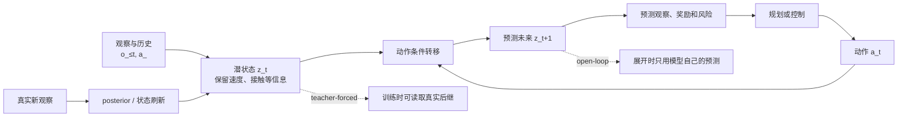

# 世界模型基础，怎样从观察预测动作后果

只看一帧画面，机械臂不知道杯子是不是还在滑。两次画面都显示杯子位于同一个位置，一次速度是 0.2 米每秒，另一次速度是零。接下来施加同样的推力，结果会不同。世界模型要保留下来的，是这种会改变下一步动作的信息。

本页用同一个杯子场景连接状态、观察、概率、训练和决策。它不要求模型必须生成视频；输出形式取决于后续要回答的问题。



这张图先把两个常被混在一起的过程分开。训练时可以用真实后继观察校正状态，开放循环评测时不能每一步把真实状态塞回模型；闭环控制则会在执行动作后重新获得真实观察，再规划下一步。

## 当前画面为什么不等于完整状态

设杯子位置为 $x_t$、速度为 $v_t$，一维状态可以写成 $s_t=(x_t,v_t)$。相机可能只可靠提供位置 $o_t=x_t+\epsilon_t$。两次都看到 $x_t=0$，一次杯子向右滑，另一次静止，相同推力就会产生不同后果。

如果状态已包含所有影响下一步的因素，转移可写成 $p(s_{t+1}\mid s_t,a_t)$，不再需要更早历史，这就是 [Markov 条件](../prerequisite-math/stochastic-processes-and-markov.md)。实际摩擦、接触和外力还可能隐藏，因此 $x,v$ 在真实任务里也未必充分。状态是建模假设，不能因为一个向量被命名为 `state` 就认为信息已经完整。

过去两帧有助于估计速度。若 0.1 秒内位置从 0 变为 0.02 米，平均速度约为 0.2 米/秒。差分会放大观测噪声，更多历史可以提供平滑与动态线索，也可能引入过期信息。神经编码器用 $z_t=E(o_{\le t},a_{<t})$ 学习历史摘要，作用相似，但是否保留了速度需要检查。

## 不知道隐藏状态时，保留多个可能

为了看清推断，暂把杯子速度简化成向左、向右两种状态，先验各为 0.5。传感器报告“向右”，已知真向右时有 0.8 概率这样报告，真向左时有 0.2 概率误报。根据 Bayes 公式

\[
p(\text{右}\mid\text{报告右})=
\frac{0.8\times0.5}{0.8\times0.5+0.2\times0.5}=0.8.
\]

新的 belief 为左 0.2、右 0.8。若下一个独立观测在给定真实方向时具有同样误差，也报告右，则右向后验为 $0.8^2/(0.8^2+0.2^2)\approx0.9412$。这里需要条件独立假设；同一图像复制两遍不能当两份独立证据。

当桌边在右侧，剩下的 0.2 左向概率与 0.8 右向概率会影响风险判断。只保存最可能方向会省表示空间，却丢掉这部分信息。随机 latent、混合分布或粒子都能表示多种可能，但需要验证这些分支确实对应速度与接触，而不是仅改变画面纹理。

## 动作先有物理含义，才有可学的转移

假设动作 $a_t$ 为一段时间内的加速度，简化动力学为

\[
v_{t+1}=v_t+a_t\Delta t,\qquad
x_{t+1}=x_t+v_t\Delta t+\frac12a_t\Delta t^2.
\]

取 $x_t=0$、$v_t=0.2$ 米/秒、$\Delta t=0.1$ 秒。无动作时杯子前进 0.02 米；施加 $a_t=-2$ 米/秒平方的制动时，末速度为零，期间仍前进 0.01 米。停止后再看位置与立即完全不动，是不同预测。

真实机器人动作可能是末端位移、速度、力矩或离散技能。若 `0.2` 表示米/秒，应乘执行时长得到位移；若它已经是米，则不能再乘一次。控制器还可能饱和或拒绝动作，模型训练需要知道实际执行值。接口错误不会因为数据量大而自动消失。

学习型动力学用 $F_\theta$ 替代部分或全部方程，仍需保留这个输入输出含义。一个只看视频、不接动作的模型可以学习数据里的自然未来分布，但它不能仅靠换一个输入动作就回答上述制动对照。

## 状态预测、观察生成和任务评价是三件事

转移模型预测下一状态，观察模型把状态映射到可见画面，任务头再评价结果。

\[
z_{t+1}\sim p_\theta(z'\mid z_t,a_t),\qquad
\hat o_{t+1}\sim p_\theta(o\mid z_{t+1}),\qquad
\hat r_t=r_\theta(z_t,a_t).
\]

这里 $r_t$ 指执行 $a_t$ 后收到的奖励。若需要处理任务结束，还可预测继续概率，但它与碰撞概率、成功概率应分开命名。杯子停在安全位置却没被拿起，可以安全且未成功。

Planner 若只比较离桌边距离和滑落风险，可以直接读取 latent 的相应量；人审需要看未来视频时才调用 decoder。重建画面清晰并不能证明风险读出正确，风险准确也不要求每一处桌面纹理都被重建。

多模态未来更说明输出目标的重要性。若杯子可能从障碍左右绕过，位置分别为 −1 与 1，平方误差最优点预测为均值 0，恰好穿过障碍。均值是一个统计量，未必是一条可执行轨迹。

## 一步拟合怎样变成多步误差

训练时可以给模型真实 $z_t$ 预测真实 $z_{t+1}$；展开未来时，第二步输入通常变成上一步的 $\hat z_{t+1}$。如果模型每步多预测 1 cm，五步后就可能多走 5 cm。非线性接触还可能把小偏差放大成完全不同事件。

```python
true_x = predicted_x = 0.0
errors = []
for _ in range(5):
    true_x += 0.02
    predicted_x += 0.03
    errors.append(predicted_x - true_x)
assert abs(errors[-1] - 0.05) < 1e-12
print([round(e, 3) for e in errors])
```

这段程序只演示确定性累积误差，输出 `[0.01, 0.02, 0.03, 0.04, 0.05]`。真实评测还要固定动作序列、说明中途是否读取真实观察，并分别查看状态与事件。RSSM 用 posterior 读取新观察、用 prior 展开未知未来，明确管理这条信息边界，见[RSSM 与 Dreamer](rssm-dreamer-and-planning.md)。

## 三种评测回答三个不同问题

世界模型常被一张漂亮的 rollout 图概括，但真正需要先分开三种评测。它们的输入、时间范围和结论都不同。

| 评测 | 输入 | 主要测量 | 能支持的判断 |
| --- | --- | --- | --- |
| teacher-forced 一步预测 | 真实的 (z_t) 或观察 | 下一状态、奖励或观测误差 | 模型能否在训练分布附近完成局部转移 |
| open-loop rollout | 初始真实状态，之后只用模型自己的预测 | 随 horizon 变化的状态误差、事件准确率 | 误差怎样沿想象轨迹积累 |
| closed-loop 控制 | 模型规划动作，环境持续返回真实观察 | 成功率、碰撞、恢复和交互成本 | 预测是否真的改善决策 |

同一个模型可能在第一项很好、第二项很快漂移，第三项仍然可用，因为控制器会频繁用新观察纠正；也可能画面相似度不错，风险事件判断却错误，导致第三项失败。报告时至少给出 horizon、是否刷新观察、动作序列来源和任务重置规则，不能把一项的结果写成另外两项的证据。

一个最小的 rollout 评测可以固定同一批初始状态和动作序列，记录每个 horizon 的位置误差与事件标签：

```python
def evaluate_rollout(model, initial_state, actions, true_states, event_fn):
    predicted = initial_state
    rows = []
    for horizon, action in enumerate(actions, start=1):
        predicted = model.predict_next(predicted, action)
        true_state = true_states[horizon]
        rows.append({
            'horizon': horizon,
            'state_error': abs(predicted.x - true_state.x),
            'predicted_event': event_fn(predicted),
            'true_event': event_fn(true_state),
        })
    return rows
```

这段接口故意不指定模型框架。它要求 `true_states` 只用于评估，不回灌给 `model`；如果每一步都把真实状态重新喂回去，测到的是 teacher-forced 条件。事件准确率还应按碰撞、成功、越界等类别分桶，因为一个总体平均可能掩盖最危险的一类错误。

## 预测怎样影响当前动作

回到桌边杯子，系统可以比较不推、继续推和制动，在各自未来中计算安全边界与任务代价，然后只执行第一小段，再根据真实新观察规划。这个 receding horizon 给了纠错机会，但预测偏差仍可能让它反复选错。

另一种用法是在模型里训练 actor，部署时不再每步搜索；也可以把生成未来交给人做失败分析。三种用途需要不同输出与证据。模型若错误地认为杯子会悬浮在桌边，更充分的搜索可能更稳定地利用这个漏洞。

因此入门之后最有用的检查，是沿一条任务追问输入的信息是否足够、动作语义是否正确、预测误差如何展开，以及使用者是否真正据此改善决策。后续可按问题阅读[表示预测](masked-jepa-and-latent-prediction.md)、[风险规划](uncertainty-and-risk-aware-planning.md)或[训练样本设计](action-conditioned-video-world-model-training-case.md)。原始方法入口是 [PlaNet](https://arxiv.org/abs/1811.04551) 与 [Dreamer](https://arxiv.org/abs/1912.01603)。

## 来源与改编说明

- **概念参考**：[World Models](https://worldmodels.github.io/) 提供 VAE、记忆动力学和 controller 的早期连贯示例，页面标注 CC BY 4.0；第三方图例需单独核对。
- **方法入口**：[PlaNet](https://arxiv.org/abs/1811.04551) 与 [Dreamer](https://arxiv.org/abs/1912.01603)分别连接潜变量规划和想象轨迹中的策略学习。本文只讲状态、belief、动作条件和误差展开，不把生成视频质量等同于规划能力。
- **自测**：为“向右推杯子”写出观测、belief、动作和下一状态四个接口；再列出一个会让单步预测正确、但多步 rollout 失败的误差来源。
