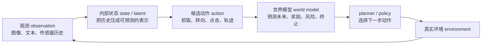
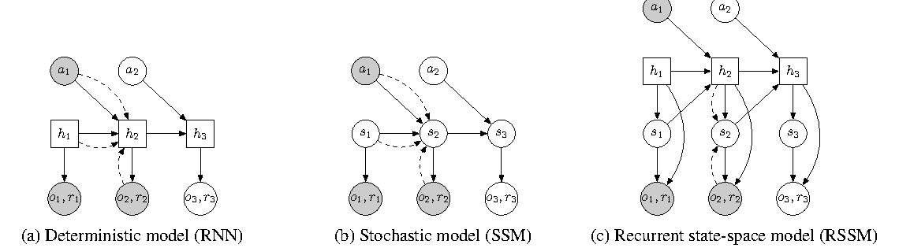
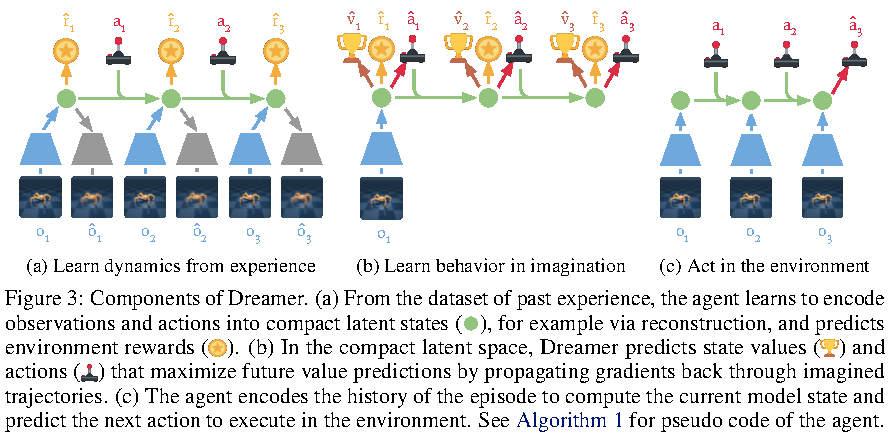

# 从零理解世界模型

这页是世界模型专题的入口缓冲层。默认你已经知道神经网络、Transformer、token 和训练 loss 的大概意思，但还不熟 `RL`、`RSSM`、`JEPA`、`WAM/VAM` 和论文里的公式符号。

<!-- [补充] -->
| 读者 | 建议读法 | 工程落点 |
| --- | --- | --- |
| 初学者 | 先抓“从零理解世界模型”要解决的问题、关键术语和最小例子；公式只看变量方向。 | 能说清输入、输出和常见失败信号。 |
| 工程师 | 直接对照结构、指标、成本和边界条件，必要时回到前置页补概念。 | 落到数据、算力、延迟、显存、评测和回滚检查。 |


!!! note "读法定位"
    这页先回答“从零理解世界模型”在「世界模型」里的位置：它解决什么局部问题，依赖哪些前置，最后会影响哪类工程或研究判断。
    **前置**：先知道潜变量、时序预测、VLM/VLA 与训练效率；再看具体论文和工程案例。 必要时先回 [世界模型入口](index.md)、[基础知识](../foundations/index.md) 或 [术语表](../glossary/index.md)。
    **主线关系**：把表征预测、潜变量动力学、规划、rollout 服务和具身/视频应用连成“可模拟、可评估、可行动”的主线。

先把一句话放在前面：

> 世界模型不是“会生成未来视频”的模型，而是“能预测动作后果，并把这种预测交给 planner、policy、风险模块或数据引擎使用”的模型。

如果读后面的论文页时感到符号和缩写太密，先回到这页。这里的目标不是替代细节，而是给你一张不迷路的小地图。

## 一个智能体循环

世界模型总是放在一个循环里理解。没有循环，它就容易被误读成普通生成模型。



这条环里有四个关键问题：

1. 现在看到了什么：观测 \(o_t\) 或 \(x_t\)。
2. 内部相信世界处于什么状态：真实状态 \(s_t\) 不一定可见，模型常用 latent \(z_t\) 或记忆 \(h_t\) 表示。
3. 如果执行动作 \(a_t\)，未来会怎样：下一状态、未来观测、奖励、风险、是否终止。
4. 谁使用这些预测：planner、policy、value model、risk checker、数据引擎或人类审查。

普通视频生成器通常只回答“接下来画面可能长什么样”。世界模型必须多回答一步：“换一个动作，未来会不会合理改变，并且这种改变能不能帮助选择动作？”

## 先分清四个常见东西

| 名称 | 它回答的问题 | 常见输入 | 常见输出 | 初学者容易误读 |
| --- | --- | --- | --- | --- |
| 视频生成器 | 未来看起来像什么 | 历史视频、文本、图像 | 未来帧或视频 | 画面自然不等于懂动作后果 |
| VLA policy | 现在应该做什么 | 视觉、语言、状态历史 | 动作 token、动作块、轨迹 | 会出动作不等于能预测动作后果 |
| Latent dynamics | 状态如何随动作演化 | latent、动作、历史记忆 | 下一 latent、reward、done | 不生成清晰视频也可能很有用 |
| 可规划世界模型 | 候选动作哪个更好 | 状态、目标、候选动作 | 未来、风险、价值、排序 | 关键是被 planner/policy 消费 |

所以 `VLA` 和世界模型不是同一个角色。`VLA` 更像“驾驶员”，世界模型更像“驾驶员脑中的可调用沙盘”。最强的系统常常会把两者接起来：policy 产生候选动作，world model 预测后果，planner 或 risk module 再决定是否执行。

## 符号表：先把论文公式读顺

最常见的一行公式是：

$$
p_\theta(z_{t+1} \mid z_t, a_t)
$$

<!-- [补充：符号说明] -->
| 符号 | 含义 | 取值范围 / 常见值 |
| --- | --- | --- |
| \(\theta\) | 模型或策略参数 | 实值张量，形状由模型结构决定 |
| \(p\) | 概率、转移分布或预测量 | 概率分布或任务定义的张量 |
| \(z_{t+1}\) | 样本、状态或 latent 变量 | 张量空间，形状由数据表示决定 |
| \(z_t\) | 样本、状态或 latent 变量 | 张量空间，形状由数据表示决定 |
| \(a_t\) | 动作、优势或系数 | 动作空间/实数标量，依上下文而定 |


它读作：给定当前 latent state \(z_t\) 和动作 \(a_t\)，模型预测下一步 latent state \(z_{t+1}\) 的概率分布。这里最重要的是动作 \(a_t\)：如果动作不进入模型，或者进入了但不会改变预测，那它就很难成为对决策有用的世界模型。

## 状态、观测和 latent 的区别

`observation` 是传感器看到的表面，`state` 是足以预测未来的真实局面，`latent` 是模型自己学出来的内部摘要。

举个机器人抓杯子的例子：

| 层级 | 可能包含什么 | 为什么不一样 |
| --- | --- | --- |
| 观测 \(o_t\) | 当前 RGB 图像、深度图、关节角 | 可能看不到杯子背面、速度和接触力 |
| 真实状态 \(s_t\) | 杯子位置、速度、质量、摩擦、夹爪接触 | 这是理想信息，现实中很难完全知道 |
| 潜状态 \(z_t\) | 神经网络学到的一组向量/token | 不必逐项对应物理量，但要保留决策相关信息 |
| 记忆 \(h_t\) | 过去几帧、过去动作、遮挡前的信息 | 当前帧缺的信息可能藏在历史里 |

世界模型的难点就在这里：它必须从不完整观测中学出足够好的 latent，让未来预测和动作选择不被表面纹理牵着走。

## 三个最小公式

### 5.1 动作条件转移

$$
p_\theta(z_{t+1} \mid z_t, a_t)
$$

<!-- [补充：符号说明] -->
| 符号 | 含义 | 取值范围 / 常见值 |
| --- | --- | --- |
| \(\theta\) | 模型或策略参数 | 实值张量，形状由模型结构决定 |
| \(p\) | 概率、转移分布或预测量 | 概率分布或任务定义的张量 |
| \(z_{t+1}\) | 样本、状态或 latent 变量 | 张量空间，形状由数据表示决定 |
| \(z_t\) | 样本、状态或 latent 变量 | 张量空间，形状由数据表示决定 |
| \(a_t\) | 动作、优势或系数 | 动作空间/实数标量，依上下文而定 |


含义：动作之后，世界状态如何变化。  
初学者要问：换一个 \(a_t\)，预测的 \(z_{t+1}\) 是否真的不同？

### 5.2 观测解码

$$
p_\theta(x_t \mid z_t)
$$

<!-- [补充：符号说明] -->
| 符号 | 含义 | 取值范围 / 常见值 |
| --- | --- | --- |
| \(\theta\) | 模型或策略参数 | 实值张量，形状由模型结构决定 |
| \(p\) | 概率、转移分布或预测量 | 概率分布或任务定义的张量 |
| \(x_t\) | 样本、状态或 latent 变量 | 张量空间，形状由数据表示决定 |
| \(z_t\) | 样本、状态或 latent 变量 | 张量空间，形状由数据表示决定 |


含义：从 latent 还原或解释当前观测。  
初学者要问：重建像素只是辅助，真正重要的是 latent 是否保留动作、奖励、风险需要的信息。

### 5.3 想象回报

$$
J(\psi)=\mathbb{E}_{\pi_\psi,p_\theta}
\left[
\sum_{k=0}^{H-1}\gamma^k r_{t+k}
\right]
$$

<!-- [补充：符号说明] -->
| 符号 | 含义 | 取值范围 / 常见值 |
| --- | --- | --- |
| \(\psi\) | 概率、转移分布或预测量 | 概率分布或任务定义的张量 |
| \(\pi_\psi\) | 策略或概率分布 | 非负概率分布，总和为 1 |
| \(\theta\) | 模型或策略参数 | 实值张量，形状由模型结构决定 |
| \(\gamma\) | return、组大小或缩放系数 | 按任务定义；组大小通常为正整数 |
| \(J\) | 优化目标 | 实数标量，通常越大或越小由正文定义 |
| \(p\) | 概率、转移分布或预测量 | 概率分布或任务定义的张量 |


含义：策略 \(\pi_\psi\) 在世界模型 \(p_\theta\) 里 rollout \(H\) 步，累计未来奖励。  
初学者要问：这个 imagined return 在真实环境里是否仍然可信？如果世界模型错了，policy 会利用这个错误。

## 一张图理解 latent dynamics

{ width="860" }

<small>图源：[Learning Latent Dynamics for Planning from Pixels](https://arxiv.org/abs/1811.04551)，Figure 2。原论文图意：比较 RNN、SSM 和 RSSM 三种 latent dynamics 结构；RSSM 同时保留 deterministic memory 和 stochastic latent state。</small>

!!! note "图解卡：PlaNet / RSSM"
    **输入输出**：输入是历史 latent、历史动作和当前观测；输出是下一步 latent、重建观测和奖励预测。<br>
    **关键模块**：\(h_t\) 负责记忆历史，\(z_t\) 负责表达当前不确定性，prior 负责不看未来图像时向前预测，posterior 负责看到真实图像后修正 belief。<br>
    **公式对应**：\(h_t=f_\theta(h_{t-1},z_{t-1},a_{t-1})\)，\(p_\theta(z_t\mid h_t)\)，\(q_\phi(z_t\mid h_t,x_t)\)。<br>
    **容易误读**：RSSM 不是为了把图像画得更清楚，而是为了在部分可观测环境里维护一个可 rollout 的 belief state。

## 一张图理解 Dreamer

{ width="890" }

<small>图源：[Dream to Control: Learning Behaviors by Latent Imagination](https://arxiv.org/abs/1912.01603)，Figure 3。原论文图意：Dreamer 从经验中学习 latent dynamics，再在 latent imagination 中训练 actor 和 value，最后回到真实环境执行动作。</small>

!!! note "图解卡：Dreamer 三步"
    **输入输出**：真实 episode 进入 replay buffer；world model 学 latent、reward 和 continuation；actor/value 在 imagined rollout 上更新。<br>
    **关键模块**：左边是学世界，中间是用世界训练行为，右边是真实执行并收集新数据。<br>
    **公式对应**：world model 学 \(p_\theta(z_{t+1}\mid z_t,a_t)\)，actor 学 \(\pi_\psi(a_t\mid h_t,z_t)\)，critic 学 \(V_\eta(h_t,z_t)\)。<br>
    **容易误读**：Dreamer 的价值不是“会生成视频”，而是把真实环境试错的一部分换成 latent imagination。

## 三条主线怎么排顺序

建议按下面顺序读世界模型专题：

| 顺序 | 先解决什么困惑 | 对应页面 |
| --- | --- | --- |
| 1 | 世界模型和 VLA、视频生成器有什么区别 | 本页、[世界模型路线图](index.md) |
| 2 | latent state、RSSM、imagined rollout 是什么 | [RSSM、Dreamer 与规划](rssm-dreamer-and-planning.md) |
| 3 | 为什么很多方法不直接预测像素 | [Masked / JEPA 与潜变量预测](masked-jepa-and-latent-prediction.md) |
| 4 | WM、WAM、VAM 到底差在哪 | [WM / WAM / VAM：动作条件建模](wm-wam-vam-and-action-conditioned-modeling.md) |
| 5 | 视频生成怎样变成可交互模拟 | [生成式模拟与视频世界模型](generative-simulation-and-video.md) |
| 6 | 怎么证明模型真的有用 | [世界模型评测与失效模式](evaluation-and-failure-modes.md) |

读任何新论文时，都可以固定问五个问题：

1. 它建模的是像素、token、latent、动作、奖励、风险，还是完整轨迹？
2. 动作 \(a_t\) 是输入、输出、条件变量，还是只在数据标签里出现？
3. 模型输出被谁消费：planner、policy、risk checker、数据引擎，还是只给人看？
4. 它的证据是 open-loop loss、benchmark 曲线、闭环任务、系统吞吐，还是 demo？
5. 它不能证明什么：长时 rollout、真实机器人、安全部署、跨任务泛化，还是动作因果？

## 一个最小验收标准

初学者最容易被漂亮视频或复杂公式带偏。一个简单但很有用的验收标准是：

```text
固定同一段历史观测
  -> 替换多个候选动作
  -> 世界模型给出不同未来、奖励、风险或成功排序
  -> planner 选择的动作在真实环境里更安全或更成功
```

如果只满足前两行，它可能是动作条件预测器。  
如果还能给出可比较的风险和成功排序，它开始接近可规划世界模型。  
如果接入真实闭环后成功率、恢复率或 cost per success 变好，才算进入工程证据层。

## 接下来怎么读

读完本页后，先回到 [世界模型路线图](index.md) 看总览，再按 `RSSM/Dreamer -> Masked/JEPA -> WM/WAM/VAM -> 生成式模拟 -> 评测` 的顺序走。后面的页面会继续使用本页这套符号，其中 \(z_t\) 表示 latent state、\(h_t\) 表示历史记忆、\(a_t\) 表示动作、\(p_\theta\) 表示带参数的预测模型，不再每次重新解释。

!!! tip "下一站"
    - 回到本专题入口：[世界模型](index.md)，确认这页在整条路线中的位置。
    - 按导航顺序继续：[主线：世界模型高效训练](efficient-training-roadmap.md)。
    - 概念或符号卡住时，先查 [术语表](../glossary/index.md)，再回到当前页。
