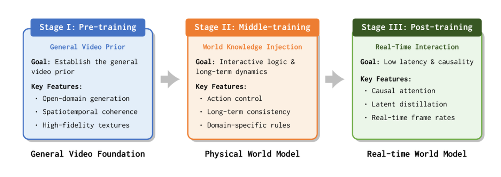
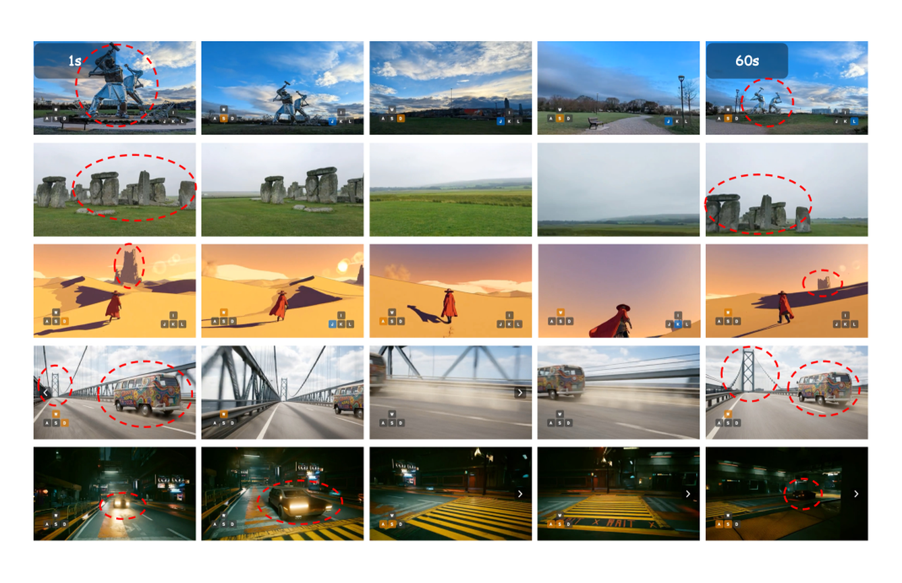

# 世界模型数据引擎，一次滑落失败怎样改变下一轮训练

机械臂从透明箱里抓取反光瓶盖，夹爪合上后瓶盖旋转滑落，操作员接管。世界模型在执行前只给了 0.18 的风险。接下来最容易做的是把视频放进“失败”文件夹，再增加训练次数；更有用的工作是查清这条记录能提供什么监督，以及它是否代表一个尚未覆盖的问题。

下面的瓶盖任务是构造案例，数字用于解释流程。它并非本站完成的机器人实验。仓库[手工候选示例](world-model-efficient-training-experiment-report.md)也只有固定标签，不能作为数据回流有效的实测证据。

## 一条失败记录先要恢复动作与后果的对应

假设日志记录，6.8 秒发生人工接管，最后一个自主动作是 `top_grasp`，随后瓶盖发生滑移与旋转。风险 0.18 对应哪个预测窗口，需要回到输出时刻核对。如果预测的是接下来 0.5 秒，而滑落发生在两秒以后，就不能直接标成这次预测漏报；如果时间戳错位，正确的监督也会被挂到错误动作上。

多相机还应根据采集时间对齐。假设瓶盖边缘速度为 0.25 米/秒，相机与动作错位 80 ms，仅时间差就对应 2 cm 位移。这个算例解释为何某些任务对同步敏感，80 ms 不是通用可接受阈值。容许误差由对象运动、动作精度和传感器定义共同决定。

操作者写下“反光让瓶盖边缘看起来更高”，这是一条诊断线索。它可能解释错误，也可能只是人对失败的猜测。应保存原始图像、深度有效区域、提出动作、执行动作和关节反馈，才能在后续区分感知高度错误与接触摩擦错误。

## 从失败现象形成可验证的归因

同样的滑落，可能由三条不同路径产生。第一种是状态估计已经偏了，夹爪根本没到正确接触点。第二种是状态正确，模型对反光材料对应的摩擦和接触变化预测错误。第三种是未来状态显示不稳，risk head 却没有把它转换成高风险。

可以用有限的干预区分这些解释。例如给模型输入人工标定的目标姿态，再重算原动作后果。如果预测改善，表示层值得优先检查；若仍预测稳定，转而比较一步动力学与真实接触变化。替换一个模块的结果是诊断证据，不等于替换方案已经可以部署。

归因不必马上得出唯一答案。数据记录可以同时保留 `observed_event=slip` 和 `suspected_cause=pose_error`，前者来自可见事件，后者是待验证假设。混成同一个确定标签，会让后续模型学习人的猜测。

## 高价值样本也会改变训练分布

这一条失败值得保留，不代表它的二十个相邻视频片段就是二十次独立失败。相邻窗口共享物体、背景和大部分动作。若按帧随机切分，其中一些进入训练、另一些进入评测，模型可能通过记住箱体位置表现得很好。

可以先按 episode、物体与场景聚合，再决定保留哪些片段。失败前的关键接触、错误开始的时刻、接管后的恢复各提供不同信息。只保留最后掉落画面，模型可能知道失败长什么样，却学不到何时还能避免。

重采样也会改变概率。设真实任务中这种反光失败占 1%，为了学会识别它，训练时提高到 20%。这有助于梯度注意到稀有模式，但 risk head 在新采样分布下输出的概率不自动等于部署分布风险。可以保留原分布验证集，用适当的加权、校准或采样设计处理差异；不能直接把训练桶比例当真实发生率。

更稳的记录是把“采样权重”和“真实标签”分开。把失败重复十倍不会让它的物理真值更确定，也不应让置信度随重复次数虚增。

## 补采什么，比自动生成多少更关键

如果怀疑姿态错误，可以补反光强弱、视角和深度缺失的对照；如果怀疑快抓导致滑移，就需要在可控条件下比较速度、夹紧程度和材料。只继续收同一失败动作，会增加样本数，却不一定区分原因。

世界模型可以提出替代动作，例如侧抓或先重新观察。生成出的成功未来是一种候选假设。它能帮助安排真实试验或人工审查，但在独立验证之前不能被标记成真实成功。多个相似模型一致预测侧抓成功，也可能只是共享同一训练盲区。

采样预算可写成总成本约束 $\sum_i n_i c_i\le B$，其中 $c_i$ 包含重置、机器人占用、标注和复核。若一次新材料试验比一次已有视频重标注贵很多，就应先判断哪种证据能消除当前歧义。预期信息收益难以精确知道，因此排序模型的分数应接受真实收益反馈，而不是被当成价值真值。

## 回流之后，怎样判断改善来自数据

保留一个从未参与筛选、标注规则调节和训练的测试集合。使用同一初始模型与训练预算，比较原数据、加入目标失败数据，以及增加等量普通数据。这样才有机会区分“针对性补样本”的效果和“只是多训练了一段”。

评测应同时观察反光材料上的风险漏报、任务成功、恢复和正常任务表现。目标桶改善但普通抓取明显退化，说明训练混合或共享表示发生了取舍。只展示新收的失败例子被修好，会过度乐观。

记录每个模型版本使用的数据清单、标签版本、采样权重与训练设置。若同时放宽成功判据或改变接管规则，成功率上升就不再能归因于模型。真正需要追踪的是一条连续证据链。

```text
原始失败 -> 对齐回放 -> 归因假设 -> 采样/标注选择
-> 数据版本 -> 固定训练对照 -> 独立结果 -> 下一轮问题
```

## 视频预训练和交互回流提供不同信息

{ width="920" }

<small>图源：[LingBot-World](https://arxiv.org/abs/2601.20540)，Figure 4。其训练阶段展示从视频先验到交互和系统适配的组织方式。这是论文路线，不是上述瓶盖实验已经实现的管线。</small>

大规模视频可以提供物体外观和常见运动，但无动作标签的视频未必告诉模型控制命令的精确含义。真实机器人回流需要补控制时间、执行结果、接触与任务终止。两者可以互补，不能只按视频小时数合并为一种监督量。

{ width="920" }

<small>图源同上，Figure 12 长时记忆示例。短片段上看似合理，不能代替回到旧位置时的身份与状态检查。</small>

瓶盖任务若持续到重新进入同一箱子，还应检查目标位置与已移动物体是否被正确记忆。长时失败需要按任务过程保留，而不是被切碎成互不相干的短片。数据引擎的每一轮都应留下可比较的结果，才能判断系统是否真的在修补自身缺口。合成数据的使用边界见[反事实与合成 rollout](simulators-counterfactuals-and-synthetic-rollouts.md)。
