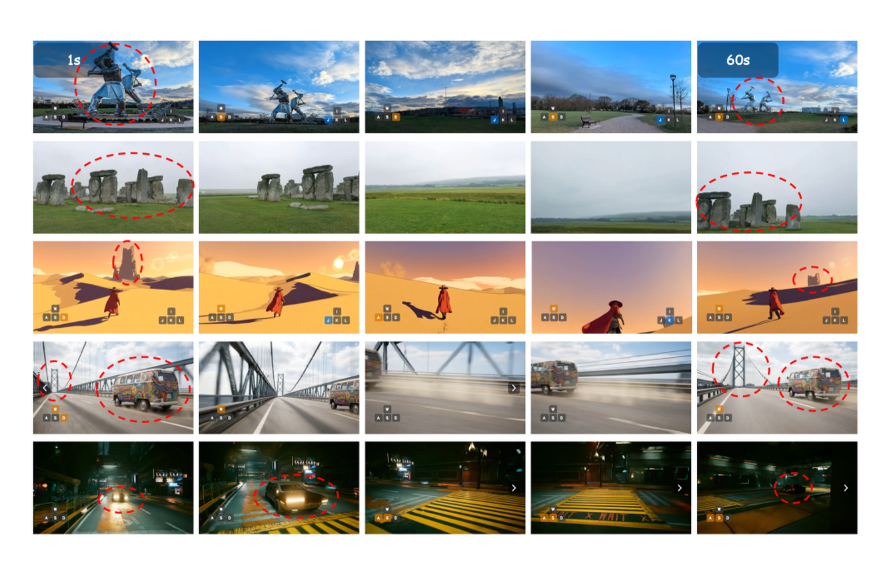

# 世界模型数据引擎与自我改进

世界模型的长期价值，不只在于一次训练出一个“会想象未来”的模型，而在于它能否成为持续收集数据、发现盲点、生成新经验并反哺策略的核心引擎。换句话说，世界模型不仅是预测器，也可能是数据调度器、失败分析器、样本筛选器和反事实生成器。

这页讨论世界模型如何与主动采样、失败回流、near-miss 挖掘、仿真生成、人工反馈和门禁验证结合，形成持续演化的学习系统。前置概念见 [世界模型路线图](index.md) 和 [模拟器、反事实与合成 Rollout](simulators-counterfactuals-and-synthetic-rollouts.md)。

!!! note "初学者先抓住"
    世界模型做数据引擎时，重点不是“生成更多数据”，而是发现哪里最不确定、哪些失败最有信息量、哪些反事实最值得验证。

!!! example "有趣例子：教练看训练录像"
    教练不会随机重看所有录像，而会重点看差点摔倒、差点撞人、动作变形的片段。世界模型数据引擎也应优先挖 near-miss 和失败分支。

## 为什么世界模型适合做数据引擎

相比纯策略模型，世界模型显式学习状态如何演化，因此更容易回答“哪里不会、为什么不会、该补什么数据”。

它可以评估哪些状态区域最不确定，想象不同动作会导向什么未来，在离线环境中筛选高价值轨迹，从失败轨迹中定位错误传播起点，生成反事实轨迹来分析“如果当时换个动作会怎样”，并区分“看起来异常”和“对决策真的重要”。

普通日志回流通常只能告诉你哪里失败了；世界模型还可能告诉你哪一步开始进入危险分支，哪种动作能降低风险，哪些 near-miss 虽然没有事故却最值得优先回流。

## 闭环结构

一个典型数据引擎闭环是：先收集真实交互轨迹 \(\mathcal{D}_t\)，训练或更新世界模型 \(M_t\)，再用 \(M_t\) 评估不确定性、价值或失败模式；随后选择下一批采样任务或生成候选轨迹，获得新数据 \(\Delta \mathcal{D}\)，并合并更新到 \(\mathcal{D}_{t+1}\)。

形式上可以写成：

\[
\mathcal{D}_{t+1} = \mathcal{D}_t \cup \mathcal{A}(M_t, \mathcal{D}_t)
\]

其中 \(\mathcal{A}\) 是主动数据采集策略。关键点不在“闭环”这个词，而在选择机制：哪些日志最值得回流，哪些失败最有信息量，哪些想象轨迹值得人工复核，哪些数据应该被拒绝进入训练集。

真实系统里通常有三个闭环并行存在：

| 闭环 | 关注点 | 典型数据 |
| --- | --- | --- |
| 模型闭环 | 世界模型预测哪里差 | 高误差 rollout、不确定状态、模型分歧 |
| 策略闭环 | 策略在哪些任务上退化 | 失败轨迹、恢复轨迹、边界任务 |
| 安全闭环 | 哪些状态接近失控 | near-miss、人工接管、风险触发日志 |

这三者优先级未必一致。成熟数据引擎必须在模型收益、策略收益、安全收益和采集成本之间做预算分配。

## 主动采样与预算分配

在机器人和自动驾驶里，真实交互昂贵，因此要优先采那些最可能提升系统的数据。世界模型可以把 ensemble 分歧、rollout 误差预测、value / risk head 不稳定性、成功率边界附近的高敏感区、不同 planner 的动作建议冲突、新旧模型在同一状态上的预测偏移，以及反事实动作导致的未来差异，都当成信息价值的近似信号。

若某状态-动作对的信息价值为 \(I(s,a)\)，可以优先采：

\[
(s^\star, a^\star) = \arg\max_{s,a} I(s,a)
\]

但实际系统还要考虑成本。不同数据源单位成本不同，真实机器人采样、驾驶 shadow mode、高保真仿真、世界模型 imagined rollout、人工演示和人工修正不可能无限采。一个概念上的预算分配是：

\[
\max_{\{n_i\}}\sum_i n_i u_i
\quad
\text{s.t.}
\quad
\sum_i n_i c_i \le B
\]

这里 \(u_i\) 是预期收益，\(c_i\) 是单位成本。数据引擎不只是“会挑样本”，还要会在成本约束下挑样本。

## 失败回流与 Near-Miss

成功轨迹多告诉你系统的舒适区，失败轨迹和 near-miss 才真正暴露能力边界。世界模型在失败回流里有两个独特作用：判断失败从哪一步开始不可逆偏离，并在失败附近生成反事实轨迹，比较“如果当时换个动作会怎样”。

失败样本最好不要只做成功/失败二元标注，而应分层：

| 类型 | 价值 |
| --- | --- |
| 完全成功 | 维持主分布和行为稳定性 |
| 成功但过程不稳 | 发现效率和鲁棒性问题 |
| Near-miss | 处在风险边界，信息密度高 |
| 可恢复失败 | 学习恢复策略和容错 |
| 不可恢复失败 | 定义安全边界和回退规则 |
| 人工接管 | 暴露系统不应自主执行的区域 |

Near-miss 往往最值钱，因为它同时具备风险高、可学习、数量比真实事故多的特点。它比纯事故更适合训练风险头、恢复策略和保守模式，因为系统还处在“来得及修正”的边界带上。

## 反事实与合成 Rollout

世界模型可以在失败或高风险状态附近提出反事实问题：如果提前减速会怎样，如果换抓取角度会怎样，如果不变道而等待会怎样，如果工具调用延后一步会怎样，如果从人工接管前一刻开始重新规划会怎样。这些 imagined rollouts 可以帮助人类标注关键决策点，为 planner 提供候选动作比较，生成训练数据候选，做安全策略的离线门禁，也可以构造课程学习中的边界样本。

但合成数据必须经过门禁。常见检查包括动作可执行性、物理/逻辑一致性、风险标签可信度、与真实分布距离、是否会放大模型自身偏差。世界模型生成的数据如果未经验证直接回流，很容易形成自我强化的幻觉闭环。

## 在线与离线两套闭环

离线闭环和在线闭环要分开设计。

| 闭环 | 更适合做什么 | 风险 |
| --- | --- | --- |
| 离线闭环 | 批量误差分析、版本对比、near-miss 挖掘、课程式重采样 | 指标好看但线上不稳定 |
| 在线闭环 | 高不确定触发额外观察、人工接管、保守模式、实时打标回流 | 误触发影响体验或安全 |

离线闭环适合大规模筛选和复盘，在线闭环适合风险控制和高价值样本捕获。两者共享同一套数据资产，但验收标准不同：离线重在信息增益和覆盖，在线重在安全、延迟和可回退。

## 门禁与评估

数据引擎是否有效，不能只看“新增了多少数据”。更关键的是新增数据是否改善了目标能力，并且没有污染训练分布。

建议同时看新增样本中 near-miss、可恢复失败和长尾场景占比，通过门禁的合成数据比例，回流数据对目标 bucket 的能力提升，主分布能力是否退化，风险率、接管率和恢复成功率是否改善，世界模型不确定性是否更校准，以及数据采集成本是否被有效降低。

## 从 LingBot-World 看三阶段数据飞轮

世界模型的数据引擎不能只理解成“多收点数据再训一次”。技术报告里更常见的是分阶段飞轮：先继承大规模视频先验，再用交互和长程数据补因果关系，最后用因果化、蒸馏和在线回放把模型推向可交互系统。

{ width="920" }

<small>图源：[Advancing Open-source World Models](https://arxiv.org/abs/2601.20540)，Figure 4。原论文图意：LingBot-World 从 foundation video generator 出发，经过 pre-training、middle-training 和 post-training，逐步获得通用视频先验、交互逻辑/长时动态和低延迟因果交互能力。</small>

!!! note "这张图帮你补哪块基础"
    第一阶段像给模型看海量世界录像，让它知道物体、场景和一般运动长什么样。第二阶段开始喂动作、相机、游戏或交互轨迹，让模型知道“做了什么会改变未来”。第三阶段才把系统约束放进来：因果注意力、KV cache、少步蒸馏、延迟预算和实时交互。世界模型的数据飞轮不是单一数据池，而是按能力阶段组织的数据供应链。

{ width="920" }

<small>图源：[Advancing Open-source World Models](https://arxiv.org/abs/2601.20540)，Figure 12。原论文图意：展示模型在长时交互中保持空间记忆与历史一致性的能力。</small>

!!! note "图解：数据引擎为什么要专门收长时失败"
    长时记忆问题通常不会在短片段 loss 里暴露：模型可能 5 秒内看起来稳定，30 秒后忘记门开没开、物体放到哪里、之前绕过哪个障碍。数据引擎应该把“长时不一致、回到旧位置认错、状态记忆断裂”单独成桶，而不是只按视频质量或短期成功率回流。

这条线和 RSSM/Dreamer 的交互轨迹路线不同。RSSM/Dreamer 从一开始就把 `observation-action-reward-done` 当成训练核心；LingBot-World 这类视频路线先把“世界长什么样、会怎么动”的视觉先验学强，再补动作条件和交互逻辑。两条路线都需要数据回流，但回流重点不同：

| 路线 | 最值钱的回流数据 | 为什么 |
| --- | --- | --- |
| RSSM / Dreamer | reward 错、done 错、动作后果错的轨迹 | 直接影响 policy 和 imagined rollout |
| 视频世界模型 | 动作不敏感、长时不一致、反事实错误的视频片段 | 决定模拟器是否真的可控 |
| Agentic 世界模型 | 工具轨迹失败、状态记忆错、恢复失败日志 | 决定多轮交互是否闭环 |

一个生动的判断是：如果模型只是把失败视频续写得很漂亮，它还没有完成自我改进；如果它能指出“从哪个动作开始未来变坏”，并帮助系统补采 near-miss、恢复轨迹和反事实样本，它才真正进入数据引擎角色。

世界模型数据引擎的目标不是无限扩数据，而是让每轮数据都更接近系统当前短板。只有当采集、生成、筛选、门禁、训练和评测形成闭环时，“自我改进”才不是口号。
