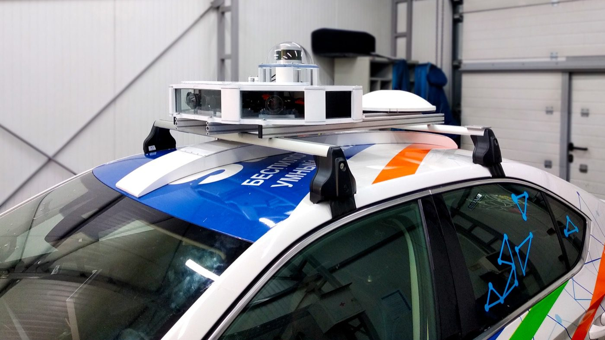

# 世界模型开发路线：先把数据、动作和评测接成闭环

面向机器人任务开发世界模型，第一步不是选最大的视频模型，而是把“世界状态是什么、动作如何改变它、怎样判定成功”讲清楚。否则模型即使能生成未来，也不知道自己在预测哪个坐标系里的未来，更无法服务真实闭环。

这页只回答一个问题：如果今天要做一个能服务机器人任务的世界模型，数据、几何、动作、仿真和评测应该怎样接起来。

{ width="920" }

<small>图源：[Wikimedia Commons: Equipment for self-driving car.jpg](https://commons.wikimedia.org/wiki/File:Equipment_for_self-driving_car.jpg)。原图展示自动驾驶车上的多传感器硬件。本站读法：世界模型的输入通常不是一张 RGB 图，而是一组带时间戳、坐标系、外参、深度、控制状态和风险语义的数据流。</small>

## 先定义世界状态

世界模型最容易失败的地方，是状态定义不稳定。比如同一个 episode 里，相机字段一会儿叫 `cam_pose_list`，一会儿叫 `cam_pos_list`；工件有 `gongjian_pose`，焊缝却缺少 `seam_pose`；动作日志有轨迹点，但没有控制频率和坐标系。模型训练还能勉强跑，评测和复现会立刻崩。

一个机器人世界模型的最小数据契约应包括四类字段。感知字段记录 RGB、depth、内参、外参、多相机同步和有效帧；机器人字段记录关节、末端位姿、夹爪状态、控制模式和频率；任务字段记录目标物、工件、焊缝、功能点、success checker 需要的几何或语义状态；动作字段记录动作 chunk、单位、坐标系、时间戳、planner 输出和控制器执行结果。

这不是文档洁癖。世界模型最终要学习类似下面的映射：

$$
z_{t+1:t+H}, r_{t:t+H}, c_{t:t+H}
=
W_\theta(z_t, a_{t:t+H-1}, g)
$$

这里 \(z_t\) 表示当前状态或 latent，\(a_{t:t+H-1}\) 是未来一段动作，\(g\) 是任务目标，\(r\) 是奖励或进展，\(c\) 可以表示 continuation、碰撞、可达性或失败风险。公式的重点是：如果 \(z_t\) 和 \(a_t\) 的物理含义没有固定，\(W_\theta\) 学到的只是混乱日志上的统计相关。

## 几何账本比模型名更早

机器人任务经常不是“图像里有什么”，而是“目标在哪里、从哪里能看见、夹爪是否可达、会不会碰撞”。所以世界模型项目要先建立几何账本：相机内外参、深度、点云、物体 pose、机器人末端位姿和任务功能点必须能放进同一坐标系。

以焊缝观察任务为例，模型不需要一开始就生成高清视频。一个更可验收的目标是：给定多视角图像、相机位姿、工件 pose 和候选相机轨迹，预测每个焊缝点是否可见、是否被遮挡、轨迹是否可达、风险是否升高。

$$
\hat v_{i,t}, \hat c_t, \hat q_t
=
W_\theta(z_t, a_{t:t+H})
$$

其中 \(\hat v_{i,t}\) 表示第 \(i\) 个任务点在未来时刻 \(t\) 是否可见，\(\hat c_t\) 表示碰撞或不可达风险，\(\hat q_t\) 表示覆盖率或轨迹质量。这个目标比“未来视频像不像”更硬，因为它直接对应可见性、碰撞、覆盖率和闭环成功率。

3D encoder 的作用就是帮这张账本变得可学习。Depth Anything、VGGT、MapAnything、DUSt3R / MoGe 这类模型可以提供 depth、camera、ray map、point map 或 3D state。它们不一定直接输出动作，但能告诉系统：目标是否在视野里，遮挡在哪里，候选视角是否覆盖关键区域，尺度和位姿是否可信。

{ width="760" }

<small>图源：[Wikimedia Commons: Velodyne High-Def LIDAR.jpg](https://commons.wikimedia.org/wiki/File:Velodyne_High-Def_LIDAR.jpg)。原图展示 LiDAR 传感器。本站读法：depth、LiDAR、pose 和 point map 都在把视觉问题改写为空间问题；机器人世界模型要服务动作选择，就不能只停在图像语义。</small>

## 动作接口要能被反事实测试

动作条件是世界模型和普通视频续写器的分水岭。固定同一历史状态，换三组动作，未来状态、风险和成功概率应该合理分叉。如果换动作后模型给出几乎一样的未来，它只是带动作标签的视频模型。

动作接口至少要写清五件事：动作空间是关节、末端位姿、相机轨迹、离散技能还是语言子目标；动作频率和 chunk 长度是多少；动作在哪个坐标系里；归一化和单位如何定义；动作执行失败时记录什么原因。

这一步常被低估。VLA 可以输出动作 token，Diffusion Policy 可以输出连续动作块，planner 可以输出几何轨迹，但世界模型必须知道这些动作如何进入 dynamics。否则候选动作排序、风险预测和闭环评测都没有共同语言。

## 仿真不是展示环境，而是自动判卷器

仿真环境的价值不只是“能生成数据”，而是把任务生成、轨迹执行、观测渲染、成功判定和失败回放接成流水线。RoboTwin、Isaac Sim / Isaac Lab、ManiSkill 和 cuRobo 各有不同位置：RoboTwin 适合看双臂任务、资产和 success checker；Isaac Sim 适合传感器、渲染、USD 资产和 headless 部署；ManiSkill 适合快速 baseline；cuRobo 适合把目标位姿转成可执行轨迹。

{ width="960" }

<small>图源：[Towards Video World Models](https://www.xunhuang.me/blogs/world_model.html)，Figure 9。原图比较不同模拟路线。本站读法：真实项目中的世界模型不是孤立预测器，而是在 data、reconstruction、simulation、policy/evaluation 之间反复循环。</small>

Success checker 要比最终状态更细。比如“把物体放进抽屉”不能只检查物体最后是否在抽屉范围内，还要检查抽屉是否打开、是否穿模、是否碰撞、夹爪是否释放、轨迹是否平滑、失败时是否可回放。一个只看最终坐标的 checker 会让模型学会钻评测漏洞。

## 最小闭环怎么搭

最稳的开发顺序是先小后大。

第一步，冻结 episode schema，确认字段、shape、单位、坐标系、时间戳和控制频率。第二步，做 100 条样本的数据可视化，让相机、工件、机器人、目标物和轨迹出现在同一坐标系。第三步，在 10 条 episode 上复算 depth、pose、覆盖率和碰撞结果。第四步，用规则或 planner 先做轨迹 baseline。第五步，训练小模型预测可见性、风险、coverage 或 reward。第六步，把预测放回仿真执行，记录真实结果和失败原因。第七步，把遮挡、near-miss、不可达、误抓取、checker 分歧等样本回流。

可以把最小链路写成：

```text
episode schema
  -> geometry replay
  -> candidate actions
  -> world model predicts visibility/risk/reward
  -> simulator/checker executes and scores
  -> failure replay updates data buckets
```

这条链一旦存在，后面替换 VLA、扩散动作头、视频世界模型、低比特推理或更快 kernel，才有共同验收标准。

## 评测应该从第一天存在

世界模型评测至少分四层。数据层看字段完整率、pose 复算误差和时间戳偏差；几何层看 depth、point map、可见性、覆盖率和遮挡判断；轨迹层看碰撞率、可达率、平滑度和控制器 reject；闭环层看任务成功率、near-miss、恢复成功率、人工接管率和 cost per success。

视频世界模型还要额外看动作敏感性、长时一致性、因果 rollout 和决策收益。同一状态下换动作，未来是否合理分叉；绕回同一场景时物体是否还在；自回归 rollout 是否越滚越偏；接入 planner 或 policy 后是否真的提高成功率。

## 外部精读

- [Genie 3](https://deepmind.google/models/genie/)：理解实时交互世界模型的产品化方向，但要记住它不等于机器人闭环控制已经解决。
- [NVIDIA Cosmos](https://www.nvidia.com/en-us/ai/cosmos/)：理解 physical AI 的 world foundation model 平台，适合看数据生成、仿真和评测工具链。
- [V-JEPA 2 world model blog](https://ai.meta.com/blog/v-jepa-2-world-model-benchmarks/)：理解视频表征、物理推理和规划基准如何连接。
- [RoboTwin 2.0 官方文档](https://robotwin-platform.github.io/doc/)：适合学习任务、资产、轨迹和 success checker 的组织方式。
- [Isaac Sim container installation](https://docs.isaacsim.omniverse.nvidia.com/5.1.0/installation/install_container.html)：适合看 headless 仿真和远程部署的工程口径。

## 相关阅读与下一步

- 外部材料：[World Models 论文](https://arxiv.org/abs/1803.10122)。
- 外部材料：[DeepMind Genie 2](https://deepmind.google/discover/blog/genie-2-a-large-scale-foundation-world-model/)。
- 外部材料：[Meta V-JEPA 2](https://ai.meta.com/blog/v-jepa-2-world-model-benchmarks/)。
- 站内下一步：[世界模型专题](index.md)。
- 站内下一步：[RSSM、Dreamer 与规划](rssm-dreamer-and-planning.md)。
- 站内下一步：[世界模型评测与失效模式](evaluation-and-failure-modes.md)。
