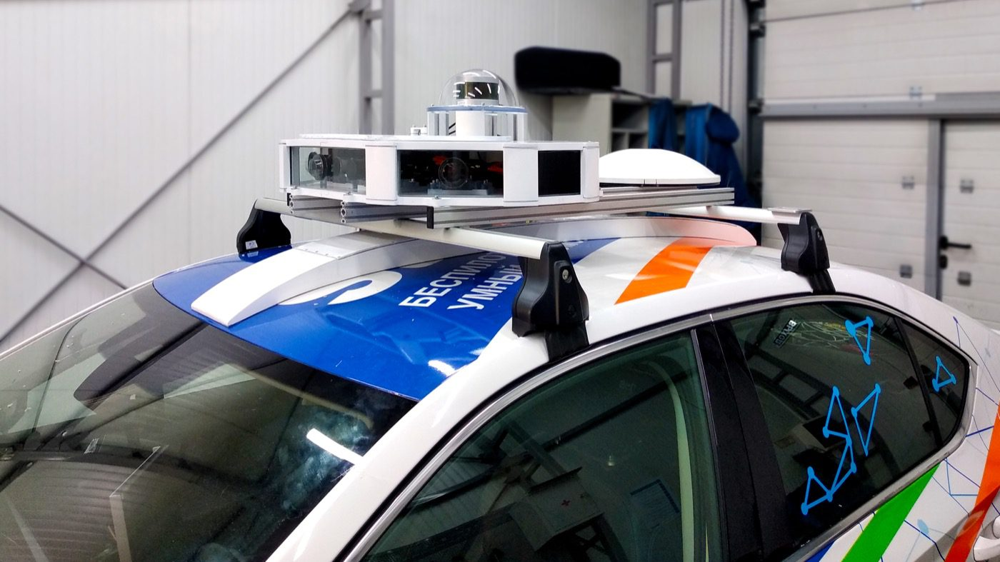
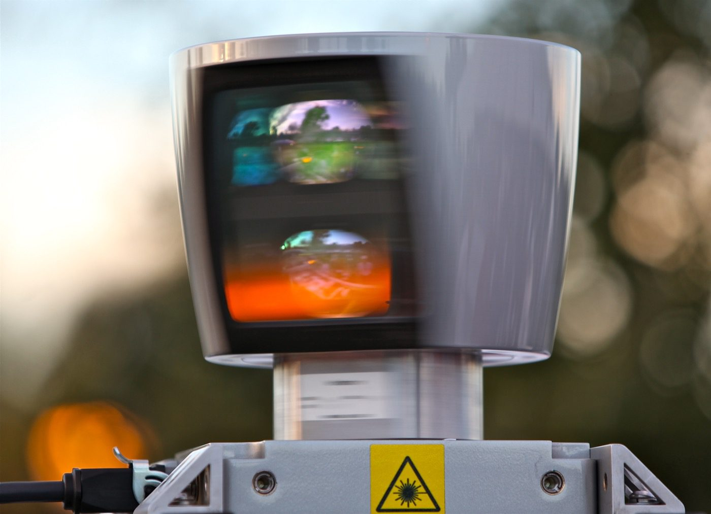
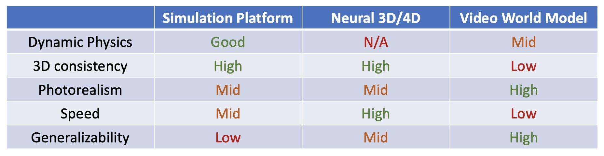

# 从一次失败决定世界模型的下一项实验

模型在日志上预测得很清楚，接入抓取 planner 后却频繁滑落。此时“换更大的 backbone”与“多收失败数据”都还只是猜测。真正有用的下一步，是找一个能把状态、动作、读出或时延中的某个假设单独推翻的实验，减少把预算花在错误模块上的可能。

下面沿桌边玻璃杯的失败设计开发过程。它可以在已有项目的任一阶段使用，无须按课程顺序完成所有步骤。完整接口见[VLA 到世界模型](vla-world-model-full-chain-case.md)，这里关注的是怎样从证据决定下一步。

## 首先确认预测和执行谈论的是同一件事

回放原观察、实际执行动作与预测未来。检查时间窗口、相机标定和动作单位。在模型看来向上 1 cm，在控制器看来却是归一化速度 0.01，两者即使张量 shape 完全一致也不是同一个动作。

假设相机点坐标为 $p_C$，相机到机器人基座的变换为 $R_{BC},t_{BC}$，则

\[
p_B=R_{BC}p_C+t_{BC}.
\]

如果 $p_C$ 用毫米、$t_{BC}$ 用米，相加后数值仍能通过程序，却没有正确物理意义。先用已知标定点检查单位、方向与变换顺序，比从巨大训练 loss 猜错误更直接。

{ width="920" }

<small>图源：[Wikimedia Commons，Equipment for self-driving car](https://commons.wikimedia.org/wiki/File:Equipment_for_self-driving_car.jpg)。多传感器意味着多条带时间与坐标的观测链；图片本身不证明某套融合方案有效。</small>

一次回放能确认的内容应明确记录。例如“相机重投影在此组静态标定点正确”比“数据已对齐”更准确，后者还包括动态时间同步、执行器延迟和数据转换。

## 如果信息根本不在输入里，先改变观察问题

玻璃杯被夹爪完全遮住时，只凭单帧 RGB 可能无法区分稳定夹紧与松动。训练更久不能从不存在的证据中恢复唯一真值。可以增加历史、本体反馈、接触传感或重新观察动作，也可以让模型表达多个可能状态。

一个简单对照是保留原模型，用同一任务增加一个侧视角；另一个对照是保留相机，用短历史替代单帧。只改其中一项，才能知道改善来自新信息还是模型结构变化。若只能得到平均改善，也要查看究竟哪些遮挡情形仍无解。

{ width="760" }

<small>图源：[Wikimedia Commons，Velodyne High-Def LIDAR](https://commons.wikimedia.org/wiki/File:Velodyne_High-Def_LIDAR.jpg)。新的传感器能增加观测，但也带来同步、标定与成本；“有三维数据”不自动等于状态正确。</small>

机器人任务的观测选择与自动驾驶不同，点云并不替代接触力，力传感也不替代远处道路布局。应从当前缺失变量倒推传感证据。

## 信息可见，却没有进入状态时，测试编码器

若原视频清楚显示杯子已经歪斜，latent probe 却无法辨认，可以固定动力学模块，比较原编码状态与带人工姿态信息的状态。这个替换不是部署方案，而是询问后续模块在获得正确信息时能否工作。

Probe 也要控制复杂度。一个很大的 probe 可能重新学会整个任务，使弱表示看起来可用；过弱 probe 又可能读不出分布式表示。应同时比较模型实际使用的读出、简单基线以及相同预算下的替代表示。重建画面逼真只能说明某些信息可重建，未必说明当前决策头读得出来。

压缩 token 的实验也放在这里。保持训练预算和输入分布，改变 resampler 数量，观察状态保真、模型时间和闭环后果。token 减少后若任务退化，不能只报告系统收益；若任务持平却没有时间收益，则要继续 profile encoder 与其他瓶颈。

## 状态正确以后，再测试动作动力学

从相同已知状态执行不同动作，是检查动作条件的直接方式。对快抓与慢抓，应比较实际执行速度、夹紧和滑落，而不仅是两个动作名称。自然日志里快抓可能总发生在容易物体上，慢抓总发生在难物体上；直接相关性会把物体难度误归因给速度。

在模拟器中可以固定初始状态、材料和随机种子做控制比较，但模拟器对摩擦与接触的假设也要校准。真实重复实验不能完全复位时，应记录剩余差异并估计不确定性。模型在其训练分布外的自信，不能代替这些证据。

{ width="960" }

<small>图源：[Towards Video World Models](https://www.xunhuang.me/blogs/world_model.html)，Figure 9。不同模拟来源带来不同可控变量和误差；选择工具应服务当前待区分的假设。</small>

先测一步，再延长 horizon。若一步已错，增加多步 loss 未必解决输入或动作语义问题；若一步准确、长时漂移，则考虑状态记忆、滚动训练或反馈频率。模型在什么时刻开始偏离，比一个汇总分更能指导修复。

## 模型预测对了，也可能被错误消费

假设未来预测已显示滑落，risk head 却输出低风险。应核对风险定义的事件和时间范围，特别是“下一步发生”与“整段至少一次”是否混淆。若概率正确但 planner 仍选危险动作，则检查代价函数和约束。真实目标可能要求风险低于阈值，简单相减的成功减风险不一定表达这个要求。

Success checker 同样属于被评测系统。杯子短暂接触托盘就算成功，与放开夹爪后稳定停留两秒，是不同任务。若模型学会利用判据漏洞，优化器只是忠实优化了错误定义。判据应在比较模型前冻结，并通过明确成功、失败和边界轨迹检查。

最后检查时间。模型越复杂越慢，输出的正确未来也可能在控制器接收时已经过期。可以固定预测器，用更及时的状态重规划；也可以固定重规划频率，比较加速路径。将两者一起改变，难以判断收益来源。

## 让一次改进留下可以复核的证据

对“快抓滑落”这一问题，实验记录应写清被检验的假设、只改变的变量、固定任务与预算、观察到的结果及仍未解释的失败。例如“增加侧视角后遮挡桶改善，而无遮挡桶持平”，能支持继续研究观测不足；它不能直接证明某种网络架构普遍更强。

重训时保存数据版本、初始 checkpoint、代码版本与实际生效配置。静态 YAML、模型设计图和几条手工标签都不能替代训练日志。当前本站 mini-chain 的证据范围见[报告](world-model-efficient-training-experiment-report.md)。

当状态、动力学、读出与时延都能被独立检查，再扩大任务规模、模型或合成数据，实验结果才比较容易解释。来源方法可从 [PlaNet](https://arxiv.org/abs/1811.04551) 的潜状态规划、[MWM](https://arxiv.org/abs/2206.14244) 的表示分工与 [V-JEPA 2](https://arxiv.org/abs/2506.09985) 的动作条件规划开始对照。

## 模型和实验依据

实验顺序借鉴 [PlaNet](https://arxiv.org/abs/1811.04551) 对潜状态和规划的拆分、[MWM](https://arxiv.org/abs/2206.14244) 对表示与动力学的分工，以及 [V-JEPA 2](https://arxiv.org/abs/2506.09985) 对动作条件预测的接口。玻璃杯、快抓/慢抓、单位错位和 success checker 是本站的构造案例，作用是练习如何提出可区分的假设，不是某篇论文的实测结果。

写实验记录时，至少保留“只改变哪一项、预期区分什么、哪一类失败应该减少、结果仍无法解释什么”。如果一次实验同时换模型、数据、控制频率和判据，最后即使成功，也很难知道是哪一项起作用。
