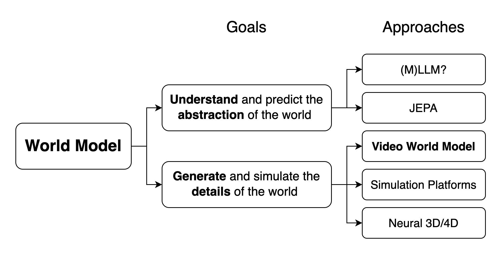

# 世界模型效率技术对照

这页适合在遇到具体瓶颈以后查。表格把方法、已有证据和本地还缺的测量放在一起。论文里的结果、本站的小算例和还没跑过的工程设想，分量不一样，不能拼成一条“已经验证”的结论。



<small>图源：[Towards Video World Models](https://www.xunhuang.me/blogs/world_model.html)，Figure 2。它提供模型用途的分类视角，不提供本页技术组合的实测性能。</small>

## 当真实交互很贵

| 候选机制 | 改变哪笔工作 | 可追溯材料 | 在自己的任务中仍需比较 |
| --- | --- | --- | --- |
| RSSM 与 imagined behavior learning | 用模型轨迹提供部分策略更新信号 | [Dreamer 方法](https://arxiv.org/abs/1912.01603)、[状态与行为学习解释](rssm-dreamer-and-planning.md) | 固定真实交互预算的回报，以及新增 GPU 计算与模型偏差 |
| 表征与动力学分工 | 改变视觉训练和时序训练的目标与更新组织 | [MWM](https://arxiv.org/abs/2206.14244)、[机制说明](masked-jepa-and-latent-prediction.md) | 相同数据/计算下的接触、遮挡和任务结果 |
| 针对失败补采 | 调整采样分布与可获得监督 | [瓶盖失败的数据流程](data-engines-and-self-improvement.md)，构造案例 | 独立目标桶收益、主分布退化、采样成本与选择偏差 |
| 固定日志再训练 | 复用真实转移 | [离线 RL](../reinforcement-learning/offline-reinforcement-learning.md) | 动作支持与离线评测偏差，不能凭日志数量推出泛化 |

训练损失更低，和用更少的真实交互完成任务，是两笔账。把 GPU 算力换成数据效率时，两边都要列出来；训练步数被组合方法改过，也要把预算写清楚。

## 当状态太大，显存不够

| 候选机制 | 直接机制 | 可追溯材料 | 关键限制 |
| --- | --- | --- | --- |
| Visual resampler | 将多 patch 映射为少量 token | [视觉连接器](../vlm/visual-tokenizers-and-connectors.md)、[fixture 的 6.70 倍 token 账](world-model-efficient-training-experiment-report.md) | fixture 没有训练 encoder；token 比不是速度比 |
| JEPA-style prediction | 在目标表征中预测，改变对像素 decoder 的依赖 | [V-JEPA](https://arxiv.org/abs/2404.08471)、[V-JEPA 2](https://arxiv.org/abs/2506.09985) | 表征可预测不等于已学动作后果；需要对应动作数据与接口 |
| Activation checkpointing | 保留较少激活，反向重新计算 | [训练系统](../training/distributed-training-and-checkpointing.md) | 重算时间、随机性、循环状态与 mask 语义 |
| 参数/优化器分片 | 将训练状态分布到多设备 | [分布式训练](../training/distributed-training-and-checkpointing.md) | 通信、保存恢复与实际峰值显存 |
| 低比特训练 | 用不同数值格式存储或计算 | [低比特与数值](../training/low-bit-training-and-numerics.md) | scale、累加、稳定性和任务退化需要单独测 |

压缩值不值得做，取决于省掉的那部分是不是主要成本。先看[效率路线](efficient-training-roadmap.md)里的 Amdahl 算例，再决定要不要实现更复杂的压缩。

## 当候选规划已经等不起

| 候选机制 | 可以省掉什么 | 来源与推导 | 本地必须验证什么 |
| --- | --- | --- | --- |
| 相同前缀 KV 共享 | 候选分叉前的重复存储与计算 | [24 MiB 前缀与 16 分支算例](rollout-serving-quantization-kernel-case.md) | 条件真正相同、动作分支隔离、缓存版本与实测延迟 |
| KV 量化/合并 | 缓存大小及部分访存 | [KVSlimmer](https://arxiv.org/abs/2603.00907)、[部署解释](rollout-serving-quantization-kernel-case.md) | 身份记忆、接触事件、候选排序；文本结果不能直接迁移 |
| 权重量化 | 参数存储、访存及支持硬件上的低精度计算 | [SmoothQuant](https://arxiv.org/abs/2211.10438) | 校准分布、转换开销、风险/动作读出与尾延迟 |
| 少步、因果视频生成 | 生成步骤与交互组织 | [CausVid](https://arxiv.org/abs/2412.07772) | 动作条件预测与闭环用途，生成速度不证明物理准确 |
| Packing、mask 与 attention 调度 | 无效计算、负载不均及通信等待 | [MagiAttention 文档](https://sandai-org.github.io/MagiAttention/docs/main/index.html) | 与基准相同的可见关系、硬件/shape 和端到端性能 |
| 有界队列与期限处理 | 过期观察、排队和迟到结果 | [观测年龄](../thinking-exploration/embodied-inference-observation-age-1009-2059.md) | 丢帧是否遗漏事件，超时回退与实际任务后果 |

## 怎样辨认一行证据的分量

本站 mini-chain 真实执行的是 JSONL 指标计算，它没有训练模型、生成视频或执行机器人。它支持核对 token 总数、分桶 ECE 与 top-1 选择规则；不支持某项优化改善了任务成功的结论。其 `training-config.yaml` 也未被 evaluator 读取。

论文图与原始代码能够解释方法，复现性能还需要匹配数据、模型、硬件与预算。对于自己的系统，一项技术是否保留，应由成本变化和对应任务结果共同决定。沿一条失败定位下一实验，可直接查[开发与评测](development-roadmap-data-simulation-and-evaluation.md)。

## 把候选方法放进同一张预算表

世界模型实验很容易把“每秒生成帧数”“单次训练损失”和“任务成功率”混在一起。建议每个候选方案都记录同一组字段，再决定是否值得实现：

| 层次 | 必填字段 | 常见误判 |
| --- | --- | --- |
| 数据 | 真实交互小时数、视频帧数、动作覆盖、失败样本比例 | 只报总帧数，忽略动作是否覆盖候选干预 |
| 训练 | GPU 小时、有效 token、参数/激活显存、重算比例 | 只报 wall-clock，忽略机器数量与中断恢复 |
| 推理 | 生成 horizon、采样步数、候选数、batch、峰值 KV | 只报单条平均延迟，忽略并发和排队 |
| 预测质量 | 一步误差、多步 rollout、事件召回、校准误差 | 用清晰视频或低 loss 代替可查询的后果准确性 |
| 任务结果 | 成功率、碰撞率、人工接管、失败类型 | 只在模型自己生成的轨迹上验收 |

把同一任务按固定预算拆成三份运行：基线模型、只改效率机制的模型、只改数据或监督的模型。每份都保存 commit、数据 manifest、随机种子、硬件拓扑和停止原因。这样“少了一半采样步”才可以与“多消耗多少训练 GPU 小时”放在同一张表里。

## 决策顺序：先找主瓶颈，再选机制

可以沿四个问题逐层缩小范围：

1. 是显存放不下，还是计算、通信、排队或数据读取占主要时间？先用 profiler 和峰值显存确定瓶颈，避免在非关键路径上做优化。
2. 瓶颈发生在训练、单条 rollout，还是候选并发？训练侧优先看有效 token/s，交互侧优先看从观测到可执行动作的 p95。
3. 机制是否会改变模型看到的信息或动作语义？会改变的方案必须增加反事实、数据泄漏和时间对齐检查。
4. 节省的资源是否换来了任务退化或新的失败类型？若没有独立任务评测，只能把结果写成“系统成本变化”，不能写成“能力提升”。

例如，若 GPU trace 显示 70% 时间在视频解码，继续压缩 KV 只会改善理论上很小的部分；若 rollout 主要等待候选排序，减少单条生成步数也可能没有端到端收益。把每个候选的理论节省乘以它在关键路径上的占比，是比阅读宣传数字更可靠的第一轮筛选。

## 一页实验记录模板

每次比较可以先写下如下最小记录，再开始跑实验：

```yaml
question_id: wm-eff-001
task: "固定起点，比较两种动作的 16 帧后果"
budget:
  real_episodes: 200
  gpu_hours: 12
  rollout_candidates: 8
baseline: "latent predictor, 8 sampling steps"
variant: "latent predictor, 2 sampling steps + shared prefix"
primary_metrics: [closed_loop_success, p95_action_latency]
guardrails: [event_recall, collision_rate, peak_memory]
stop_if: "任一 guardrail 比基线恶化超过 5 个百分点"
evidence: [config, commit, manifest, trace, failure_buckets]
```

这份记录不替代结果，只是防止在看到速度提升后临时改变分母。若中途改变 horizon、动作频率或候选数，应新建 `question_id`，而不是覆盖原实验。

## 自测

1. 如果方法让训练损失下降 20%，但真实交互预算增加 3 倍，你会把它归到哪一列？
2. 如果缓存使单候选延迟下降，但候选数从 8 增到 64，端到端 p95 应怎样重新测？
3. 如果模型能生成连贯视频，却对相同起点的两个动作生成同样后果，哪一项能力尚未被证实？

参考答案应分别指向预算分离、并发关键路径、动作条件响应。答不出这三问时，先补协议和失败分桶，再实现更复杂的效率技巧。

## 模型和实验依据

表格把 [Dreamer](https://arxiv.org/abs/1912.01603)、[MWM](https://arxiv.org/abs/2206.14244)、[V-JEPA 2](https://arxiv.org/abs/2506.09985)、[CausVid](https://arxiv.org/abs/2412.07772)、SmoothQuant 和相关部署页面的可追溯证据放在同一张表里。它不是方法排行榜，也没有把论文 benchmark、本站算例和未运行的工程设想相加成“已验证性能”。

使用时先填 `question_id`、真实交互预算、GPU 预算和 guardrail，再选择一个候选机制。任何改变 horizon、动作频率、候选数或成功判据的实验都应生成新问题编号，保留原始比较。
