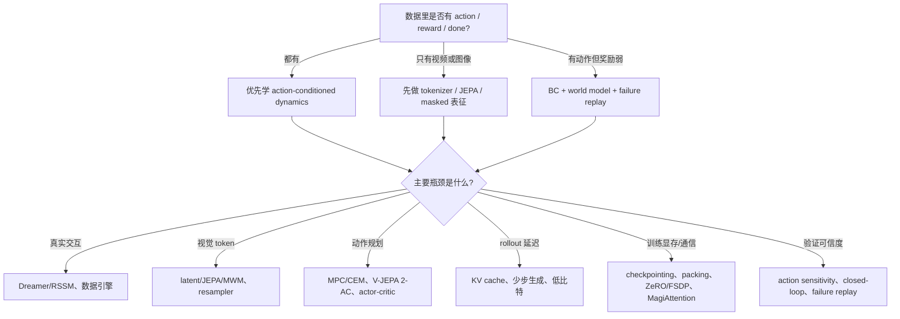

# 世界模型高效训练路线图

世界模型高效训练不是“找最新论文”，而是在有限预算下回答一个工程问题：**怎样少用真实交互、少用视频 token、少占显存和通信、少花 rollout 延迟，同时还能让预测真的改善决策。**

这篇是全站主线枢纽。它不要求你先读总览页，也不把所有论文排成清单；它把世界模型训练拆成五类成本、四条主要路线和一套证据判断方法。

## 中心问题：预测未来是为了选动作

一个面向决策的世界模型至少要建模：

\[
p_\theta(z_{t+1:t+H},x_{t+1:t+H},r,d,u\mid z_{\le t},a_{t:t+H-1},c)
\]

这行公式可以按“输入、输出、用途”读：

| 部分 | 含义 | 决策里为什么重要 |
| --- | --- | --- |
| \(z_{\le t}\) | 当前和历史 latent state | 保存部分可观测世界里的有用历史 |
| \(a_{t:t+H-1}\) | 候选未来动作序列 | 让模型能比较“换动作会怎样” |
| \(c\) | 任务条件、语言或目标图像 | 决定什么未来算成功 |
| \(z,x\) | 未来 latent 或观测 | 判断物体、位置、遮挡、接触会怎样变化 |
| \(r,d,u\) | reward、done、uncertainty/risk | 给 planner、critic 或 actor 提供未来账本 |

如果模型没有动作输入，它可能是很好的视频/表征模型，但不能直接当可规划世界模型；如果模型没有 reward/done/risk，planner 很难知道未来好坏；如果只做 open-loop prediction，不接 closed-loop eval，就不能证明它改善决策。

## 五类成本

“高效”必须落到具体成本项。世界模型训练最常见的五类成本是：

| 成本 | 为什么贵 | 常见压缩路线 | 容易伤什么 |
| --- | --- | --- | --- |
| 真实交互 | 机器人小时、重置、人工接管、失败采集都贵 | Dreamer/RSSM、offline-online hybrid、数据引擎 | 模型漏洞、分布偏移 |
| 视频 token | 多相机、高分辨率、长 horizon 让 token 爆炸 | visual tokenizer、latent prediction、JEPA/MWM | 接触、遮挡、风险细节 |
| 训练显存/通信 | 长序列 attention、optimizer state、activation 占用大 | checkpointing、ZeRO/FSDP、packing、MagiAttention | mask 错误、恢复语义 |
| rollout 延迟 | 规划要比较多条候选未来，生成步数和 KV 生命周期长 | latent rollout、few-step diffusion、KV cache、低比特 | 候选排序、长时一致性 |
| 验证预算 | 真机闭环、人审和失败复核都慢 | action sensitivity、failure replay、cost per success | open-loop 指标误导 |

读一篇论文或博客时，先不要问“它是不是 SOTA”，先问它省的是哪一项成本，又把成本转移到哪里。

## 路线一：RSSM / Dreamer，把真实试错换成 latent imagination

Dreamer 类方法的核心是：先学 latent dynamics，再在 latent imagination 中训练 actor-critic。它省的是真实环境交互，而不是神奇地消除计算。

{ width="900" }

{ width="900" }

<small>图源：[DreamerV3](https://arxiv.org/abs/2301.04104)，Figure 3(a)/(b)。原图表达：Figure 3(a) 展示 world model learning，Figure 3(b) 展示 actor-critic 在 imagined latent trajectories 上学习。本站读法：真实经验进入 replay 训练 dynamics，策略大量更新发生在 latent rollout 内，因此能减少真实试错。</small>

这条路线的效率机制是：

```text
真实轨迹 -> 学 latent transition/reward/continue
  -> 从真实 latent state 出发展开 imagined rollout
  -> 用 imagined return 训练 actor/critic
  -> 回到真实环境收新数据校准 world model
```

它最适合真实交互贵、状态能被 latent 压缩、reward/done 较清楚的任务。它最怕 model exploitation：actor 学会在模型里拿高分，但真实环境失败。读这类论文要看 return per environment step、horizon ablation、reward/continue head 误差和 closed-loop success。

## 路线二：Masked / JEPA / MWM，把像素重建换成表征预测

视频像素很贵。逐像素预测会把大量容量花在纹理、光照和背景细节上，而这些细节不一定影响动作选择。Masked/JEPA/MWM 路线试图把训练预算转向 latent 或 embedding。

{ width="920" }

{ width="920" }

<small>图源：[Masked World Models for Visual Control](https://arxiv.org/abs/2206.14244)，Figure 1 与 Figure 4。原图表达：Figure 1 展示 masked visual representation learning 与 latent dynamics learning 的解耦；Figure 4 展示 Meta-world aggregate 与 RLBench 任务上的 success rate 学习曲线。本站读法：先学更紧凑的视觉表征，再把 dynamics 接到表征上，能减少像素级建模负担。</small>

这条路线要分清两件事：

| 目标 | 省什么 | 不能自动证明 |
| --- | --- | --- |
| Pixel reconstruction | 监督密集，训练直观 | 容量可能花在无关视觉细节 |
| Latent reconstruction | 减少高维像素输出 | encoder 是否保留任务变量 |
| JEPA target prediction | 不必生成像素，只预测抽象表征 | 原始 JEPA 不含 action/reward/done |
| MWM / latent dynamics | 表征和 dynamics 解耦 | 跨任务、跨机器人自动成立 |

Masked/JEPA 类路线适合作为表征预训练或视觉压缩层，但如果要进入规划，还必须补 action-conditioned dynamics、reward/done/risk 和 closed-loop eval。

## 路线三：Action-conditioned planning，把表征接回动作

世界模型要服务控制，动作必须进入模型。V-JEPA 2-AC 这类工作展示了一条路线：先用大规模视频学表征，再训练 action-conditioned latent dynamics，并用 MPC/CEM 搜索动作。

{ width="920" }

{ width="920" }

<small>图源：[V-JEPA 2](https://arxiv.org/abs/2506.09985)，Figure 7 与 Table 3。原图表达：Figure 7 展示用 V-JEPA 2-AC 做 model predictive control；Table 3 比较 V-JEPA 2-AC 与 Cosmos world model 在机器人操作任务中的规划性能与时间。本站读法：这张图的重点不是“视频表征很强”，而是表征空间 dynamics 能否在给定动作后预测目标接近程度，并进入 closed-loop planning。</small>

读 action-conditioned 世界模型时，最重要的不是 future frame 好不好看，而是三类测试：

| 测试 | 问的问题 |
| --- | --- |
| counterfactual action | 同一当前状态，换动作后预测是否合理变化 |
| candidate ranking | 模型是否能把更可能成功的动作排前面 |
| closed-loop success | planner/actor 接入模型后，真实任务是否更成功、更省成本 |

如果一篇文章只展示 open-loop 视频，没有动作反事实和闭环结果，它最多支持“模型有生成或表征能力”，不能支持“可用于规划”。

## 路线四：系统效率，把长序列、KV 和 rollout 跑得动

世界模型训练和 rollout 常遇到系统瓶颈：长视频序列、复杂 attention mask、多相机 token、候选动作展开、KV cache、低比特推理。系统优化不会让 dynamics 更准，但能决定这条路线能不能跑到有效规模。

| 系统技术 | 省什么 | 质量风险 |
| --- | --- | --- |
| sequence packing / block mask | padding 和无效 attention | mask 语义错误导致训练污染 |
| activation checkpointing | 训练激活显存 | 重算增加 step time |
| FSDP / ZeRO | 参数、梯度、optimizer state 单卡显存 | 通信、恢复语义、碎片化 |
| KV cache / prefix reuse | rollout prefill 成本 | 长上下文一致性和 cache 管理 |
| FP8/INT8/FP4 | 显存和带宽 | 候选动作排序、risk recall、长时一致性 |

{ width="920" }

<small>图源：[MagiAttention docs](https://sandai-org.github.io/MagiAttention/docs/main/index.html)。原图表达：长上下文训练中可能出现多种异构 attention mask。本站读法：世界模型和多轨迹训练常不是规则 dense attention，mask-aware 调度能省系统成本，但不能自动提升模型预测质量。</small>

这类工作必须把 system throughput 和 quality regression 同表报告。只看 TFLOPs、MFU 或 latency，很容易把“跑得快”误写成“模型更好”。

## 证据账：每条 claim 要写清能证明什么

| Claim | Direct Source | Evidence Type | 能支持 | 不能证明 |
| --- | --- | --- | --- | --- |
| Dreamer 类 latent imagination 能减少真实交互 | [DreamerV3](https://arxiv.org/abs/2301.04104) | Paper Result | 论文设置下 world model + imagined actor-critic 有效 | 高分辨率真实机器人一定同样省样本 |
| MWM 的 masked representation + dynamics 可提升视觉控制样本效率 | [MWM](https://arxiv.org/abs/2206.14244) | Paper Result | masked feature learning 能服务论文中的 visual control | 任意 masked model 都具备动作因果 |
| V-JEPA 2-AC 可把表征空间 dynamics 接到目标图像规划 | [V-JEPA 2](https://arxiv.org/abs/2506.09985) | Closed-loop / Paper Result | 特定机器人任务的 action-conditioned planning 结果 | 跨平台通用机器人控制 |
| MagiAttention 能降低异构 mask 长上下文训练成本 | [MagiAttention docs](https://sandai-org.github.io/MagiAttention/docs/main/index.html) | System Throughput | 长上下文 attention 子系统成本下降 | world model dynamics 更准 |

这张表的意义是防止外推。论文结果能支持论文 setting，系统吞吐能支持系统成本下降，官方 demo 能展示能力形态；它们都不能自动替代真实闭环收益。

## 先按瓶颈选路线

| 当前瓶颈 | 优先看什么 | 必须验收 |
| --- | --- | --- |
| 机器人小时数太贵 | Dreamer/RSSM、offline-online 数据引擎 | cost per success、failure replay、return per env step |
| 视频 token 太多 | visual tokenizer、JEPA/MWM、latent dynamics | token compression、object permanence、contact/risk bucket |
| 没有动作敏感性 | action-conditioned dynamics、counterfactual action eval | action sensitivity、candidate ranking |
| rollout 太慢 | latent rollout、few-step diffusion、KV cache、低比特 | latency、long-horizon consistency、质量回归 |
| 训练长序列跑不动 | packing、checkpointing、FSDP/ZeRO、MagiAttention | step time、mask correctness、恢复语义 |
| 评测不可信 | closed-loop eval、failure replay、Claim Ledger | success、risk recall、cannot prove |

## 路线选择决策树



这棵树的第一步是数据条件，不是模型名字。没有 action 的视频模型不能直接规划；没有 reward/done 的 dynamics 很难做长期价值；没有闭环验证的 open-loop 结果只能作为候选证据。

## 外部精读

- [World Models](https://worldmodels.github.io/)：用直观实验说明内部模型如何服务控制。
- [DreamerV3](https://arxiv.org/abs/2301.04104)：latent world model + imagined actor-critic 的成熟代表。
- [Masked World Models for Visual Control](https://arxiv.org/abs/2206.14244)：表征和 dynamics 解耦的清晰例子。
- [V-JEPA 2](https://arxiv.org/abs/2506.09985)：从视频表征接到 action-conditioned planning 的近期例子。
- [Lil'Log: Diffusion Models for Video Generation](https://lilianweng.github.io/posts/2024-04-12-diffusion-video/)：学习如何把一个技术方向的任务难点、数据、结构和评测边界讲清。
- [OneFlow/智源：全栈 Transformer 推理优化](https://hub.baai.ac.cn/view/33449)：学习如何把推理优化从硬件、MLSys、模型结构和解码算法放进同一张成本账。

## 阅读结论

世界模型高效训练的核心不是覆盖更多论文，而是把每个方法放回成本账：它省真实交互、视频 token、训练显存、rollout 延迟还是验证预算；它是否保留动作敏感性、reward/done/risk 和闭环收益；它的证据到底能支持什么，不能外推到哪里。
