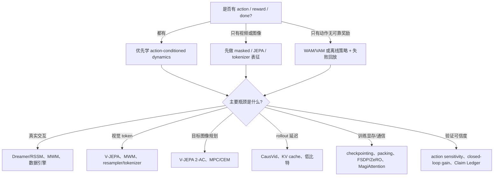
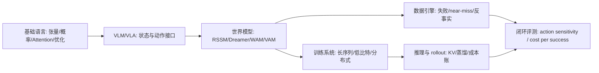

# 世界模型高效训练技术路线图

这页是全站的主线枢纽：**如何在有限真实交互、有限视频 token、有限 GPU-hour 和有限验证预算下，训练出对动作敏感、能长时 rollout、能改善决策的世界模型。**

它不是要替代基础知识、训练、推理、量化、算子、VLM/VLA 或具身智能章节。相反，这些章节都被放到同一条主线下：它们分别解决世界模型训练中的不同成本项。

!!! tip "快速定位"
    **一句话结论**：世界模型高效训练是一张成本账，不是一组论文名。
    **适合读者**：想判断 Dreamer/RSSM、Masked/JEPA、视频 rollout、低比特/KV 和数据引擎如何组合的人。
    **先看哪张表**：先看“初读版：先按瓶颈选路线”，再看“效率技术矩阵（工程审计版）”。

!!! note "读法提醒"
    主线是世界模型高效训练，但这不是说其它内容不重要。基础知识提供公共语言，训练/推理/量化/算子提供工程能力，VLM/VLA 和具身智能提供状态、动作、数据和闭环场景。读的时候先抓主线，再按需要回到支撑专题补工具。

## TL;DR

世界模型高效训练不是单一技巧，而是同时压低**数据、token、显存、rollout、验证**五类成本。表征路线省像素和视频 token，Dreamer/RSSM 省真实试错，系统路线省长上下文与 KV 成本。任何效率 claim 都要同时写清：证据能证明什么、不能证明什么、失败时伤哪条决策链。

!!! tip "术语速查"
    `RSSM` 是带确定性记忆和随机 latent 的状态空间模型；`JEPA` 是预测 embedding 而非像素的自监督目标；`WAM/VAM` 分别指 world-action / video-action 建模路线；`MPC/CEM` 是在模型内搜索候选动作序列的方法；`DMD` 是少步扩散蒸馏的一类分布匹配方法；`GQA/KV` 决定长上下文 rollout 的 attention 缓存宽度、显存和带宽。

!!! tip "全站地图"
    如果要快速查“某类效率技术覆盖到哪里、原始证据是什么、还有什么缺口”，看 [全站效率矩阵](../references/site-efficiency-coverage-matrix.md) 和 [世界模型效率矩阵](efficiency-technique-coverage-matrix.md)。如果要把数据、配置、系统账、评测和失败归因写成报告，看 [完整实验报告样例](world-model-efficient-training-experiment-report.md)；如果要看跨专题执行路线，看 [VLA 全链路案例](vla-world-model-full-chain-case.md) 和 [Rollout 服务案例](rollout-serving-quantization-kernel-case.md)。

## 评分门槛：什么样的世界模型博客能达到 9+

如果把本站当成一组围绕世界模型高效训练的博客文章来评估，`9+` 的门槛不是“覆盖很多论文名”，而是每个关键 claim 都能回答：省什么成本、为什么省、代价是什么、证据是什么、什么时候不能外推。

| 评估维度 | 9+ 标准 | 本站补强动作 |
| --- | --- | --- |
| Technical Accuracy | 区分 world model、model-based RL、视频生成器、VLA policy 和 simulator，不把视频质量直接等同于规划价值 | 在核心页加入 `Claim Ledger`，把 paper result、ablation、system throughput、closed-loop 和官方 demo 分开 |
| Depth & Specificity | 解释 latent prediction、masked prediction、JEPA、imagined rollout 的损失、机制、成本转移和失败边界 | 增加公式对照、效率机制表和“何时不用某路线”的判断框架 |
| Coverage | 至少覆盖 latent dynamics、masked/JEPA、action-conditioned rollout、低比特/KV、长上下文和数据引擎 | 用效率技术矩阵把 RSSM/Dreamer、MWM、V-JEPA、WAM/DreamZero、CausVid、MagiAttention 和数据闭环放到同一张图里 |
| Clarity | 技术读者能在不熟悉单篇论文的情况下读懂输入输出、训练目标和评测边界 | 每张复杂原图都补 `这张图怎么读`，用固定四点解释输入输出、效率机制、主线意义和不能证明什么 |
| Originality & Insight | 不只是复述论文，而是给出工程判断：什么时候用、什么时候不用、如何组合 | 增加“成本账”和“证据账”，把路线选择变成可审计的工程取舍 |
| Citations & Honesty | 明确哪些是论文结果、官方 claim、站内推断、未复现外推 | 新增全站 [Claim Ledger](../references/claim-ledger.md)，前沿系统统一标注证据等级 |

## 中心问题

一个面向决策的世界模型至少要回答：

\[
p_\theta(z_{t+1:t+H}, x_{t+1:t+H}, r, d, u \mid z_{\le t}, a_{t:t+H-1}, c)
\]

其中 \(z\) 是潜状态，\(x\) 是未来观测或视频，\(a\) 是动作，\(r\) 是奖励或任务进展，\(d\) 是终止/失败信号，\(u\) 是不确定性或风险。高效训练真正关心的不是公式本身，而是以下问题：

1. 真实交互能不能少一些。
2. 视频 token 和上下文长度能不能少一些。
3. 动作条件能不能更有效地进入模型。
4. 长时 rollout 能不能稳定又便宜。
5. 训练和推理能不能用更低显存、更低通信和更低延迟跑起来。
6. 评测能不能证明预测真的改善了决策。

## 七条效率轴

| 效率轴 | 省的是什么 | 核心技术 | 对应专题 |
| --- | --- | --- | --- |
| 数据效率 | 真实交互、人工标注、失败采集 | 示范数据、near-miss、失败回流、合成 rollout、数据门禁 | [世界模型数据引擎](data-engines-and-self-improvement.md)、[具身智能](../embodied-ai/index.md) |
| 表示效率 | 像素重建、视觉 token、长视频冗余 | VLM 连接器、视频 tokenizer、latent state、RSSM/JEPA | [VLM/VLA](../vlm/index.md)、[RSSM/Dreamer](rssm-dreamer-and-planning.md) |
| 动作效率 | 动作序列长度、条件无效、反事实样本浪费 | action token、动作 chunk、WAM/VAM、动作敏感评测 | [WM/WAM/VAM](wm-wam-vam-and-action-conditioned-modeling.md)、[VLA 专题](../vla/index.md) |
| 长序列效率 | attention 计算、显存、padding、通信 | sequence packing、block-causal mask、context parallel、MagiAttention | [训练](../training/index.md)、[MagiAttention](../paper-deep-dives/foundations/magiattention.md) |
| 数值效率 | 权重/激活/KV 显存、带宽、通信 payload | BF16、FP8、FP4/QAT、KV 量化、混合精度保护 | [低比特训练](../training/low-bit-training-and-numerics.md)、[量化](../quantization/index.md) |
| Rollout 效率 | 推理延迟、生成步数、KV 生命周期 | causalization、KV cache、few-step diffusion、DMD/consistency distillation | [推理](../inference/index.md)、[扩散蒸馏](../diffusion/consistency-models-and-rectified-flow.md) |
| 验证效率 | 无效 demo、人眼主观判断、线上试错 | action sensitivity、temporal consistency、risk calibration、cost per successful rollout | [世界模型评测](evaluation-and-failure-modes.md)、[多模态评测](../vlm/multimodal-evaluation-and-failure-modes.md) |

## 初读版：先按瓶颈选路线

如果第一次读，不要先看完整矩阵。先找瓶颈，再回到对应路线补机制和证据。

| 你现在的瓶颈 | 先看什么 | 必须补的评测门禁 |
| --- | --- | --- |
| 机器人小时数太贵 | Dreamer/RSSM、MWM、数据引擎 | return per env step、failure replay、cost per success |
| 视觉 token 太多 | visual tokenizer、MWM、V-JEPA | token compression ratio、object permanence、latent drift |
| 目标图像规划 | V-JEPA 2-AC、MPC/CEM | closed-loop success、goal reach、action sensitivity |
| rollout 延迟太高 | CausVid、KV cache、低比特 | latency、candidate ranking、long-horizon consistency |
| 长上下文训练跑不动 | sequence packing、activation checkpointing、FSDP/ZeRO、MagiAttention | step time、padding ratio、mask correctness |
| 验证不可信 | action sensitivity、closed-loop gain、Claim Ledger | counterfactual actions、risk calibration、Cannot Prove |

## 效率技术矩阵（工程审计版）

下面这张矩阵把“高效训练”拆成可比较的技术路线。它故意不按论文发布时间排序，而是按成本项和证据形态排序，方便判断一项新工作到底补了哪块短板。

| 路线 | 主要省什么 | 为什么省 | 证据应该看什么 | 典型边界 |
| --- | --- | --- | --- | --- |
| RSSM / Dreamer latent dynamics | 真实环境交互、像素级 rollout 成本 | 用紧凑 belief state 学 \(p(z_{t+1}\mid z_t,a_t)\)，在 latent space 里 imagined rollout 并训练 actor-critic | return per environment step、horizon ablation、reward/continue head 误差 | 容易被 model exploitation 利用；小环境收益不能直接外推到多相机长任务 |
| Masked World Models | 视觉表示样本成本、无关像素重建成本 | 先用 masked convolutional features 学表征，再冻结或解耦到 latent dynamics | Meta-world / RLBench 学习曲线、representation/dynamics ablation | 提升表征和样本效率，不保证动作因果和 closed-loop 成功 |
| JEPA / V-JEPA | 像素解码器容量、视频 token 冗余 | 预测 target encoder latent，而不是把被遮挡区域逐像素画回来 | frozen evaluation、downstream prediction、masking ablation | 原始 V-JEPA 不含 action、reward、done，不能直接等同可规划世界模型 |
| V-JEPA 2-AC | 机器人数据、视觉目标规划成本 | 用大规模视频预训练表征，再训练 action-conditioned latent dynamics，并用 MPC/CEM 搜动作 | closed-loop robot success、planning table、动作条件 ablation | 仍受限于任务、机器人平台、目标图像设定和动作空间 |
| WAM / DreamZero | policy 数据、动作监督和未来视频割裂带来的样本浪费 | 未来视频和未来动作联合建模，并用真实新观测 refresh | closed-loop robot eval、real observation refresh、系统吞吐 | 不是通用 VLA 替代品；联合生成让归因和安全验证更难 |
| LingBot-World / CausVid | 视频 rollout 延迟、长时生成步数 | 视频底座继续训练成动作条件模拟器，再用 causalization、DMD 或少步蒸馏压缩生成 | latency、streaming rollout、少步质量、官方 demo 与任务指标分开 | 视频自然度不证明 planning utility；demo 不能替代闭环任务 |
| MagiAttention / context parallel | 长上下文显存、通信和 padding 浪费 | mask-aware slicing、负载均衡和 overlap 调度减少异构 mask 下的无效计算 | system throughput、TFLOPs、step time、scaling curve | 只解决训练系统成本，不会让 dynamics 本身更准 |
| Low-bit / KV quantization | 权重、激活、KV 显存和带宽 | FP8/FP4/INT8 与敏感模块保护降低 memory traffic | latency、显存、长时一致性、risk/action head 回归 | 低比特可能改变候选动作排序或降低 near-miss recall |
| Data engine / offline-online hybrid | 真实交互、人工复核和长尾失败采集 | 用失败、near-miss、反事实和 hard negatives 提高每条样本的信息量 | hard-negative yield、recovery improvement、cost per success | 自生成数据会放大模型偏差，必须有门禁和回放 |

## 为什么 latent / masked / imagined rollout 更高效

高效不是把 loss 写小，而是把模型容量和训练预算从“视觉上无关紧要的细节”转移到“会改变动作选择的变量”。四类训练目标的差别可以压成下面这张表。

| 目标 | 简化形式 | 省下的成本 | 容易丢掉什么 | 适合接到 |
| --- | --- | --- | --- | --- |
| Pixel reconstruction | \(\mathcal{L}_{pix}=d(\hat{x}_{t+1},x_{t+1})\) | 监督信号密集，容易训练 | 容量花在纹理、光照和背景；动作相关细节可能被平均化 | 视频生成、可视化模拟、数据扩增 |
| Token / latent reconstruction | \(\mathcal{L}_{lat}=d(\hat{z}_{t+1},z_{t+1})\) | 减少高维像素输出，压低 decoder 和 token 成本 | 如果 encoder 没保留接触、风险或目标状态，下游无法恢复 | RSSM、MWM、视频 tokenizer |
| Joint-embedding prediction | \(\mathcal{L}_{jepa}=d(p_\theta(f_{ctx}(x_{\setminus M})),\text{sg}(f_{tgt}(x_M)))\) | 不必生成像素，只预测抽象表征；高 mask ratio 强迫语义和运动建模 | 原始目标通常没有动作、奖励和终止信号 | JEPA / V-JEPA 表征预训练 |
| Action-conditioned latent dynamics | \(\mathcal{L}_{dyn}=d(\hat{z}_{t+1},z_{t+1})+\lambda_r\ell(\hat{r},r)+\lambda_d\ell(\hat{d},d)\) | 在 latent 中比较候选动作，减少真实试错和像素 rollout | 长 horizon 漂移、模型漏洞、reward/risk head 校准失败 | Dreamer、V-JEPA 2-AC、MPC、actor-critic |

这四类目标不是互斥关系。一个可落地系统常用 JEPA/MWM 先学可压缩表征，再用 action-conditioned dynamics 接入动作、reward、done 和风险，最后用 closed-loop 评测证明它真的改善决策。

## 成本账：先把“高效”拆成可估算数字

读任何方法前，先不要急着问“是不是最新”。更稳的做法是把它放进同一张成本账：它到底减少了哪一项，是否把成本转移到了另一项。

| 成本项 | 粗略估算方式 | 常见放大因子 | 优先回看 |
| --- | --- | --- | --- |
| 真实交互 | 机器人小时数、环境重置次数、人工接管次数、失败回放时长 | reset 慢、长尾任务少、near-miss 没成桶 | [世界模型数据引擎](data-engines-and-self-improvement.md) |
| 视频 token | 相机数 \(\times\) 帧数 \(\times\) 每帧 patch/token 数 \(/\) 压缩率 | 多相机、长 horizon、高分辨率、无选择性 resampler | [视觉 Tokenizer](../vlm/visual-tokenizers-and-connectors.md) |
| 长序列训练 | 有效序列长度、padding 率、attention mask 复杂度、通信 payload | 变长轨迹、block mask、跨样本 packing、context parallel | [训练系统](../training/index.md)、[MagiAttention](../paper-deep-dives/foundations/magiattention.md) |
| 动作条件 | 动作频率 \(\times\) horizon / chunk size，动作和观测时间戳误差 | 高频控制、动作太细、坐标系不统一、动作记录延迟 | [动作表示与控制接口](../vla/action-representation-and-interfaces.md) |
| 数值显存 | 权重、激活、optimizer state、KV cache、通信 buffer 分别计算 | 低比特 kernel 未命中、敏感模块误压、KV 比权重更早爆 | [低比特训练](../training/low-bit-training-and-numerics.md)、[量化](../quantization/index.md) |
| Rollout 推理 | \(T_{\text{observe}}+T_{\text{encode}}+T_{\text{rollout}}+T_{\text{policy}}+T_{\text{control}}\) | 采样步数多、KV 生命周期长、长短请求混排、risk head 旁路慢 | [推理成本建模](../inference/cost-modeling-and-slo-design.md) |
| 闭环验证 | 场景桶数 \(\times\) rollout 次数 \(\times\) 重复实验 \(\times\) 人审/真机成本 | 只看 demo、没有反事实动作、失败样本不回流 | [世界模型评测](evaluation-and-failure-modes.md) |

一个方法如果说自己“高效”，至少要能填出：节省哪一项、增加哪一项、证据是什么、失败时怎么回滚。比如视觉 tokenizer 省 token，但可能丢接触状态；KV 量化省显存，但可能伤长时一致性；少步视频生成省 rollout 延迟，但可能让 action sensitivity 下降。

## 硬证据模块：每条主线都要能落到六格表

这页后面的所有“高效”判断，都应尽量收敛到同一套硬证据模块。它不是要求每页都做大型实验，而是要求读者能看清：这里是在解决哪项成本，有没有最小可复算例子，失败时会暴露什么，证据等级在哪里，边界是什么，验收指标是什么。

| 模块 | 必须回答 | 最小证据 | 更强证据 |
| --- | --- | --- | --- |
| 本页解决哪项成本 | 数据、token、显存、通信、rollout、验证中的哪一项 | 一张成本账 | 真实 step time / latency / GPU-hour 对比 |
| 最小可复算例子 | 输入数据、配置、输出和指标能否复跑 | fixture + 脚本 | 固定 checkpoint + 固定 seed + CI 回归 |
| 失败案例 | 这项技术会在哪类 hard case 上坏 | 一条 failure replay | 失败桶统计和人工复核 |
| 论文或日志证据 | 结论来自 benchmark、ablation、throughput、closed-loop 还是 demo | 明确证据等级 | 独立复现或线上灰度日志 |
| 反例和适用边界 | 什么时候收益会消失或变成风险 | 边界表 | 跨任务/跨硬件分桶结果 |
| 验收指标 | 怎么判定它真的服务世界模型 | action sensitivity、risk calibration、drift、cost per success | 闭环成功率和成本收益同时过门禁 |

本站的最小可复算样例放在 [动作条件视频世界模型端到端训练案例](action-conditioned-video-world-model-training-case.md) 的“可复算 mini-chain”小节。它用 `episodes.jsonl -> token stats -> training-config.yaml -> rollouts.jsonl -> eval_mini_chain.py` 串出一个小链路。它不是生产证据，但给出了页面应该追求的证据形状：读者不只看到“应该这样做”，还可以复算“这一页的指标从哪里来”。

## Claim Ledger

| Claim | Source | Evidence Type | Can Support | Cannot Prove |
| --- | --- | --- | --- | --- |
| DreamerV3 类 latent imagination 能在多个 benchmark 中用较少真实交互学习控制策略 | [DreamerV3 专题](../paper-deep-dives/world-models/dreamerv3.md) | Paper Result | latent dynamics + imagined actor-critic 是有效的 model-based RL 基线 | 高分辨率视频世界模型或真实机器人系统一定同样省样本 |
| MWM 的 decoupled representation + dynamics 在 Meta-world / RLBench 设置中优于 DreamerV2 对照 | [MWM](https://arxiv.org/abs/2206.14244) | Paper Result | masked feature learning 可提升视觉控制样本效率 | MWM 直接解决所有 action-conditioned planning 问题 |
| V-JEPA 式 latent prediction 可避免像素重建的部分冗余 | [V-JEPA](../paper-deep-dives/world-models/v-jepa.md) | Ablation | 表征学习阶段可以减少对像素 decoder 的依赖 | 原始 V-JEPA 天然具备 reward/done/action-conditioned rollout |
| MagiAttention 能降低异构 mask 长上下文训练的系统开销 | [MagiAttention docs](https://sandai-org.github.io/MagiAttention/docs/main/index.html) | System Throughput | mask-aware 调度对长上下文训练系统有价值 | attention 系统优化会提升世界模型的物理预测能力 |
| LingBot-World、DreamZero、CausVid 等前沿系统展示了动作条件或因果视频 rollout 的工程潜力 | [全站 Claim Ledger](../references/claim-ledger.md) | Official Demo | 方向值得纳入世界模型效率路线 | 未独立复现条件下不能证明通用闭环收益 |

## 最小可验证来源

下面这张表把本页最关键的效率 claim 直接绑到原论文 figure、table 或 benchmark setting。站内专题可以帮助理解，但判断 claim 时优先回到这些最小来源。

| Claim | Direct Source | Figure/Table/Setting | Evidence Type | Can Support | Cannot Prove |
| --- | --- | --- | --- | --- | --- |
| DreamerV3 的 latent imagination 可以在 learned dynamics 中训练 actor-critic | [DreamerV3, arXiv:2301.04104](https://arxiv.org/abs/2301.04104) | Figure 3(a)/(b), Figure 6 | Paper Result | world model learning、behavior learning、scaling/replay ratio 的机制和消融 | 视频生成式模拟器天然可规划 |
| MWM 的 decoupled representation + dynamics 改善视觉控制样本效率 | [MWM, arXiv:2206.14244](https://arxiv.org/abs/2206.14244) | Figure 1, Figure 4; Meta-world / RLBench | Paper Result | masked feature representation 能服务论文设置下的 visual control | 任意 masked model 都具备动作因果 |
| V-JEPA 的 latent target prediction 降低像素重建负担 | [V-JEPA, arXiv:2404.08471](https://arxiv.org/abs/2404.08471) | Figure 3, Table 1, Table 4, Table 5 | Ablation | joint embedding prediction 和 frozen evaluation 的表征收益 | 原始 V-JEPA 含 action/reward/done |
| V-JEPA 2-AC 能把表征空间世界模型接到目标图像规划 | [V-JEPA 2, arXiv:2506.09985](https://arxiv.org/abs/2506.09985) | Figure 7, Table 3; robot planning setting | Closed-loop | 特定机器人任务中 action-conditioned representation planning 的结果 | 跨平台通用控制或长时风险规划 |
| MagiAttention 降低异构 mask 长上下文训练的系统成本 | [MagiAttention docs](https://sandai-org.github.io/MagiAttention/docs/main/index.html) | 官方 CP benchmark、AttnSlice / dispatch / overlap | System Throughput | 长上下文 attention 子系统吞吐和通信收益 | 世界模型 dynamics 或闭环任务质量提升 |

## 三组原图证据卡

这些图不是装饰，而是把“效率来自哪里”落到原论文结构上。第一次读可以只看每张图后的四点解释。

{ width="900" }

{ width="900" }

<small>图源：[DreamerV3: Mastering Diverse Domains through World Models](https://arxiv.org/abs/2301.04104)，Figure 3(a)/(b)。原图意：Figure 3(a) 展示 world model learning，Figure 3(b) 展示 actor-critic 在 imagined latent trajectories 上学习。</small>

!!! note "这张图怎么读"
    **输入输出**：Figure 3(a) 从真实经验中编码观测、动作和奖励，学习 latent representation、dynamics、reward 和 continuation；Figure 3(b) 用这些 latent rollout 训练 actor 与 critic。<br>
    **效率机制**：真实环境交互只进入 replay，策略大量更新发生在 learned latent dynamics 内，减少真实试错。<br>
    **对世界模型主线的意义**：DreamerV3 说明世界模型的核心价值可以是“内部模拟服务策略学习”，不是生成清晰视频。<br>
    **不能证明什么**：它不证明任意高分辨率视频模拟器都能规划，也不证明没有 reward/continue 信号的表征模型可直接用于 actor-critic。

{ width="920" }

{ width="920" }

<small>图源：[Masked World Models for Visual Control](https://arxiv.org/abs/2206.14244)，Figure 1 与 Figure 4。原图意：Figure 1 展示 masked visual representation learning 与 latent dynamics learning 的解耦；Figure 4 展示 Meta-world aggregate 与 RLBench 任务上的 success rate 学习曲线。</small>

!!! note "这张图怎么读"
    **输入输出**：MWM 先把图像编码成 masked convolutional features，训练 autoencoder 和 reward prediction；再在 autoencoder latent space 中训练 dynamics。<br>
    **效率机制**：视觉表征不被 dynamics 端到端拖着学像素细节，dynamics 在更紧凑的 latent 上学习动作后果。<br>
    **对世界模型主线的意义**：它是“先压缩视觉，再学动作条件 dynamics”的清晰证据。<br>
    **不能证明什么**：它不能证明所有 masked 表征都能 closed-loop 控制，也不能替代动作反事实和风险校准。

!!! warning "读数边界"
    Figure 4 的 benchmark 条件是论文设置下的 Meta-world 和 RLBench visual control；有 closed-loop control 学习曲线，但不是任意真实机器人部署；报告的是样本效率和成功率，不是系统吞吐；不能直接外推到多相机长时任务。

{ width="920" }

{ width="920" }

<small>图源：[V-JEPA 2: Self-Supervised Video Models Enable Understanding, Prediction and Planning](https://arxiv.org/abs/2506.09985)，Figure 7 与 Table 3。原图意：Figure 7 展示用 V-JEPA 2-AC 做 model predictive control；Table 3 比较 V-JEPA 2-AC 与 Cosmos world model 在机器人操作任务中的规划性能与时间。</small>

!!! note "这张图怎么读"
    **输入输出**：输入当前观测、目标图像和候选动作序列；模型在 representation space 中 rollout，并让未来表示接近目标表示。<br>
    **效率机制**：不生成完整未来视频，而是在 latent / representation space 中用 CEM 搜动作，减少每个候选动作的评估成本。<br>
    **对世界模型主线的意义**：这是 JEPA-style 表征接入 action-conditioned planning 的关键证据。<br>
    **不能证明什么**：它不证明跨机器人平台、长 horizon 风险规划或复杂语言目标都已解决。

!!! warning "读数边界"
    Table 3 是论文中的 closed-loop robot manipulation planning 设置，使用目标图像、MPC/CEM 和单张 RTX 4090；它报告了每步规划时间和若干 Lab 2 技能表现，不是系统级长时部署报告，也不是独立复现。

## 主线定位框模板

后续打磨主线 13 页和关键支撑页时，页面开头尽量补一个相同口径的定位框。它不需要很长，但要让读者在 30 秒内知道这页为什么存在。

| 字段 | 写法 |
| --- | --- |
| 本页解决的成本 | 视频 token、真实交互、KV 显存、rollout 延迟、验证成本、通信或训练显存 |
| 核心风险 | 这项技术最可能伤什么：动作敏感性、风险召回、长时一致性、吞吐、恢复语义 |
| 读完要能判断 | 读者应该能做出的工程判断 |
| 适合接到 | 下一页、相邻专题或论文专题 |

示例：

```text
本页解决的成本：KV 显存和长上下文 rollout 延迟
核心风险：低精 KV 改变候选动作排序，降低 near-miss recall
读完要能判断：是否该压权重、压 KV，还是先改 runtime / batch
适合接到：推理成本建模、QAT/KV Cache、世界模型评测
```

## 路线选择决策树



这棵树的读法很简单：先看数据里有没有动作、奖励和终止信号，再看真正卡住的是数据、token、延迟、显存还是验证。如果一个方法没有动作接口，却声称能规划，它至少还缺 action-conditioned dynamics 或 closed-loop 证据；如果一个方法只降系统延迟，它不能自动变成更好的 world model。

## 贯穿案例：4 路机器人相机 + 目标图像规划任务

假设机器人有 4 路 RGB/RGBD 相机和 16 帧历史，目标是从当前观测到达一张目标图像状态。候选动作来自 action chunk 或 MPC/CEM，评测不只看未来图像像不像，还看 `action sensitivity`、`closed-loop success`、`cost per success` 和 `latency`。

| 路线 | 怎么接入这个任务 | 主要省什么 | 主要风险 | 最小验收 |
| --- | --- | --- | --- | --- |
| Dreamer/RSSM | 用观测、动作、reward/continue 学 latent dynamics，在 imagined rollout 中训练 actor/critic | 真实交互 | 需要可靠 reward/continue；actor 可能利用模型漏洞 | return per env step、model error vs horizon |
| MWM | 先用 masked visual representation 压图像，再在 latent 上学 dynamics | 视觉样本、像素重建 | 表征好不等于动作因果好 | Meta-world/RLBench 式曲线、action sensitivity |
| V-JEPA 2-AC | 用目标图像表示作为规划目标，在 representation space 里用 MPC/CEM 搜动作 | 目标图像规划成本、像素 rollout | 受机器人平台、动作空间和任务集限制 | closed-loop robot success、每步规划时间 |
| 视频 rollout / CausVid | 生成候选动作下的可视化未来，让人或系统检查反事实 | 可视化审查、少步视频 rollout | 视频自然度不等于决策收益 | latency、反事实一致性、planning utility |
| MagiAttention / KV / 低比特 | 支撑长历史、多相机和批量候选动作的训练或推理 | 显存、通信、带宽、延迟 | 系统优化不提升 dynamics 质量 | step time、KV 显存、候选排序回归 |

这个案例也解释了为什么“世界模型高效训练”不能只选一个冠军路线。真实系统常是组合：V-JEPA/MWM 负责状态压缩，Dreamer/RSSM 或 V-JEPA 2-AC 负责动作条件 rollout，CausVid 类方法负责可视化未来，MagiAttention/KV/低比特负责把长历史和候选动作跑起来。

## 训练内存与梯度效率：轨迹训练为什么比普通样本更难

世界模型训练的数据不是独立图片，而是带边界、动作、时间戳和隐状态依赖的轨迹。普通训练省显存技巧可以用，但必须保护 episode boundary、action alignment 和风险/奖励头。

| 技术 | 省什么 | 伤什么 | 世界模型特有注意点 |
| --- | --- | --- | --- |
| Activation checkpointing | 激活显存 | 增加重算和 step time | 适合长轨迹 Transformer / video encoder；要确认 recurrent state 和 mask 重算一致 |
| Sequence packing | padding、无效 attention | mask metadata 和数据管线复杂度 | 必须保留 episode boundary、causal/block mask、action timestamp，不能让不同 episode 互相可见 |
| FSDP / ZeRO | optimizer、gradient、parameter state | 通信、checkpoint、恢复复杂度 | 大视频 batch 下 checkpoint I/O 和 all-gather 可能反过来支配 step time |
| Gradient accumulation | 峰值显存，模拟大 batch | 更新反馈变慢 | policy/world-model 交替训练时，过长 accumulation 会延迟模型偏差暴露 |
| Mixed precision / FP8 | 显存、带宽、通信 payload | 数值误差和敏感头掉点 | reward、risk、action head 和 small-object state probe 要做精度保护或回归测试 |

这些技术解决的是训练系统成本，不是 world model 目标本身。验收时要同时看 `tokens/s`、`step time`、`peak memory` 和 `action/risk regression`，否则很容易得到“训练跑得动，但候选动作排序变差”的系统。

## 算一遍：4 路相机、16 帧、32k context 的账

下面这个例子不是推荐配置，而是给“世界模型高效训练”一个数量级锚点。假设系统输入 `4` 路相机、每路 `16` 帧，视觉 encoder 用 `14x14` patch，主干上下文上限是 `32k` token，batch size 是 `16`，模型有 `32` 层、`32` 个 attention heads、GQA 下 `8` 个 KV heads，head dim 是 `128`。

{ width="920" }

<small>图源：[MagiAttention 官方文档](https://sandai-org.github.io/MagiAttention/docs/main/index.html) 与 [GitHub](https://github.com/SandAI-org/MagiAttention)，Figure 4。原图意：不同样本和不同任务会产生异构 attention mask，长上下文训练的难点不只是序列长，还包括 mask 结构、负载均衡和通信调度。</small>

**第一步：视频 token 是否装得进上下文。**

| 单帧分辨率 | 每帧 patch token | 4 路相机 x 16 帧 token | 对 32k context 的含义 |
| --- | ---: | ---: | --- |
| `224x224` | `16x16 = 256` | `16,384` | 还能留下约 `16k` 给文本、状态、动作、历史和特殊 token |
| `336x518` | `24x37 = 888` | `56,832` | 已经超过 `32k`，必须做 resampler、ROI、降帧或压缩 |
| `448x448` | `32x32 = 1,024` | `65,536` | 只放视觉 token 就爆掉，更别说动作和语言 |

这说明多相机世界模型常见的第一个瓶颈不是“模型懂不懂视觉”，而是 token 入口就已经把 context 挤满。高效训练里的视觉 tokenizer、frame selector、query resampler 和 latent state，都是在解决这一步。

**第二步：KV cache 到底有多大。**

对自回归 rollout 来说，每层 KV cache 的近似大小是：

\[
M_{\text{KV, layer}} = B \times L \times 2 \times H_{\text{kv}} \times d_h \times \text{bytes}.
\]

代入 \(B=16, L=32768, H_{\text{kv}}=8, d_h=128\)：

| KV 设计 | 每层 KV | 32 层 KV | 和 FP16 GQA 比 |
| --- | ---: | ---: | ---: |
| GQA KV FP16/BF16 | `2 GiB` | `64 GiB` | `1.0x` |
| GQA KV INT8 | `1 GiB` | `32 GiB` | `0.5x` |
| 标准 MHA KV FP16/BF16 | `8 GiB` | `256 GiB` | `4.0x` |
| 标准 MHA KV INT8 | `4 GiB` | `128 GiB` | `2.0x` |

如果把 attention score 矩阵朴素 materialize，一层就是：

\[
16 \times 32 \times 32768^2 \times 2 \approx 1\ \text{TiB}.
\]

这也是为什么 FlashAttention、context parallel、MagiAttention 这类方法不是“锦上添花”。没有它们，score 矩阵和 KV 生命周期会先把显存、带宽和通信打爆。

**第三步：吞吐下限由 KV 读取决定。**

假设长上下文 decode 时，每生成一个 token 都要读完整历史 KV，且有效 HBM 带宽按 `3 TiB/s` 粗估：

| KV 路线 | 单步要读的 32 层 KV | 仅 KV 读取的理论下限 |
| --- | ---: | ---: |
| GQA KV FP16/BF16 | `64 GiB` | `20.8 ms/token` |
| GQA KV INT8 | `32 GiB` | `10.4 ms/token` |
| 标准 MHA KV FP16/BF16 | `256 GiB` | `83.3 ms/token` |
| 标准 MHA KV INT8 | `128 GiB` | `41.7 ms/token` |

真实系统还会叠加 layout、page miss、mask、GEMM、通信和调度开销，所以表里的数字只是乐观下限。但它足以说明一个关键事实：`KV INT8 + GQA` 不只是省显存，也会直接改变 rollout decode 的带宽下限；相反，如果 kernel 不成熟、scale 读取太碎或质量掉点明显，省下来的显存也可能被延迟和误差还回去。

!!! note "按问题链读这个例子"
    **症状**：4 路相机和长历史一接入，batch 开不上去，rollout token/s 下降。<br>
    **指标观察**：visual token 占掉 `16k` 到 `65k`，KV cache 从 `32 GiB` 到 `256 GiB` 摆动，朴素 score 矩阵一层可到 `1 TiB`。<br>
    **技术机制**：视觉 patch 决定 \(L\)，GQA/MLA/KV 量化决定 KV 宽度，FlashAttention/MagiAttention 决定 score 和 mask 是否能被高效调度。<br>
    **设计取舍**：压 token 会丢细节，压 KV 会引入数值误差，压 mask/packing 会增加系统复杂度。<br>
    **失败反例**：只把 KV 改成 INT8，却没有 fused kernel 和长上下文回归，可能显存下降但 token/s 不升，甚至长时一致性变差。<br>
    **适用边界**：这个账适合估算长上下文自回归 rollout；如果模型是 latent dynamics、短 horizon diffusion 或强 resampler VLM，瓶颈会从 KV 转到 latent decoder、采样步数或视觉压缩质量。

### 一条推荐学习路径



第一次读按图推进即可：先建立 state/action/rollout 接口，再接 VLM/VLA 状态和动作来源，随后读 Masked/JEPA、RSSM/Dreamer、WAM/VAM 与数据引擎，最后按瓶颈回到训练、推理、量化、算子和具身智能专题。

### 主线必读 13 页

如果读者只想抓住“世界模型高效训练技术”这一条主线，建议先把下面 13 页读成闭环。其它页面可以作为背景、查阅或论文扩展，不必一开始全刷。

| 顺序 | 页面 | 读完要能回答 |
| --- | --- | --- |
| 1 | [世界模型路线图](index.md) | 世界模型和普通视频生成、VLM、VLA 的边界在哪里 |
| 2 | [世界模型高效训练技术路线图](efficient-training-roadmap.md) | 高效训练到底省的是数据、token、显存、推理还是验证成本 |
| 3 | [VLM/VLA 与世界模型高效训练接口](../vlm/vlm-vla-for-efficient-world-model-training.md) | 状态、动作、失败回流和闭环验证分别从哪里来 |
| 4 | [Masked / JEPA 与潜变量预测](masked-jepa-and-latent-prediction.md) | masked、JEPA 和 latent prediction 如何降低像素重建与 token 成本 |
| 5 | [视觉 Tokenizer、连接器与信息瓶颈](../vlm/visual-tokenizers-and-connectors.md) | 哪些视觉信息该保留，哪些 token 可以省 |
| 6 | [视频表征、状态记忆与长时序压缩](../vlm/video-representation-and-memory.md) | 视频如何从多帧图片变成可预测状态 |
| 7 | [动作表示与控制接口](../vla/action-representation-and-interfaces.md) | 动作粒度、坐标系、chunk 和控制器如何影响训练成本 |
| 8 | [RSSM、Dreamer 与规划](rssm-dreamer-and-planning.md) | latent imagined rollout 如何节省真实交互 |
| 9 | [WM / WAM / VAM 与动作条件建模](wm-wam-vam-and-action-conditioned-modeling.md) | 动作如何成为未来分叉的条件，而不只是策略输出 |
| 10 | [世界模型数据引擎与自我改进](data-engines-and-self-improvement.md) | near-miss、失败和反事实如何变成高价值训练数据 |
| 11 | [动作条件视频世界模型端到端训练案例](action-conditioned-video-world-model-training-case.md) | 一条训练链路如何从数据 schema 跑到闭环评测 |
| 12 | [推理成本建模与 SLO 设计](../inference/cost-modeling-and-slo-design.md) | rollout、KV、batch 和量化如何进入同一张请求成本账 |
| 13 | [世界模型评测与失效模式](evaluation-and-failure-modes.md) | 如何证明世界模型真的改善决策，而不只是生成好看未来 |

读完这 13 页后，再回到训练、推理、量化、算子和论文页，会更容易判断哪些内容是主线必需，哪些只是某个瓶颈下的工具。

### 支撑知识和论文页怎么接回来

支撑专题不需要从头刷。用 [全站效率矩阵](../references/site-efficiency-coverage-matrix.md) 判断它服务哪类成本，用 [证据标准](../references/evidence-and-reproducibility-standard.md) 判断论文 claim 能外推到哪里；卡在具体瓶颈时，再回到训练、推理、量化、算子、扩散、VLM/VLA 或具身智能专题。

### 标杆论文连接

| 论文/系统 | 效率贡献 | 读法 |
| --- | --- | --- |
| [DreamerV3](../paper-deep-dives/world-models/dreamerv3.md) | 用 latent imagined rollout 提升样本效率 | 看 RSSM/Dreamer 的内部模拟路线 |
| [LingBot-World](../paper-deep-dives/world-models/lingbot-world.md) | 从视频基础模型到实时交互世界模拟器 | 看数据、动作条件、因果化和少步蒸馏如何组合 |
| [MagiAttention](../paper-deep-dives/foundations/magiattention.md) | 解决超长上下文异构 mask 训练中的并行和通信瓶颈 | 看长视频/长上下文训练如何落到 CP、mask 和 kernel |
| [CausVid](../paper-deep-dives/diffusion/causvid.md) | 把视频扩散推向流式 causal rollout | 看视频生成模型如何服务实时世界模拟 |
| [π0.5](../paper-deep-dives/embodied-ai/pi05.md) | 把 web 语义、机器人数据和动作专家合到开放世界 VLA | 看 VLA 如何给世界模型提供动作和闭环信号 |

### 最小判断框架

一个新方法如果想进入这条主线，至少要回答：

1. 它是否让世界模型更少依赖真实交互。
2. 它是否减少视频 token、长序列或显存压力。
3. 它是否让未来预测对动作更敏感。
4. 它是否能被 policy、planner、risk module 或数据引擎消费。
5. 它是否有闭环指标，而不只是视觉 demo。

如果只能让生成视频更好看，却无法说明动作、成本和决策收益，它可以放在生成模型背景里，但还不能算世界模型高效训练的核心贡献。
