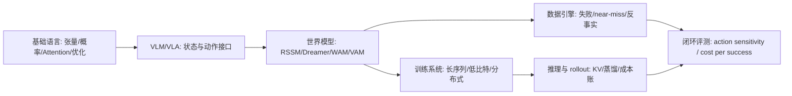

# 世界模型高效训练技术路线图

这页是全站的主线枢纽：**如何在有限真实交互、有限视频 token、有限 GPU-hour 和有限验证预算下，训练出对动作敏感、能长时 rollout、能改善决策的世界模型。**

它不是要替代基础知识、训练、推理、量化、算子、VLM/VLA 或具身智能章节。相反，这些章节都被放到同一条主线下：它们分别解决世界模型训练中的不同成本项。

!!! note "读法提醒"
    主线是世界模型高效训练，但这不是说其它内容不重要。基础知识提供公共语言，训练/推理/量化/算子提供工程能力，VLM/VLA 和具身智能提供状态、动作、数据和闭环场景。读的时候先抓主线，再按需要回到支撑专题补工具。

## 中心问题

一个面向决策的世界模型至少要回答：

\[
p_\theta(z_{t+1:t+H}, x_{t+1:t+H}, r, d, u \mid z_{\le t}, a_{t:t+H-1}, c)
\]

其中 \(z\) 是潜状态，\(x\) 是未来观测或视频，\(a\) 是动作，\(r\) 是奖励或任务进展，\(d\) 是终止/失败信号，\(u\) 是不确定性或风险。高效训练真正关心的不是公式本身，而是以下问题：

1. 真实交互能不能少一些。
2. 视频 token 和上下文长度能不能少一些。
3. 动作条件能不能更有效地进入模型。
4. 长时 rollout 能不能稳定又便宜。
5. 训练和推理能不能用更低显存、更低通信和更低延迟跑起来。
6. 评测能不能证明预测真的改善了决策。

## 七条效率轴

| 效率轴 | 省的是什么 | 核心技术 | 对应专题 |
| --- | --- | --- | --- |
| 数据效率 | 真实交互、人工标注、失败采集 | 示范数据、near-miss、失败回流、合成 rollout、数据门禁 | [世界模型数据引擎](data-engines-and-self-improvement.md)、[具身智能](../embodied-ai/index.md) |
| 表示效率 | 像素重建、视觉 token、长视频冗余 | VLM 连接器、视频 tokenizer、latent state、RSSM/JEPA | [VLM/VLA](../vlm/index.md)、[RSSM/Dreamer](rssm-dreamer-and-planning.md) |
| 动作效率 | 动作序列长度、条件无效、反事实样本浪费 | action token、动作 chunk、WAM/VAM、动作敏感评测 | [WM/WAM/VAM](wm-wam-vam-and-action-conditioned-modeling.md)、[VLA 专题](../vla/index.md) |
| 长序列效率 | attention 计算、显存、padding、通信 | sequence packing、block-causal mask、context parallel、MagiAttention | [训练](../training/index.md)、[MagiAttention](../paper-deep-dives/foundations/magiattention.md) |
| 数值效率 | 权重/激活/KV 显存、带宽、通信 payload | BF16、FP8、FP4/QAT、KV 量化、混合精度保护 | [低比特训练](../training/low-bit-training-and-numerics.md)、[量化](../quantization/index.md) |
| Rollout 效率 | 推理延迟、生成步数、KV 生命周期 | causalization、KV cache、few-step diffusion、DMD/consistency distillation | [推理](../inference/index.md)、[扩散蒸馏](../diffusion/consistency-models-and-rectified-flow.md) |
| 验证效率 | 无效 demo、人眼主观判断、线上试错 | action sensitivity、temporal consistency、risk calibration、cost per successful rollout | [世界模型评测](evaluation-and-failure-modes.md)、[多模态评测](../vlm/multimodal-evaluation-and-failure-modes.md) |

## 一条推荐学习路径

第一次读可以按这条线推进：

1. 先读 [世界模型路线图](index.md)，建立 state、action、rollout、planner 的基本接口。
2. 再读 [VLM/VLA 与世界模型高效训练接口](../vlm/vlm-vla-for-efficient-world-model-training.md)，理解视觉状态和动作数据从哪里来。
3. 接 [RSSM、Dreamer 与规划](rssm-dreamer-and-planning.md) 和 [WM/WAM/VAM](wm-wam-vam-and-action-conditioned-modeling.md)，分清 latent dynamics、视频未来预测和动作世界模型。
4. 进入 [世界模型数据引擎](data-engines-and-self-improvement.md)，看失败、near-miss、反事实和合成 rollout 如何降低真实交互成本。
5. 按瓶颈回到支撑专题：长序列看训练和算子，显存看量化，实时 rollout 看推理，闭环落地看具身智能。

## 支撑知识怎么保留

这个站不是只保留和世界模型直接相关的页面。保留基础和旁支内容有三个原因：

| 内容类型 | 为什么仍然重要 | 读法 |
| --- | --- | --- |
| 基础知识 | 没有张量、Attention、概率、优化、显存语言，后面每页都会变成硬背术语 | 卡住时回读，不需要一次刷完 |
| 通用训练/推理/量化/算子 | 世界模型最终也要用这些系统能力跑起来 | 带着瓶颈读，例如长序列、KV、FP8、profile |
| 扩散、VLM、强化学习、具身智能 | 它们分别提供生成、状态、策略、动作和闭环场景 | 只追问它们如何服务状态、动作、rollout 和评测 |
| 技术报告和论文专题 | 真实系统往往把多种技术混在一起 | 看效率贡献、证据和不可外推边界 |

换句话说，主线不是删掉旁支，而是给旁支一个阅读位置。

## 论文页统一追问

读任何论文专题时，都建议补这六个问题：

| 问题 | 目的 |
| --- | --- |
| 它节省了什么成本 | 数据、token、显存、通信、推理步数、验证成本还是人工成本 |
| 它改变了哪个接口 | 状态、动作、训练目标、attention mask、runtime、评测还是数据引擎 |
| 证据在哪里 | ablation、scaling、系统指标、闭环成功率还是只给 demo |
| 副作用是什么 | 质量掉点、延迟上升、数据污染、动作不敏感、维护复杂度 |
| 能不能接到世界模型 | 是否支持 action-conditioned rollout、长期一致性和闭环消费 |
| 应该读本站哪一页 | 回到对应主题页补背景，而不是孤立记论文名 |

## 标杆论文连接

| 论文/系统 | 效率贡献 | 读法 |
| --- | --- | --- |
| [DreamerV3](../paper-deep-dives/world-models/dreamerv3.md) | 用 latent imagined rollout 提升样本效率 | 看 RSSM/Dreamer 的内部模拟路线 |
| [LingBot-World](../paper-deep-dives/world-models/lingbot-world.md) | 从视频基础模型到实时交互世界模拟器 | 看数据、动作条件、因果化和少步蒸馏如何组合 |
| [MagiAttention](../paper-deep-dives/foundations/magiattention.md) | 解决超长上下文异构 mask 训练中的并行和通信瓶颈 | 看长视频/长上下文训练如何落到 CP、mask 和 kernel |
| [CausVid](../paper-deep-dives/diffusion/causvid.md) | 把视频扩散推向流式 causal rollout | 看视频生成模型如何服务实时世界模拟 |
| [π0.5](../paper-deep-dives/embodied-ai/pi05.md) | 把 web 语义、机器人数据和动作专家合到开放世界 VLA | 看 VLA 如何给世界模型提供动作和闭环信号 |

## 最小判断框架

一个新方法如果想进入这条主线，至少要回答：

1. 它是否让世界模型更少依赖真实交互。
2. 它是否减少视频 token、长序列或显存压力。
3. 它是否让未来预测对动作更敏感。
4. 它是否能被 policy、planner、risk module 或数据引擎消费。
5. 它是否有闭环指标，而不只是视觉 demo。

如果只能让生成视频更好看，却无法说明动作、成本和决策收益，它可以放在生成模型背景里，但还不能算世界模型高效训练的核心贡献。
