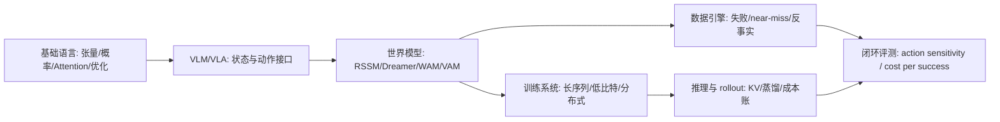

# 世界模型高效训练技术路线图

这页是全站的主线枢纽：**如何在有限真实交互、有限视频 token、有限 GPU-hour 和有限验证预算下，训练出对动作敏感、能长时 rollout、能改善决策的世界模型。**

它不是要替代基础知识、训练、推理、量化、算子、VLM/VLA 或具身智能章节。相反，这些章节都被放到同一条主线下：它们分别解决世界模型训练中的不同成本项。

!!! note "读法提醒"
    主线是世界模型高效训练，但这不是说其它内容不重要。基础知识提供公共语言，训练/推理/量化/算子提供工程能力，VLM/VLA 和具身智能提供状态、动作、数据和闭环场景。读的时候先抓主线，再按需要回到支撑专题补工具。

## 中心问题

一个面向决策的世界模型至少要回答：

\[
p_\theta(z_{t+1:t+H}, x_{t+1:t+H}, r, d, u \mid z_{\le t}, a_{t:t+H-1}, c)
\]

其中 \(z\) 是潜状态，\(x\) 是未来观测或视频，\(a\) 是动作，\(r\) 是奖励或任务进展，\(d\) 是终止/失败信号，\(u\) 是不确定性或风险。高效训练真正关心的不是公式本身，而是以下问题：

1. 真实交互能不能少一些。
2. 视频 token 和上下文长度能不能少一些。
3. 动作条件能不能更有效地进入模型。
4. 长时 rollout 能不能稳定又便宜。
5. 训练和推理能不能用更低显存、更低通信和更低延迟跑起来。
6. 评测能不能证明预测真的改善了决策。

## 七条效率轴

| 效率轴 | 省的是什么 | 核心技术 | 对应专题 |
| --- | --- | --- | --- |
| 数据效率 | 真实交互、人工标注、失败采集 | 示范数据、near-miss、失败回流、合成 rollout、数据门禁 | [世界模型数据引擎](data-engines-and-self-improvement.md)、[具身智能](../embodied-ai/index.md) |
| 表示效率 | 像素重建、视觉 token、长视频冗余 | VLM 连接器、视频 tokenizer、latent state、RSSM/JEPA | [VLM/VLA](../vlm/index.md)、[RSSM/Dreamer](rssm-dreamer-and-planning.md) |
| 动作效率 | 动作序列长度、条件无效、反事实样本浪费 | action token、动作 chunk、WAM/VAM、动作敏感评测 | [WM/WAM/VAM](wm-wam-vam-and-action-conditioned-modeling.md)、[VLA 专题](../vla/index.md) |
| 长序列效率 | attention 计算、显存、padding、通信 | sequence packing、block-causal mask、context parallel、MagiAttention | [训练](../training/index.md)、[MagiAttention](../paper-deep-dives/foundations/magiattention.md) |
| 数值效率 | 权重/激活/KV 显存、带宽、通信 payload | BF16、FP8、FP4/QAT、KV 量化、混合精度保护 | [低比特训练](../training/low-bit-training-and-numerics.md)、[量化](../quantization/index.md) |
| Rollout 效率 | 推理延迟、生成步数、KV 生命周期 | causalization、KV cache、few-step diffusion、DMD/consistency distillation | [推理](../inference/index.md)、[扩散蒸馏](../diffusion/consistency-models-and-rectified-flow.md) |
| 验证效率 | 无效 demo、人眼主观判断、线上试错 | action sensitivity、temporal consistency、risk calibration、cost per successful rollout | [世界模型评测](evaluation-and-failure-modes.md)、[多模态评测](../vlm/multimodal-evaluation-and-failure-modes.md) |

## 成本账：先把“高效”拆成可估算数字

读任何方法前，先不要急着问“是不是最新”。更稳的做法是把它放进同一张成本账：它到底减少了哪一项，是否把成本转移到了另一项。

| 成本项 | 粗略估算方式 | 常见放大因子 | 优先回看 |
| --- | --- | --- | --- |
| 真实交互 | 机器人小时数、环境重置次数、人工接管次数、失败回放时长 | reset 慢、长尾任务少、near-miss 没成桶 | [世界模型数据引擎](data-engines-and-self-improvement.md) |
| 视频 token | 相机数 \(\times\) 帧数 \(\times\) 每帧 patch/token 数 \(/\) 压缩率 | 多相机、长 horizon、高分辨率、无选择性 resampler | [视觉 Tokenizer](../vlm/visual-tokenizers-and-connectors.md) |
| 长序列训练 | 有效序列长度、padding 率、attention mask 复杂度、通信 payload | 变长轨迹、block mask、跨样本 packing、context parallel | [训练系统](../training/index.md)、[MagiAttention](../paper-deep-dives/foundations/magiattention.md) |
| 动作条件 | 动作频率 \(\times\) horizon / chunk size，动作和观测时间戳误差 | 高频控制、动作太细、坐标系不统一、动作记录延迟 | [动作表示与控制接口](../vla/action-representation-and-interfaces.md) |
| 数值显存 | 权重、激活、optimizer state、KV cache、通信 buffer 分别计算 | 低比特 kernel 未命中、敏感模块误压、KV 比权重更早爆 | [低比特训练](../training/low-bit-training-and-numerics.md)、[量化](../quantization/index.md) |
| Rollout 推理 | \(T_{\text{observe}}+T_{\text{encode}}+T_{\text{rollout}}+T_{\text{policy}}+T_{\text{control}}\) | 采样步数多、KV 生命周期长、长短请求混排、risk head 旁路慢 | [推理成本建模](../inference/cost-modeling-and-slo-design.md) |
| 闭环验证 | 场景桶数 \(\times\) rollout 次数 \(\times\) 重复实验 \(\times\) 人审/真机成本 | 只看 demo、没有反事实动作、失败样本不回流 | [世界模型评测](evaluation-and-failure-modes.md) |

一个方法如果说自己“高效”，至少要能填出：节省哪一项、增加哪一项、证据是什么、失败时怎么回滚。比如视觉 tokenizer 省 token，但可能丢接触状态；KV 量化省显存，但可能伤长时一致性；少步视频生成省 rollout 延迟，但可能让 action sensitivity 下降。

## 硬证据模块：每条主线都要能落到六格表

这页后面的所有“高效”判断，都应尽量收敛到同一套硬证据模块。它不是要求每页都做大型实验，而是要求读者能看清：这里是在解决哪项成本，有没有最小可复算例子，失败时会暴露什么，证据等级在哪里，边界是什么，验收指标是什么。

| 模块 | 必须回答 | 最小证据 | 更强证据 |
| --- | --- | --- | --- |
| 本页解决哪项成本 | 数据、token、显存、通信、rollout、验证中的哪一项 | 一张成本账 | 真实 step time / latency / GPU-hour 对比 |
| 最小可复算例子 | 输入数据、配置、输出和指标能否复跑 | fixture + 脚本 | 固定 checkpoint + 固定 seed + CI 回归 |
| 失败案例 | 这项技术会在哪类 hard case 上坏 | 一条 failure replay | 失败桶统计和人工复核 |
| 论文或日志证据 | 结论来自 benchmark、ablation、throughput、closed-loop 还是 demo | 明确证据等级 | 独立复现或线上灰度日志 |
| 反例和适用边界 | 什么时候收益会消失或变成风险 | 边界表 | 跨任务/跨硬件分桶结果 |
| 验收指标 | 怎么判定它真的服务世界模型 | action sensitivity、risk calibration、drift、cost per success | 闭环成功率和成本收益同时过门禁 |

本站的最小可复算样例放在 [动作条件视频世界模型端到端训练案例](action-conditioned-video-world-model-training-case.md) 的“可复算 mini-chain”小节。它用 `episodes.jsonl -> token stats -> training-config.yaml -> rollouts.jsonl -> eval_mini_chain.py` 串出一个小链路。它不是生产证据，但给出了页面应该追求的证据形状：读者不只看到“应该这样做”，还可以复算“这一页的指标从哪里来”。

## 算一遍：4 路相机、16 帧、32k context 的账

下面这个例子不是推荐配置，而是给“世界模型高效训练”一个数量级锚点。假设系统输入 `4` 路相机、每路 `16` 帧，视觉 encoder 用 `14x14` patch，主干上下文上限是 `32k` token，batch size 是 `16`，模型有 `32` 层、`32` 个 attention heads、GQA 下 `8` 个 KV heads，head dim 是 `128`。

{ width="920" }

<small>图源：[MagiAttention: A Distributed Attention System for Hyper-Scale Long Context Training](https://arxiv.org/abs/2506.09394)，Figure 4。原论文图意：不同样本和不同任务会产生异构 attention mask，长上下文训练的难点不只是序列长，还包括 mask 结构、负载均衡和通信调度。</small>

**第一步：视频 token 是否装得进上下文。**

| 单帧分辨率 | 每帧 patch token | 4 路相机 x 16 帧 token | 对 32k context 的含义 |
| --- | ---: | ---: | --- |
| `224x224` | `16x16 = 256` | `16,384` | 还能留下约 `16k` 给文本、状态、动作、历史和特殊 token |
| `336x518` | `24x37 = 888` | `56,832` | 已经超过 `32k`，必须做 resampler、ROI、降帧或压缩 |
| `448x448` | `32x32 = 1,024` | `65,536` | 只放视觉 token 就爆掉，更别说动作和语言 |

这说明多相机世界模型常见的第一个瓶颈不是“模型懂不懂视觉”，而是 token 入口就已经把 context 挤满。高效训练里的视觉 tokenizer、frame selector、query resampler 和 latent state，都是在解决这一步。

**第二步：KV cache 到底有多大。**

对自回归 rollout 来说，每层 KV cache 的近似大小是：

\[
M_{\text{KV, layer}} = B \times L \times 2 \times H_{\text{kv}} \times d_h \times \text{bytes}.
\]

代入 \(B=16, L=32768, H_{\text{kv}}=8, d_h=128\)：

| KV 设计 | 每层 KV | 32 层 KV | 和 FP16 GQA 比 |
| --- | ---: | ---: | ---: |
| GQA KV FP16/BF16 | `2 GiB` | `64 GiB` | `1.0x` |
| GQA KV INT8 | `1 GiB` | `32 GiB` | `0.5x` |
| 标准 MHA KV FP16/BF16 | `8 GiB` | `256 GiB` | `4.0x` |
| 标准 MHA KV INT8 | `4 GiB` | `128 GiB` | `2.0x` |

如果把 attention score 矩阵朴素 materialize，一层就是：

\[
16 \times 32 \times 32768^2 \times 2 \approx 1\ \text{TiB}.
\]

这也是为什么 FlashAttention、context parallel、MagiAttention 这类方法不是“锦上添花”。没有它们，score 矩阵和 KV 生命周期会先把显存、带宽和通信打爆。

**第三步：吞吐下限由 KV 读取决定。**

假设长上下文 decode 时，每生成一个 token 都要读完整历史 KV，且有效 HBM 带宽按 `3 TiB/s` 粗估：

| KV 路线 | 单步要读的 32 层 KV | 仅 KV 读取的理论下限 |
| --- | ---: | ---: |
| GQA KV FP16/BF16 | `64 GiB` | `20.8 ms/token` |
| GQA KV INT8 | `32 GiB` | `10.4 ms/token` |
| 标准 MHA KV FP16/BF16 | `256 GiB` | `83.3 ms/token` |
| 标准 MHA KV INT8 | `128 GiB` | `41.7 ms/token` |

真实系统还会叠加 layout、page miss、mask、GEMM、通信和调度开销，所以表里的数字只是乐观下限。但它足以说明一个关键事实：`KV INT8 + GQA` 不只是省显存，也会直接改变 rollout decode 的带宽下限；相反，如果 kernel 不成熟、scale 读取太碎或质量掉点明显，省下来的显存也可能被延迟和误差还回去。

!!! note "按问题链读这个例子"
    **症状**：4 路相机和长历史一接入，batch 开不上去，rollout token/s 下降。 
    **指标观察**：visual token 占掉 `16k` 到 `65k`，KV cache 从 `32 GiB` 到 `256 GiB` 摆动，朴素 score 矩阵一层可到 `1 TiB`。 
    **技术机制**：视觉 patch 决定 \(L\)，GQA/MLA/KV 量化决定 KV 宽度，FlashAttention/MagiAttention 决定 score 和 mask 是否能被高效调度。 
    **设计取舍**：压 token 会丢细节，压 KV 会引入数值误差，压 mask/packing 会增加系统复杂度。 
    **失败反例**：只把 KV 改成 INT8，却没有 fused kernel 和长上下文回归，可能显存下降但 token/s 不升，甚至长时一致性变差。 
    **适用边界**：这个账适合估算长上下文自回归 rollout；如果模型是 latent dynamics、短 horizon diffusion 或强 resampler VLM，瓶颈会从 KV 转到 latent decoder、采样步数或视觉压缩质量。

## 一条推荐学习路径

第一次读可以按这条线推进：

1. 先读 [世界模型路线图](index.md)，建立 state、action、rollout、planner 的基本接口。
2. 再读 [VLM/VLA 与世界模型高效训练接口](../vlm/vlm-vla-for-efficient-world-model-training.md)，理解视觉状态和动作数据从哪里来。
3. 接 [RSSM、Dreamer 与规划](rssm-dreamer-and-planning.md) 和 [WM/WAM/VAM](wm-wam-vam-and-action-conditioned-modeling.md)，分清 latent dynamics、视频未来预测和动作世界模型。
4. 进入 [世界模型数据引擎](data-engines-and-self-improvement.md)，看失败、near-miss、反事实和合成 rollout 如何降低真实交互成本。
5. 用 [动作条件视频世界模型端到端训练案例](action-conditioned-video-world-model-training-case.md) 把数据、动作、训练系统、推理和评测串成一条完整链路。
6. 按瓶颈回到支撑专题：长序列看训练和算子，显存看量化，实时 rollout 看推理，闭环落地看具身智能。

## 主线必读 12 页

如果读者只想抓住“世界模型高效训练技术”这一条主线，建议先把下面 12 页读成闭环。其它页面可以作为背景、查阅或论文扩展，不必一开始全刷。

| 顺序 | 页面 | 读完要能回答 |
| --- | --- | --- |
| 1 | [世界模型路线图](index.md) | 世界模型和普通视频生成、VLM、VLA 的边界在哪里 |
| 2 | [世界模型高效训练技术路线图](efficient-training-roadmap.md) | 高效训练到底省的是数据、token、显存、推理还是验证成本 |
| 3 | [VLM/VLA 与世界模型高效训练接口](../vlm/vlm-vla-for-efficient-world-model-training.md) | 状态、动作、失败回流和闭环验证分别从哪里来 |
| 4 | [视觉 Tokenizer、连接器与信息瓶颈](../vlm/visual-tokenizers-and-connectors.md) | 哪些视觉信息该保留，哪些 token 可以省 |
| 5 | [视频表征、状态记忆与长时序压缩](../vlm/video-representation-and-memory.md) | 视频如何从多帧图片变成可预测状态 |
| 6 | [动作表示与控制接口](../vla/action-representation-and-interfaces.md) | 动作粒度、坐标系、chunk 和控制器如何影响训练成本 |
| 7 | [RSSM、Dreamer 与规划](rssm-dreamer-and-planning.md) | latent imagined rollout 如何节省真实交互 |
| 8 | [WM / WAM / VAM 与动作条件建模](wm-wam-vam-and-action-conditioned-modeling.md) | 动作如何成为未来分叉的条件，而不只是策略输出 |
| 9 | [世界模型数据引擎与自我改进](data-engines-and-self-improvement.md) | near-miss、失败和反事实如何变成高价值训练数据 |
| 10 | [动作条件视频世界模型端到端训练案例](action-conditioned-video-world-model-training-case.md) | 一条训练链路如何从数据 schema 跑到闭环评测 |
| 11 | [推理成本建模与 SLO 设计](../inference/cost-modeling-and-slo-design.md) | rollout、KV、batch 和量化如何进入同一张请求成本账 |
| 12 | [世界模型评测与失效模式](evaluation-and-failure-modes.md) | 如何证明世界模型真的改善决策，而不只是生成好看未来 |

读完这 12 页后，再回到训练、推理、量化、算子和论文页，会更容易判断哪些内容是主线必需，哪些只是某个瓶颈下的工具。

## 支撑知识怎么保留

这个站不是只保留和世界模型直接相关的页面。保留基础和旁支内容有三个原因：

| 内容类型 | 为什么仍然重要 | 读法 |
| --- | --- | --- |
| 基础知识 | 没有张量、Attention、概率、优化、显存语言，后面每页都会变成硬背术语 | 卡住时回读，不需要一次刷完 |
| 通用训练/推理/量化/算子 | 世界模型最终也要用这些系统能力跑起来 | 带着瓶颈读，例如长序列、KV、FP8、profile |
| 扩散、VLM、强化学习、具身智能 | 它们分别提供生成、状态、策略、动作和闭环场景 | 只追问它们如何服务状态、动作、rollout 和评测 |
| 技术报告和论文专题 | 真实系统往往把多种技术混在一起 | 看效率贡献、证据和不可外推边界 |

换句话说，主线不是删掉旁支，而是给旁支一个阅读位置。

## 论文页统一追问

读任何论文专题时，都建议补这六个问题：

| 问题 | 目的 |
| --- | --- |
| 它节省了什么成本 | 数据、token、显存、通信、推理步数、验证成本还是人工成本 |
| 它改变了哪个接口 | 状态、动作、训练目标、attention mask、runtime、评测还是数据引擎 |
| 证据在哪里 | ablation、scaling、系统指标、闭环成功率还是只给 demo |
| 副作用是什么 | 质量掉点、延迟上升、数据污染、动作不敏感、维护复杂度 |
| 能不能接到世界模型 | 是否支持 action-conditioned rollout、长期一致性和闭环消费 |
| 应该读本站哪一页 | 回到对应主题页补背景，而不是孤立记论文名 |

## 标杆论文连接

| 论文/系统 | 效率贡献 | 读法 |
| --- | --- | --- |
| [DreamerV3](../paper-deep-dives/world-models/dreamerv3.md) | 用 latent imagined rollout 提升样本效率 | 看 RSSM/Dreamer 的内部模拟路线 |
| [LingBot-World](../paper-deep-dives/world-models/lingbot-world.md) | 从视频基础模型到实时交互世界模拟器 | 看数据、动作条件、因果化和少步蒸馏如何组合 |
| [MagiAttention](../paper-deep-dives/foundations/magiattention.md) | 解决超长上下文异构 mask 训练中的并行和通信瓶颈 | 看长视频/长上下文训练如何落到 CP、mask 和 kernel |
| [CausVid](../paper-deep-dives/diffusion/causvid.md) | 把视频扩散推向流式 causal rollout | 看视频生成模型如何服务实时世界模拟 |
| [π0.5](../paper-deep-dives/embodied-ai/pi05.md) | 把 web 语义、机器人数据和动作专家合到开放世界 VLA | 看 VLA 如何给世界模型提供动作和闭环信号 |

## 最小判断框架

一个新方法如果想进入这条主线，至少要回答：

1. 它是否让世界模型更少依赖真实交互。
2. 它是否减少视频 token、长序列或显存压力。
3. 它是否让未来预测对动作更敏感。
4. 它是否能被 policy、planner、risk module 或数据引擎消费。
5. 它是否有闭环指标，而不只是视觉 demo。

如果只能让生成视频更好看，却无法说明动作、成本和决策收益，它可以放在生成模型背景里，但还不能算世界模型高效训练的核心贡献。
