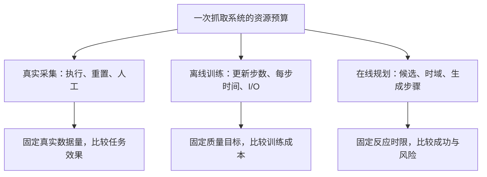
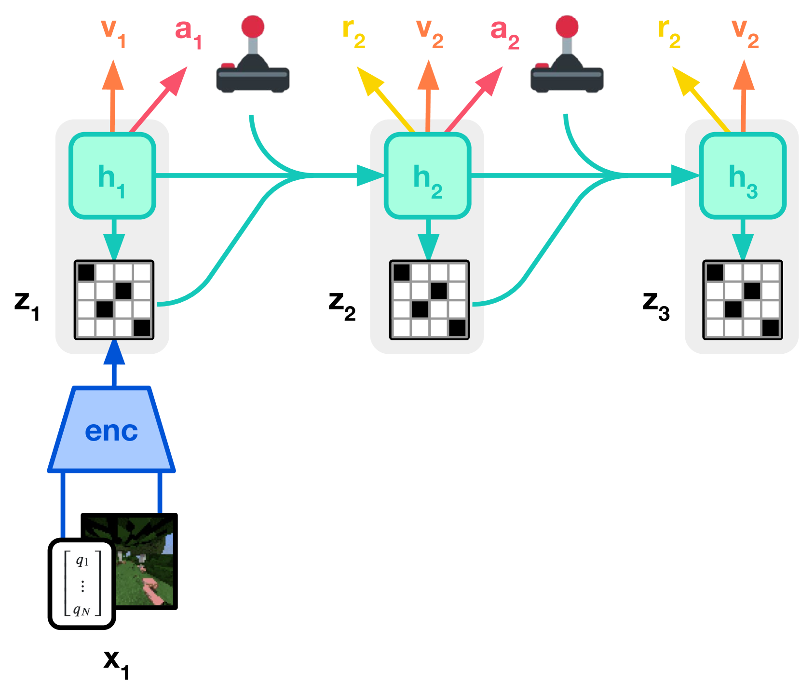
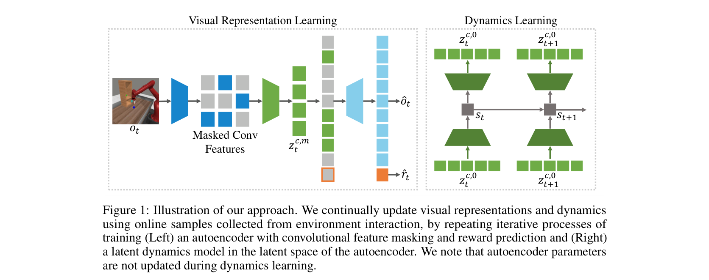
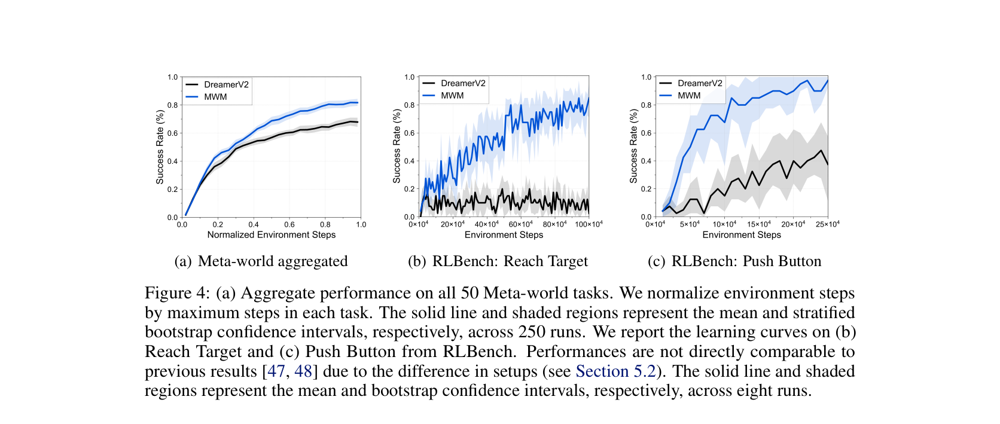
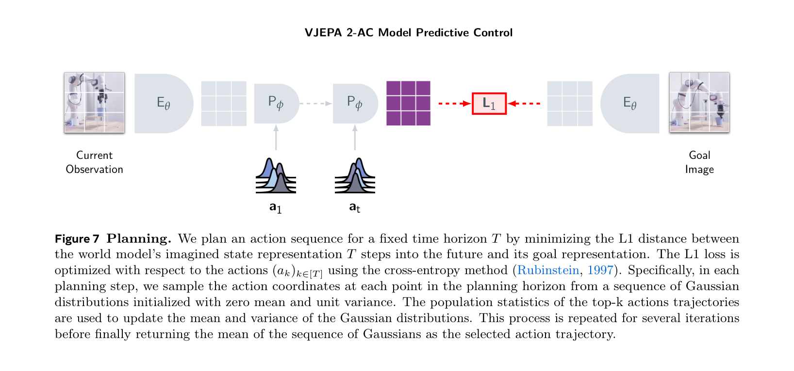
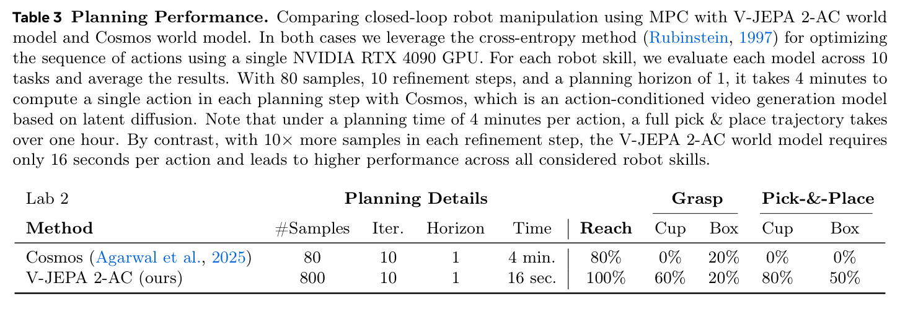
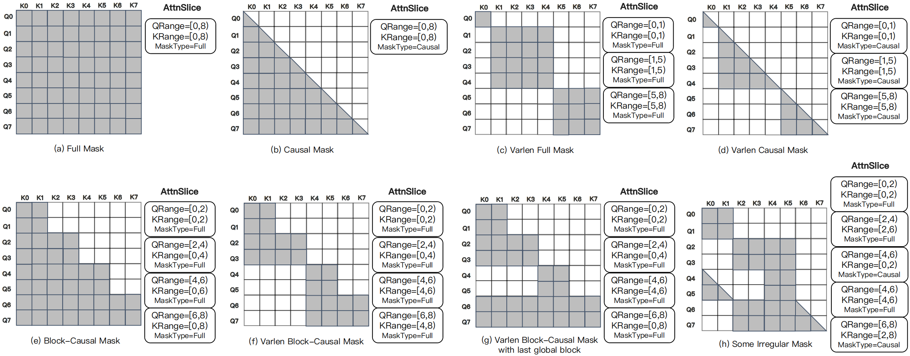

# 世界模型效率，先算清正在支付哪笔成本

一个抓取系统可能只有几小时真实机器人数据，却在 GPU 上训练几天；另一个系统模型已经训练好，但每次要给十六个候选动作预测未来，来不及等结果。两者都在讨论效率，真正受限的资源不同。选择 RSSM、masked prediction、压缩 token 或少步生成之前，应先把成本拆到具体使用过程。

本文继续使用桌边抓杯子的场景。所有时间算例都明示为假设，用于理解成本关系，不能当成论文测速。已有 fixture 的 token 数则可以[直接复算](world-model-efficient-training-experiment-report.md)。

## 真实交互时间和 GPU 时间不能混成一个数字

假设采集一次抓取需要 10 秒，失败重置另需 20 秒，且十分之一试验失败。平均每条轨迹占用 $10+0.1\times20=12$ 秒，采集 3000 条约需 10 小时机器人时间，尚未计人工标注与设备停顿。若仿真或想象减少真实试验需求，就可能节约这项成本。

训练成本却是另一笔账。模型每次更新耗时 $T_{\mathrm{step}}$，完成 $N$ 次更新，计算时间约为 $NT_{\mathrm{step}}$，还需加启动、评测、checkpoint 与故障恢复。减少真实交互可能伴随更多模型训练与搜索，两者应分别报告或按明确价格换算。

规划时又要按每次调用计量。$K$ 个候选、$H$ 个时间步、$S$ 个生成步骤会共同决定工作量，但并行批处理、缓存和模型结构使实际时间不必等于 $KHS$ 乘一个固定单步时间。需要用实际 shape 的 profile 验证。

沿每一列把成本与对应比较条件一起读。减少真实采集、缩短训练和降低规划延迟可以互相交换成本，不能合成一个没有单位的“效率提升”。

## 模型内想象节省的是哪些真实反馈

Dreamer 从真实 replay 推断状态，训练动力学、奖励与继续预测，再在想象轨迹上训练 actor/critic。策略的许多更新可以不等待新机器人动作，但模型偏差会随想象进入学习。

{ width="900" }

{ width="900" }

<small>图源：[DreamerV3](https://arxiv.org/abs/2301.04104)，world model learning 与 actor-critic learning。两张图对应不同数据来源与优化对象，不能把想象步数当作真实交互次数。</small>

对玻璃杯而言，若模型一直把快抓预测为稳定，更多想象训练可能更强化快抓。需要比较固定真实数据预算下的任务表现，并同时报告模型计算量。原始 [Dreamer](https://arxiv.org/abs/1912.01603) 的行为学习机制见 [RSSM 与 Dreamer](rssm-dreamer-and-planning.md)。

规划与 actor 学习也是两种成本分配。PlaNet 每次行动前在线搜索；Dreamer 把较多优化放进训练，执行时由 actor 直接给动作。哪种更适合取决于模型变化速度、任务目标和实时预算。

## 表征压缩只有穿过任务才有意义

Fixture 的原始 patch 总数 82368，压缩状态 token 总数 12292，比值约 6.70。这个比值没有包含 encoder/resampler 的运行时间，也没有测量杯沿是否仍可辨认。若视觉模块耗费总训练时间 60%，只把其余 40% 的时间加速两倍，总时间从 1 降到 $0.6+0.4/2=0.8$，整体只快 1.25 倍。这是串行分解假设下的 Amdahl 算例。

压缩目标也可改变。像素重建要求解释纹理、光照和背景，latent prediction 可以聚焦编码表征，但“重要信息”由训练目标和表示学习决定，不能预先假定它恰好就是接触状态。

{ width="920" }

{ width="920" }

<small>图源：[Masked World Models](https://arxiv.org/abs/2206.14244)，Figure 1 与 Figure 4。表示与动力学分工需要结合控制结果判断；原论文曲线不是任意压缩方法的保证。</small>

可以固定数据与训练更新数，比较不同 token 数或预测目标，分别记录 encoder 时间、dynamics 时间、状态 probe 与任务表现。若只改 token 数却同时扩了 batch，优化轨迹也变了，应说明比较回答的是同资源下系统效果，还是纯表示消融。

## 不解码视频，可以省什么，又失去什么

候选抓取只需要目标距离与事件概率时，可以在 latent 空间搜索，省去每个候选的像素 decoder。人审、视觉模拟和合成训练则可能仍需解码。一个模型的高效接口应匹配实际消费者，而非默认所有未来都要显示成视频。

{ width="920" }

{ width="920" }

<small>图源：[V-JEPA 2](https://arxiv.org/abs/2506.09985)，Figure 7 与 Table 3。动作条件表征与 MPC 相连，比较论文时间时应同时看模型、候选预算、任务和硬件设置。</small>

latent 距离也有代价。若表示主要编码背景，候选在特征空间接近目标却抓错物体，省掉 decoder 并未省掉任务错误。目标表征、距离函数与动作覆盖应一起验证，见[latent prediction](masked-jepa-and-latent-prediction.md)。

## 长序列优化从实际 mask 开始

多相机、变长 episode 和未来动作组成的 batch 往往有大量 padding。Packing 可以把有效片段放到同一批计算，但需要隔离 episode 并保留动作时序。若一个样本能读取另一个样本的未来，吞吐提升测量的是已经改变的问题。

{ width="920" }

<small>图源：[MagiAttention 文档](https://sandai-org.github.io/MagiAttention/docs/main/index.html)，mask pattern 示意。图提醒实现需要表达实际可见关系；它本身不能证明某个世界模型获得特定吞吐或质量收益。</small>

Activation checkpointing 减少保留的激活，代价是反向时重算；分片减少单卡模型状态，可能增加通信。若数据加载与 checkpoint I/O 占主要时间，只换 attention kernel 不会解决等待。Profile 应同时显示计算、通信、输入和保存，而不只显示单算子的最快结果。

## 用一次有界对照决定下一步

如果真实机器人时间紧张，优先比较固定真实数据下的策略效果；如果显存不足，测清参数、优化器、激活与缓存的各自占用；如果规划超时，拆开历史编码、候选分支、生成步骤、读出与排队。不同瓶颈需要不同实验。

报告最终可以同时写出“减少多少真实采集”“每次更新耗时怎样变化”“在给定时限内成功率怎样变化”。只有把任务定义和质量条件固定，数字才有可比性。具体候选机制可查[效率技术对照](efficiency-technique-coverage-matrix.md)，部署中的 cache 与 deadline 推导见[rollout 服务](rollout-serving-quantization-kernel-case.md)。
