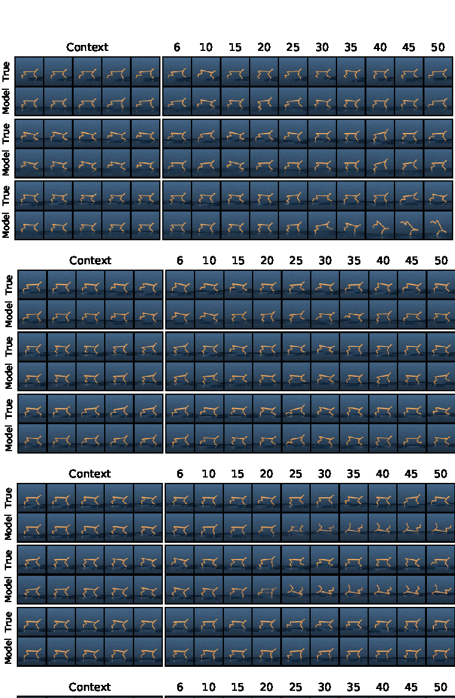

# 世界模型评测与失效模式

世界模型评测不能只看一步预测误差。一个模型可能生成很清晰的视频，却不能帮助规划；也可能短期 rollout 很准，但一接入闭环控制就被自己的误差放大。真正有用的评测应同时回答：模型是否学到世界结构、是否对动作和反事实敏感、是否能在闭环里提升决策、是否知道自己什么时候不可靠。

这页建议和 [世界模型路线图](index.md)、[生成式模拟与视频世界模型](generative-simulation-and-video.md)、[不确定性与风险敏感规划](uncertainty-and-risk-aware-planning.md) 一起读。总览页讲世界模型的定义，本页讲如何验收它是否可用。

!!! note "初学者先抓住"
    世界模型评测不能只看预测画面清不清楚。更关键的是：它是否对动作敏感，是否保留决策相关状态，接入 planner 后是否真的让任务变好。

!!! example "有趣例子：天气预报和出门决策"
    一张漂亮的云图不一定能帮你决定带不带伞。真正有用的天气模型要告诉你降雨概率、时间、地点和不确定性。世界模型也是这样：好看的未来不等于可规划的未来。

{ width="560" .atlas-figure-tall }

<small>图源：[Learning Latent Dynamics for Planning from Pixels](../paper-deep-dives/world-models/planet.md)，Figure 9。原论文图意：展示从真实历史出发的 open-loop latent dynamics 预测，随着 rollout 变长，模型必须在没有真实未来输入的情况下维持世界状态。</small>

!!! note "图解：open-loop 图要看漂移，不只看第一帧"
    这类图最容易被误读成“像不像视频”。正确读法是沿时间看：物体身份是否保持、空间布局是否漂移、关键任务变量是否还可读、误差是不是越滚越大。世界模型如果只在短 horizon 好看，接入 planner 后会把小误差放大成错误动作。

## 硬证据模块：评测页先看六道门

世界模型评测的最低要求，不是“给一个平均分”，而是把模型可能服务决策的每条路径都验一遍。一个可发布的评测报告至少要有下面六道门。

| 门禁 | 最小可复算例子 | 失败案例 | 证据等级 | 合格信号 |
| --- | --- | --- | --- | --- |
| Action sensitivity | 固定历史，替换 3-8 个动作候选，比较未来 latent / event / risk | 不同动作生成几乎一样的未来 | counterfactual benchmark / ablation | 动作排序和真实结果高度一致 |
| Latent drift | 从同一状态 open-loop rollout 到 2s/8s/30s | 目标物位置逐步漂移或身份重置 | horizon curve / replay | 漂移曲线可解释，关键状态不过阈值 |
| Risk calibration | hard-negative 桶计算 ECE、near-miss recall、false negative | 平均 ECE 好但滑落/碰撞桶漏报 | calibration eval | near-miss recall 不低于高精 baseline |
| Closed-loop gain | 接入 planner/policy，比较 success、recovery、collision | open-loop 好但策略利用模型漏洞 | closed-loop benchmark | 成功率提升且事故不升 |
| Cost per success | 统计 GPU 秒、真实交互、人工接管和成功任务数 | latency 降了但失败率上升 | system log + task eval | 成本下降不是靠牺牲安全换来 |
| Failure replay | 保存输入、动作候选、预测、真实结果和人工标签 | 只有总分，无法定位为什么错 | reproducible log | 任意失败都能回放和归因 |

本仓库的 mini-chain fixture 可以作为最小格式参考：它计算 `action_sensitivity_pass=3/4`、`top1_safe_success_agreement=2/4` 和两个 failure replay。这个结果本身是不合格的，恰好说明评测页的作用：不是证明模型强，而是尽早暴露“排序会选错动作”和“遮挡后对象身份漂移”这类世界模型特有风险。

## Claim Ledger

| Claim | Source | Evidence Type | Can Support | Cannot Prove |
| --- | --- | --- | --- | --- |
| Open-loop rollout 图只能说明模型能沿真实历史预测一段未来 | [PlaNet 专题](../paper-deep-dives/world-models/planet.md) | Paper Result | horizon drift 和状态保持是必要评测项 | open-loop 好就能 closed-loop 好 |
| Action sensitivity 是动作条件世界模型的最低门槛 | 本页评测框架 | Site Inference | 固定历史替换动作能暴露“平均未来”问题 | 单一反事实测试能覆盖所有风险 |
| Closed-loop gain 比视频质量更接近 world model utility | [RSSM/Dreamer](rssm-dreamer-and-planning.md) | Closed-loop | 接入 planner/policy 后的任务收益是强证据 | 闭环成功率一定能解释失败原因 |
| mini-chain 的失败回放是证据形状示例 | [端到端案例](action-conditioned-video-world-model-training-case.md) | Toy Fixture | 可复算日志应包含候选动作、预测、真实结果和失败标签 | 不是生产模型的性能证明 |

## 一、先分清评测对象：WM、WAM、VAM 不一样

世界模型至少有三层能力：先把历史观测压成足够充分的 belief 或 latent，再给定状态和动作合理预测未来，最后把这些预测用于规划、控制、探索、风险评估或数据回流。评测时也应沿着这三层往下追问，而不是只停在像素误差。

`WM / WAM / VAM` 的评测重点不同：

| 类型 | 应重点问什么 |
| --- | --- |
| `WM` | rollout 是否稳定，reward/risk/done 是否可读，imagined planning 是否提升决策 |
| `WAM` | 动作和世界是否被联合建模，动作生成是否从 world modeling 中获益 |
| `VAM` | 视频先验是否提升动作质量，视频 latent 是否有控制价值，视频分支成本是否值得 |

因此，评测前先写清模型定位。一个只服务离线视频反事实的模型，不应被要求满足高频控制预算；一个声称可用于规划的模型，也不能只汇报视频质量。

## 二、观测层和状态层：别把“看起来准”当成“可规划”

观测层评测包括一步预测、多步 rollout、视频质量和 horizon-conditioned 曲线。一步预测损失可写成：

$$
\mathcal{L}_{1\text{-step}}
=
\mathbb{E}[\ell(\hat{o}_{t+1}, o_{t+1})].
$$

多步误差更关键：

$$
\mathcal{L}_{\text{rollout}}(H)
=
\frac{1}{H}\sum_{h=1}^{H}
\mathbb{E}[\ell(\hat{o}_{t+h}, o_{t+h})].
$$

如果 $H=1$ 表现很好，但随着 horizon 变长快速恶化，说明模型只能做局部拟合，不能稳定推演。对机器人、自动驾驶和长任务 agent 来说，这种模型很容易在规划中偏航。

### 状态表示评测

隐藏状态 $s_t$ 应保留任务相关信息，同时避免记忆大量无关细节。可用代理任务检查目标位置、速度、接触、遮挡和对象状态能否被线性读出，未来 reward、done、constraint violation 能否被稳定预测，部分可观测环境中的 belief 是否一致，改变动作后状态演化是否合理变化，以及成功轨迹和失败轨迹的关键差异是否被保留下来。

视频质量指标如 FVD、PSNR、SSIM、LPIPS 只能说明一部分问题。世界模型最终要服务决策，清晰但平均化的未来可能比略粗糙但保留关键风险的未来更差。

## 三、决策层：Open-loop、Closed-loop 与反事实

世界模型最重要的指标之一，是接入规划或策略后能否提升累计回报：

$$
J(\pi_{\text{plan}})
=
\mathbb{E}\left[\sum_{t=0}^{T}\gamma^t r_t\right].
$$

但只报回报仍不够。评测必须区分 open-loop 和 closed-loop。

| 评测方式 | 优点 | 风险 |
| --- | --- | --- |
| Open-loop | 可离线大规模跑，指标清晰，可复现 | 始终靠近真实轨迹，不能暴露策略利用模型漏洞 |
| Closed-loop | 更接近真实部署，能暴露误差反馈 | 成本高，变量多，复现实验更难 |

很多世界模型 open-loop 好，closed-loop 差。原因是 closed-loop 会把模型错误反馈给后续输入，策略还会主动寻找模型中“看起来收益高”的漏洞。

!!! note "常见误区：open-loop 好就能闭环好"
    Open-loop 像让模型沿着真实历史轨迹补全未来，closed-loop 则是让模型的预测反过来影响下一步输入。前者更容易复现，后者更接近真实使用。世界模型一旦要服务规划，就必须检查策略是否会利用模型偏差，而不是只看离线 rollout 误差。

### 反事实评测应成为标配

如果模型声称理解动作后果，就必须测试反事实：固定历史替换动作时，未来应合理分叉；固定动作改变场景结构时，风险应随场景变化；在边界决策处，不同动作的未来排序应接近真实结果；模型还应能识别“更安全”和“更危险”的分支，并把动作敏感性集中在真正相关的状态变量上。

动作敏感性可概念化为：

$$
\Delta_{\text{act}} =
d(\hat{o}_{t+1:t+H}^{(a)}, \hat{o}_{t+1:t+H}^{(a')}).
$$

如果不同动作给出的未来几乎一样，模型再逼真也不适合控制。

## 四、风险、不确定性与长尾场景

高风险系统不能只看平均回报。世界模型必须在 near-miss、罕见遮挡、复杂接触、多主体交互、施工路段、突发横穿、透明/软体/反光物体等长尾场景中单独评测。

不确定性评测至少要看五件事：高不确定性是否对应更高真实误差，高风险预测是否对应更高失败率，预测区间是否覆盖真实未来，不同场景桶里的校准是否一致，以及不确定性升高时回退策略是否真的更保守。

只报一个 ECE 或平均 NLL 不够。模型可能在常规场景校准良好，但在稀有风险场景极度过度自信。对部署而言，后者更危险。

### Near-miss 应单独建桶

Near-miss 比真实事故更高频，也更适合回流训练。记录时不只保存视频片段，还要保留最小安全间距、接触或碰撞前的风险分数、模型是否提前预测危险、planner 是否因为模型低估风险而继续推进，以及回退或人工接管是否及时触发。

世界模型如果只拟合“常见正常情况”，在低概率危险事件上错误但自信，就不应进入高风险闭环。

### 一个评测样本怎么从日志变成门槛

以移动操作机器人“把杯子放进上层橱柜”为例，线上失败日志可能长这样：

```json
{
  "episode_id": "cabinet_place_0417",
  "scene_bucket": "new_kitchen_glossy_cabinet",
  "instruction": "put the mug on the top shelf",
  "action_a": "raise_arm_then_extend",
  "action_b": "step_closer_then_raise_arm",
  "real_outcome_a": "mug_hits_shelf_lip",
  "real_outcome_b": "success",
  "wm_pred_a": {"risk": 0.21, "future": "mug clears shelf"},
  "wm_pred_b": {"risk": 0.34, "future": "base moves closer"},
  "takeover": true
}
```

这条样本进入评测集前要变成四个判定任务，而不是只存一段失败视频：

| 判定任务 | 问题 | 通过标准 |
| --- | --- | --- |
| Open-loop state | 给定真实历史，未来关键状态是否保持 | 杯子、柜门、架沿位置可读，`H=3s` 内不漂移 |
| Counterfactual ranking | `action_a` 和 `action_b` 谁更安全 | 模型应把 `action_b` 排在 `action_a` 前面 |
| Risk calibration | 高风险动作是否高分 | `action_a` risk 应进入高风险分桶，而不是低于阈值 |
| Closed-loop guard | planner 依赖该预测时会不会被截停 | 若模型低估风险，安全层必须触发拒绝或人审 |

打分时不要只给一个总分。更稳的记录是：

| 指标 | 样本级观测 | 归因 |
| --- | --- | --- |
| `state_probe/cup_pose` | 预测误差 `4.8cm` | 状态表示不足，杯子高度漂移 |
| `counterfactual_order` | `a` 被错误排在 `b` 前 | 动作条件失败 |
| `risk_ece_bucket` | 低风险桶真实失败率过高 | 不确定性过度自信 |
| `planner_regret` | 选错动作导致接管 | 决策层失败 |

发布门槛可以因此写得很硬：

| 门槛 | 规则 |
| --- | --- |
| 高风险桶不退化 | near-miss / collision / human takeover 三个桶任一退化超过 `2%`，拒绝发布 |
| 反事实排序必须提升 | 目标任务桶 counterfactual ranking 至少提升 `5%`，否则不能声称“更懂动作后果” |
| 主分布不被牺牲 | 常规 pick-place success 下降超过 `1%`，需要单独审批 |
| 失败可回放 | 每个新失败必须能定位到状态、动作条件、风险或系统预算中的至少一类 |

这样评测才会从“视频像不像”变成“模型能不能支持更好的动作选择”。如果一个模型在这条样本上生成的视频更清晰，但仍然把 `raise_arm_then_extend` 判断为安全，它就没有通过世界模型评测。

## 五、典型失效模式

世界模型的 failure mode 最好按“修复动作”分类，而不是只写现象。

| 失效类型 | 现象 | 常见修复方向 |
| --- | --- | --- |
| 表示失败 | 小物体丢失、遮挡后失忆、接触状态不可读 | 改 tokenizer/latent、加辅助头、补关键状态标签 |
| 动力学失败 | 短期准、长期漂，多主体交互崩 | 多步训练、latent rollout 正则、真实 closed-loop 回归 |
| 动作条件失败 | 改动作未来不变，或动作影响方向错 | 反事实数据、动作注入方式、action-conditioned loss |
| 平均化未来 | 多模态未来被洗成均值 | 随机 latent、分支采样、扩散/token 生成 |
| 规划漏洞 | planner 找到模型里高回报但现实坏的动作 | adversarial planning test、模型不确定性惩罚、真实回放 |
| 部署失败 | 太慢、不可监控、无法回退 | 分层使用、低频分析、回退阈值、资源预算 |

{ width="920" }

<small>图源：[DreamZero](../paper-deep-dives/embodied-ai/dreamzero.md)，Figure 16。原论文图意：展示 video-action model 在特定视觉未来或动作计划上失败时，动作会沿着错误预测继续执行。</small>

!!! note "图解：WAM 的失败往往是“一致地错”"
    普通策略失败可能只是动作噪声；WAM 失败更危险的一点是，错误未来视频和错误动作可能相互支持，看起来像一条连贯计划。评测时要专门检查失败案例：视频未来错在哪里，动作是否跟着错，真实观测刷新后模型能不能纠正，以及 safety layer 是否能在执行前截停。

一个具体例子是机械臂抓取。模型可能生成“物体靠近夹爪”的画面，但没有学到摩擦、接触和夹爪闭合后的状态转移。视觉上没问题，反事实动作一测就暴露：轻微改变抓取角度后，未来仍然几乎不变。

## 六、评测流水线与发布门槛

世界模型验收建议分五层推进：观测层看一步、多步、视频质量和 horizon-conditioned 曲线；状态层看 reward、risk、done 可读性、belief consistency 和线性探测；决策层看 planning return、成功率、regret 和 closed-loop 表现；鲁棒层看长尾、near-miss、OOD、部分观测和长时任务；部署层看实时预算、回退条件、监控、人审和数据回流。

发布门槛不应写成一张论文榜单，而应写成验收单。模型定位必须说明是 `WM / WAM / VAM` 中哪一类，输入输出接口和部署环节要清楚，open-loop 与 closed-loop 指标都应过线，counterfactual sensitivity 需要专项测试，高风险桶中不能过度自信，实时性要满足目标环节预算，失败样本能进入数据回流，并且自动回退和人工接管条件已经定义。

### 人审也要结构化

人类评审仍然重要，但不能只问“看起来像不像”。更好的方式是按场景桶抽样，让评审者回答结构化问题：物理一致性、动作敏感性、风险可见性、长期稳定性、是否保留任务关键信息。

## 七、线上回流：评测不是一次性表格

一旦世界模型进入系统，评测就应变成持续回流。线上要记录高不确定性样本、预测与真实偏差大的片段、planner 依赖模型后失败的案例，以及 near-miss、人工接管和回退触发；随后把失败映射到表示、动力学、动作条件、规划或部署问题，并把高价值样本沉淀进专项评测桶和再训练数据。

最终判断很直接：一个世界模型如果不能在闭环里提升决策、识别风险、支持反事实或改善数据回流，那它还只是预测模型或生成模型；只有当它改变系统决策质量时，才算通过世界模型验收。
