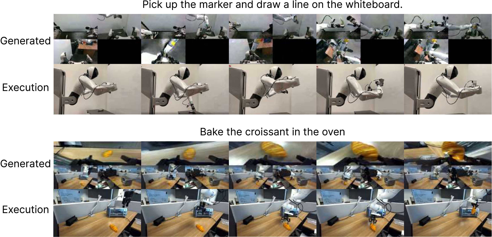

# 世界模型评测，从预测误差追到一次错误决策

假设一个模型预测玻璃杯被稳稳提起，planner 据此选择快抓，执行后杯子却滑落。仅看平均视频误差，很难知道是模型没看见接触松动、没学到滑落动力学，还是风险头没有读出危险。评测应沿着这次决策逐层取证。

本文以仓库的[候选抓取示例](world-model-efficient-training-experiment-report.md)为持续例子。它是手工数据，能展示计算与诊断；真实模型结论需要独立预测和执行结果。世界模型也可能服务视频生成、状态表征或人工分析，具体用途不同，验收对象随之变化。

## 先判断预测的东西是不是任务所需

快抓后的视频可能只有少量像素偏离真实画面，恰好这些像素是夹爪与杯沿的接触处；大面积桌面背景则预测得很好。全图平均误差会被背景稀释。若任务是判断杯子能否稳定提起，就还应观测对象位置、接触状态和滑落事件。

把预测误差写成 $\ell(\hat y,y)$，第一步需要定义 $y$。它可以是像素、编码表征、三维位置、事件或奖励。不同模型的 latent 坐标与尺度未必相同，未经对齐的 latent MSE 不能直接横向排名。

一步评测用真实当前状态预测下一步。多步 rollout 则连续把模型自己的状态送回输入。

\[
E(H)=\frac1H\sum_{h=1}^{H}\mathbb E\left[\ell(\hat y_{t+h},y_{t+h})\right].
\]

应同时看每个 horizon 的误差，而不只看平均。杯子在前七步都没滑、第八步突然掉落，前七步的准确可能掩盖最关键的终局。随机环境中，一条真实未来也不是唯一合法结果；用逐像素误差惩罚另一条合理分支，会混淆分布建模和单轨迹匹配。

## 换动作后有变化，只完成了一半检查

固定同一历史，分别输入 fast 和 slow，观察未来是否不同。如果完全一样，动作可能未进入有效计算路径；但有变化仍不足以证明预测正确。

Fixture 使用 `latent_delta_to_noop` 的最大值与阈值 8 比较，得到 3/4 通过。Fast 与 slow 的距离分别为 11.2、10.6，均超过阈值。这个测试没有规定差异对应什么变量，也没有确认方向。背景变化、反向位移或错误事件都可能产生大距离。

更有信息的对照是，在可重复初始条件下分别执行候选，比较杯子位移、接触、滑落以及它们的条件概率。若无法完全重置隐藏摩擦，需重复试验或记录不确定性。普通日志只观察了其中一个动作，不能把模型自己生成的另一个分支当独立反事实真值。

可以先做零动作、动作符号反转和幅度变化等结构测试，但它们也需要物理前提。杯子已经被障碍挡住时，推力翻倍未必使位移翻倍。测试的意义在于揭露具体违例，不是要求所有系统服从同一线性规则。

## 把候选分数交给真正会使用它的决策器

若 planner 按 $S=p_{\mathrm{success}}-p_{\mathrm{risk}}$ 排序，fast 得分 0.60、slow 得分 0.30，而独立结果为 fast 滑落、slow 成功，那么模型确实诱导了一次错误选择。此时重点已经从视频相似度转到选择后果。

三种常被混用的量应分开计算。

| 指标 | 需要的真值 | 回答的问题 |
| --- | --- | --- |
| top-1 安全成功率 | 被选动作的成功与风险标签 | 最后选中的方案有多常有效 |
| 排序相关性或成对准确率 | 多个候选的可比较结果 | 分数是否保持候选优劣关系 |
| decision regret | 选中动作和可行最优动作的任务价值 | 这次选错造成多大损失 |

Fixture 的 `top1_safe_success_agreement=2/4` 只属于第一项。它没有计算整组排名，也没有连续的真实任务价值。报告中的名称不能让数据承担它没有提供的信息。

候选生成器本身也会影响分数。只给模型三个很容易的候选，与让强 planner 专门搜索模型高估的动作，难度不同。评测应包含实际部署会搜索的分布，并保留简单策略或无模型基线。否则可能只证明了固定日志上的评分能力。

## 概率校准、危险漏报和任务失败分别是什么

风险校准讨论，在被预测为某个风险水平的一组样本中，事件频率是否相符。Fixture 的十一条低风险候选和一条中风险候选得到 ECE 约 0.103，详细计算见[报告](world-model-efficient-training-experiment-report.md)。这个总体值并没有阻止 fast 的滑落被低估。

更进一步，wrong target 标签表示任务失败，却可能没有安全违反。若 risk head 只预测碰撞或滑落，抓错对象属于 success head 与状态身份判断的问题。将所有失败塞进同一个风险标签，会使训练和解释都含糊。

部署阈值还引入召回与误报的取舍。例如在风险高于 0.25 时回退，fixture 中 slow 的 0.32 被拦截，fast 的 0.20 却获准通过。调阈值不能修复风险排序颠倒。需要先识别错误来自数据、读出还是动力学，再在独立数据上选阈值。

高风险桶样本少时，应报告计数与不确定性。某桶两次测试都无事故不能证明事故概率接近零；重新分桶也会改变 ECE。校准图和按任务细分的结果，比孤立的单一小数更可解释。

## 闭环会主动改变被评测的分布

Open-loop 中模型预测后不改变真实日志。Closed-loop 中 planner 依据预测行动，下一次输入由这次行动产生。若模型在某种极端抓法上高估，搜索器可能反复选择它，错误分布便被主动放大。更多搜索预算甚至可能让真实结果更差。

公平比较需要固定初始任务分布、控制周期和资源预算，或把差异明确报告。世界模型提高排序但增加 200 ms 延迟，也可能让移动目标错过；只展示成功视频则无法看见中途接管和恢复成本。

{ width="920" }

<small>图源：[DreamZero](https://arxiv.org/abs/2602.15922)，Figure 16 失败案例。联合生成的动作与视频可能在内部彼此一致，但外部执行仍可失败；原图属于论文设置，不是本页示例实测。</small>

一次完整任务应报告成功判据、失败次数、干预、恢复、时间与计算。辅助完成和全自主完成分别计数。模型生成步数、仿真步数和真实机器人时间也不能相加为同一种“交互量”。

## 评测集要按未来信息切分

随机把连续轨迹的帧打散到训练集和测试集，会让相邻画面同时出现在两边。模型可能只记住外观和短期速度，测试分数却看起来很高。至少要按 episode 切分，并根据问题再按对象、场景、动作组合或时间段做更严格的外推测试。

| 切分方式 | 适合回答的问题 | 常见泄漏 |
| --- | --- | --- |
| episode split | 对没见过的轨迹是否能预测 | 同一 episode 的帧跨集合 |
| object split | 对没见过的物体外观是否稳健 | 相同物体纹理出现在训练集 |
| dynamics split | 摩擦、质量或速度变化后是否稳健 | 变化只出现在标签不在输入的字段 |
| action-composition split | 未见过的动作组合能否规划 | 测试组合由训练中的完整片段组成 |

历史观测、动作和标签的时间截点也要固定。不能用未来帧生成的轨迹特征作为当前状态输入，再把结果称作在线预测。离线数据里尤其容易发生这种“看过答案再预测”的泄漏。

## 小样本分数要给不确定性

一组任务只有 20 个 episode 时，成功 18 次和 19 次的差别不能只写成两个百分比。对 episode 级指标，可以用 bootstrap 重采样得到置信区间；对稀有碰撞或滑落，至少同时报告事件计数、暴露时长和分母。

例如 20 个 episode 中发生 1 次滑落，点估计是 5%，但这并不等于真实风险已经精确到 5%。可以保存每次重采样的 top-1 成功率、regret 和安全事件率，再报告中位数与区间。不同模型必须使用同一组初始任务和同一随机种子集合，否则区间反映的可能是任务差异，而不是模型差异。

如果一个模型只在少数高风险任务上失败，平均分会掩盖重要差异。按对象类别、动作幅度、遮挡程度和场景难度分桶，并保留每桶的样本数。空桶不能写成零失败，样本不足也不应被自动解释为泛化成功。

## 反事实评测需要真实的动作后果

同一历史下同时测试 fast 和 slow，最好来自可重置的仿真或真实系统的独立重复，而不是把模型生成的视频当成另一条真值轨迹。若真实世界无法重置，可以使用历史中已经执行过的动作片段，但要明确这是 off-policy 评测，不能把未执行动作的结果填成确定标签。

一份反事实记录至少包含

```text
history_id: h_017
candidate_action: fast
source: simulator_reset_3
initial_state_hash: ...
outcome: slipped
outcome_time: 0.84 s
intervention: none
```

`source` 用来区分真实重置、仿真、日志回放和模型 rollout。它们的证据强度不同，不能汇总成一个没有来源标签的“反事实准确率”。

## 先写决策合同，再选择指标

评测前写清 planner 实际如何使用模型输出，指标才有意义。一个简单的决策合同可以是

```text
candidate_count: 8
selection: argmax(success - 2 * risk)
fallback: stop_if_all_risk_above_0.25
budget_ms: 200
success_definition: object placed and stable for 2 s
```

如果实际系统使用 `argmax`，只报告模型的平均预测误差不能证明排序正确；如果系统在风险都很高时会停止，报告“选择成功率”时要把停止和失败分开。改变风险权重或预算后，必须重新报告，因为这已经改变了决策问题。

决策合同还应记录候选是由谁生成的。模型在一个固定候选集上排名很好，不等于它能发现更好的候选。可以保留无模型启发式、随机候选和强规划器三种基线，说明性能来自预测、候选质量还是搜索预算。

## 如何用干预定位失败

对快抓滑落，可以先检查原视频与本体信号是否足以看出夹持不稳。若输入证据不存在，单纯扩大网络未必能解决，应考虑额外观测或表达不确定性。若证据存在，再用人工标定的接触状态替换编码器输出，观察后续预测是否改善；这能检验表示层的责任。

如果正确状态输入后仍预测稳定提起，可对照真实一步转移与多步预测，判断误差何时开始增长。若未来状态已显示滑落而最终 risk 很低，则需要检查风险标签、读出和时间窗口。替换某一模块后的变化只是诊断证据，最终组合仍需独立闭环验证。

这种定位方式把下一轮实验变得具体。为状态问题补观测，为动力学问题补动作覆盖，为读出问题修标签与校准，为系统问题查延迟和过期状态。它们各自需要不同数据，不能由一张“扩大规模、增加失败样本”的通用清单替代。开发中的完整例子见[从失败决定下一次实验](development-roadmap-data-simulation-and-evaluation.md)。

## 世界模型评测应沿决策链推进

先做一步预测，确定状态和动作接口没有错；再做多步 rollout，观察模型误差是否被自身反馈放大；随后让 planner 使用候选未来，检查排序是否与真实结果一致；最后才报告闭环任务成功。每一层的分母、候选分布和验证成本都应单独说明。

**来源与改编说明**：[Dreamer](https://arxiv.org/abs/1912.01603)提供想象轨迹训练策略的背景，[World Models](https://worldmodels.github.io/)提供早期 VAE/记忆/controller 的连贯示例。本文的 fixture 只验证计算和诊断路径，不能证明真实世界模型能力。自测时举一个一步误差很小但多步规划失败的案例，并指出应新增哪种独立观测。
