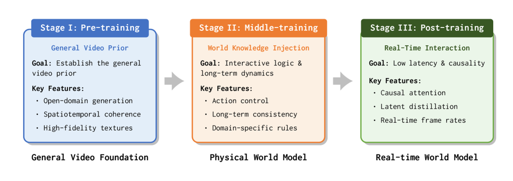
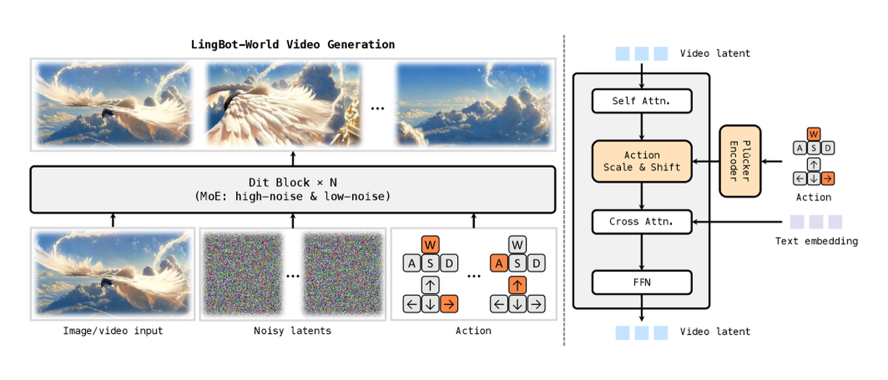
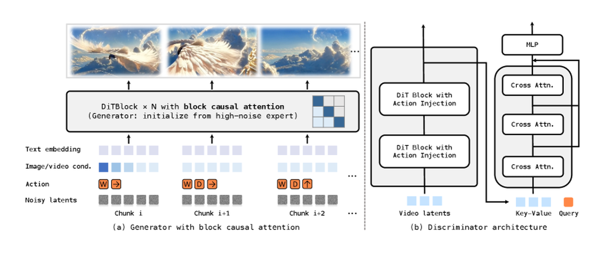

# 生成式模拟与视频世界模型

视频世界模型很容易被误读成“更强的视频生成”。但在世界模型语境里，它真正要回答的是：**给定历史、动作、目标和场景约束，未来是否会以可验证、可交互、可用于决策的方式演化。**

本页按四步讲：

1. 从视频生成底座开始。
2. 加入动作条件。
3. 改造成可交互 rollout。
4. 用评测门禁证明它不是只会生成好看视频。

!!! note "初学者先抓住"
    普通视频生成关心“看起来像未来”；视频世界模型还要关心“这个未来是否由动作造成、能否保持长时一致、能否帮助规划和风险判断”。

!!! example "行车记录仪和驾驶模拟器"
    行车记录仪能播放过去发生了什么；驾驶模拟器必须回答“我现在刹车、并线、加速，会发生什么”。视频世界模型要往后者靠。

## 1. 从视频生成到底缺什么

普通视频生成常建模：

$$
p_\theta(v_{t+1:t+H}\mid v_{\le t}, c)
$$

其中 \(v\) 是视频帧或视频 latent，\(c\) 是文本、图像、风格或场景条件。这个目标能学到视觉质量、物体外观和一般运动规律，但它还不是可规划世界模型。

视频世界模型至少要进一步建模：

$$
p_\theta(v_{t+1:t+H}, u_{t+1:t+H}
\mid v_{\le t}, a_{t:t+H-1}, c)
$$

这里 \(a\) 是动作，\(u\) 可以是风险、不确定性、可达性、碰撞或成功概率。核心变化是动作条件：固定同一段历史时，换动作应该换未来。

| 普通视频生成 | 视频世界模型 |
| --- | --- |
| 生成视觉上自然的未来 | 生成动作条件下的未来 |
| 可以只服务展示 | 要服务规划、风险、人审或数据回流 |
| 常离线生成 | 需要考虑交互延迟和 rollout 成本 |
| 评测偏视觉质量 | 评测还要看动作一致性和闭环收益 |

## 2. 路线一：先继承视频生成底座

大规模视频模型已经学到很多昂贵先验：物体外观、运动连续性、场景布局、光照和短中程时序。当前很多视频世界模型不是从零训练，而是在视频生成底座上继续训练动作、交互、长记忆和因果 rollout。

{ width="920" }

<small>图源：[Advancing Open-source World Models](https://arxiv.org/abs/2601.20540)，Figure 4。原论文图意：LingBot-World 从 foundation video generator 出发，经过 pre-training、middle-training 和 post-training，逐步获得通用视频先验、交互逻辑/长时动态和低延迟因果交互能力。</small>

!!! note "图解卡：为什么不是从零训练"
    **输入输出**：输入从通用视频数据逐步扩展到交互数据、控制信号和长序列；输出从普通视频续写逐步变成可交互模拟。<br>
    **关键模块**：video foundation model 提供视觉和时序先验，middle-training 注入交互和长时一致性，post-training 处理因果化和低延迟。<br>
    **公式对应**：从 \(p(v_{future}\mid v_{history},c)\) 走向 \(p(v_{future}\mid v_{history},a_{future},c)\)。<br>
    **容易误读**：继承视频底座不等于已经懂动作；动作数据、因果结构和评测门禁仍然是分水岭。

这类路线通常分三阶段：

| 阶段 | 训练重点 | 从视频模型到世界模型的变化 |
| --- | --- | --- |
| 视频基础模型 | 视觉质量、开放域语义、短中程时序 | 先学“世界看起来怎样” |
| 中程训练 | 真实视频、游戏录屏、合成轨迹、动作/相机控制 | 开始学习“动作如何改变未来” |
| 因果化与蒸馏 | 因果 attention、KV cache、少步生成 | 从离线长视频转向低延迟交互模拟 |

## 3. 路线二：动作条件进入模型内部

动作可以是键盘输入、相机轨迹、机器人关节动作、末端位姿、离散技能、语言子目标或工具调用。动作条件不是写在 prompt 里就够了，它必须能改变模型内部的生成路径。

{ width="920" }

<small>图源：[Advancing Open-source World Models](https://arxiv.org/abs/2601.20540)，Figure 5。原论文图意：左侧展示图像/视频、噪声 latent 和用户动作如何共同生成具备空间记忆、长时一致性和动作跟随的视频；右侧展示 DiT block 中 self-attention、Plucker action embedding、adaptive normalization 与 text cross-attention 的组织方式。</small>

!!! note "图解卡：动作条件要进模型内部"
    **输入输出**：输入是历史图像/视频、噪声 latent、文本和用户动作；输出是动作跟随的视频未来。<br>
    **关键模块**：action embedding、adaptive normalization、self-attention 和 text cross-attention 共同影响去噪路径。<br>
    **公式对应**：\(a_{t:t+H-1}\) 出现在条件里，而不是只作为生成后再解释的标签。<br>
    **容易误读**：如果动作只是弱 prompt，模型可能仍靠视频惯性生成平均未来；真正要验证的是反事实动作分叉。

动作条件的最小测试很简单：

```text
固定同一历史画面
  -> 给三组不同动作
  -> 检查未来视频、latent、风险和成功排序是否合理分叉
```

如果三组未来几乎一样，模型可能只是普通视频续写器。  
如果未来分叉合理，但不能被 planner 使用，它仍只是动作条件预测器。  
如果接入 planner 后成功率或风险控制变好，才进入世界模型证据层。

## 4. 路线三：从离线生成到可交互 rollout

普通视频生成可以整段视频一起生成；可交互世界模型必须逐步向前，持续接收用户或 agent 的动作，并保持环境一致性。这里会遇到 `train-test gap`：训练时模型可能看完整片段，推理时却只能看过去。

{ width="790" }

<small>图源：[Advancing Open-source World Models](https://arxiv.org/abs/2601.20540)，Figure 6。原论文图意：该图说明 causal generator adaptation 和 discriminator architecture；前者用 block causal attention 支持流式自回归生成，后者在长时训练中通过 GAN classification head 与 cross-attention 缓解累积漂移。</small>

!!! note "图解卡：因果化在解决什么"
    **输入输出**：输入从完整视频上下文变成只能依赖过去和当前 chunk 的流式上下文；输出是一段段向前滚动的视频。<br>
    **关键模块**：block causal attention、KV cache、长时 discriminator 和少步生成共同服务低延迟 rollout。<br>
    **公式对应**：推理时要近似 \(p(v_{t+1:t+H}\mid v_{\le t},a_{t:t+H-1},c)\)，不能偷看未来帧。<br>
    **容易误读**：能长视频生成不等于能交互；交互需要每一步动作都能改变后续 rollout。

在线使用时要分清三条链路：

| 链路 | 频率 | 适合输出 |
| --- | --- | --- |
| 高频控制 | 毫秒级 | 不适合昂贵视频采样，通常需要传统控制或轻量 policy |
| 中频规划 | 低 Hz 到数 Hz | latent rollout、低分辨率未来、风险排序 |
| 低频分析 | 离线或人审 | 高清视频、反事实回放、数据标注 |

视频解码不一定发生在控制主路径。主路径更需要的是哪个动作更安全、更可达、更可能完成任务。

## 5. 三种系统用法

### 5.1 在线规划

机器人可以对多条候选轨迹做短 horizon rollout，筛掉会碰撞、会滑落、会遮挡关键物体的动作。自动驾驶可以比较刹车、让行、变道的未来风险。

### 5.2 反事实与失败回放

真实危险事件稀有、采集成本高、复现困难。视频世界模型可以回答：如果当时慢一点、换一条路径、先移动另一个物体、不要执行某个工具调用，会不会避免失败。

### 5.3 数据引擎

模型可以生成相邻反事实、扩增长尾场景、辅助人工标注和错误归因。但合成数据不能直接信任，必须经过真实数据校准、failure replay 和 closed-loop evaluation。

## 6. 评测门禁：不要只看好看视频

| 评测层 | 关注点 | 最小问题 |
| --- | --- | --- |
| 视觉层 | 清晰、连续、物体不乱跳 | 看起来是否合理 |
| 动力学层 | 接触、遮挡、碰撞、速度 | 物体是否按动作后果变化 |
| 动作层 | 固定历史换动作 | 未来是否合理分叉 |
| 任务层 | 接入 planner/policy | 成功率、恢复率是否提升 |
| 风险层 | near-miss、碰撞、不确定性 | 危险未来是否被低估 |
| 系统层 | latency、显存、吞吐 | 是否能进入真实链路 |

如果方法声称是 VAM/WAM/视频世界模型，还应额外报告：

1. `action sensitivity`：不同动作是否改变未来。
2. `candidate ranking agreement`：预测最优动作是否和真实结果一致。
3. `temporal consistency`：长时 rollout 中对象身份、地图结构和目标状态是否保持。
4. `risk calibration`：危险未来是否被低估。
5. `cost per success`：增加 rollout 成本后，单位成功成本是否下降。

## 7. 常见失效模式

| 失败 | 表现 | 伤害 |
| --- | --- | --- |
| 视觉上对，动力学上错 | 画面自然但接触、摩擦、碰撞不对 | planner 选错动作 |
| 动作被历史惯性淹没 | 换动作后未来差异很小 | 反事实和规划失效 |
| 长时重造世界 | 地标、房间结构、物体身份漂移 | 数据回流污染策略 |
| 只生成平均未来 | 稀有危险分支被抹掉 | 风险低估 |
| 采样太慢 | 每个候选动作都要多步扩散 | 无法在线规划 |
| 自生成偏差回灌 | 合成数据越来越像模型自己 | 策略适应模拟器而非现实 |

## 8. 与 RSSM/JEPA/WAM 的关系

| 路线 | 这里如何连接 |
| --- | --- |
| RSSM / Dreamer | 提供“latent rollout 服务决策”的经典基线，提醒视频路线也要证明 planning utility |
| Masked / JEPA | 提供更省的表征和 token 接口，视频世界模型可只在需要时解码 |
| WM / WAM / VAM | 视频路线要说明动作是条件、输出还是联合变量 |
| 数据引擎 | 生成式模拟最有价值的输出常是反事实、失败回放和 hard negatives |
| 推理/量化 | 可交互 rollout 需要 KV cache、因果化、少步生成和低延迟系统 |

## 9. Claim Ledger

| Claim | Source | Evidence Type | Can Support | Cannot Prove |
| --- | --- | --- | --- | --- |
| 视频基础模型可作为世界模拟器的起点 | [LingBot-World 专题](../paper-deep-dives/world-models/lingbot-world.md) | Official / Paper Claim | 继续训练视频底座是可行工程路线 | 视频底座天然具备动作因果 |
| 动作条件必须进入模型内部并通过反事实验证 | 本页机制归纳 | Site Inference | 解释为什么 prompt 弱条件不够 | 不能替代具体系统的 closed-loop 证据 |
| 因果化、KV cache 和少步生成是交互 rollout 的关键系统问题 | [LingBot-World](https://arxiv.org/abs/2601.20540)、[CausVid](../paper-deep-dives/diffusion/causvid.md) | Paper / System Evidence | 视频 world model 需要低延迟流式推理 | 低延迟本身会提升规划质量 |

## 10. 落地清单

设计视频世界模型系统时，先填这张表：

| 问题 | 决策 |
| --- | --- |
| 输出服务谁 | 人审、数据增强、策略训练、在线规划、风险评估 |
| 动作表示是什么 | 连续控制、离散技能、相机轨迹、语言子目标、工具调用 |
| 主路径输出什么 | latent、低分辨率未来、风险分布、候选排序、高清视频 |
| 频率预算是多少 | 高频控制、中频规划、低频分析分别多快 |
| 评测门禁是什么 | action sensitivity、closed-loop success、risk calibration、latency |
| 合成数据怎么标记 | 来源、置信度、适用范围、失败桶、人工复核状态 |

最直接的判断是：如果一个视频世界模型不能让系统更好地选择动作、发现风险或构造有价值的反事实，那它还只是视频生成模型；只有当它改变规划、训练和数据回流决策时，才真正进入世界模型工程范畴。
