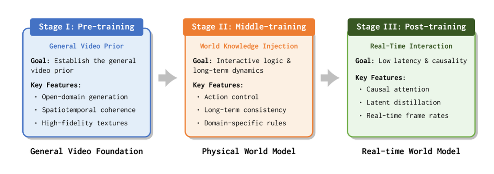
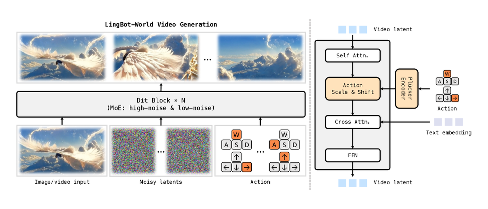
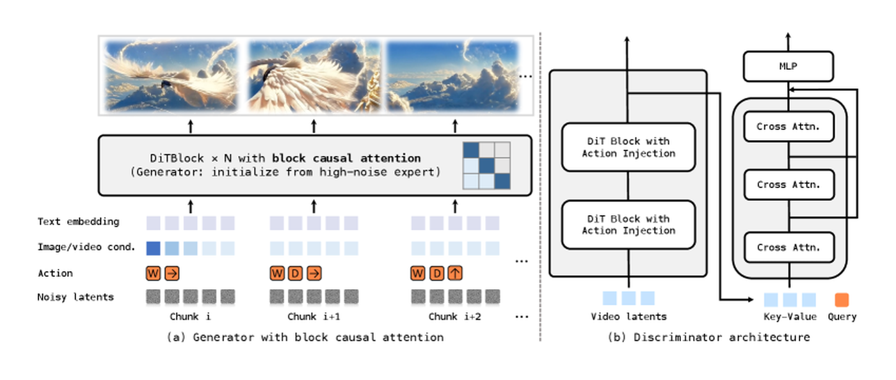

# 生成式模拟与视频世界模型

交互场景里，桌上有一只红杯子。用户转身走向门口，随后转回来，杯子应该仍在原来的桌上；如果途中伸手把它推到边缘，返回时还应看到这个动作留下的变化。视频生成器需要连续产生画面，交互模型还要接收新动作并维持已有状态。两者可以共享视觉底座，但训练掩码、动作时间对齐和缓存有效条件会改变。

## 环境时间与生成时间先分开

令 $t$ 表示环境帧时间，$\tau$ 表示扩散或 flow 采样时间。一次生成未来四帧，可能对同一组未来 latent 运行多次去噪。去噪步数减少不等于环境推进更少，也不改变动作每隔多久生效。

普通条件视频模型写作 $p(v_{t+1:t+H}\mid v_{\le t},g)$；动作条件模型写作

\[
p_\theta(v_{t+1:t+H}\mid v_{\le t},a_{t:t+H-1},g).
\]

模型可以通过 action token、cross-attention 或调制层注入动作。但接口中出现动作张量，只能说明模型有机会使用动作，不能证明训练后一定响应动作。需要固定相同起点与随机种子，替换动作并检查任务变量变化，而不是只比较像素差异。

## 转身过程中，模型到底承诺保留什么

假设一秒生成十帧，用户转身两秒，杯子有二十帧完全不可见。逐帧外观一致并没有为杯子的位置提供监督，因为它不在画面中。返回时模型可能重新生成一只外观合理的杯子，却放错位置。需要保存的状态包括物体身份、离开前位置，以及遮挡期间是否发生能改变它的事件。

如果场景中只有相机转动，几何记忆可以约束返回画面；如果桌子会被其他人推动，还要表达未观测事件的不确定性。把杯子永远固定在原位与每次随机重画，都会在不同情形失效。评测应分别包含静态返回、用户已移动物体、外部事件可能发生的返回，不能用一段流畅短片同时证明三者。

## 视频底座与交互适配分别学什么

视频预训练提供外观与运动先验，动作数据再约束“给定控制会怎样”，因果适配与蒸馏则处理在线生成的输入分布和成本。[LingBot-World](https://arxiv.org/abs/2601.20540)在原论文中区分 pre-training、middle-training 与 post-training，可用来阅读这些责任如何拆开。

{ width="920" }

<small>图源：Advancing Open-source World Models，Figure 4，训练阶段示意。</small>

{ width="920" }

<small>图源：同上，Figure 5，输入条件与生成系统示意。</small>

共享视频底座不保证接触动力学正确。互联网视频多为观察数据，动作与后果之间可能含隐藏变量；机器人或相机控制数据还需要单位、坐标系和执行时长。条件建模的因果边界见 [WM/WAM/VAM 接口](wm-wam-vam-and-action-conditioned-modeling.md)。

## Chunk causal attention 限制哪些信息

假设每块生成四帧。Block-causal 模型可允许同一块中的 noisy token 相互注意，但禁止当前块读取以后块的真实内容；已经生成的过去块提供上下文。下一动作到达后，后续块根据这个新输入继续生成。

如果训练当前块时能看到未来真实帧，在线推理却只能看到过去，模型可能利用泄漏信息得到很低训练 loss。Teacher-forced 的真实历史与在线滚动的生成历史也存在差异，后续 rollout 评测必须让模型消费自己的输出。

{ width="790" }

<small>图源：LingBot-World，Figure 6，因果适配相关结构。</small>

缓存也取决于计算图。对已经固定且不会受后续输入影响的过去 token，可以考虑复用 K/V；对双向模型中会随未来变化的过去表示，或依赖当前去噪时间的状态，不能默认跨步复用。改换动作分支时，分叉之前的共同前缀可能共享，分叉之后的状态必须各自维护。视频缓存的更多条件见 [Serving 案例](rollout-serving-quantization-kernel-case.md)。

## 交互成本为什么随候选数增长

教学系统用 32 条动作候选，每条预测 8 块，每块 4 次网络采样。忽略共享与批处理时，共有 $32\times8\times4=1024$ 次“候选块前向”的计算量。减少采样步数至 2 可将这一部分减半，但编码、候选评分和解码没有必然同比减少。

若 planner 只需要终点 latent 和碰撞概率，逐候选解码高清视频可能浪费关键路径预算。可以让控制路径使用 latent 和任务头，人审时再解码选中的少数轨迹。这样改变了输出用途，需要分别报告控制延迟与可视化延迟。

[CausVid](https://arxiv.org/abs/2412.07772)研究因果视频生成与少步采样，相关视频机制见[视频扩散](../diffusion/video-and-multimodal-diffusion.md)。其视觉生成结果不能直接作为动作规划收益的证据。

## 一个交互环境还需要什么

模型需要定义 reset、step、动作频率、状态保存、终止原因与随机种子。对红杯子例子，reset 应恢复约定初始场景，step 应按动作持续时间推进，保存再恢复状态后应延续同一条件分支。若转身后物体身份被重新生成，短视频可以连贯，环境记忆却不成立。若改变动作后只有背景纹理改变，像素差异很大，动作语义仍可能无效。

评测可以分别检查固定动作序列下的多步误差、相同起点不同动作的后果、回看同一地标的状态一致性、风险事件校准以及 agent 使用后的任务成功。可交互产品入口包括 [Genie](https://deepmind.google/models/genie/) 与 [Cosmos](https://www.nvidia.com/en-us/ai/cosmos/)，其展示能力与当前任务所需的控制接口应分别核对。[Towards Video World Models](https://www.xunhuang.me/blogs/world_model.html)提供路线整理，具体数据门槛见[合成 rollout](simulators-counterfactuals-and-synthetic-rollouts.md)。

## Teacher forcing 与在线 rollout 要分开报告

训练时，模型常常读取真实历史帧 $o_{t-k:t}$；在线滚动时，第 $t+1$ 步读到的可能是自己在第 $t$ 步生成的帧。若每一步预测误差很小，误差仍可能在长序列中累积，形成 rollout gap。一个最小对照是：

| 评测模式 | 历史输入 | 主要回答的问题 |
| --- | --- | --- |
| 一步 teacher-forced | 真实历史 + 真实动作 | 局部预测是否贴近数据 |
| 多步 teacher-forced | 每步都重置为真实历史 | 误差是否来自 horizon，而非输入漂移 |
| 多步 free-running | 消费自身生成结果 | 误差是否会积累并破坏状态 |
| 动作反事实 rollout | 相同起点，替换动作序列 | 是否真正响应动作条件 |

四种模式的随机种子、初始帧和动作必须对应。只报告第一种模式，不能推出模型可以作为环境使用。对于视频指标，还应把像素相似度与事件指标分开，例如杯子是否越过桌边、夹爪是否接触目标、物体身份是否在遮挡后保持一致。

## 用干预矩阵检查动作响应

对每个动作维度先构造小规模干预矩阵。固定起点 $s_0$ 和相同随机种子，运行“无动作”“正向动作”“反向动作”三组，再记录目标状态变化：

| 干预 | 预期可观察变化 | 需要防止的替代解释 |
| --- | --- | --- |
| 夹爪闭合 / 保持 | 接触事件或夹持距离变化 | 物体只是因为目标文字先验而移动 |
| 末端向左 / 向右 | 物体或末端相对位置方向相反 | 相机视角变化造成像素差异 |
| 延长动作持续时间 | 位移或接触时间增加 | 模型只改变视频速度，不改变状态 |

将每个结果写成事件标签和置信度，而不是只保存视频。若动作响应在短 horizon 成立、长 horizon 消失，应标记可用时间范围；planner 不应把超出范围的预测当成可靠代价。

## 缓存和分支必须有状态版本

交互模型可以把过去上下文编码成 latent 或 K/V cache，但缓存并不等于环境状态。每个缓存对象至少需要记录：

```text
state_id, parent_state_id, action_prefix_hash,
observation_time, diffusion_step, model_commit, rng_seed
```

候选动作在同一个 `parent_state_id` 上分叉时，分叉前的表示可能共享；一旦某候选修改了动作、观测或去噪时间，后续状态必须建立新的版本。恢复检查应比较“从保存状态继续生成”和“从头重放相同前缀”的事件标签、随机数和延迟。如果两者只在像素纹理上相似，却在物体身份或碰撞事件上不同，缓存不能用于规划。

## 最小闭环验收顺序

先在可重置的小环境里完成四步：

1. 记录固定轨迹，验证 `reset → step → save → restore` 后状态可复现。
2. 用真实历史做一步和多步 teacher-forced 评测，建立局部误差基线。
3. 切到 free-running，加入相同起点不同动作的反事实矩阵，统计事件召回和校准误差。
4. 最后才接入 planner，比较模型建议动作与真实执行结果，并记录人工接管和超时。

这条顺序将“生成得像”“能维持状态”“能回答动作后果”“能帮助控制”拆成四个可被否证的主张。每一步都应保留失败样本，不能只上传成功视频。

## 模型和实验依据

动作条件视频的接口参考 [CausVid](https://arxiv.org/abs/2412.07772)、[LingBot-World](https://arxiv.org/abs/2601.20540) 和[视频世界模型分类](https://www.xunhuang.me/blogs/world_model.html)，缓存版本、动作分叉和闭环验收是本站按部署问题整理的实验协议。红杯子、四帧未来、环境时间与采样时间的区分是教学场景，不是某个生成模型的物理准确性结果。

最小反事实矩阵固定历史、随机种子和模型版本，只交换一个动作，再对位置、接触、碰撞和身份事件做标签。若输出只在像素纹理上变化，不能写成模型已经理解动作；若从保存 cache 继续与从头重放不一致，先暂停规划集成。
