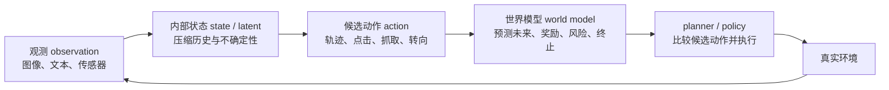

# 世界模型路线图

<div class="atlas-hero">
  <div class="atlas-kicker">World Models</div>
  <p class="atlas-lead">从“看见当前世界”走向“预测动作后果”：本专题按初学者可读的顺序串起 state、action、latent rollout、RSSM/Dreamer、JEPA、WAM/VAM、视频世界模型、风险规划和数据闭环。</p>
  <div class="atlas-chip-row">
    <span class="atlas-chip">从零入门</span>
    <span class="atlas-chip">RSSM / Dreamer</span>
    <span class="atlas-chip">Masked / JEPA</span>
    <span class="atlas-chip">WAM / VAM</span>
    <span class="atlas-chip">视频模拟</span>
  </div>
</div>

!!! note "读法定位"
    这页先回答“世界模型路线图”在「世界模型」里的位置：它解决什么局部问题，依赖哪些前置，最后会影响哪类工程或研究判断。
    **前置**：先知道潜变量、时序预测、VLM/VLA 与训练效率；再看具体论文和工程案例。 必要时先看本页路线，或回 [基础知识](../foundations/index.md) 或 [术语表](../glossary/index.md)。
    **主线关系**：把表征预测、潜变量动力学、规划、rollout 服务和具身/视频应用连成“可模拟、可评估、可行动”的主线。

!!! tip "第一次读的顺序"
    先读 [从零理解世界模型](beginner-world-models-primer.md)，再回到本页。那页负责解释 \(x_t/o_t\)、\(s_t\)、\(z_t\)、\(h_t\)、\(a_t\)、\(r_t\)、\(d_t/c_t\)、\(p_\theta\)、\(q_\phi\)、\(\pi_\psi\)、\(V_\eta\) 等符号；本页负责把这些符号接到完整路线图。

!!! warning "最常见误区"
    会生成未来视频，不等于拥有可规划世界模型。关键要看动作是否真正改变未来、预测是否能被 planner / policy / risk checker 消费、接入闭环后是否改善成功率或风险控制。

## 先看一个智能体循环

世界模型不是孤立模型，而是智能体循环中的“内部沙盘”。



这张图给出本专题的主轴：世界模型要回答“如果现在做动作 \(a_t\)，未来 \(t+1:t+H\) 会怎样”，并把结果交给下游系统使用。它不是只预测当前画面，也不是只输出动作。

一个面向决策的最小形式可以写成：

$$
p_\theta(z_{t+1:t+H}, x_{t+1:t+H}, r, d, u \mid z_{\le t}, a_{t:t+H-1}, c)
$$

其中 \(z\) 是潜状态，\(x\) 是观测或视频，\(a\) 是动作，\(r\) 是奖励或任务进展，\(d\) 是终止/失败，\(u\) 是不确定性或风险，\(c\) 是语言、地图、目标图像、场景结构等上下文。初学者不用一口气记住这个式子，只要抓住：**状态 + 动作 -> 未来 + 可决策信号**。

## 世界模型回答什么问题

| 问题 | 如果答得好 | 如果答不好 |
| --- | --- | --- |
| 当前状态是什么 | latent 保留物体、速度、遮挡、任务阶段 | 只记住纹理和背景，丢掉接触/风险 |
| 动作会改变什么 | 不同动作产生可区分未来 | 模型只顺着视频惯性续写 |
| 未来能滚多远 | 短 horizon 可靠，长 horizon 有边界 | rollout 漂移后还自信输出 |
| 预测被谁使用 | planner、policy、risk checker 或数据引擎消费 | 只给人看 demo，无法改变决策 |
| 成本是否可承受 | latent rollout、KV cache、低比特、少步生成可部署 | 每个候选动作都要昂贵视频采样 |

对机器人来说，它要预测抓取是否稳定、杯子是否滑动、夹爪是否会撞到桌沿。对自动驾驶来说，它要预测变道、刹车、让行会怎样改变周围车辆和风险。对网页或工具 agent 来说，它要预测点击、提交、调用 API 后系统状态怎么变。

## 三个基础概念

### 3.1 观测、状态和 latent

`observation` 是看到的表面，`state` 是足以预测未来的真实局面，`latent` 是模型学到的压缩表示。真实世界经常部分可观测：单帧图像看不到速度、接触力、遮挡物体和任务历史，所以世界模型通常需要记忆 \(h_t\) 与潜状态 \(z_t\)。

### 3.2 动作条件

动作 \(a_t\) 是世界模型和普通视频续写的分水岭。没有动作条件，模型只能预测“可能自然发生什么”；有动作条件，模型才开始回答“如果我这样做，会发生什么”。工程验收时要固定同一历史，替换多个动作，看未来、风险和成功排序是否合理分叉。

### 3.3 Rollout 和消费方

`rollout` 是从当前状态出发向未来展开。它可以在 latent space 中发生，也可以解码成视频。世界模型的输出必须被某个模块消费：

| 消费方 | 需要世界模型提供什么 |
| --- | --- |
| Planner / MPC | 候选动作的未来状态、风险、成功排序 |
| Policy / Actor | imagined trajectory、reward、value target |
| Risk checker | near-miss、碰撞、失败概率、不确定性 |
| Data engine | hard negative、失败回放、反事实样本 |
| 人类审查 | 可视化未来、错误归因、数据标注线索 |

## 一张 taxonomy 图先建立方位

{ width="900" }

<small>图源：[Towards Video World Models](https://www.xunhuang.me/blogs/world_model.html)，Figure 2。原文图意：把 world model 分成 internal world model 与 external world simulation model，并把 JEPA、Video World Model、Simulation Platforms、Neural 3D/4D 等路线放到同一张 taxonomy 中。</small>

!!! note "图解卡：internal 和 external"
    **输入输出**：internal 路线通常输出 latent、reward、risk 或 value；external 路线更强调生成可观察、可交互、可检查的视频或模拟环境。<br>
    **关键模块**：Dreamer/RSSM 更靠近内部决策接口，Genie/LingBot-World/Cosmos 更靠近外部生成式模拟接口。<br>
    **公式对应**：internal 常先看 \(p(z_{t+1}\mid z_t,a_t)\)，external 常先看 \(p(x_{t+1:t+H}\mid x_{\le t},a_{t:t+H-1},c)\)。<br>
    **容易误读**：两类不是高低关系，而是服务位置不同；真实系统常把二者组合起来。

## 方法谱系：按学习顺序读

### 5.1 RSSM / Dreamer：经典 latent dynamics

这条线从交互轨迹出发，学习 \(p(z_{t+1}\mid z_t,a_t)\)、reward 和 continue，再在 latent space 里 imagined rollout。它最适合建立“世界模型如何减少真实试错”的直觉。

{ width="860" }

<small>图源：[Learning Latent Dynamics for Planning from Pixels](https://arxiv.org/abs/1811.04551)，Figure 2。原论文图意：比较 RNN、SSM 和 RSSM 三种 latent dynamics 结构；RSSM 同时保留 deterministic hidden state 和 stochastic state。</small>

!!! note "图解卡：为什么先学 RSSM"
    **输入输出**：历史动作和观测被编码成 \(h_t,z_t\)，模型预测下一 latent、观测和奖励。<br>
    **关键模块**：\(h_t\) 记历史，\(z_t\) 表达当前不确定性，prior 用于没有未来观测时 rollout，posterior 用真实观测校正 belief。<br>
    **公式对应**：\(h_t=f_\theta(h_{t-1},z_{t-1},a_{t-1})\)，\(p_\theta(z_t\mid h_t)\)，\(q_\phi(z_t\mid h_t,x_t)\)。<br>
    **容易误读**：它不追求高清未来视频，而是追求能服务规划和策略学习的紧凑动态模型。

入口页：[RSSM、Dreamer 与规划](rssm-dreamer-and-planning.md)。

### 5.2 Masked / JEPA：先学更省的状态表示

这条线不急着预测像素，而是预测 masked latent 或 target embedding。它回答的是：怎样避免把训练容量浪费在纹理和背景上，让 latent 更适合后续 dynamics、规划或目标图像控制。

入口页：[Masked / JEPA 与潜变量预测](masked-jepa-and-latent-prediction.md)。

### 5.3 WM / WAM / VAM：动作和世界如何放在一起

`WM` 更像“给动作，预测世界”；`WAM` 更像“动作和未来世界一起建模”；`VAM` 更像“把视频时序先验接到动作建模”。这组缩写不是硬分类，而是帮助你检查一篇论文的输入、输出和消费方。

入口页：[WM / WAM / VAM：动作条件建模](wm-wam-vam-and-action-conditioned-modeling.md)。

### 5.4 视频世界模型：从视频生成到可交互模拟

视频世界模型把未来显式展开成可看、可审查的观测。它的挑战不是只生成自然视频，而是让动作、相机、场景结构、长时记忆和低延迟 rollout 进入同一个系统。

入口页：[生成式模拟与视频世界模型](generative-simulation-and-video.md)。

## 工程主线图

{ width="900" }

<small>图源：[Towards Video World Models](https://www.xunhuang.me/blogs/world_model.html)，Figure 5。原文图意：把 observation、latent state、action 和 rollout 接成可被 policy / planner 消费的状态空间视频世界模型。</small>

!!! note "图解卡：世界模型专题主轴"
    **输入输出**：历史观测进入 state encoder，动作让未来分叉，模型 rollout 未来 latent 或视频。<br>
    **关键模块**：state 压缩历史，action 提供反事实分支，rollout 输出 planner / policy 可比较的后果。<br>
    **公式对应**：\(p(z_{t+1:t+H},x_{t+1:t+H}\mid z_{\le t},a_{t:t+H-1},c)\)。<br>
    **容易误读**：视频帧不是全部；真正关键的是 state、action 和下游消费接口是否连通。

## 高效训练怎么放进来

世界模型高效训练是一张成本账，不是一组论文名。核心成本包括：

| 成本 | 典型问题 | 先看页面 |
| --- | --- | --- |
| 真实交互 | 机器人试错、环境重置、失败采集太贵 | [高效训练路线图](efficient-training-roadmap.md)、[数据引擎](data-engines-and-self-improvement.md) |
| 视频 token | 多相机、长历史、高分辨率把上下文撑爆 | [Masked / JEPA](masked-jepa-and-latent-prediction.md)、[VLM/VLA 接口](../vlm/vlm-vla-for-efficient-world-model-training.md) |
| 动作条件 | 动作频率、坐标系、chunk 和时间戳不对齐 | [WM / WAM / VAM](wm-wam-vam-and-action-conditioned-modeling.md) |
| Rollout 延迟 | 每个候选动作都要生成未来，在线规划跑不动 | [Rollout 服务案例](rollout-serving-quantization-kernel-case.md)、[生成式模拟](generative-simulation-and-video.md) |
| 验证可信度 | demo 好看但不知道是否改善决策 | [评测与失效模式](evaluation-and-failure-modes.md) |

更完整的工程审计见 [世界模型高效训练技术路线图](efficient-training-roadmap.md) 和 [效率技术覆盖矩阵](efficiency-technique-coverage-matrix.md)。

## 硬证据读法

世界模型最容易滑成概念地图，所以每个关键 claim 都应尽量回答：

| 证据问题 | 最小要求 |
| --- | --- |
| 省了什么成本 | 真实交互、token、显存、rollout 延迟、验证预算中的哪一项 |
| 动作是否生效 | 固定历史，替换动作，未来和风险是否合理变化 |
| rollout 是否可靠 | H=1/5/15/30 的误差、drift、reward/done/risk 校准 |
| 是否改善决策 | closed-loop success、cost per success、near-miss recall |
| 不能证明什么 | 是否只是 open-loop loss、官方 demo、站内推断或小规模 benchmark |

一个最小可接受证据链是：

```text
episode 样例
  -> token / 成本统计
  -> 训练或推理配置
  -> rollout 输出
  -> 失败 replay
  -> 验收表
```

如果只有 demo，它只能支撑“方向值得探索”；如果有 ablation，可以支撑“模块可能有用”；如果还有系统吞吐和闭环成功率，才适合进入工程 baseline。

## 继续阅读

| 路径 | 适合谁 | 推荐顺序 |
| --- | --- | --- |
| 10 分钟版 | 想知道世界模型到底是什么 | [从零理解世界模型](beginner-world-models-primer.md) -> 本页 -> [评测与失效模式](evaluation-and-failure-modes.md) |
| 深读版 | 想理解关键路线差异 | [RSSM/Dreamer](rssm-dreamer-and-planning.md) -> [Masked/JEPA](masked-jepa-and-latent-prediction.md) -> [WM/WAM/VAM](wm-wam-vam-and-action-conditioned-modeling.md) -> [生成式模拟](generative-simulation-and-video.md) |
| 工程版 | 想写方案或复现实验 | [高效训练路线图](efficient-training-roadmap.md) -> [端到端案例](action-conditioned-video-world-model-training-case.md) -> [完整实验报告样例](world-model-efficient-training-experiment-report.md) -> [Rollout 服务案例](rollout-serving-quantization-kernel-case.md) |

## 专题页地图

<div class="atlas-card-grid">
  <a class="atlas-card" href="beginner-world-models-primer/">
    <strong>从零理解世界模型</strong>
    <p>解释 observation、state、latent、action、reward、done、rollout、policy 和 planner，以及常见公式符号。</p>
  </a>
  <a class="atlas-card" href="efficient-training-roadmap/">
    <strong>世界模型高效训练</strong>
    <p>把数据、表示、动作、长序列、数值、rollout 和评测成本放到同一张主线图。</p>
  </a>
  <a class="atlas-card" href="rssm-dreamer-and-planning/">
    <strong>RSSM、Dreamer 与规划</strong>
    <p>经典 latent world model 入口，重点是 belief state、imagined rollout 和 policy learning。</p>
  </a>
  <a class="atlas-card" href="masked-jepa-and-latent-prediction/">
    <strong>Masked / JEPA 与潜变量预测</strong>
    <p>解释为什么不总是预测像素，以及 latent prediction 如何降低 token 和表征成本。</p>
  </a>
  <a class="atlas-card" href="wm-wam-vam-and-action-conditioned-modeling/">
    <strong>WM / WAM / VAM</strong>
    <p>用输入、输出和消费方拆清世界演化、动作生成和视频先验之间的关系。</p>
  </a>
  <a class="atlas-card" href="generative-simulation-and-video/">
    <strong>生成式模拟与视频世界模型</strong>
    <p>解释视频生成模型如何变成动作条件、可交互、可评测的未来模拟接口。</p>
  </a>
  <a class="atlas-card" href="evaluation-and-failure-modes/">
    <strong>世界模型评测与失效模式</strong>
    <p>建立 action sensitivity、latent drift、risk calibration 和 closed-loop gain 的验收标准。</p>
  </a>
  <a class="atlas-card" href="data-engines-and-self-improvement/">
    <strong>世界模型数据引擎</strong>
    <p>讨论 near-miss、主动采样、失败回放、反事实生成和闭环数据回流。</p>
  </a>
  <a class="atlas-card" href="applications-in-robotics-and-autonomous-driving/">
    <strong>机器人与自动驾驶应用</strong>
    <p>把世界模型放回真实具身与驾驶系统里看收益、约束和安全边界。</p>
  </a>
</div>

## 检查标准

读世界模型论文时，不要先背模型名，先定位五件事：

1. 它预测的是 latent、视频、动作、reward、risk，还是完整轨迹。
2. 动作 \(a_t\) 是不是让未来产生可验证分叉。
3. rollout 是给 planner、policy、risk checker、data engine，还是只给人看。
4. 证据来自 paper benchmark、closed-loop、system throughput、官方 demo，还是站内推断。
5. 它省下的成本是否会转移成新的风险，例如 latent 丢接触、视频采样太慢、低比特改变候选动作排序。

只要这五件事清楚，Dreamer、JEPA、WAM、VAM、Genie、LingBot-World、CausVid 和 Cosmos 就不会混成一团。

!!! tip "下一站"
    - 按导航顺序继续：[从零理解世界模型](beginner-world-models-primer.md)。
    - 概念或符号卡住时，先查 [术语表](../glossary/index.md)，再回到当前页。
