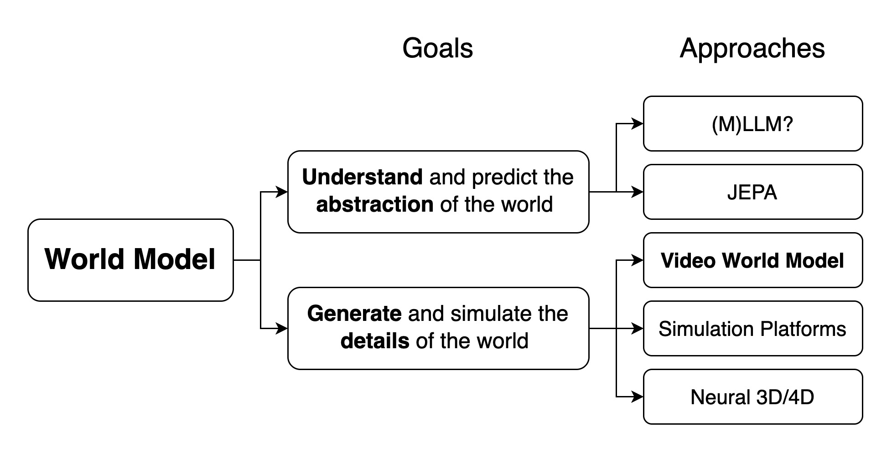
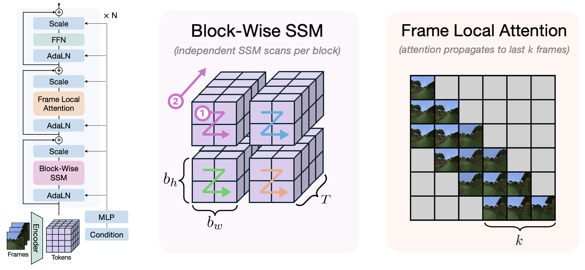
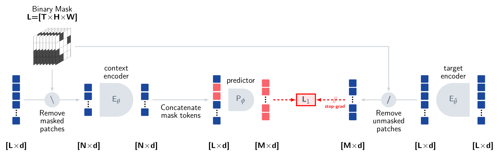

# 世界模型路线图

<div class="atlas-hero">
  <div class="atlas-kicker">World Models</div>
  <p class="atlas-lead">这一专题围绕“先在内部模拟，再做决策”的方法谱系展开，覆盖 RSSM、Dreamer、视频世界模型、WM/WAM/VAM、风险规划、反事实与数据引擎。</p>
  <div class="atlas-chip-row">
    <span class="atlas-chip">RSSM / Dreamer</span>
    <span class="atlas-chip">WM / WAM / VAM</span>
    <span class="atlas-chip">视频模拟</span>
    <span class="atlas-chip">风险规划</span>
  </div>
</div>

!!! tip "10 分钟读法 | 深入读法 | 实验/工程读法"
    **10 分钟读法**：先问模型预测什么、动作是否进入预测、rollout 被谁消费。
    **深入读法**：深读 Dreamer/JEPA/WAM/视频世界模型时，把 latent、video、reward/risk 和 policy 接口分开。
    **实验/工程读法**：实验上优先验 action sensitivity、closed-loop gain、risk ECE、latency 和 failure replay。

!!! warning "核心失败模式"
    | 失败模式 | 先查什么 |
    | --- | --- |
    | compounding error | 多步 latent/video rollout 会累积误差 |
    | 动作不敏感 | 同一历史下不同动作必须导致可区分未来 |
    | 视频自然度误导 | 好看的未来不等于 planning utility |

!!! info "最小验收指标"
    | 要证明什么 | 最小指标 | 不能替代什么 |
    | --- | --- | --- |
    | 动作条件成立 | counterfactual actions 产生可区分未来 | 自然视频续写 |
    | 规划有收益 | closed-loop success、cost per success、risk calibration | open-loop loss |
    | rollout 可用 | latency、drift、uncertainty、failure replay | 单步预测 |


!!! failure "最佳反例"
    视频 rollout 很自然，但替换候选动作后未来状态、风险和成功排序几乎不变。这说明它可能是好视频模型，却还不是对决策有用的 action-conditioned world model。

## 专题定位

世界模型的核心问题不是“能不能生成未来”，而是“能不能把未来预测转化成更好的决策”。它位于表征学习、生成模型、强化学习、机器人、自动驾驶和数据引擎的交叉处。

{ width="900" }

<small>图源：[Towards Video World Models](https://www.xunhuang.me/blogs/world_model.html)，Figure 2。原文图意：把 world model 分成内部理解型和外部模拟型两类，并把 `(M)LLM?`、JEPA、Video World Model、Simulation Platforms、Neural 3D/4D 等路线放到同一张 taxonomy 里。</small>

!!! note "难点解释：先分清 internal 和 external"
    `internal world model` 更像 agent 内部的抽象预测器，目标是帮助 reasoning、planning 和 decision making，不一定要生成像素级画面。`external world simulation model` 则要生成可观察、可交互、可检查的外部世界细节。Dreamer/RSSM 更偏前者的决策接口，LingBot-World、Genie、CausVid 这类视频世界模型更偏后者的交互模拟接口。读后面的页面时，先问清楚模型最后服务的是“内部决策”还是“外部模拟”。

!!! tip "本专题的读法"
    世界模型不要按论文名字背，先按三个问题读：模型预测什么，动作是否真的进入预测，预测结果被谁消费。只要这三问清楚，Dreamer、Genie、V-JEPA、LingBot-World、DreamZero 和 Cosmos 这几条路线就不会混成一团。

!!! tip "主线入口：高效训练视角"
    如果你的目标是“世界模型的高效训练技术”，建议先读 [世界模型高效训练技术路线图](efficient-training-roadmap.md)。本页负责建立世界模型的概念地图；高效训练路线图则把数据效率、视觉 token、动作条件、长序列训练、低精度、rollout 推理和闭环评测放到同一张成本账里。

<div class="atlas-meta-grid">
  <div>
    <strong>读前先知道</strong>
    <p>latent state、序列建模、概率预测、reward 和基础强化学习语言。</p>
  </div>
  <div>
    <strong>读中抓主线</strong>
    <p>状态、动作、rollout、风险、不确定性、planner/policy 消费接口。</p>
  </div>
  <div>
    <strong>读完能判断</strong>
    <p>一个模型是在做表征预测、视频续写、动作条件模拟，还是能真正改善决策。</p>
  </div>
</div>

## 三层阅读入口

第一次读不需要刷完所有专题。先选一个目标，再沿对应路径读。

| 路径 | 适合谁 | 推荐顺序 |
| --- | --- | --- |
| 10 分钟版 | 想知道世界模型到底是什么 | 本页定义与方法谱系 → [高效训练路线图](efficient-training-roadmap.md) → [Claim Ledger](../references/claim-ledger.md) |
| 深读版 | 想理解关键路线差异 | [Masked / JEPA](masked-jepa-and-latent-prediction.md) → [RSSM/Dreamer](rssm-dreamer-and-planning.md) → [WM/WAM/VAM](wm-wam-vam-and-action-conditioned-modeling.md) → [评测失效](evaluation-and-failure-modes.md) |
| 实验版 | 想复现证据链或写方案 | [完整实验报告样例](world-model-efficient-training-experiment-report.md) → [VLA 全链路案例](vla-world-model-full-chain-case.md) → [Rollout 服务案例](rollout-serving-quantization-kernel-case.md) → [效率技术覆盖矩阵](efficiency-technique-coverage-matrix.md) |

!!! tip "如果只看一页 / 如果要做实验 / 如果要查证据"
    只看一页就读 [高效训练路线图](efficient-training-roadmap.md)；要做实验就读 [完整实验报告样例](world-model-efficient-training-experiment-report.md)、[VLA 全链路案例](vla-world-model-full-chain-case.md) 和 [Rollout 服务案例](rollout-serving-quantization-kernel-case.md)；要查证据就读 [Claim Ledger](../references/claim-ledger.md) 与 [全站证据标准](../references/evidence-and-reproducibility-standard.md)，先区分论文结果、官方 demo、系统吞吐、toy fixture 和站内推断。

## 阅读分层与小地图

| 分层 | 推荐内容 | 读到什么程度 |
| --- | --- | --- |
| 主线必读 | [高效训练路线图](efficient-training-roadmap.md)、[Masked / JEPA 与潜变量预测](masked-jepa-and-latent-prediction.md)、[RSSM/Dreamer](rssm-dreamer-and-planning.md)、[WM/WAM/VAM](wm-wam-vam-and-action-conditioned-modeling.md)、[端到端案例](action-conditioned-video-world-model-training-case.md) | 能判断模型输出的是 latent、视频、动作、风险还是可被 policy 消费的信号 |
| 工程查阅 | 数据引擎、评测失效、风险规划、机器人/驾驶应用 | 做数据回流、闭环验证或风险模块时查 |
| 论文扩展 | Dreamer、Genie、LingBot-World、DreamZero、CausVid、Self Forcing | 区分论文证据、本站推断和工程外推 |
| 基础补课 | 概率潜变量、Transformer、强化学习、扩散采样 | 卡在 dynamics、rollout 或采样时补 |
| 暂时可跳过 | 开放式技术展望和产品 demo | 还没建立成本账和评测口径时先略读 |

本专题解决的是：世界模型如何从“预测未来”变成“改善决策”。它服务的核心成本是**真实交互、视频 token、rollout 延迟和验证预算**。先读 3-5 页建立 state-action-rollout 接口，读完后接到 [VLM/VLA](../vlm/index.md)、[具身智能](../embodied-ai/index.md)、[推理](../inference/index.md) 和 [量化](../quantization/index.md)。

## 硬证据读法

世界模型页面最容易滑成“概念地图”或“系统设想”。为了让判断更可信，后续关键页都尽量按硬证据模块组织：先说解决哪项成本，再给一个可复算例子或数字账，再给失败 replay，最后写清证据等级、反例边界和验收指标。

| 读到的说法 | 先问证据来自哪里 | 世界模型必须追加的问题 |
| --- | --- | --- |
| “预测未来更准” | benchmark、open-loop loss、可视化 demo | 对动作敏感吗，长时 latent 会漂吗 |
| “rollout 更便宜” | kernel throughput、端到端 latency、显存账 | 闭环成功率和 cost per success 是否变好 |
| “低比特不掉点” | PTQ/QAT eval、KV microbench、线上日志 | risk head、action head、near-miss recall 是否保住 |
| “数据回流有效” | ablation、失败桶统计、真实重训结果 | 是补了 hard cases，还是扩大了模型偏差 |
| “demo 很自然” | 作者 demo 或少量 qualitative case | 是否有反事实动作、失败 replay 和闭环任务 |

一个最小可接受证据链是：`episode 样例 -> token / 成本统计 -> 训练或推理配置 -> rollout 输出 -> 失败 replay -> 验收表`。如果只有 demo，它只能支撑“方向值得探索”；如果有 ablation，可以支撑“模块可能有用”；如果还有系统吞吐和闭环成功率，才适合进入工程 baseline。

## 一条贯穿路线

这个专题可以按一条更工程化的路线来读：

{ width="900" }

<small>图源：[Towards Video World Models](https://www.xunhuang.me/blogs/world_model.html)，Figure 5。世界模型的工程主线可以理解为把 observation、latent state、action 和 rollout 接成可被 policy / planner 消费的状态空间视频世界模型。</small>

!!! note "图解：这张图是世界模型专题的主轴"
    图里最重要的不是视频帧，而是 state、action 和 rollout 的接口。`state` 负责压缩历史观测，`action` 负责让未来分叉，`rollout` 负责给 planner / policy 提供可比较的后果。后面读 Dreamer、WAM、LingBot-World、DreamZero 时，都可以回到这三个接口判断它们到底补强了哪一环。

| 阶段 | 本专题要回答的问题 | 对应入口 |
| --- | --- | --- |
| 高效训练主线 | 真实交互、视频 token、显存、通信、rollout 和评测成本如何一起降低 | [世界模型高效训练技术路线图](efficient-training-roadmap.md) |
| 端到端案例 | 一个动作条件视频世界模型如何从数据、动作、训练、推理到评测跑通 | [动作条件视频世界模型端到端训练案例](action-conditioned-video-world-model-training-case.md) |
| 工程地基 | 数据 schema、相机、pose、焊缝/物体状态是否稳定 | [世界模型开发路线](development-roadmap-data-simulation-and-evaluation.md) |
| 表征路线 | masked / JEPA-style latent prediction 如何降低像素重建和视频 token 成本 | [Masked / JEPA 与潜变量预测](masked-jepa-and-latent-prediction.md) |
| 内部模拟 | latent state 如何在动作条件下 rollout | [RSSM、Dreamer 与规划](rssm-dreamer-and-planning.md) |
| 动作条件建模 | 未来视频、未来动作和 policy 如何接起来 | [WM/WAM/VAM 与动作条件建模](wm-wam-vam-and-action-conditioned-modeling.md) |
| 外部模拟 | 可交互视频世界和生成式仿真如何服务物理 AI | [生成式模拟与视频世界模型](generative-simulation-and-video.md) |
| 闭环改进 | 失败、near-miss 和 hard case 如何回流 | [世界模型数据引擎与自我改进](data-engines-and-self-improvement.md) |

这样读，分标题就不再是论文名列表，而是一条从“世界如何被表示”到“预测怎样改善行动”的链路。

## 世界模型的定义

**世界模型（World Model）** 是智能体在内部学习到的一套“环境运行机制”的近似模型。更直白地说，它像智能体脑中的可调用沙盘：给定历史观测、已执行动作、当前目标和候选动作，它能在内部推演“接下来可能会发生什么”，再把这些推演结果交给规划器、策略、风险模块或数据引擎使用。

一个面向决策的定义可以写成：

> 世界模型是一个预测环境状态如何随时间、动作和任务条件变化的模型，它输出未来观测、潜状态、奖励、风险、终止或其他对行动有用的信号。

这个定义里有三个关键词。**面向决策**意味着它不是为了生成好看的未来，而是为了帮助选择动作、评估风险或产生训练数据；**动作条件**意味着真正有用的世界模型必须回答“如果我这样做，会怎样”，而不只是顺着视频自然续写；**内部模拟**则意味着它把一部分真实环境试错搬到模型内部完成，降低真实试错成本。

一个最基础的潜状态形式是：

$$
p_\theta(z_t \mid z_{t-1}, a_{t-1}), \qquad p_\theta(x_t \mid z_t),
$$

其中 \(z_t\) 是潜状态，\(x_t\) 是观测。现代系统通常还会同时预测奖励、终止、风险、可通行性、接触状态、动作候选或未来视频片段。

## 世界模型到底在做什么

世界模型试图回答的问题可以压缩成一句话：

**如果我现在做动作 \(a\)，接下来世界会怎样变化？**

这和普通表征学习不同。表征学习更关注“当前是什么”，世界模型更关注“下一步会发生什么、不同动作会造成什么差异、这些差异是否影响决策”。

对自动驾驶来说，它可能要预测前车是否急刹、旁车是否让行、变道是否安全、后车是否会逼近。对机器人来说，它可能要预测抓取是否稳定、杯子是否会滑动、当前姿态是否碰撞、失败后是否还能恢复。对网页或工具 agent 来说，它可能要预测一次点击、提交或 API 调用之后系统状态如何变化。

真正有价值的世界模型通常需要在部分可观测环境中保留历史记忆，对动作分叉敏感而不是只生成平均未来，支持多步 rollout 而不是只做一步预测，并能输出风险、不确定性或恢复空间。最关键的是，它的输出必须能被规划、控制、评测或数据闭环消费。

所以，世界模型不仅要“像”，还要“有用”。一个视频生成器如果不能比较不同动作导致的不同未来，它最多是预测器或生成器，还不能算真正对决策有用的世界模型。

## 方法谱系

今天谈世界模型，已经不能只停留在经典 latent dynamics 公式上。随着视频生成、动作建模、具身控制、自动驾驶和生成式模拟的发展，世界模型正在变成一个更大的方法家族。

| 路线 | 建模重点 | 代表问题 | 典型价值 |
| --- | --- | --- | --- |
| Latent dynamics | 在潜空间学习可 rollout 的状态演化 | \(p(z_{t+1}\mid z_t,a_t)\) 是否稳定 | imagined rollout、策略学习、MPC |
| Masked / JEPA-style world models | 在遮挡或未来区域预测 token / latent / joint embedding | 表征是否保留世界结构、运动和下游控制变量 | 视觉表征预训练、样本效率、状态压缩 |
| 视频/生成式模拟 | 直接预测未来观测或视频片段 | 未来是否视觉合理且动作敏感 | 数据扩增、反事实、可视化规划 |
| 动作联合建模 | 把动作和世界演化放入同一序列 | 动作未来和观测未来是否一致 | 行为先验、离线控制、多任务泛化 |
| 几何/场景表示 | occupancy、BEV、object state、scene token | 是否保留碰撞、接触和空间结构 | 机器人、驾驶、风险判断 |
| 数据引擎路线 | 用模型发现、生成和筛选高价值数据 | near-miss 和失败样本是否被覆盖 | 自我改进、主动采样、仿真闭环 |

## 常见世界模型放在这条线里的位置

下面这张表按“从 latent dynamics 到生成式模拟”的学习脉络整理代表模型。它不是最新榜单，而是帮助你判断一篇工作到底在学状态转移、视频未来、行为先验，还是可交互模拟器。

| 模型 / 路线 | 核心贡献 | 与 VLM/VLA 的关系 | 站内专题 |
| --- | --- | --- | --- |
| [PlaNet](https://arxiv.org/abs/1811.04551) | 从像素学习 RSSM latent dynamics，并在潜空间里做 planning | 从“看见像素”走向“用潜状态预测动作后果”的经典入口 | [PlaNet 专题](../paper-deep-dives/world-models/planet.md) |
| [Dreamer](https://arxiv.org/abs/1912.01603) | 在 learned latent dynamics 中 imagined rollout，并训练 actor-critic | 说明世界模型不只是预测器，还能直接服务策略学习 | [Dreamer 专题](../paper-deep-dives/world-models/dreamer.md) |
| DreamerV2 / DreamerV3 | 把 Dreamer 路线扩展到离散 latent、更大任务集合和更通用训练配方 | 展示 latent imagination 如何从小环境走向更稳的通用控制 | [DreamerV2](../paper-deep-dives/world-models/dreamerv2.md)、[DreamerV3](../paper-deep-dives/world-models/dreamerv3.md) |
| DayDreamer | 把 Dreamer 式 latent imagination 推向真实机器人任务 | 连接 VLA 和 model-based RL：真实机器人可以用世界模型减少实机试错 | 可先读 [机器人应用](applications-in-robotics-and-autonomous-driving.md) |
| [Masked World Models](https://arxiv.org/abs/2206.14244) / [V-JEPA 2-AC](https://arxiv.org/abs/2506.09985) | 用 masked / JEPA-style latent prediction 提高表示和样本效率，并在 V-JEPA 2-AC 中接入动作条件规划 | 连接 VLM 表征和 world-model dynamics：先省 token/像素成本，再补 action-conditioned rollout | [Masked / JEPA 与潜变量预测](masked-jepa-and-latent-prediction.md) |
| [JEPA](https://openreview.net/forum?id=BZ5a1r-kVsf) / [V-JEPA](https://arxiv.org/abs/2404.08471) | 在表征空间预测被遮挡或未来的 latent，而不是生成像素细节 | 更偏 internal world model 表征：帮助理解和规划，但不一定直接输出动作 | [JEPA](../paper-deep-dives/world-models/jepa.md)、[V-JEPA](../paper-deep-dives/world-models/v-jepa.md)、[Masked / JEPA 主线页](masked-jepa-and-latent-prediction.md) |
| [Genie](https://arxiv.org/abs/2402.15391) | 从互联网视频中学习可交互生成环境和 latent actions | 从视频数据走向“可操作世界模拟”的代表路线 | [Genie 专题](../paper-deep-dives/world-models/genie.md) |
| LWM / 长上下文视频模型 | 用长上下文建模图文视频序列，增强跨时间记忆 | 提醒世界模型需要长时记忆，否则只能做短片段续写 | [LWM 专题](../paper-deep-dives/world-models/lwm.md) |
| LingBot-World | 从视频基础模型继续训练成可交互世界模拟器 | 代表“视频生成底座 + 动作条件 + 因果化 + 少步蒸馏”的工程路线 | [LingBot-World 专题](../paper-deep-dives/world-models/lingbot-world.md) |
| DreamZero / WAM 路线 | 把 world-action modeling 用于 zero-shot policy 或动作联合建模 | 更靠近 VLA：动作生成和世界演化不再完全分开，但评测必须看闭环收益 | [DreamZero 专题](../paper-deep-dives/embodied-ai/dreamzero.md) |

!!! note "初学者读世界模型时的抓手"
    先问模型预测什么：latent state、未来帧、奖励、done、风险、动作还是完整轨迹。再问动作是否真的作为条件进入模型。最后问它被谁消费：planner、policy、风险模块、数据引擎，还是只给人看视频。能生成漂亮未来，不等于能改善决策；能拟合动作，也不等于理解动作后果。

## 从论文专题回填的世界模型知识点

世界模型专题页已经覆盖了从 RSSM 到视频世界模拟器的多条路线。回看总览时，可以把单篇论文压回这几条主线：

| 专题来源 | 回填到世界模型章节的知识点 | 应接到本章哪里 |
| --- | --- | --- |
| [PlaNet](../paper-deep-dives/world-models/planet.md)、[Dreamer](../paper-deep-dives/world-models/dreamer.md)、[DreamerV3](../paper-deep-dives/world-models/dreamerv3.md) | RSSM、latent imagination、reward/continue prediction 和 actor-critic 说明世界模型首先是决策接口，不是视频生成器 | [RSSM、Dreamer 与规划](rssm-dreamer-and-planning.md)、[规划即推断与潜在动作](planning-as-inference-and-latent-actions.md) |
| [V-JEPA](../paper-deep-dives/world-models/v-jepa.md)、[H-JEPA](../paper-deep-dives/world-models/h-jepa.md)、[MWM](https://arxiv.org/abs/2206.14244) | 表征空间预测可以学习世界结构和运动，不一定要重建像素；但原始形式通常还缺 action、reward、done | [Masked / JEPA 与潜变量预测](masked-jepa-and-latent-prediction.md)、[WM/WAM/VAM 与动作条件建模](wm-wam-vam-and-action-conditioned-modeling.md) |
| [Genie](../paper-deep-dives/world-models/genie.md)、[LingBot-World](../paper-deep-dives/world-models/lingbot-world.md) | 视频世界模型要从被动视频走向可交互模拟，关键是 latent action / action conditioning、causal rollout、长时记忆和实时化 | [生成式模拟与视频世界模型](generative-simulation-and-video.md)、[世界模型数据引擎与自我改进](data-engines-and-self-improvement.md) |
| [Self Forcing](../paper-deep-dives/world-models/self-forcing.md)、[CausVid](../paper-deep-dives/diffusion/causvid.md) | 流式视频世界模型的核心难点是 train-test gap、self-rollout 漂移、KV cache 和少步生成稳定性 | [评测与失败模式](evaluation-and-failure-modes.md)、[生成式模拟与视频世界模型](generative-simulation-and-video.md) |
| [DreamZero](../paper-deep-dives/embodied-ai/dreamzero.md) | WAM 把未来视频和未来动作联合建模，强调“世界预测能否直接支撑 policy” | [WM/WAM/VAM 与动作条件建模](wm-wam-vam-and-action-conditioned-modeling.md)、[机器人与自动驾驶中的世界模型](applications-in-robotics-and-autonomous-driving.md) |

### 三种“内部世界”：像素、latent 和表征

论文专题里容易混在一起的还有一个问题：世界模型不一定要生成像素。它可以在像素上模拟，也可以在 latent state 里 rollout，也可以只预测抽象表征。三种路线像三种地图：像素视频是街景实拍，latent dynamics 是可规划的简化地图，JEPA 式表征预测则像只保留路口、墙、障碍物和可行动区域的导航图。

{ width="900" }

<small>图源：[V-JEPA: Latent Video Prediction for Visual Representation Learning](https://arxiv.org/abs/2404.08471)，Figure 3。原论文图意：V-JEPA 将视频 clip 展平成 token sequence；context encoder 只处理 masked sequence，predictor 接收 context output 和 learnable mask tokens，target encoder 处理完整 unmasked token sequence，最后用 \(L_1\) loss 回归对应 masked tokens 的 target encoder output。</small>

!!! note "这张图和 Dreamer 有什么不同"
    V-JEPA 不是把遮住的像素画回来，而是预测被遮住区域的 latent representation。它更关心“那里应该有什么语义和运动结构”，不急着生成每一根纹理。Dreamer / RSSM 则更关心动作条件下的状态转移、奖励和 done，目标是让 agent 能在 latent space 里想象并学策略。视频世界模型又进一步要求把未来解码成可看、可交互、可检查的视频。

更系统的 masked / JEPA / latent prediction 对照见 [Masked / JEPA 与潜变量预测](masked-jepa-and-latent-prediction.md)，那里把 pixel reconstruction、token/latent reconstruction、joint-embedding prediction 和 action-conditioned latent dynamics 放在同一张效率表里。

| 路线 | 输出看起来像什么 | 最适合回答的问题 | 典型风险 |
| --- | --- | --- | --- |
| JEPA / V-JEPA | 被遮挡或未来区域的表征 | 世界结构和运动关系是否被理解 | 表征强，但不直接生成可检查未来 |
| RSSM / Dreamer | latent state、reward、continue、imagined rollout | 这个动作是否会带来更高回报 | latent 漂移会被 policy 放大 |
| 视频世界模型 | 未来帧或未来视频 | 人和系统能否检查反事实未来 | 视觉逼真不等于动作因果正确 |

这三条路线没有谁天然高级。做机器人闭环控制时，Dreamer 式 latent dynamics 可能比高清视频生成更实用；做开放世界交互 demo 时，视频模拟更直观；做通用视觉理解时，JEPA 式表征预测可能更稳。真正的判断标准是：模型内部的“世界”最后要被谁使用。

## 先用 Demo 建立直觉

世界模型的 demo 最好不要只看“画面是否好看”，而要看它是否能维持同一个世界、是否能被用户动作或 agent 动作持续驱动、是否能在长时 rollout 中保持空间和对象一致。

<div class="atlas-video-grid">
  <figure class="atlas-video-demo">
    <video controls muted playsinline preload="none">
      <source src="https://storage.googleapis.com/gdm-deepmind-com-prod-public/media/media/genie-3__project-genie__promo.webm" type="video/webm">
    </video>
    <figcaption>视频源：<a href="https://deepmind.google/models/genie/">Google DeepMind Genie 3 官方页面</a>。页面说明 Genie 3 用文本描述生成可实时探索的 photorealistic environments。</figcaption>
  </figure>
  <figure class="atlas-video-demo">
    <video controls muted playsinline preload="none">
      <source src="https://images.nvidia.com/aem-dam/Solutions/cosmos/cosmos-predict.mp4" type="video/mp4">
    </video>
    <figcaption>视频源：<a href="https://www.nvidia.com/en-us/ai/cosmos/">NVIDIA Cosmos 官方页面</a>，Cosmos Predict demo。页面把 Cosmos 定位为 world foundation models、tokenizers、guardrails 与数据处理管线组成的平台。</figcaption>
  </figure>
</div>

!!! note "图解：看世界模型 Demo 时先看四件事"
    第一，看是否是**可交互 rollout**：用户动作或控制信号是否持续影响未来，而不是一次性生成固定视频。第二，看**环境一致性**：角色走远再回来，场景布局、物体身份和方向感是否还能对上。第三，看**动作敏感性**：同一历史下换动作，未来是否合理分叉。第四，看**系统边界**：demo 能说明模型的视觉和交互潜力，但不能替代闭环成功率、风险校准和真实任务评测。

<div class="atlas-meta-grid">
  <div>
    <strong>核心问题</strong>
    <p>如何让模型不只理解当前观测，还能对动作条件下的未来、风险和反事实做内部模拟。</p>
  </div>
  <div>
    <strong>适合读者</strong>
    <p>适合做机器人、自动驾驶、世界模型规划、视频未来预测、合成数据和数据闭环的人。</p>
  </div>
  <div>
    <strong>阅读方式</strong>
    <p>先读定义和 RSSM/Dreamer，再看 WM/WAM/VAM、视频模拟、风险规划和数据引擎。</p>
  </div>
</div>

!!! tip "基础知识入口"
    世界模型会反复用到 latent state、概率分布、序列建模和训练闭环。第一次读可以先看 [概率与潜变量模型](../foundations/probability-latent-variables-and-generative-models.md) 和 [Transformer 与 Attention](../foundations/transformer-attention-and-tokenization.md)。

## 两条训练路线

如果按“训练数据从哪里来、模型先学什么”来划分，当前世界模型可以先分成两条主线。它们都会走向动作条件未来预测，但出发点不同。

### 路线 A：视频生成型世界模型

这条路线从大规模视频生成或视频预测出发：

```text
大规模视频数据
  -> 视频生成 / 视频预测模型
  -> 加入控制、交互和长记忆
  -> 形成视觉世界模拟器
```

它的核心是先学会世界“看起来如何演化”，再逐步加入动作、相机、交互事件和因果 rollout。`LingBot-World`、`Genie`、`Cosmos` 以及一部分视频 diffusion / AR video generator 都更接近这条路线。

这条路线的优势是视觉质量强、开放场景覆盖广、容易生成可被人检查的视频未来；风险是视觉合理不等于任务可用，动作 grounding 可能偏弱，模型可能更依赖视频惯性而不是候选动作。

### 路线 B：交互轨迹驱动的 latent dynamics 路线

这条路线从 agent 和环境的交互经验出发：

```text
观测 o_t、动作 a_t、奖励 r_t、终止 done_t
  -> 学习潜状态 z_t
  -> 学习状态转移 p(z_{t+1} | z_t, a_t)
  -> 在 latent space 中 imagined rollout
  -> 用于规划或训练 policy
```

代表方法是 `RSSM / Dreamer / DreamerV3 / DayDreamer` 一类 model-based RL 世界模型。它的核心不是生成高清视频，而是学习“状态、动作、下一状态、奖励和终止”之间的动力学关系，让策略能在 learned latent dynamics 里想象未来。

{ width="860" }

<small>图源：[Learning Latent Dynamics for Planning from Pixels](https://arxiv.org/abs/1811.04551)，Figure 2。原论文图意：比较 RNN、SSM 和 RSSM 三种 latent dynamics 设计；RSSM 同时保留 deterministic hidden state 和 stochastic state，用于从像素学习可规划的潜空间动力学。</small>

!!! note "图解：RSSM 为什么适合世界模型"
    RNN 只靠确定性记忆，适合保留历史但不擅长表达多种可能未来；SSM 有随机状态，但长时记忆较弱。RSSM 把两者合起来：确定性状态 \(h_t\) 负责记住历史和动作轨迹，随机状态 \(z_t\) 负责表达当前不确定性。Dreamer 系列沿用这类思想，是因为规划需要的不只是重建当前画面，而是能稳定 rollout 的 latent state。

这条路线的优势是动作因果关系更直接，天然服务规划和控制；风险是交互数据收集贵，真实视觉质量和开放场景覆盖通常不如大视频生成模型，且 latent rollout 的误差会直接传给 policy。

两条路线的对比如下：

| 维度 | 视频生成型世界模型 | 交互轨迹 latent dynamics 世界模型 |
| --- | --- | --- |
| 代表 | LingBot-World、Genie、Cosmos、视频 diffusion simulator | RSSM、Dreamer、DreamerV3、DayDreamer |
| 数据 | 大规模视频、图文视频、少量控制或相机信号 | 环境交互轨迹：观测、动作、奖励、done |
| 核心目标 | 生成或预测未来视觉状态 | 学习状态转移和动作后果 |
| 训练目标 | video reconstruction、diffusion loss、next-frame prediction | latent dynamics loss、reward prediction、continuation prediction、policy learning |
| 输出 | 未来视频、未来帧、可视化世界模拟 | latent state、reward、termination、imagined rollout |
| 强项 | 视觉真实感、开放场景、多样性、长视频模拟 | 决策相关性强、动作因果明确、适合规划与控制 |
| 弱点 | 动作 grounding 可能弱，视觉正确不等于决策可用 | 数据采集贵，视觉真实感和开放域覆盖较弱 |

这两条路线不是互斥的。更现实的长期方向可能是：用视频生成型世界模型提供视觉动态和开放世界先验，用交互轨迹型世界模型提供动作条件动力学、奖励、终止和规划接口。

### 不要把第二条路线等同于 VLA

交互轨迹型世界模型也不等于 `VLA`。`VLA` 主要回答：

$$
\text{vision} + \text{language} \rightarrow \text{action}.
$$

世界模型主要回答：

$$
\text{state} + \text{action} \rightarrow \text{next state / reward / future trajectory}.
$$

也就是说，`VLA` 更像 policy，世界模型更像 dynamics 或 simulator。动作在世界模型中是建模世界动态的条件变量，而不是唯一最终输出。

经典 [RSSM、Dreamer 与规划](rssm-dreamer-and-planning.md) 是理解这一方向的入口，因为它把 belief state、reward、rollout 和 policy learning 的关系讲得最清楚。视频和生成式路线则在 [生成式模拟与视频世界模型](generative-simulation-and-video.md) 里展开。

近期 `LingBot-World` 一类工作展示了更现实的训练路径：先继承视频基础模型的视觉与时序先验，再通过动作标注交互数据、长序列训练、因果化和少步蒸馏，把视频生成器继续训练成可交互的世界模拟器。

## WM、WAM、VAM 的关系

`WM / WAM / VAM` 这组缩写近年在机器人和视频生成交叉方向出现得越来越多，但它们不是完全统一的标准术语。一个实用划分是：**WM（World Model）**更强调世界如何随动作演化，**WAM（World-Action Model）**更强调把动作生成和世界演化联合建模，**VAM（Video-Action Model）**更强调把视频生成能力和动作建模结合起来做控制或数据生成。

传统 `WM + policy` 的分工是：世界模型负责预测，策略负责出动作。但在机器人和驾驶数据里，观测与动作天然共同组成轨迹，把两者完全拆开未必符合数据结构。WAM/VAM 的吸引力在于，它们尝试把“哪类视觉态势经常接哪类动作”和“这些动作会把世界带向哪里”学成同一个时序模式。

这类统一建模的风险也很明确：视频目标可能压过动作目标，导致生成很强但控制一般；联合目标更难训练，失败时归因更复杂；如果评测只看短步动作拟合，又很容易高估真实规划能力；模型还可能复制离线演示数据里的行为偏差。

具体路线见 [WM / WAM / VAM：动作条件建模](wm-wam-vam-and-action-conditioned-modeling.md)。

## 评测与工程边界

世界模型现在最难的地方不是“展示一个看起来合理的未来”，而是稳定证明它对真实决策有用。重建 loss、next-frame loss、FID、FVD 或视觉自然度都不能直接等价于规划质量。

更合适的评测应分层报告：

| 评测层 | 关注点 | 典型问题 |
| --- | --- | --- |
| Open-loop prediction | 多步 rollout 后关键状态是否可靠 | 单步像、长时漂 |
| Action sensitivity | 不同动作是否导致合理分叉 | 只学平均未来 |
| Planning utility | 接入 planner 后任务是否变好 | 离线收益不等于闭环收益 |
| Risk and uncertainty | near-miss、碰撞、失败恢复是否可识别 | 自信地产生错误未来 |
| System cost | rollout 延迟、显存、调用次数是否可承受 | 有用但跑不动 |

训练和推理基础设施也会成为瓶颈。世界模型的数据通常是连续轨迹，不能随便切成独立样本；隐状态误差会沿 rollout 累积；规划器会反复调用模型，单步延迟会被候选数和 horizon 放大。因此世界模型评估必须同时报告收益和成本。

更详细的失效模式与验收方法见 [世界模型评测与失效模式](evaluation-and-failure-modes.md)、[不确定性与风险敏感规划](uncertainty-and-risk-aware-planning.md)。

## 推荐阅读路径

如果刚进入这个方向，建议先读 [世界模型开发路线](development-roadmap-data-simulation-and-evaluation.md)，把数据契约、3D encoder、仿真和 success checker 的工程地基立起来；再读 [RSSM、Dreamer 与规划](rssm-dreamer-and-planning.md)，建立 latent state、belief、reward、rollout 和策略学习的基本概念。之后进入 [WM / WAM / VAM：动作条件建模](wm-wam-vam-and-action-conditioned-modeling.md)、[生成式模拟与视频世界模型](generative-simulation-and-video.md) 和 [模拟器、反事实与合成 Rollout](simulators-counterfactuals-and-synthetic-rollouts.md)，理解动作联合建模、视频生成和数据引擎如何汇合。最后用 [规划即推断与潜在动作](planning-as-inference-and-latent-actions.md) 与 [世界模型评测与失效模式](evaluation-and-failure-modes.md) 检查模型是否真的进入决策闭环。

读每类工作时建议固定问四个问题：它建模的基本单位是什么，动作条件放在哪一层，模型输出最终被谁消费，它的失败更多出在表示、规划、数据还是系统成本。

## 阶段检查与下一站

世界模型的学习顺序要避免两个误区：把它只当视频生成，或者只当 model-based RL。更稳的检查方式如下：

| 你正在关注 | 关键判断 | 读完后接到哪里 |
| --- | --- | --- |
| Latent dynamics | latent state 是否保留决策所需信息，rollout 误差是否会误导 policy | [规划即推断与潜在动作](planning-as-inference-and-latent-actions.md)、[训练](../training/index.md) |
| 视频/生成式模拟 | 生成未来是否对动作敏感，而不是只顺着视频惯性续写 | [视频与多模态扩散](../diffusion/video-and-multimodal-diffusion.md)、[VLM/VLA](../vlm/index.md) |
| 数据引擎 | 模型生成的数据是否覆盖 near-miss、失败恢复和长尾状态 | [模拟器、反事实与合成 Rollout](simulators-counterfactuals-and-synthetic-rollouts.md)、[具身智能](../embodied-ai/index.md) |
| 风险规划 | 不确定性和风险信号是否真的被 planner 或安全模块消费 | [不确定性与风险敏感规划](uncertainty-and-risk-aware-planning.md)、[部署与安全](../vla/deployment-and-safety.md) |

如果一个世界模型页面只展示预测结果，而没有说明动作条件、规划接口、风险输出和系统成本，就还没有进入决策系统语境。

## 专题页地图

<div class="atlas-card-grid">
  <a class="atlas-card" href="development-roadmap-data-simulation-and-evaluation/">
    <strong>世界模型开发路线</strong>
    <p>把数据准备、3D 重建、仿真环境、success checker 和焊缝任务整理成工程路线。</p>
  </a>
  <a class="atlas-card" href="rssm-dreamer-and-planning/">
    <strong>RSSM、Dreamer 与规划</strong>
    <p>经典 latent world model 入口，重点是 belief state、imagined rollout 和 policy learning。</p>
  </a>
  <a class="atlas-card" href="wm-wam-vam-and-action-conditioned-modeling/">
    <strong>WM / WAM / VAM：动作条件建模</strong>
    <p>拆清世界演化、动作生成和视频先验之间的关系。</p>
  </a>
  <a class="atlas-card" href="generative-simulation-and-video/">
    <strong>生成式模拟与视频世界模型</strong>
    <p>解释视频生成模型如何进入未来预测、反事实和数据合成。</p>
  </a>
  <a class="atlas-card" href="planning-as-inference-and-latent-actions/">
    <strong>规划即推断与潜在动作</strong>
    <p>把 world model、planner、latent action 和目标条件建模连起来。</p>
  </a>
  <a class="atlas-card" href="uncertainty-and-risk-aware-planning/">
    <strong>不确定性与风险敏感规划</strong>
    <p>关注世界模型进入高风险决策闭环时必须暴露的风险信号。</p>
  </a>
  <a class="atlas-card" href="simulators-counterfactuals-and-synthetic-rollouts/">
    <strong>模拟器、反事实与合成 Rollout</strong>
    <p>从“会预测”走向“能制造有价值训练样本”。</p>
  </a>
  <a class="atlas-card" href="data-engines-and-self-improvement/">
    <strong>世界模型数据引擎与自我改进</strong>
    <p>讨论 near-miss、主动采样、失败回放和闭环数据生成。</p>
  </a>
  <a class="atlas-card" href="applications-in-robotics-and-autonomous-driving/">
    <strong>机器人与自动驾驶中的世界模型</strong>
    <p>把世界模型放回真实具身与驾驶系统里看收益和限制。</p>
  </a>
  <a class="atlas-card" href="evaluation-and-failure-modes/">
    <strong>世界模型评测与失效模式</strong>
    <p>建立世界模型是否真的改善决策的验收标准。</p>
  </a>
</div>
## 深度标杆页

世界模型专题的标杆页要围绕“更少真实交互、更少视频 token、更低 rollout 成本、更可用于决策”展开。其它页面应向这几页补充效率贡献、证据和失败边界。

| 标杆页 | 对齐标准 |
| --- | --- |
| [世界模型高效训练技术路线图](efficient-training-roadmap.md) | 把数据、表示、动作、长序列、数值、rollout 和评测成本放到同一张主线图 |
| [动作条件视频世界模型端到端训练案例](action-conditioned-video-world-model-training-case.md) | 用完整案例串起数据 schema、视觉 token、动作 chunk、长序列训练、低比特、rollout 和闭环评测 |
| [WM / WAM / VAM：动作条件建模](wm-wam-vam-and-action-conditioned-modeling.md) | 清楚区分世界模型、动作世界模型和视频动作模型 |
| [RSSM、Dreamer 与规划](rssm-dreamer-and-planning.md) | 解释 latent dynamics、imagined rollout 和样本效率 |
| [世界模型数据引擎与自我改进](data-engines-and-self-improvement.md) | 把失败回放、合成 rollout 和数据回流接起来 |
| [世界模型评测与失效模式](evaluation-and-failure-modes.md) | 重点验证 action sensitivity、temporal consistency 和闭环收益 |
| [世界模型开发路线](development-roadmap-data-simulation-and-evaluation.md) | 给出从数据、仿真、评测到系统落地的工程路线 |
