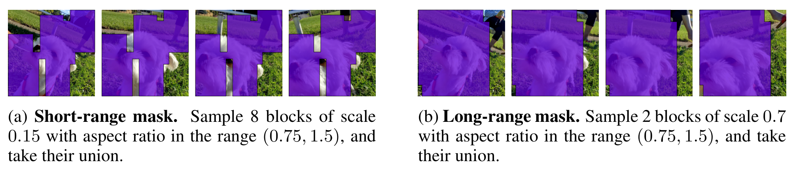

# Masked / JEPA 与潜变量预测：为什么世界模型不一定要画像素

世界模型常被想象成“给当前画面和动作，生成未来视频”。这当然是一种路线，但不是唯一路线。对规划和控制来说，模型真正需要预测的是会改变动作选择的东西：物体位置、速度、接触、遮挡、任务阶段、风险、奖励和终止。高清纹理、背景光照、阴影细节，有时只是昂贵的旁枝。

这篇只回答一个问题：**为什么很多世界模型先预测 latent 或 embedding，而不是直接预测像素？**

## 像素预测的问题不是没用，而是太贵也太分散

像素重建的优点很明显：监督信号密集，输出可视化，人能直接检查。问题也同样明显：像素空间里包含大量对决策不重要的变化。桌面纹理、光照阴影、墙面细节都可能占掉模型容量；而真正决定机器人下一步动作的，可能只是杯子边缘、手爪接触点和目标物是否滑动。

所以世界模型里常见一条折中路线：

```text
原始观测 x
  -> encoder 压成 latent / embedding z
  -> 在 z 空间预测未来、遮挡部分或目标表示
  -> 接动作、奖励、done、risk 和 planner
  -> 必要时再 decoder 回像素给人检查
```

这里的关键不是“永远不要生成视频”，而是“控制主链路不一定需要每个候选动作都解码成高清视频”。如果 planner 只需要比较哪个动作更接近目标，latent 空间里的距离可能已经足够；如果要做人审、数据回流或反事实可视化，再把关键 rollout 解码出来。

## 四类目标其实在回答不同问题

| 训练目标 | 简化写法 | 它证明了什么 | 它没有证明什么 |
| --- | --- | --- | --- |
| Pixel reconstruction | \(\mathcal{L}_{pix}=d(\hat{x},x)\) | 模型能复原可见细节 | 复原像素不等于会选动作 |
| Masked latent reconstruction | \(\mathcal{L}_{lat}=d(\hat{z}_M,z_M)\) | 模型能补全被遮挡的表征 | latent 是否保留 reward/risk 仍要验证 |
| JEPA / joint embedding prediction | \(\mathcal{L}_{jepa}=d(P_\theta(E_c(x_{\setminus M})),\mathrm{sg}(E_t(x_M)))\) | 模型能从上下文预测目标区域的高层表示 | 原始 JEPA 不含动作、奖励、终止 |
| Action-conditioned latent dynamics | \(\mathcal{L}_{dyn}=d(\hat z_{t+1},z_{t+1})+\lambda_r\ell(\hat r,r)+\lambda_d\ell(\hat d,d)\) | 模型开始回答“做这个动作会怎样” | 多步漂移、reward hacking、闭环风险仍存在 |

这张表要按问题读。Pixel reconstruction 问“我能不能还原输入”；JEPA 问“我能不能预测被遮挡或未来部分的抽象表示”；action-conditioned dynamics 才问“如果采取动作 \(a_t\)，未来状态 \(z_{t+1}\) 怎么变”。世界模型用于控制时，最后一个问题躲不开。

## MWM：视觉表征和 dynamics 分开学

`Masked World Models for Visual Control` 的思路很适合入门：先用 masked visual representation 学一个更好的视觉 latent，再在 latent space 里训练 dynamics model。它不是说 masked reconstruction 本身已经会规划，而是说好的视觉表示能让后续模型基于更干净、更低维的状态学习动作后果。

{ width="920" }

<small>图源：[Masked World Models for Visual Control](https://arxiv.org/abs/2206.14244)，Figure 1。原图表达：左侧训练 masked visual autoencoder 并预测 reward，右侧在 autoencoder latent space 中训练 latent dynamics。本站读法：左边负责“看懂并压缩”，右边负责“动作之后怎么变”；两者解耦是为了减少视觉噪声对 dynamics 的干扰。</small>

MWM 的关键是 decoupling。视觉 encoder 如果一边为像素重建服务，一边被 dynamics 反复拉扯，容易在“画得像”和“对控制有用”之间互相干扰。先学表示，再学 dynamics，相当于把世界模型拆成两个问题：状态怎么表示，状态怎么随动作变化。

{ width="920" }

<small>图源：[Masked World Models for Visual Control](https://arxiv.org/abs/2206.14244)，Figure 4。原图表达：MWM 和 DreamerV2 在 Meta-world aggregate、RLBench Reach Target、RLBench Push Button 等任务上的 success rate 曲线。本站读法：这类图要看样本效率和任务设置，不能直接推广成“所有 masked model 都优于 RSSM”。</small>

## JEPA：不预测像素，预测目标区域的表示

V-JEPA 的转向是把目标从“补像素”换成“补 target encoder 的 latent”。一个简化流程是：

```text
完整视频 x
  -> 采样时空 mask M
  -> context encoder 只看 x_{\setminus M}
  -> target encoder 看目标区域 x_M
  -> predictor 从 context latent 预测 target latent
```

JEPA loss 可以写成：

\[
\mathcal{L}_{jepa}=d(P_\theta(E_c(x_{\setminus M})),\mathrm{sg}(E_t(x_M)))
\]

这里 \(E_c\) 是 context encoder，\(E_t\) 是 target encoder，\(P_\theta\) 是 predictor，\(\mathrm{sg}\) 表示 stop-gradient。读这行公式时抓住两点：模型不是直接输出像素 \(x_M\)，而是输出目标区域的表示；target encoder 提供学习目标，但不被这条梯度直接拖着走。这样做的动机是把容量更多花在对象、运动和场景结构上，而不是逐点纹理。

{ width="860" }

<small>图源：[V-JEPA: Revisiting Feature Prediction for Learning Visual Representations from Video](https://arxiv.org/abs/2404.08471)，Figure 2。原图表达：在视频时空体上采样多个 3D block mask。本站读法：mask 遮的是时间和空间上的结构块，迫使模型利用运动连续性和对象关系，而不是只补局部纹理。</small>

{ width="920" }

<small>图源：[V-JEPA](https://arxiv.org/abs/2404.08471)，Figure 3。原图表达：context encoder 处理 masked sequence，predictor 用 mask tokens 预测目标位置，target encoder 处理完整输入并提供 latent target。本站读法：老师网络给目标表示，学生网络根据可见上下文预测；输出不是 RGB，而是 representation。</small>

## 为什么 JEPA 还不是完整的可规划世界模型

JEPA 能学到强表征，但“强表征”不自动等于“可规划”。缺口主要有四个。

第一，原始 JEPA 通常没有 action。它学的是视频中可见上下文和目标区域的关系，不是 \(p(z_{t+1}\mid z_t,a_t)\)。没有动作，模型无法回答“我推杯子”和“我不动杯子”未来有什么不同。

第二，原始 JEPA 通常没有 reward、done 和 risk head。规划需要比较候选动作序列，比较标准不能只靠 latent 距离；任务是否完成、是否碰撞、是否进入不可恢复状态，都需要单独建模或评测。

第三，表征 benchmark 不等于 closed-loop。分类、检索、视频问答能证明表示有信息，但控制需要在模型预测基础上反复选动作。多步 rollout 的漂移和 planner 对模型漏洞的利用，往往只有闭环才暴露。

第四，latent 压缩可能丢掉小但关键的变量。机器人抓取里的接触点、透明物体边界、遮挡身份、工具姿态，可能在视觉 benchmark 中不显眼，却决定动作是否成功。

因此，JEPA 更像世界模型的表示底座。要成为规划模型，还必须把 action-conditioned dynamics、reward/risk/done、planner 和闭环评测接上。

## V-JEPA 2-AC：往动作条件规划靠近的一步

V-JEPA 2 的官方论文和 Meta 介绍强调了两阶段路线：先用大规模视频/图像做 action-free 自监督预训练，再用少量机器人轨迹把表示接到 action-conditioned world model。V-JEPA 2-AC 的关键是：给当前观测、目标图像和候选动作序列，在 latent space 中 rollout，选择让未来表示接近目标表示的动作。

{ width="920" }

<small>图源：[V-JEPA 2: Self-Supervised Video Models Enable Understanding, Prediction and Planning](https://arxiv.org/abs/2506.09985)，Figure 7。原图表达：V-JEPA 2-AC 对候选动作序列做 model predictive control，让 imagined state representation 在未来 \(T\) 步后接近 goal representation。本站读法：这张图的关键不是“生成视频”，而是“在 latent space 里比较候选动作后果”。</small>

可以把它写成：

\[
\hat z_{t+1:t+H}=f_\theta(z_t,a_{t:t+H-1})
\]

这里 \(z_t\) 是当前观测表示，\(a_{t:t+H-1}\) 是候选动作序列，\(\hat z_{t+1:t+H}\) 是想象出的未来 latent。Planner 不是直接问“哪段视频最漂亮”，而是问“哪条动作序列让未来 latent 更接近目标 latent，并且满足任务约束”。

{ width="920" }

<small>图源：[V-JEPA 2](https://arxiv.org/abs/2506.09985)，Table 3。原图表达：比较 V-JEPA 2-AC 和其他 world model/planning 方法在机器人操作任务中的性能与时间。本站读法：这是 closed-loop planning 证据，比单纯表征评测更接近“世界模型是否能服务动作选择”，但仍受任务集、动作空间和硬件设置限制。</small>

## 工程上怎样选择路线

| 目标 | 更合适的路线 | 原因 |
| --- | --- | --- |
| 样本效率高的视觉控制 | RSSM/Dreamer/MWM | 直接围绕 latent dynamics、reward 和 policy 训练 |
| 大规模视频表征预训练 | V-JEPA/H-JEPA/VideoMAE 类 masked objective | 不需要动作标注，能吃大规模视频 |
| 目标图像驱动的短 horizon 规划 | V-JEPA 2-AC / MPC | latent space 里搜索动作序列，避免全量解码 |
| 需要人审和反事实可视化 | action-conditioned video world model | 输出视频便于检查，但成本更高 |
| 真实机器人实时闭环 | latent dynamics + 短 horizon refresh | 延迟、漂移和安全边界比像素质量更重要 |

一个务实判断是：如果你缺动作数据，先用 JEPA/Masked 预训练学表示；如果你有动作和 reward/done，尽快接 dynamics；如果你要部署控制，闭环评测必须早于漂亮 demo。

## 外部精读

- [Masked World Models for Visual Control](https://arxiv.org/abs/2206.14244)：看 masked representation 如何接 model-based RL。
- [V-JEPA 论文](https://arxiv.org/abs/2404.08471)：看 latent video prediction 和 3D masking 设计。
- [V-JEPA 2 官方研究页](https://ai.meta.com/research/publications/v-jepa-2-self-supervised-video-models-enable-understanding-prediction-and-planning/)：看从视频理解到机器人 planning 的证据边界。
- [Meta V-JEPA 2 介绍](https://ai.meta.com/vjepa/)：适合快速把握官方定位和系统图。

## 本页结论

Masked / JEPA 路线的核心不是“把像素藏起来再补出来”，而是把预测目标从原始像素移到更抽象的 latent。这样能省容量、降低输出维度、让模型更多关注对象和运动结构。但如果目标是世界模型和控制，latent prediction 只是第一步；还必须接动作条件 dynamics、reward/risk/done、planner 和闭环评测。最容易误读的地方正是在这里：会预测表示，不等于已经会规划。
