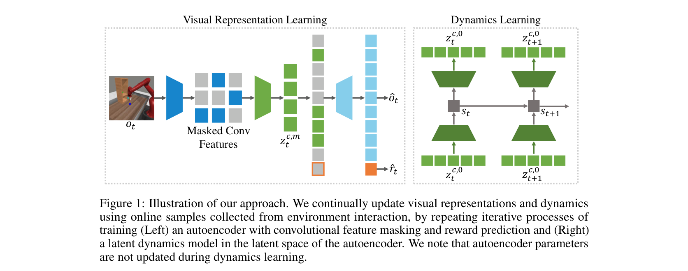
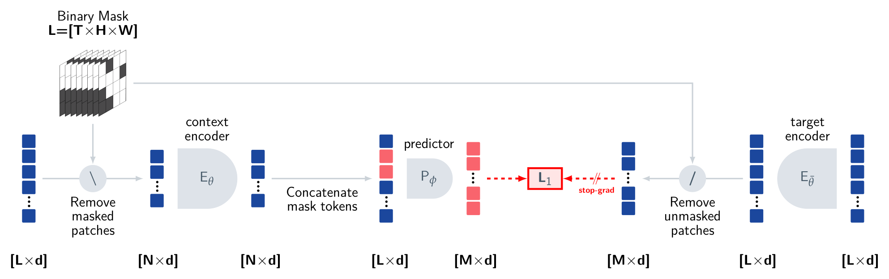

# Masked 与 JEPA，为什么改为预测表征

抓杯子视频中，模型既能看到手指与杯沿的接触，也能看到桌面纹理和反光。若要求预测每个像素，就要花能力解释这些细节；若改为预测编码后的表征，监督更短，但哪些信息被保留又取决于 encoder。Masked 与 JEPA 方法的差别，可以沿同一段抓取视频中的“隐藏区域该怎样预测”理解。

## 隐藏图像的一部分，首先改变了输入

MAE 把图像分成 patch，隐藏其中一部分，只把可见 patch 送入 encoder，再由 decoder 重建隐藏区域。假设一帧 196 个 patch、隐藏 75%，encoder 读取 49 个 token。密集 attention 的成对项数变成原来的 $1/16$，但 decoder、MLP 和数据读取仍需计算，因此不是总训练时间自动缩短十六倍。

当隐藏的是杯沿，模型可以利用周围形状补全；当整只杯子都隐藏且场景包含多个可能物体，它可能只能依据数据先验猜测。高遮挡率提供了学习压力，也减少真实证据，不能无条件认为越高越好。[MAE](https://arxiv.org/abs/2111.06377)的具体非对称结构需要和这一信息关系一起理解。

像素重建还能遇到任务权重问题。杯沿接触只占少数 patch，背景占多数；降低平均误差可能主要来自背景更清楚。若最终目标是抓取，就还要知道表示是否保留了接触和目标身份。

## MWM 将看清楚与预测动作后果分开训练

[Masked World Models](https://arxiv.org/abs/2206.14244)用 masked autoencoding 学视觉表示，再在表示上学习 latent dynamics，并以任务相关信号辅助表示学习。对抓杯子来说，第一部分学习如何把观察压成信息丰富的表示，第二部分学习给定动作后表示如何变化。

{ width="920" }

<small>图源：Masked World Models for Visual Control，Figure 1。视觉表征和动力学有不同训练责任，图中连接应结合原论文损失阅读。</small>

解耦不等于永远冻结 encoder，更不等于不用动作。一个很好的静态杯子表示仍可能不知道快抓会滑落。阅读实现时，应沿 loss 追到它更新的参数，而非仅凭两个模块名字判断训练是否独立。

这种分工提供一种消融方式，固定动力学比较不同视觉表示，或固定表示比较动力学。若两者和数据一起改变，就很难确定任务提升来自哪里。

## JEPA 连监督目标也移到了表征空间

JEPA 类方法不要求把隐藏区域还原成像素，而是预测其 target embedding。设 context encoder 为 $E_\theta$，target encoder 为 $E_{\bar\theta}$，predictor 为 $P_\phi$，$m$ 表示待预测位置，V-JEPA 的简化 L1 目标为

\[
L=\left\|P_\phi(E_\theta(x_{\mathrm{context}}),m)
-\operatorname{sg}(E_{\bar\theta}(x_{\mathrm{target}}))\right\|_1.
\]

Context 路径不能读取被隐藏的目标内容，target 路径读取完整监督并停止当前 loss 的梯度。目标 encoder 用指数移动平均更新，例如 $\bar\theta\leftarrow\tau\bar\theta+(1-\tau)\theta$，这里 $\tau$ 是旧参数权重。

{ width="920" }

<small>图源：[V-JEPA](https://arxiv.org/abs/2404.08471)，Figure 3。两条分支分别承担从有限上下文预测与提供目标表示的责任。</small>

若杯子表面的高频反光在编码空间不重要，预测器无需精确还原每个高光像素。但如果 target encoder 也忽略了手指是否接触，预测器就没有监督压力保留这个差别。因此“在 latent 里预测”不能直接推出“学到任务语义”。

## 预测误差低，也可能所有状态都变成同一点

假设每张图都被编码成 $[0,0]$，predictor 也输出 $[0,0]$，上式损失为零。模型却无法区分快抓、慢抓或空手，这就是表示塌缩。非对称结构、mask、teacher 更新等共同构成实际训练设计，不能把一个 stop-gradient 当作任意架构下的无条件保证。

还可以有不完全塌缩，模型能区分桌子颜色，却分不清杯子身份。Feature variance 和有效秩能发现一部分问题，下游任务 probe 才能检查具体变量。Probe 太强可能重新学任务，太弱也可能读不出表示，应保持对照的容量与预算。

用两个候选说明目标距离的条件。假设目标表示为 $[1,0]$，预测 fast 为 $[0.9,0.5]$，slow 为 $[0.8,0.1]$，平方距离分别为 0.26 与 0.05，planner 会选 slow。

```python
goal = (1.0, 0.0)
predicted = {"fast": (0.9, 0.5), "slow": (0.8, 0.1)}
distance = {name: sum((x-g)**2 for x, g in zip(z, goal))
            for name, z in predicted.items()}
assert abs(distance["fast"] - 0.26) < 1e-12
assert abs(distance["slow"] - 0.05) < 1e-12
assert min(distance, key=distance.get) == "slow"
```

这个结论依赖两个坐标承载了任务需要的信息。如果它们主要表示背景和光照，接近目标图的候选仍可能抓错杯子。数值计算正确与任务距离有效，需要分别验证。

## 视频表示还需要接上真实动作

原始 V-JEPA 从视频学习预测表征，它不因为能补隐藏片段就自动提供机器人动作、奖励与终止接口。[V-JEPA 2](https://arxiv.org/abs/2506.09985)进一步区分视频预训练与动作条件学习，利用机器人状态动作数据让预测器可以被规划调用。

对抓杯子任务，模型需要配对 $z_t,a_t,z_{t+1}$。动作必须使用实际执行值和对应时间，不能让预测器偷看未来目标帧，也不能仅在真实动作上准确后就断言未见动作下可靠。若历史策略总快抓容易物体、慢抓困难物体，缺少难度变量时还可能学到混淆关系。

部署时从当前历史表示出发，输入候选动作序列，连续展开未来，再用目标距离或任务头评分。中途没有真实未来图像可供 teacher 使用。一步表示回归、无观察多步预测与真实任务成功，是一条逐步增加要求的证据链。

如果问题是状态在遮挡期间怎样持续，可以转到[RSSM](rssm-dreamer-and-planning.md)；如果已经有表征，想知道训练 batch 如何组织，可查[动作条件案例](action-conditioned-video-world-model-training-case.md)。[I-JEPA](https://arxiv.org/abs/2301.08243)与[JEPA 系统构想](https://openreview.net/forum?id=BZ5a1r-kVsf)提供背景，具体实现仍应以相应方法的目标和信息路径为准。
