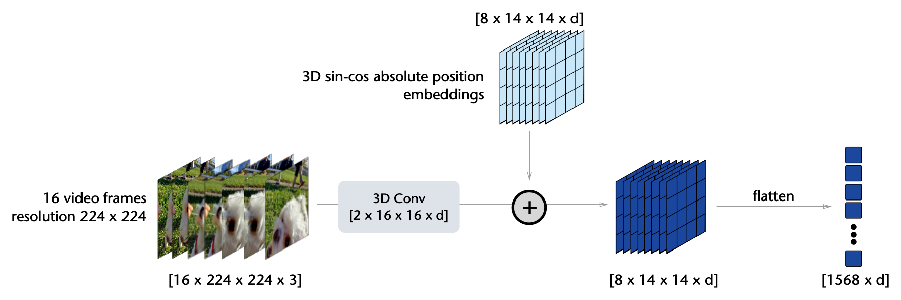

# Masked / JEPA 与潜变量预测

这页回答一个初学者很容易忽略的问题：**世界模型为什么不总是直接预测像素？**

<!-- [补充] -->
| 读者 | 建议读法 | 工程落点 |
| --- | --- | --- |
| 初学者 | 先抓“Masked / JEPA 与潜变量预测”要解决的问题、关键术语和最小例子；公式只看变量方向。 | 能说清输入、输出和常见失败信号。 |
| 工程师 | 直接对照结构、指标、成本和边界条件，必要时回到前置页补概念。 | 落到数据、算力、延迟、显存、评测和回滚检查。 |


!!! note "读法定位"
    这页先回答“Masked / JEPA 与潜变量预测”在「世界模型」里的位置：它解决什么局部问题，依赖哪些前置，最后会影响哪类工程或研究判断。
    **前置**：先知道潜变量、时序预测、VLM/VLA 与训练效率；再看具体论文和工程案例。 必要时先回 [世界模型入口](index.md)、[基础知识](../foundations/index.md) 或 [术语表](../glossary/index.md)。
    **主线关系**：把表征预测、潜变量动力学、规划、rollout 服务和具身/视频应用连成“可模拟、可评估、可行动”的主线。

如果目标是生成视频，像素或视频 latent 当然重要；但如果目标是规划和控制，模型真正需要保留的是会改变动作选择的变量：物体位置、运动趋势、接触、遮挡、任务阶段、奖励、风险和终止。Masked / JEPA 路线的价值，就是把训练压力从逐像素复原转向更抽象、更稳定的 latent 或 embedding。

!!! note "一句话结论"
    Masked / JEPA 可以提高表示效率和样本效率，但原始形式通常还不包含 action、reward、done 和 closed-loop 消费接口。要成为可规划世界模型，还必须接 action-conditioned dynamics、risk/reward heads 和闭环评测。

## 为什么不直接预测像素

像素预测有一个好处：监督信号密集，输出直观。但它对世界模型也有明显副作用。

| 像素预测容易花容量在 | 对决策是否关键 | 可能的问题 |
| --- | --- | --- |
| 背景纹理、光照、阴影 | 通常不关键 | 模型很会画，但不会判断动作风险 |
| 局部细节 | 有时关键，有时是噪声 | 接触和物体状态被纹理误差淹没 |
| 平均未来 | 对多模态未来很危险 | 杯子可能左滑或右滑，平均后变成不真实状态 |
| 高分辨率输出 | 控制主链路常承受不起 | 每个候选动作都解码视频太慢 |

所以高效世界模型常走一条更务实的路线：

```text
先学视觉 / 视频 latent
  -> 在 latent 上预测未来或遮挡部分
  -> 再接动作条件 dynamics、reward、done、risk
  -> 用 closed-loop 评测判断是否真能规划
```

这不是否定像素视频。可视化、人审、数据回流和生成式模拟仍然需要视频输出。关键是：控制主路径不一定要逐帧生成高清未来。

## 四种训练目标对照

| 目标 | 简化 loss | 输入输出 | 省下什么 | 不能证明什么 |
| --- | --- | --- | --- | --- |
| Pixel reconstruction | \(\mathcal{L}_{pix}=d(\hat{x},x)\) | 输入上下文，输出像素 | 监督直接，可视化方便 | 像素准不等于会选动作 |
| Token / latent reconstruction | \(\mathcal{L}_{lat}=d(\hat{z}_M,z_M)\) | 输入可见 token，预测遮挡 latent | 降低输出维度 | latent 是否保留 reward/risk 仍需验证 |
| Joint-embedding prediction | \(\mathcal{L}_{jepa}=d(P_\theta(E_c(x_{\setminus M})),\text{sg}(E_t(x_M)))\) | context encoder 预测 target encoder 表征 | 不需要像素 decoder | 原始 JEPA 不含动作、奖励、终止 |
| Action-conditioned latent dynamics | \(\mathcal{L}_{dyn}=d(\hat{z}_{t+1},z_{t+1})+\lambda_r\ell(\hat r,r)+\lambda_d\ell(\hat d,d)\) | 输入 latent 和动作，输出未来 latent/reward/done | 在低维状态里比较候选动作 | 多步漂移和模型漏洞仍会伤闭环 |

可以把它理解成学习阶梯：pixel reconstruction 证明模型能看见，latent prediction 证明模型能压缩，JEPA 证明模型能预测抽象结构，action-conditioned dynamics 才开始回答“如果我这样做，会发生什么”。

## MWM：先压视觉，再学 dynamics

`Masked World Models for Visual Control` 的核心思路是把视觉表征和 dynamics 解耦：先用 masked convolutional features 训练视觉 autoencoder，并加入 reward prediction；再冻结或解耦这个表示，在 latent space 中训练 dynamics model。

{ width="920" }

<small>图源：[Masked World Models for Visual Control](https://arxiv.org/abs/2206.14244)，Figure 1。原图意：左侧用 masked convolutional features 训练视觉 autoencoder，并预测 reward；右侧在 autoencoder latent space 中训练 latent dynamics，且 dynamics learning 阶段不更新 autoencoder 参数。</small>

!!! note "图解卡：MWM framework"
    **输入输出**：左边输入图像 \(o_t\)，输出重建观测和 reward；右边输入 latent、动作历史和 stochastic state，输出下一步 latent。<br>
    **关键模块**：masked visual representation 负责“看懂并压缩”，latent dynamics 负责“动作后果”。<br>
    **公式对应**：左边近似 \(\mathcal{L}_{lat}/\mathcal{L}_{pix}\)，右边接近 \(\mathcal{L}_{dyn}\)。<br>
    **容易误读**：MWM 不是说 masked reconstruction 本身已经会规划，而是说更好的视觉表征能让后续 dynamics 更省样本。

{ width="920" }

<small>图源：[Masked World Models for Visual Control](https://arxiv.org/abs/2206.14244)，Figure 4。原图意：展示 MWM 与 DreamerV2 在 Meta-world aggregate、RLBench Reach Target 和 RLBench Push Button 上的 success rate 学习曲线。</small>

!!! note "合并提示"
    **note · 图解卡：MWM results**

    **输入输出**：横轴是环境交互步数，纵轴是成功率；曲线比较同等真实交互下的学习速度。<br>
    **关键模块**：如果 MWM 曲线更快上升，说明 masked representation + latent dynamics 在这些视觉控制设置中提高样本效率。<br>
    **公式对应**：不是单纯看重建 loss，而是看 representation 是否改善 downstream control。<br>
    **容易误读**：这组结果不能外推为“所有 masked model 都能真实机器人闭环规划”。

    **warning · 读数边界**

    Figure 4 是论文设置下的 Meta-world / RLBench paper result。它支持“MWM 在这些视觉控制任务中改善样本效率”，但不能证明任意视频世界模型都应优先用 MWM，也不能替代 action sensitivity 和真实部署评测。

## V-JEPA：预测 latent，不画回像素

V-JEPA 的关键转向是：让模型预测 target encoder 产生的 latent representation，而不是用 decoder 把被遮挡区域逐像素画回来。这样可以减少对低层纹理的依赖，把容量更多放在对象、运动和场景结构上。

{ width="860" }

<small>图源：[V-JEPA: Latent Video Prediction for Visual Representation Learning](https://arxiv.org/abs/2404.08471)，Figure 2。原图意：在视频时空体上采样多个 3D block mask，让 context encoder 只能看到部分时空区域。</small>

!!! note "图解卡：3D multi-block masking"
    **输入输出**：输入是一段视频 token grid，mask 遮住多个时空块，模型从可见上下文预测被遮挡区域的 target latent。<br>
    **关键模块**：mask 不只是遮几个像素，而是在时间和空间上遮结构块，迫使模型利用运动和对象关系。<br>
    **公式对应**：\(x_{\setminus M}\) 是可见上下文，\(x_M\) 是被遮挡目标。<br>
    **容易误读**：会补全遮挡 latent 不等于懂动作后果，因为这里还没有动作 \(a_t\)。

{ width="920" }

<small>图源：[V-JEPA: Latent Video Prediction for Visual Representation Learning](https://arxiv.org/abs/2404.08471)，Figure 3。原图意：context encoder 处理 masked sequence，predictor 用 learnable mask tokens 预测目标位置，target encoder 处理未遮挡完整输入并提供 latent target。</small>

!!! note "图解卡：V-JEPA training"
    **输入输出**：context encoder 只看可见 token；target encoder 看完整视频并提供 stop-gradient latent；predictor 输出 masked positions 的预测表示。<br>
    **关键模块**：target encoder 像老师，context encoder 和 predictor 像学生；学生不画像素，只追目标表征。<br>
    **公式对应**：\(\mathcal{L}_{jepa}=d(P_\theta(E_c(x_{\setminus M})),\text{sg}(E_t(x_M)))\)。<br>
    **容易误读**：V-JEPA 是 internal representation 路线，不是直接可交互视频模拟器。

{ width="860" }

<small>图源：[V-JEPA: Latent Video Prediction for Visual Representation Learning](https://arxiv.org/abs/2404.08471)，Figure 4。原图意：展示视频如何被切分成时空 token，并通过 encoder/predictor 进入 latent prediction 目标。</small>

!!! note "图解卡：tokenization"
    **输入输出**：连续视频先变成时空 token，再进入 encoder 和 predictor；输出是目标 token 的 latent。<br>
    **关键模块**：tokenization 决定上下文长度，latent prediction 决定输出维度。<br>
    **公式对应**：视频 token 是 \(x_t\) 到 \(z_t\) 的前置压缩接口。<br>
    **容易误读**：token 更少不等于控制更好；必须检查接触、遮挡、风险和动作敏感性是否保留。

## V-JEPA 2-AC：从表征预测走向动作条件规划

V-JEPA 2-AC 更接近世界模型主线，因为它把视频自监督表征接到 action-conditioned predictor，并用 `MPC/CEM` 搜索动作序列，使未来 latent 接近目标图像 latent。

{ width="920" }

<small>图源：[V-JEPA 2: Self-Supervised Video Models Enable Understanding, Prediction and Planning](https://arxiv.org/abs/2506.09985)，Figure 7。原图意：在 V-JEPA 2-AC 中，对候选动作序列做 model predictive control，让 imagined state representation 在未来 \(T\) 步后接近 goal representation。</small>

!!! note "图解卡：V-JEPA 2-AC planning"
    **输入输出**：输入当前观测、目标图像和候选动作序列；模型在 latent space 里 rollout，输出未来表示并与目标表示比较。<br>
    **关键模块**：action-conditioned predictor 把动作放进 latent dynamics，MPC/CEM 在候选动作中搜索。<br>
    **公式对应**：从 \(\mathcal{L}_{jepa}\) 前进到 \(p_\theta(z_{t+1:t+H}\mid z_t,a_{t:t+H-1})\)。<br>
    **容易误读**：它证明的是特定机器人设置中的 representation-space planning，不是所有 JEPA 表征天然可规划。

{ width="920" }

<small>图源：[V-JEPA 2: Self-Supervised Video Models Enable Understanding, Prediction and Planning](https://arxiv.org/abs/2506.09985)，Table 3。原图意：比较 V-JEPA 2-AC 与 Cosmos world model 在机器人操作任务中的规划性能与时间。</small>

!!! note "图解卡：planning results"
    **输入输出**：表格报告不同方法在机器人任务中的规划结果和时间成本。<br>
    **关键模块**：这里的证据比 frozen eval 更接近世界模型，因为它包含 closed-loop planning 设置。<br>
    **公式对应**：模型输出未来 latent 后，planner 选择让未来 latent 更接近目标的动作。<br>
    **容易误读**：表格不是跨平台通用控制结论，仍受目标图像、动作空间、任务集和硬件设置限制。

## 什么时候它还不是完整世界模型

| 情况 | 为什么不够 | 需要补什么 |
| --- | --- | --- |
| 只有 masked image/video reconstruction | 学到视觉补全，不一定学到动作后果 | action-conditioned dynamics、反事实动作评测 |
| 只有 JEPA 表征 benchmark | 表征好不等于能规划 | reward/done/risk heads、closed-loop policy 或 MPC |
| 只报告 FVD/VBench/demo | 视频自然度和 planning utility 不是同一指标 | action sensitivity、candidate ranking agreement |
| latent 太压缩 | 省 token 但可能丢接触、透明物体、遮挡身份 | task-state probing、failure replay、hard-negative eval |
| mask 或 tokenizer 只在静态数据上验证 | 静态泛化不能覆盖控制分布 shift | offline-online hybrid、真实 rollout 回流 |

## 工程选择

| 需求 | 优先路线 | 原因 |
| --- | --- | --- |
| 机器人/游戏样本效率，已有 reward/done | RSSM / Dreamer / MWM | 直接围绕 latent dynamics 和 control signal 优化 |
| 大规模视频预训练，缺少动作 | V-JEPA / H-JEPA | 先学稳定视频表征，再接动作头 |
| 目标图像驱动规划 | V-JEPA 2-AC / MPC | 在 representation space 比较候选动作与目标 |
| 需要生成可检查视频反事实 | action-conditioned video world model | 需要外部模拟和人类/系统审查 |
| 实时闭环控制 | latent dynamics + 短 horizon refresh | 优先压延迟和 drift，而不是追求像素质量 |

## Claim Ledger

| Claim | Source | Evidence Type | Can Support | Cannot Prove |
| --- | --- | --- | --- | --- |
| MWM 在论文设置中通过 decoupled representation + dynamics 改善视觉控制样本效率 | [MWM](https://arxiv.org/abs/2206.14244) | Paper Result | masked visual representation 可以服务 model-based visual control | 任意 masked model 都能 closed-loop 规划 |
| V-JEPA 通过 latent target prediction 避免部分像素重建成本 | [V-JEPA](https://arxiv.org/abs/2404.08471) | Ablation | joint-embedding prediction 是高效视频表征预训练路线 | 原始 V-JEPA 已经包含动作、奖励和终止建模 |
| V-JEPA 2-AC 把 JEPA 表征接到动作条件 latent planning | [V-JEPA 2](https://arxiv.org/abs/2506.09985) | Closed-loop | 表征空间 MPC 可以在特定机器人设置中执行目标驱动任务 | 跨平台通用控制、长时风险规划和真实部署安全性 |

## 接回主线

读完这页后，回到 [RSSM、Dreamer 与规划](rssm-dreamer-and-planning.md) 看 latent dynamics 如何真正进入 actor-critic；再读 [WM / WAM / VAM](wm-wam-vam-and-action-conditioned-modeling.md)，判断动作是条件、输出还是和世界未来联合生成；最后用 [世界模型评测与失效模式](evaluation-and-failure-modes.md) 检查表征是否真的改善决策。

!!! tip "下一站"
    - 回到本专题入口：[世界模型](index.md)，确认这页在整条路线中的位置。
    - 按导航顺序继续：[WM / WAM / VAM：动作条件建模](wm-wam-vam-and-action-conditioned-modeling.md)。
    - 概念或符号卡住时，先查 [术语表](../glossary/index.md)，再回到当前页。
