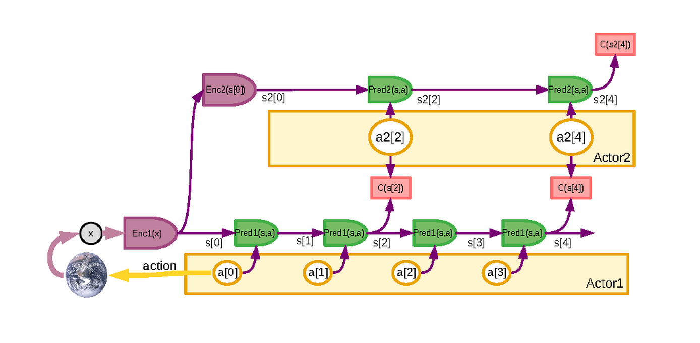

# 规划即推理与潜在动作

世界模型与规划有一条重要线索：规划不一定只能写成显式搜索或值函数优化，也可以写成推断问题。与此同时，复杂动作空间直接规划太难，很多系统会把动作片段压缩成潜在动作或技能代码，再在更紧凑的空间里做推理。

<!-- [补充] -->
| 读者 | 建议读法 | 工程落点 |
| --- | --- | --- |
| 初学者 | 先抓“规划即推理与潜在动作”要解决的问题、关键术语和最小例子；公式只看变量方向。 | 能说清输入、输出和常见失败信号。 |
| 工程师 | 直接对照结构、指标、成本和边界条件，必要时回到前置页补概念。 | 落到数据、算力、延迟、显存、评测和回滚检查。 |

!!! note "读法定位"
    这页先回答“规划即推理与潜在动作”在「世界模型」里的位置：它解决什么局部问题，依赖哪些前置，最后会影响哪类工程或研究判断。
    **前置**：先知道潜变量、时序预测、VLM/VLA 与训练效率；再看具体论文和工程案例。 必要时先回 [世界模型入口](index.md)、[基础知识](../foundations/index.md) 或 [术语表](../glossary/index.md)。
    **主线关系**：把表征预测、潜变量动力学、规划、rollout 服务和具身/视频应用连成“可模拟、可评估、可行动”的主线。

这页连接三件事：为什么奖励最大化可以改写成后验推断，为什么潜在动作适合高维控制，以及这条路线如何和 `WM / WAM / VAM` 接起来。

!!! note "合并提示"
    **note · 初学者先抓住**

    Planning as Inference 把“找最高奖励动作”改写成“推断哪些轨迹最像成功轨迹”。潜在动作则把连续细碎的控制序列压缩成技能代码，让规划器在更短、更语义化的空间里搜索。

    **note · 难点解释：为什么要有行为先验**

    直接最大化奖励容易找到奇怪但高分的动作，尤其当世界模型不完美时。行为先验像一条护栏：它偏向真实数据里可执行、自然、稳定的动作轨迹，减少 planner 利用模型漏洞。

    **example · 有趣例子：导航时不走奇怪捷径**

    如果地图软件只看最短距离，可能会推荐翻墙穿过工地。行为先验就像“人通常会走人行道和门”的常识，帮助规划器避开模型里看似高分但现实不可执行的捷径。

## 规划为什么可以写成推断

传统控制常写成：

\[
\max_\pi \mathbb{E}_{\pi}\left[\sum_{t=1}^{T} r(s_t,a_t)\right]
\]

<!-- [补充：符号说明] -->
| 符号 | 含义 | 取值范围 / 常见值 |
| --- | --- | --- |
| \(\pi\) | 策略或概率分布 | 非负概率分布，总和为 1 |
| \(t\) | 时间步、索引或计数 | 整数索引或归一化时间区间，见正文 |
| \(T\) | 时间步、索引或计数 | 整数索引或归一化时间区间，见正文 |
| \(r\) | 奖励、回报或时间索引相关量 | 实数标量或上下文定义的索引范围 |
| \(s_t\) | 状态、序列长度或分数 | 状态空间/正整数/实数标量，依上下文而定 |
| \(a_t\) | 动作、优势或系数 | 动作空间/实数标量，依上下文而定 |

`Planning as Inference` 会引入“最优性变量” \(\mathcal{O}_t\)，把高奖励轨迹视作更高后验概率的轨迹：

\[
p(a_{1:T},s_{1:T}\mid \mathcal{O}_{1:T}=1)
\]

<!-- [补充：符号说明] -->
| 符号 | 含义 | 取值范围 / 常见值 |
| --- | --- | --- |
| \(p\) | 概率、转移分布或预测量 | 概率分布或任务定义的张量 |
| \(a_{1:T}\) | 动作、优势或系数 | 动作空间/实数标量，依上下文而定 |
| \(s_{1:T}\) | 状态、序列长度或分数 | 状态空间/正整数/实数标量，依上下文而定 |
| \(T\) | 时间步、索引或计数 | 整数索引或归一化时间区间，见正文 |

一个常见构造是：

\[
p(\mathcal{O}_t=1\mid s_t,a_t)\propto \exp(r(s_t,a_t))
\]

<!-- [补充：符号说明] -->
| 符号 | 含义 | 取值范围 / 常见值 |
| --- | --- | --- |
| \(p\) | 概率、转移分布或预测量 | 概率分布或任务定义的张量 |
| \(s_t\) | 状态、序列长度或分数 | 状态空间/正整数/实数标量，依上下文而定 |
| \(a_t\) | 动作、优势或系数 | 动作空间/实数标量，依上下文而定 |
| \(r\) | 奖励、回报或时间索引相关量 | 实数标量或上下文定义的索引范围 |

于是轨迹后验可写成：

\[
p(\tau\mid \mathcal{O}_{1:T}=1)
\propto
p(\tau)\prod_{t=1}^{T}\exp(r(s_t,a_t))
\]

<!-- [补充：符号说明] -->
| 符号 | 含义 | 取值范围 / 常见值 |
| --- | --- | --- |
| \(\tau\) | 轨迹或采样路径 | 由策略与环境/数据生成过程决定 |
| \(p\) | 概率、转移分布或预测量 | 概率分布或任务定义的张量 |
| \(T\) | 时间步、索引或计数 | 整数索引或归一化时间区间，见正文 |
| \(t\) | 时间步、索引或计数 | 整数索引或归一化时间区间，见正文 |
| \(r\) | 奖励、回报或时间索引相关量 | 实数标量或上下文定义的索引范围 |
| \(s_t\) | 状态、序列长度或分数 | 状态空间/正整数/实数标量，依上下文而定 |

取对数后，奖励项推动轨迹更优，轨迹先验 \(p(\tau)\) 起到正则化作用。这也是为什么 planning as inference 常和 behavior prior、KL-regularized control、maximum-entropy RL 放在一起讨论。

{ width="860" }

<small>图源：[A Path Towards Autonomous Machine Intelligence](https://openreview.net/forum?id=BZ5a1r-kVsf)，Figure 17。原论文图意：在不确定环境中，latent variables 表达不能从先验观测推出的预测信息；规划时可以采样多条 latent trajectory，并通过均值、方差或风险敏感目标选择动作序列。</small>

!!! note "难点解释：为什么规划要保留多种未来"
    如果世界模型只给一个平均未来，planner 会误以为环境是确定的；但真实场景里可能有遮挡目标、未观测意图或随机干扰。latent variable 让模型保留多条可能轨迹，规划器就能比较“平均收益高但风险大”和“收益略低但更稳”的选择。这也是 planning as inference 比单纯最大化一条 reward 轨迹更自然的地方。

## 这个视角对世界模型有什么用

世界模型通常已经在学习：

1. 状态转移；
2. 观测分布；
3. reward / cost / risk；
4. 隐变量或 belief state。

设隐状态为 \(s_t\)，动作为 \(a_t\)。世界模型通常提供三类预测分布：

\[
p(s_{t+1}\mid s_t,a_t),\qquad
p(o_t\mid s_t),\qquad
p(r_t\mid s_t,a_t)
\]

<!-- [补充：符号说明] -->
| 符号 | 含义 | 取值范围 / 常见值 |
| --- | --- | --- |
| \(p\) | 概率、转移分布或预测量 | 概率分布或任务定义的张量 |
| \(s_{t+1}\) | 状态、序列长度或分数 | 状态空间/正整数/实数标量，依上下文而定 |
| \(s_t\) | 状态、序列长度或分数 | 状态空间/正整数/实数标量，依上下文而定 |
| \(a_t\) | 动作、优势或系数 | 动作空间/实数标量，依上下文而定 |
| \(o_t\) | 公式中的变量或中间量 | 按上下文定义 |
| \(r_t\) | 奖励、回报或时间索引相关量 | 实数标量或上下文定义的索引范围 |

在此基础上引入最优性变量，规划就可以变成隐状态轨迹上的后验推断。经典 `WM` 更强调“给定动作后世界怎么变”，planning as inference 进一步问：“在这些世界演化规律之上，什么动作后验最像成功轨迹？”

这个视角的价值是，它天然容纳不确定性、行为先验、约束和部分可观测状态，不必把规划、状态估计和动作先验拆成完全独立的问题。

## 潜在动作为什么必要

真实机器人或复杂 agent 的原始动作空间往往高维、噪声大、短时强相关。机械臂每一步可能包含末端位姿增量、抓手开合、关节速度和力控制参数；网页 agent 的动作可能包含点击、输入、等待、工具调用和状态检查。直接在这些原始动作上做长时搜索，很快会遇到组合爆炸。

潜在动作的想法是：先把动作片段压缩成低维代码 \(z\)，再规划：

\[
z_{1:K} \rightarrow a_{1:T}
\]

<!-- [补充：符号说明] -->
| 符号 | 含义 | 取值范围 / 常见值 |
| --- | --- | --- |
| \(z_{1:K}\) | 样本、状态或 latent 变量 | 张量空间，形状由数据表示决定 |
| \(a_{1:T}\) | 动作、优势或系数 | 动作空间/实数标量，依上下文而定 |

这样 planner 不必在每个细粒度控制量上搜索，而是在“接近把手”“抓取并提起”“重新观察”“调用工具并检查结果”这类更高层动作单元上推理。

潜在动作的关键要求是：

1. 足够紧凑，便于规划；
2. 足够可解码，能还原可执行动作；
3. 足够有语义，能表达任务阶段和技能；
4. 与世界模型 latent 对齐，方便预测动作后果。

{ width="920" }

<small>图源：[A Path Towards Autonomous Machine Intelligence](https://openreview.net/forum?id=BZ5a1r-kVsf)，Figure 16。原论文图意：分层 JEPA / world model 可以在不同抽象层级上预测和规划，高层处理慢变量与目标，低层处理更细的动作和观测。</small>

!!! note "合并提示"
    **note · 图解：潜在动作为什么天然适合分层**

    高层 planner 不应该搜索每一个关节微动作，而应该搜索“接近、抓取、放置、重新观察”这类更粗的技能或 latent action；低层控制器再把它展开成连续轨迹。分层规划图的意义在于把时间尺度、抽象程度和动作粒度对齐，减少长时任务里的组合爆炸。

    **note · 常见误区：潜在动作只是压缩**

    如果潜在动作只是把原始控制序列压短，却不能稳定解码成可执行动作，也不能让世界模型预测不同选择的后果，那么它只是数据压缩。真正有用的 latent action 应该同时降低搜索难度、保留技能语义，并让 planner 能比较不同动作分支的风险和收益。

## 潜在动作如何学习

常见路线包括：

| 路线 | 做法 | 适合场景 |
| --- | --- | --- |
| VAE 动作片段 | \(q_\phi(z\mid a_{t:t+H})\) 编码，\(p_\theta(a_{t:t+H}\mid z)\) 解码 | 连续控制、可微优化 |
| 离散技能代码 | tokenizer/codebook 把动作片段离散化 | 高层规划、技能组合 |
| 行为分段 | 从演示中切出技能原语 | 机器人任务、流程型 agent |
| Action chunk | 直接把固定长度动作块当规划单位 | VLA、遥操作学习 |
| World-action latent | 在世界模型 latent 中联合定义动作转移 | WAM/VAM 路线 |

不同路线的取舍在于：连续 latent 更适合梯度优化，离散技能更像程序或 token 组合，action chunk 工程上简单但解释性和复用性较弱。

## 和 WM、WAM、VAM 的关系

Planning as inference 与潜在动作可以接到三类世界模型上：

1. **WM**：给定候选 latent action，世界模型 rollout 未来状态、reward 和 risk，再由 planner 选择；
2. **WAM**：模型直接联合生成未来动作和未来观测，planner 更像在联合后验中采样；
3. **VAM**：视频 latent 提供时空先验，潜在动作对齐视频变化，用于动作生成或数据合成。

这也是为什么潜在动作是连接经典 world model 和现代 action-conditioned generative model 的桥。它把“世界如何变”和“动作如何组织”放到同一个推理框架里。

## 工程风险

这条路线常见失败模式包括：

| 风险 | 表现 | 处理方向 |
| --- | --- | --- |
| Latent 不可执行 | planner 找到高分 \(z\)，解码动作做不出来 | 加可执行性约束和行为先验 |
| Latent 无语义 | 搜索空间变小但不可控 | 加任务阶段、技能标签或离散代码 |
| World model 偏差 | imagined success 线上失败 | 做模型不确定性和真实回放校验 |
| 长时 rollout 漂移 | 短期可用，长任务崩 | 缩短 horizon、replan、引入风险头 |
| 先验过强 | 模型只会模仿旧行为 | 加反事实数据和探索机制 |

不要只看 imagined return。真正要看的是接入 planner 后的闭环成功率、恢复能力、风险率和系统延迟。

## 评测清单

评估这类方法时建议同时报告：

1. latent action 重建误差和可执行率；
2. latent 空间中的任务阶段可分性；
3. world model 对不同 latent action 的未来分叉是否合理；
4. planner 在固定计算预算下的成功率和风险率；
5. replan 频率、单步延迟和 horizon 成本；
6. OOD 状态下是否能回退到保守动作；
7. 与原始动作搜索、行为克隆和经典 MPC 的对比。

Planning as inference 的价值不在于把控制问题换个数学名字，而在于把奖励、先验、约束、不确定性和动作表示放进同一个概率框架。潜在动作则让这个框架在高维真实动作空间里更可计算。

!!! tip "下一站"
    - 回到本专题入口：[世界模型](index.md)，确认这页在整条路线中的位置。
    - 按导航顺序继续：[不确定性与风险敏感规划](uncertainty-and-risk-aware-planning.md)。
    - 概念或符号卡住时，先查 [术语表](../glossary/index.md)，再回到当前页。
