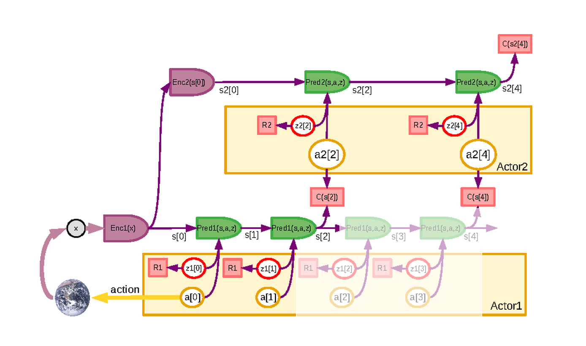
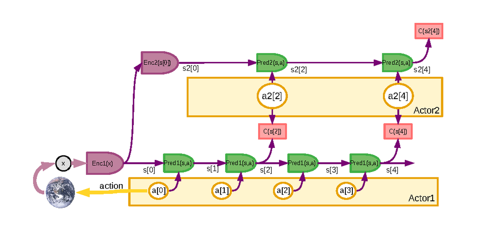

# 规划即推理与潜在动作

一维小车从位置 0 出发，目标位置为 2，动力学为 $x_{k+1}=x_k+a_k$。两步动作 `[1,1]` 到达目标，`[0,1]` 仍差一格。规划可以直接比较这两条轨迹，也可以让高回报轨迹获得更大的采样概率。这个小例子先把“规划即推断”落到两条可执行轨迹上，再讨论 soft policy、轨迹采样和 latent action 搜索，避免公式脱离控制接口。

## 奖励怎样改变轨迹分布

先限定一个可行轨迹集合与基准分布 $p_0(\tau)$。令总回报为 $R(\tau)$、温度为 $\alpha>0$，定义

\[
q^*(\tau)=\frac1Zp_0(\tau)\exp(R(\tau)/\alpha).
\]

同一基准概率下，高回报轨迹权重更大；$\alpha$ 越小，分布越集中到高回报部分。该式等价于在允许的分布族中最大化

\[
\mathbb E_q[R(\tau)]-\alpha D_{\mathrm{KL}}(q\|p_0).
\]

证明只需展开 $\log q^*=\log p_0+R/\alpha-\log Z$，代入 $D_{\mathrm{KL}}(q\|q^*)$。与 $q$ 无关的 $\alpha\log Z$ 不影响优化，因此最小化 KL 就对应上述收益与先验偏移的折中。

引入“最优性变量”时，有时写 $p(\mathcal O=1\mid\tau)\propto\exp(R/\alpha)$。如果把它当作真正二元概率，必须保证归一化后的值不超过 $1$；一般更稳妥地把指数项理解成非负势函数，而不是任意正奖励下都合法的 Bernoulli 概率。

## 小车的回报怎样改变采样概率

令每步奖励为 $-(x_{k+1}-2)^2$，则 `[1,1]` 的回报为 $-1$，`[0,1]` 为 $-5$。基准分布对二者各给 0.5，取 $\alpha=2$。二者指数权重之比为 $\exp((-1+5)/2)=e^2$，所以归一化概率约为 0.8808 和 0.1192。

```python
import math
rewards = [-1.0, -5.0]
alpha = 2.0
weights = [0.5 * math.exp(r / alpha) for r in rewards]
probabilities = [w / sum(weights) for w in weights]
assert abs(probabilities[0] - 0.880797078) < 1e-9
```

减小温度会更集中于第一条，但不会让不存在于基准支持里的轨迹凭空出现。若基准不给 `[1,1]` 任何概率，单靠乘指数权重仍无法选它。行为先验限制了搜索范围，也可能排除了更好的方案。

随机环境中还要限制哪些分布可由策略实现。直接对整条轨迹做无约束后验优化，可能同时偏爱“环境恰好走运”的状态转移；真实控制器只能选动作，不能修改转移随机性。控制即推断需要把真实动力学作为约束，或使用相应的变分推断形式，不能把任意后验直接当作可执行 policy。理论背景见 [Reinforcement Learning and Control as Probabilistic Inference](https://arxiv.org/abs/1805.00909)。

{ width="860" }

<small>图源：[A Path Towards Autonomous Machine Intelligence](https://openreview.net/forum?id=BZ5a1r-kVsf)，Figure 17，潜变量与不确定未来的规划示意。</small>

## 为什么把动作块压成 latent

若机械臂每步有七维动作，预测 16 步就有 112 个连续变量。直接在这个空间随机采样，绝大多数序列可能不平滑或不可执行。潜在动作 $u$ 用 decoder 生成动作块

\[
u\sim p(u\mid h,g),\qquad a_{t:t+K-1}=D_\psi(u,h).
\]

这里 $u$ 表示 latent action，与世界状态 $z$ 分开记号。可以用自编码器从示范动作块学习 $u$，或用 inverse dynamics 从相邻观察推断变化编码。前者有真实动作监督，后者可能只有视频中的变化，含义与可执行性不同。

压缩后的搜索空间小，不代表每个 latent 都有合法动作。Decoder 输出还必须满足动作范围、速度、控制模式与身体几何。若训练只见过抓杯子，latent 插值可能产生一段平滑但碰撞的动作；动作平滑性与任务可行性也不同。

## Latent action 什么时候只是运动标签

无动作视频中，两个帧之间的变化可能来自机器人、相机移动、外部人或物体自身运动。Inverse model 若把这些因素混入 latent，操纵这个 latent 可能改变相机视角而非机器人动作。[Genie](https://arxiv.org/abs/2402.15391)展示从视频学习 latent action 的具体路线，其可交互语义不等于任意机器人上的已标定控制命令。

若要落到机器人，可用带动作数据学习 $D_\psi(u,h)$，核对同一 latent 在不同状态和 embodiment 下的实际后果，必要时引入状态条件或层级技能。不能仅靠 latent 可视化聚类就宣称它有稳定物理语义。

{ width="920" }

<small>图源：[A Path Towards Autonomous Machine Intelligence](https://openreview.net/forum?id=BZ5a1r-kVsf)，Figure 16，分层规划示意。</small>

## 从抽象目标回到真实反馈

回到小车，可以让一个标量 latent $u$ 生成两步同幅动作 $D(u)=[u,u]$。搜索维数从二变一，但无法生成 `[1,0]` 这样的先走后停轨迹。降维同时改变了可行集合；如果目标需要中途避障，少一个变量可能恰好丢掉必要行为。机器人技能 decoder 也有同样限制，只是更难从高维轨迹中直接看出。


一种层级系统由高层选择子目标或 latent skill，低层 decoder/controller 执行动作前缀，世界模型再根据新观察更新状态。上层 horizon 较长，底层刷新较快，二者通过可验证的完成条件连接。若“到达杯子附近”没有距离、姿态和接触定义，上层计划就无法判断技能何时结束。

比较 latent 搜索与原始动作搜索时，应保持环境任务与真实交互预算一致，再分别记录候选数量、horizon、decoder 成本和闭环成功。低维搜索节省候选评估，但 decoder 的偏差可能限制可达到的动作集合。模型错误与不可执行 latent 的诊断分别见[世界模型评测](evaluation-and-failure-modes.md)和[动作接口](wm-wam-vam-and-action-conditioned-modeling.md)。

## 模型和实验依据

轨迹分布的目标函数和 KL 约束参考 [Reinforcement Learning and Control as Probabilistic Inference](https://arxiv.org/abs/1805.00909)，latent action 的视频路线参考 [Genie](https://arxiv.org/abs/2402.15391)，分层规划的表示方式对照 [A Path Towards Autonomous Machine Intelligence](https://openreview.net/forum?id=BZ5a1r-kVsf)。小车、二维 latent 和动作 decoder 是本站的构造例子，重点是区分“搜索空间变小”和“可执行动作集合没有被错误压缩”。

回放时固定同一环境和交互预算，分别记录原始动作搜索与 latent 搜索的候选数、decoder 时间、违规动作比例和闭环成功率。只报告 latent 维度变小，无法说明规划真的更便宜或更安全。
