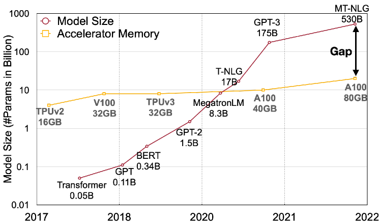
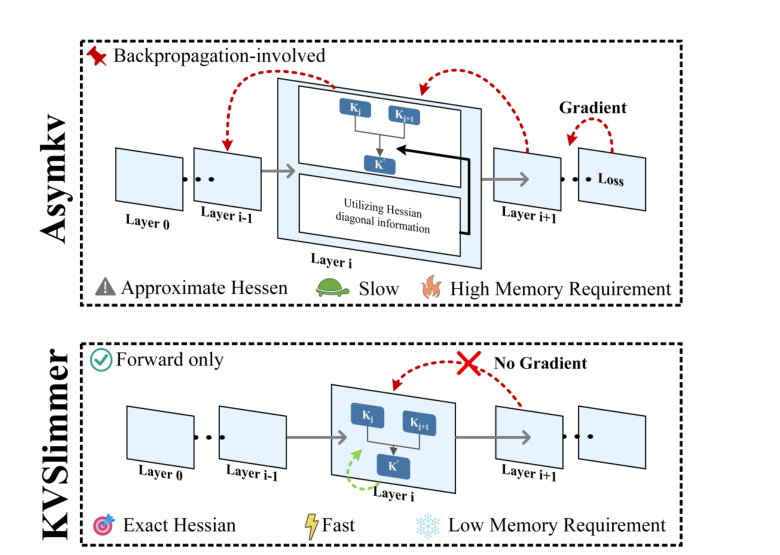
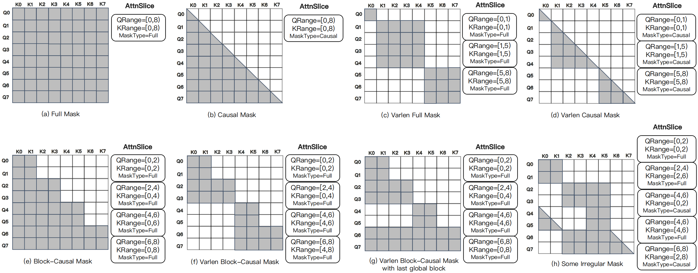
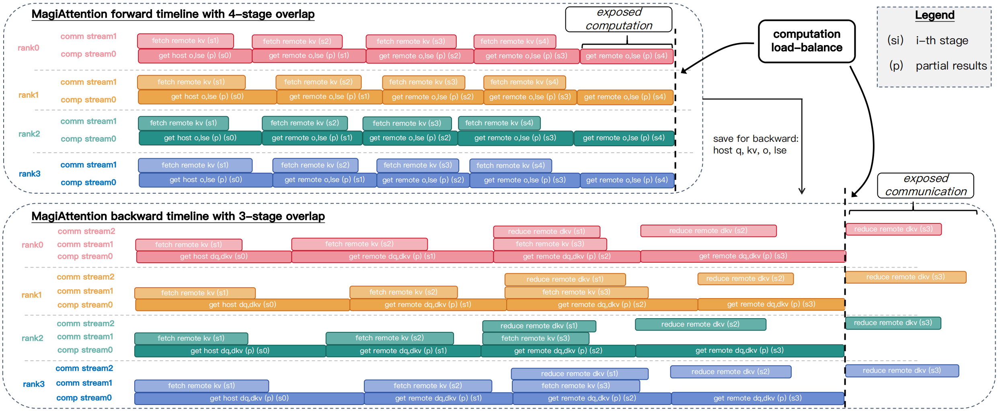
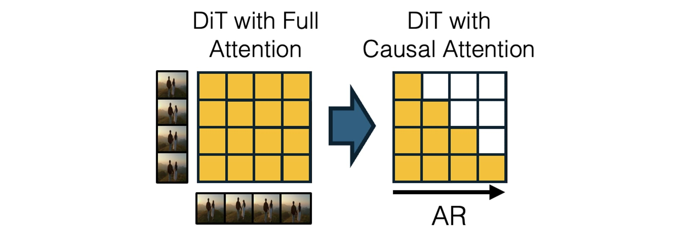

# Rollout 服务，一次候选规划请求的时间与显存

抓取 planner 在同一段历史上提出十六条动作候选，希望在 100 ms 内得到各自后果。世界模型服务需要完成历史编码、分支预测、风险读出与返回，队列中的等待也属于这 100 ms。优化应先沿这一次请求计算，才能判断量化、缓存或少步生成真正改变了哪里。

下文的层数、token 和时间都是教学假设，用于复算机制；它们不对应某个已部署系统。论文图保留为原始方法入口，不把其文本模型或视频测速外推为本抓取任务结果。

## 历史相同，不意味着所有候选都能共享缓存

假设自回归模型有 $L$ 层，每层 $n_{kv}$ 个 KV head，每头维数 $d$，缓存 $T$ 个 token，每个元素 $s$ 字节。普通密集 KV 大小为

\[
M_{\mathrm{KV}}=2L n_{kv}dTs.
\]

系数 2 对应 key 与 value。假设 $L=24,n_{kv}=8,d=64,s=2$，512 个历史 token 共需 24 MiB。每个候选再生成 64 个 token，新增缓存为 3 MiB。

如果十六个候选各自重复保存完整历史，总缓存为 $16(24+3)=432$ MiB。若运行时支持共享相同前缀、分叉后独立保存，则约为 $24+16\times3=72$ MiB，不含分页、元数据和临时缓冲。

```python
layers, kv_heads, head_dim, bytes_per_element = 24, 8, 64, 2
bytes_per_token = 2 * layers * kv_heads * head_dim * bytes_per_element
prefix = 512 * bytes_per_token
branch = 64 * bytes_per_token
assert prefix // 2**20 == 24
assert branch // 2**20 == 3
assert (prefix + 16 * branch) // 2**20 == 72
```

共享的前提是前缀计算真正相同。权重、位置编码、历史、条件和数值配置变化都可能使缓存失效。若候选动作通过双向条件影响历史 token 表示，连历史 KV 都未必相同。动作分叉以后继续复用另一候选的 KV，会把未来分支混起来。

此外，并非所有世界模型都使用这个形式。RSSM 的循环状态、扩散模型的中间张量和 Transformer KV 是不同对象。上述账只适用于所声明的缓存结构。

## 时间要按关键路径测量

假设输入与编码共 10 ms，排队 5 ms，候选 batch 预测 60 ms，读出 5 ms，下发 10 ms，总计 90 ms，距离 100 ms deadline 仅余 10 ms。把预测加速 20% 后，该段变为 48 ms，总时间变为 78 ms，整体快约 $90/78=1.154$ 倍。

这是假设串行、不重叠的账。真实系统可能并行编码或下发，应用时间戳应直接测 capture-to-apply，不能把重叠工作重复相加。十六个候选的 batch 时间也不能由单候选时间简单乘十六，矩阵利用率与显存压力都会变化。

均值 90 ms 仍可能有较多请求超时。应观察与实际负载一致的 P95/P99，以及迟到结果如何处理。一个正确但已经过期的结果和一个准时但错误的结果都可能不可用，不能用二者择一来定义系统安全。

## 量化降低的是哪一段搬运和计算

{ width="740" }

<small>图源：[SmoothQuant](https://arxiv.org/abs/2211.10438)，Figure 1。图展示大模型与设备显存的规模关系；世界模型是否受同样瓶颈约束仍需测量。</small>

权重从 16 bit 变为 8 bit，在忽略 scale 与额外元数据时，存储约减半；KV 也可以单独量化。这不保证延迟减半，运行时还需进行格式转换、scale 处理，并有对应硬件与 kernel。若工作负载受计算或队列限制，省显存可能主要增加并发容量，而不是缩短单请求时间。

SmoothQuant 通过通道尺度迁移处理激活难量化的问题。其等价变换在精确计算下保持矩阵乘结果，实际量化再引入近似。把方法迁移到视频或动作模型时，需要重新选择校准数据和模块范围，不能从原论文文本任务直接推断抓取风险头无损。

对 fast/slow 的分数差若只有 0.02，小数值误差就可能翻转选择。验证除了输出 MSE，还应查看候选间隔、危险事件漏报和完整任务。保留某些读出头高精度是一种待测方案，主干的误差仍可能传到这些头。

## 缓存压缩与删除历史是不同近似

{ width="780" }

<small>图源：[KVSlimmer](https://arxiv.org/abs/2603.00907)，Figure 1，非对称 KV 合并示意。原方法针对其论文模型与任务，不能将合并收益当成本页机器人结果。</small>

Key 影响查询如何分配注意力，value 提供被加权汇总的信息。合并、量化或删除缓存会以不同方式改变结果。对抓取任务，较旧的一帧可能恰好是杯子被遮挡前最后一次可靠观测；单凭“旧”或低平均注意力不足以证明它可安全删除。

可以固定历史与动作，比较压缩前后的对象身份、接触事件、候选排序以及长时返回场景。压缩后节省的显存还要扣除索引、聚合与额外转换开销。当前窗口保护是一种启发式，需要检验它是否足以覆盖任务所需记忆。

## Kernel 只能优化被正确表达的计算

{ width="920" }

{ width="920" }

<small>图源：[MagiAttention 文档](https://sandai-org.github.io/MagiAttention/docs/main/index.html)，mask pattern 与计算通信重叠示意。它们对应长序列系统问题，不能直接证明动力学准确性。</small>

训练时，变长轨迹和多相机 token 产生不同可见关系；推理时，共享历史与候选分支也形成特定 mask。先保证计算与基准一致，再讨论更少 padding、负载均衡和通信重叠。若优化后跨 episode 泄漏，loss 可能更低，却是在使用部署时没有的信息。

融合可以减少中间张量写回与发射开销，也可能增加寄存器占用。只有看实际 shape、GPU 和端到端 trace，才能知道它降低了哪一段等待。一个 kernel 的峰值提升不等于请求关键路径同步改善。

## 少步生成改变预测过程，需要新的任务比较

{ width="920" }

<small>图源：[CausVid](https://arxiv.org/abs/2412.07772)，双向 teacher 到因果流式 student 的机制示意。</small>

减少去噪步骤与缓存复用作用不同。前者改变采样近似，蒸馏还改变模型参数与目标；后者在满足前提时重用已有计算。视频生成更快之后，仍需确认动作条件与接触后果是否保留。

还要区分去噪步骤和环境时间。四个去噪步骤可能生成未来 0.8 秒，不能称为四个机器人控制动作。候选预测窗口、执行前缀与每轮生成步骤是三个独立参数。

对于 100 ms 请求，可以在固定候选数、固定任务集合下，分别测试原始路径、共享缓存、量化和少步模型，记录准确性、尾延迟和超时比例。最后再测试组合，因为多个近似的误差不一定相互独立。完整成本选择见[效率路线](efficient-training-roadmap.md)，任务侧指标见[世界模型评测](evaluation-and-failure-modes.md)。
