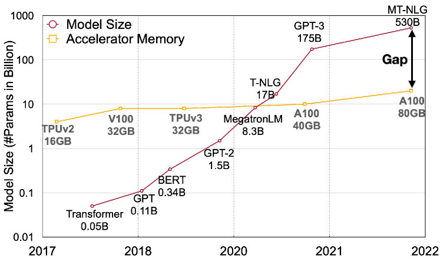
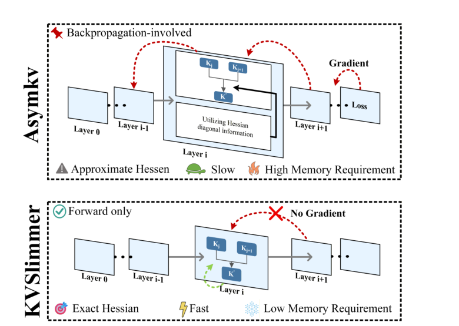
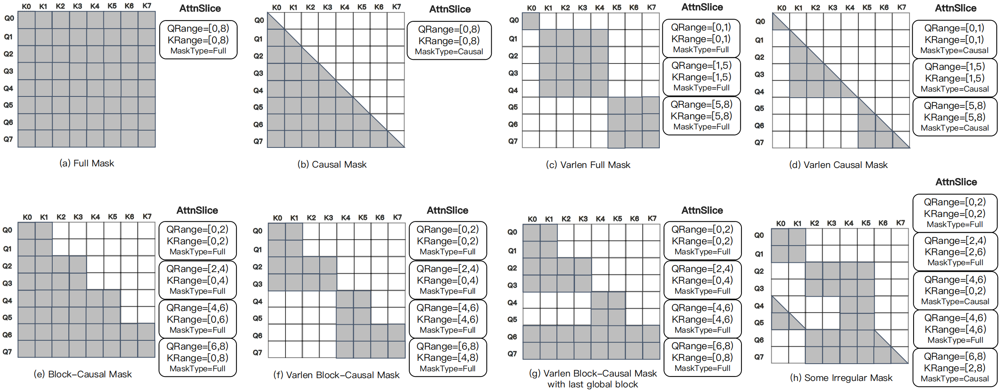
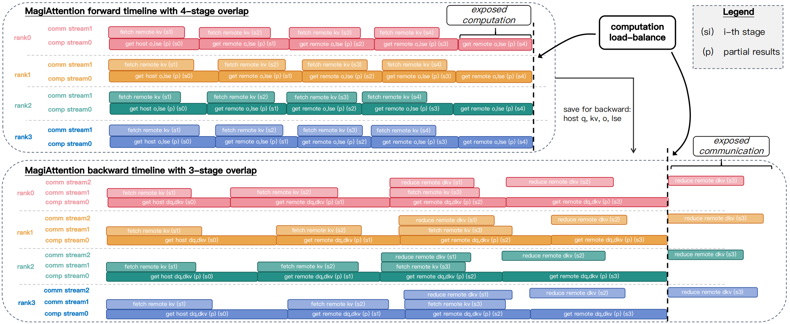
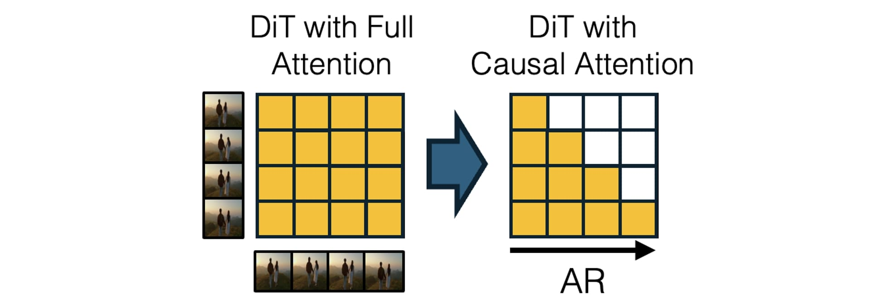

# Rollout 服务、量化与 Kernel：省成本不能省掉动作因果

世界模型进入系统后，问题会从“模型能不能预测未来”变成“能不能在规划器等待窗口内，以可接受成本预测多条候选未来”。这时量化、KV cache、少步视频生成、长上下文 attention 和 kernel 调度都会进入同一条链。

降低 rollout 成本时，必须同时证明动作分叉、风险判断和闭环收益没有被压坏。

## Rollout 服务到底在服务谁

世界模型 rollout 可能服务三类消费者。第一类是 planner，需要比较多个候选动作；第二类是 risk gate，需要识别碰撞、滑落、遮挡、不可达和 near-miss；第三类是 data engine，需要生成反事实和失败回放。它们关心的不是同一个指标。

如果服务 planner，核心指标是候选动作排序是否正确；如果服务 risk gate，核心指标是危险未来有没有漏报；如果服务 data engine，核心指标是生成样本是否能补充失败桶，而不是视频是否更漂亮。

所以系统优化的结论不能写成“KV 压缩使世界模型更好”。更稳的写法是：在指定硬件、context、batch、候选动作数和 SLO 下，某条优化降低了 rollout 成本，同时 action sensitivity、candidate ranking、risk calibration 和 failure replay 没有超过退化门槛。

## 量化先解决显存和带宽边界

量化不只是模型文件变小。对 rollout 服务来说，它决定同一块 GPU 能同时保留多少历史、多少候选动作、多少并发请求，以及是否能在规划器等待窗口内返回结果。

{ width="740" }

<small>图源：[SmoothQuant: Accurate and Efficient Post-Training Quantization for Large Language Models](https://arxiv.org/abs/2211.10438)，Figure 1。原图说明模型规模增长速度明显快于单卡 GPU 显存增长速度。读图重点：量化的第一动机是部署边界和带宽压力；但这张图不能证明 VLA 动作头、risk head 或视频 latent 在低比特下无损。</small>

世界模型量化要比普通文本模型更小心，因为关键输出可能不是主干语言 logits，而是 reward、risk、continue、action ranking 或视频 latent。一个可用的量化回归集至少要包含普通场景、动作边界场景、接触/遮挡场景、near-miss 和长 horizon drift。敏感头可以保留高精度，当前窗口和关键帧也可以保护。

## KV 压缩要保护当前窗口和动作切换帧

长历史 rollout 里，KV cache 可能比权重更早成为瓶颈。尤其是视频、机器人和长任务 agent：历史帧、多相机、动作 chunk、工具调用和失败 replay 都会把上下文拉长。

{ width="780" }

<small>图源：[KVSlimmer: Theoretical Insights and Practical Optimizations for Asymmetric KV Merging](https://arxiv.org/abs/2603.00907)，Figure 1。原图比较 AsymKV 和 KVSlimmer 的合并路径。读图重点：Key 和 Value 不应被当成同一种对象压缩；世界模型还要额外保护当前窗口、接触帧、动作切换帧和失败回放。</small>

KV 压缩的错误不一定表现成语言质量下降。它可能表现成：动作 A 和动作 B 的未来差异被抹平，当前窗口里刚发生的接触丢失，风险头漏报遮挡或碰撞，长时对象身份漂移。评测时要专门检查 top-k action ranking、risk recall、current-window protection 和 chunk boundary。

## 长视频训练不是单 kernel 问题

世界模型训练经常出现多相机、不同 episode 长度、局部 causal mask、memory token 和 action chunk。此时 attention 不能只按 token 数估算成本，还要看 mask 形状、dispatch、通信和 overlap。

{ width="920" }

<small>图源：[MagiAttention official docs](https://sandai-org.github.io/MagiAttention/docs/main/index.html)，Figure 4。原图展示 full、causal、block-causal、heterogeneous 等不同 attention mask pattern。读图重点：世界模型轨迹 packing 必须保留 episode boundary、action timestamp 和 causal/block mask，不能只把所有 token 拼成长序列。</small>

{ width="920" }

<small>图源：[MagiAttention official docs](https://sandai-org.github.io/MagiAttention/docs/main/index.html)，Figure 9。原图展示多阶段通信与计算 overlap。读图重点：overlap 能降低长上下文训练 step time，但不能证明 dynamics 更准；训练报告还要写端到端 step time、通信占比、checkpoint I/O 和质量回归。</small>

长视频训练的系统优化应和数据语义绑定。episode 边界不能被 attention 泄漏破坏，动作时间戳不能在 packing 后错位，跨相机 token 不能因为 mask 优化失去对应关系。否则 kernel 更快只是在更快地训练错误问题。

## 少步视频 rollout 不等于可规划

CausVid 这类工作提供了把高质量双向视频模型蒸馏成 causal streaming student 的路线。它对交互式世界模型很重要，因为真实交互不能每生成一帧都偷看未来，也不能用太多扩散步。

{ width="920" }

<small>图源：[From Slow Bidirectional to Fast Autoregressive Video Diffusion Models](https://arxiv.org/abs/2412.07772)，CausVid 机制图。原图展示强 bidirectional video diffusion teacher 如何迁移/蒸馏为 causal autoregressive student。读图重点：少步 causal streaming 是交互 rollout 的系统前提，但仍需动作条件、reward/risk head 和 closed-loop eval 才能证明规划价值。</small>

视频延迟下降后，还要问未来是否对动作敏感、风险是否校准、候选动作排序是否正确。一个 1 秒返回错误未来的系统，比 5 秒返回正确风险排序的系统更危险。

## 上线验收应该怎么写

上线验收至少要同时有系统账和任务账。系统账包括 P50/P95/P99 latency、GPU memory、KV GiB、tokens/s、rollout/s、batch setting、context length 和硬件拓扑。任务账包括 action sensitivity、candidate ranking agreement、risk ECE、near-miss recall、long-horizon drift、failure replay 和 closed-loop success。

| 优化 | 必须回归的任务指标 |
| --- | --- |
| 权重量化 | 动作排序、risk head、reward/continue、关键任务桶 |
| KV 压缩 | 当前窗口、动作切换帧、接触帧、长时身份保持 |
| 少步视频生成 | temporal consistency、动作分叉、风险预测 |
| attention/kernel 优化 | episode boundary、mask 语义、dynamics quality |
| batching / SLO | P95/P99、fallback、cost per success |

结论要保守：系统优化只有在成本下降且任务质量不过线退化时，才算世界模型工程改进。否则它只是一个有潜力的加速组件。

## 外部材料

- [SmoothQuant](https://arxiv.org/abs/2211.10438)：理解量化为什么首先是显存和带宽问题。
- [KVSlimmer](https://arxiv.org/abs/2603.00907)：理解非对称 KV 合并为什么不能把 Key/Value 粗暴等同处理。
- [MagiAttention docs](https://sandai-org.github.io/MagiAttention/docs/main/index.html)：理解长上下文异构 mask 和通信重叠的系统问题。
- [CausVid](https://arxiv.org/abs/2412.07772)：理解视频模型因果化和少步流式 rollout 的意义。

- [World Models 论文](https://arxiv.org/abs/1803.10122)。
- [DeepMind Genie 2](https://deepmind.google/discover/blog/genie-2-a-large-scale-foundation-world-model/)。
- [Meta V-JEPA 2](https://ai.meta.com/blog/v-jepa-2-world-model-benchmarks/)。
