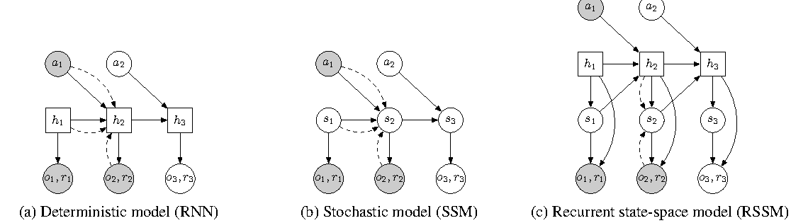
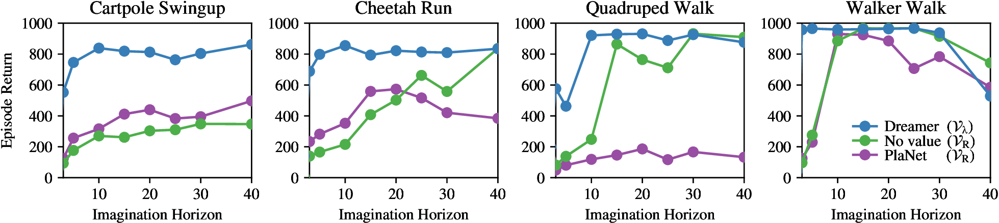

# RSSM 与 Dreamer，模型怎样边观察边想象

机械臂推了一下杯子，下一帧杯子被手臂遮住。模型需要根据之前的位置、速度和动作继续预测；手臂移开后，又应让真实图像纠正预测。RSSM 把这两条路径放进同一个潜状态模型，PlaNet 用它在线规划，Dreamer 用它训练行为。

理解这几种方法时，可以始终追踪一个问题，此刻状态来自真实观察，还是来自模型自己的预测。

## 推杯子以后，先更新记忆，再判断当前状态

记 $h_t$ 为确定性 recurrent memory，$z_t$ 为随机 latent。它们共同表示内部状态，$h_t$ 并非完整原始历史。一次递推为

\[
h_t=f_\theta(h_{t-1},z_{t-1},a_{t-1}),\qquad
z_t\sim q_\phi(z_t\mid h_t,o_t).
\]

记忆更新使用上一步状态和已经执行的动作，posterior $q$ 还读取当前真实观察。杯子重新出现时，posterior 可以把“本来预测在左边”修正成“实际已经滑到右边”。相机完全遮挡时，观察信息较弱，模型更依赖历史；这并不等于模型一定正确表达了不确定性。

想象下一步时没有 $o_{t+1}$，只能使用 prior

\[
h_{t+1}=f_\theta(h_t,z_t,a_t),\qquad
\hat z_{t+1}\sim p_\theta(z_{t+1}\mid h_{t+1}).
\]

再向前展开，继续把 $\hat z$ 与候选动作送入递推。若在这条路径调用未来真实图像的 posterior，就把未知信息泄漏给了规划器。

可以把三条状态流并排写出来：

| 状态流 | 当前能看到什么 | 主要用途 | 最容易出现的误读 |
| --- | --- | --- | --- |
| posterior | 历史、动作、当前真实观察 | 训练时校正 latent | 重建好就等于能预测未来 |
| prior | 历史、动作、过去 latent | 无观察 rollout、规划 | 一步 KL 小就等于多步稳定 |
| imagined state | 初始 latent、策略动作、prior 递推 | actor、critic 或 CEM | 想象轨迹等同真实轨迹 |

例如杯子重新出现在画面里，posterior 可以把状态从“预计在桌面左侧”改成“实际已滑到右侧”；下一步若没有图像，prior 只能从这个修正后的状态继续推。记录实验时把 `posterior_state` 和 `prior_state` 分开保存，否则一张看起来很清晰的重建图会掩盖无观察预测已经漂移的事实。

{ width="860" }

<small>图源：[PlaNet](https://arxiv.org/abs/1811.04551)，Figure 2，RNN、SSM 与 RSSM 结构。随机与确定性路径是该模型的组织方式，不意味着其他 RNN 不能输出概率分布。</small>

## 训练如何让无观察的 prior 追上 posterior

在真实轨迹里，posterior 看到了杯子，prior 只能根据此前推力和记忆猜杯子位置。训练可以要求 posterior 解释当前观察，同时要求 prior 接近这个由观察修正的状态分布。

概念性的损失为

\[
L_t=\mathbb E_q[-\log p_\theta(o_t\mid h_t,z_t)]
+\beta D_{\mathrm{KL}}\bigl(q_\phi(z_t\mid h_t,o_t)\|p_\theta(z_t\mid h_t)\bigr)
+L_{\mathrm{task},t}.
\]

$L_{\mathrm{task}}$ 包含具体版本使用的奖励或继续预测。本文采用执行 $a_t$ 后收到 $r_t$ 的约定；实现也可以把同一奖励记在后继状态，只要训练行和动作一致。不同 Dreamer 版本的分布、梯度停止和头部设计需要分别查源码。

用高斯数字看 KL 在做什么。假设观察校正后 $q=\mathcal N(1,0.5^2)$，历史预测为 $p=\mathcal N(0,1)$，则

\[
D_{\mathrm{KL}}(q\|p)=\log2+
\frac{0.5^2+(1-0)^2}{2}-\frac12
=\log2+0.125\approx0.8181.
\]

位置偏移和方差差异都产生代价。若只有重建，posterior 可以依赖图像解释每帧，prior 却学不会独立展开；若过度压低 KL，posterior 又可能忽略有用观察。因此 loss 很小要继续问，小的是哪一条路径。

## PlaNet 在杯子未来里搜索候选

给定当前 posterior，PlaNet 在 prior 中展开候选动作序列，用预测奖励评分。CEM 先从一个动作序列分布采样，选择精英，再用它们重估各时刻均值与方差，重复若干轮。

例如两步动作只讨论一维推力，某轮精英为 `[1, 0]` 和 `[1, 1]`，均值为 `[1, 0.5]`。下一轮会更多搜索先推、后小幅推的区域，但仍需动作边界和方差下限。CEM 的目标来自模型，若模型把冲过桌边误判为高奖励，搜索会朝错误方向集中。

规划后只执行第一步，再读取真实图像校正状态。这里每次行动都支付搜索成本。候选数、轮数、horizon 和粒子数共同影响计算，扩大其中一个也改变模型被搜索利用的程度。[PlaNet](https://arxiv.org/abs/1811.04551)还用多步 latent overshooting 约束转移，具体损失不能仅凭上述单步概念式复原。

模型误差怎样改变动作选择，可以用两个候选动作算一遍。真实环境对动作 A、B 的两步回报分别是 `[1, 3]` 和 `[2, 1]`，折扣取 1，真实最优是 A；如果 prior 把第二步预测成 `[0, 5]`，planner 看到的总回报就变成 A 的 1、B 的 7，因而选择 B。平均重建误差并不能告诉我们这个排序是否可靠，评测应同时记录候选排序、选中动作的真实回报和后悔值。

在真实系统中，可以先固定模型和动作候选，只比较 `teacher-forced` 的一步预测、`free-running` 的多步预测以及相同起点的反事实动作。若一步误差小而排序已经错，重点查奖励头或状态表示；若排序对但闭环失败，再查观测延迟、执行器和控制频率。这样能把“模型没有学会”与“模型预测正确但执行链路过期”分开。

## Dreamer 把较多搜索工作变成行为学习

Dreamer 从真实 replay 推断出的状态出发，由 actor 产生想象动作，prior 产生想象状态，奖励与继续头给出信号，critic 估计有限 horizon 之后的价值。Actor 通过大量这样的轨迹改善，真实执行时可直接出动作，不必每步重新运行 CEM。

对想象状态 $\hat s_t=(h_t,\hat z_t)$，一种 $\lambda$-return 递推为

\[
G_t^\lambda=\hat r_t+\gamma\hat c_t
[(1-\lambda)V(\hat s_{t+1})+\lambda G_{t+1}^\lambda],
\qquad G_H^\lambda=V(\hat s_H).
\]

继续概率 $\hat c_t$ 决定该转移后是否仍有未来价值。终止那一步的奖励保留，后续价值被去掉。为了计算清楚，构造两步奖励 `[1,2]`、后继 value `[3,4]`、$\gamma=0.9,\lambda=0.5$，继续概率均为 1。末端 $G_1=2+0.9\times4=5.6$，前一步 $G_0=1+0.9(0.5\times3+0.5\times5.6)=4.87$。

```python
rewards = [1.0, 2.0]
next_values = [3.0, 4.0]
continuations = [1.0, 1.0]
gamma, lam = 0.9, 0.5
returns = [0.0, 0.0]
g = next_values[-1]
for t in reversed(range(2)):
    g = rewards[t] + gamma * continuations[t] * (
        (1.0 - lam) * next_values[t] + lam * g)
    returns[t] = g
assert abs(returns[0] - 4.87) < 1e-12
assert abs(returns[1] - 5.6) < 1e-12
```

这些奖励是计算例子，不是抓杯实测。如果第二步为终止，令对应 continuation 为零，末端变成 2，前一步变成 3.25。把终止后的虚构价值继续累计，会让 actor 喜欢实际上已失败的计划。

Critic 拟合停止梯度的 return 目标。原始 [Dreamer](https://arxiv.org/abs/1912.01603)利用可微模型中的路径，把想象收益梯度传回 actor；离散动作和后续版本还涉及不同的梯度估计。世界模型训练和行为训练应分开看哪些参数被更新，冻结模型参数并不一定意味着切断其对动作的导数。

实现时可以把一次 imagined rollout 记录成固定 schema：

```text
episode_id, start_t, h0, z0, action_t, prior_z_next,
reward_hat, continuation_hat, value_hat, lambda_return,
posterior_available, model_revision, actor_revision
```

`posterior_available` 在想象段应为 false；若它在 rollout 中突然变成 true，通常意味着把未来观察接回了规划路径。`model_revision` 和 `actor_revision` 让之后的离线分析能区分“同一模型换了 actor”与“世界模型已经更新”。

## 想象越长，反馈为何不一定越好

{ width="760" }

<small>图源：[Dreamer](https://arxiv.org/abs/1912.01603)，horizon ablation。原论文设置中的曲线用于比较想象长度，不能给所有任务规定统一 horizon。</small>

想象更长可以看到延迟奖励，也会积累模型误差。短 horizon 更依赖 critic 尾值，长 horizon 更依赖动力学和奖励头，两种误差都可能引导 actor 走偏。玻璃杯在第二次接触后滑落，如果模型从没学过那种状态，延长十倍想象不会自动补上真实证据。

部署持续收集真实数据，为 prior、奖励与继续预测提供校准。模型想象的数量与真实交互数量应分别报告。训练损失有限、代码能运行只能说明计算链可执行，任务学习需要独立环境结果。

{ width="900" }

<small>图源：[DreamerV3](https://arxiv.org/abs/2301.04104)，world model learning。后续版本改变了 latent、目标尺度与稳定训练设计，应按相应版本阅读。</small>

诊断时依次比较同一轨迹的 posterior 重建、prior 一步预测、prior 多步预测，再看 actor 实际访问状态上的奖励与继续校准。若只有 posterior 好，重点在无观察想象路径；若未来已正确却决策差，继续查 critic、actor 目标和奖励定义。更详细的样本组织见[动作条件训练案例](action-conditioned-video-world-model-training-case.md)。

## 模型和实验依据

RSSM、潜状态规划和 latent overshooting 参考 [PlaNet](https://arxiv.org/abs/1811.04551)，想象轨迹中的 actor-critic 更新参考 [Dreamer](https://arxiv.org/abs/1912.01603)，后续稳定训练设计对照 [DreamerV3](https://arxiv.org/abs/2301.04104)。推杯子、遮挡、posterior/prior 对照和 return 数字是本站的手算例子；论文图中的 horizon 曲线保留原实验设置，不能推广成统一的最佳 horizon。

自测时保存同一条轨迹的 observation、posterior state、prior state、action、reward 和 continuation。先只改遮挡帧，观察 prior 多步误差，再只改 critic horizon，观察 actor 访问的状态分布，避免把模型误差和规划误差混成一项。
## 继续读

继续看[Dreamer 论文精读](../paper-deep-dives/world-models/dreamer.md)和[模拟器、反事实与合成 rollout](simulators-counterfactuals-and-synthetic-rollouts.md)。
