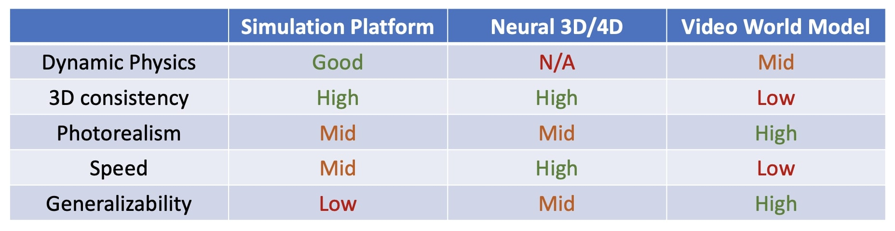
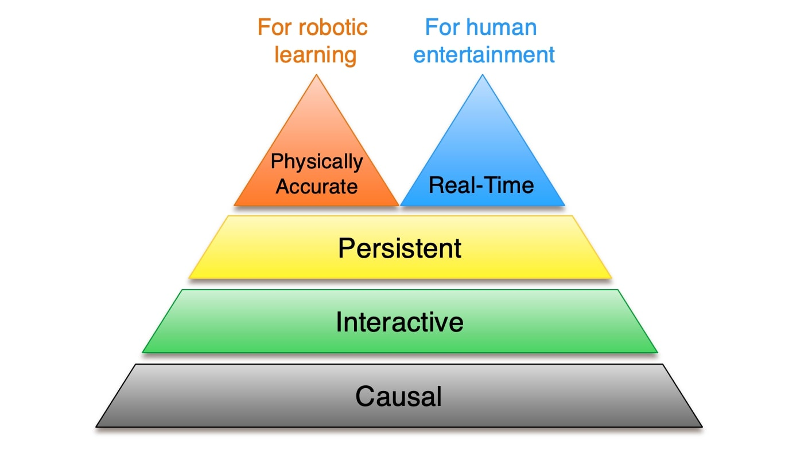

# 模拟器、反事实与合成 rollout

一次快抓造成玻璃杯滑落，世界模型从失败前的画面生成了“改成慢抓就能成功”的视频。这段视频可以提出有价值的假设，但它还没有提供慢抓的真实结果。理解合成 rollout 的关键，是分清已经发生的事实、模型补出的分支，以及用什么证据相信那个分支。

## 日志只记录了其中一条未来

设历史为 $h$，实际执行动作 $a$，观察到结果 $y$。训练数据提供的是 $(h,a,y)$，并没有同时提供 $(h,a',y')$。模型学习 $p_\theta(y\mid h,a)$ 后，可以输入 $a'$ 生成另一条未来；这个输出仍然受数据覆盖与隐藏变量影响。

例如经验丰富的操作者只在夹持稳定时快抓，在不稳时慢抓。日志可能显示快抓成功更多。若模型没有观察到“夹持稳定”这个变量，就会把人的选择策略与动作的物理作用混在一起。把慢抓输入同一张图像，并不自动完成了可靠的因果干预。

真实反事实需要同一起点的对照，实际很难完全复制。可重复模拟器允许固定状态和随机种子，但提供的真值是模拟器假设下的结果；真实实验则应尽可能控制起点并重复采样，记录无法控制的差异。两种来源都比让生成模型给自己判正确更有信息。

## 三种模拟来源各自固定了什么

经典物理模拟器通常显式规定几何、质量、摩擦、碰撞与控制方程，模型在这些假设下演化。重建场景提供与现实相近的几何或外观，却不自动知道材料属性和他者反应。生成模型从数据学习未来分布，可以覆盖难以手工建模的外观与行为，也可能在少见接触处产生不实后果。

{ width="920" }

<small>图源：[Towards Video World Models](https://www.xunhuang.me/blogs/world_model.html)，Figure 9，模拟方式对照。图用于定位不同信息来源，不表示某一来源在所有任务中更可靠。</small>

可以组合这些来源，例如用碰撞检测器拒绝穿透桌面的动作，用生成器渲染光照变化。但如果碰撞检测器和生成器使用了不同物体姿态，组合后的系统仍可能自相矛盾。共享状态、坐标和时间窗口，是混合模拟成立的前提。

对于玻璃杯，几何检查能发现手指穿进杯壁，却不能单凭几何证明摩擦足够。通过一种检查，只能消除它覆盖的错误。

## 一条合成样本怎样获得可信的用途

假设模型提出 slow 的预测风险为 0.10，并生成了稳定提起的未来。先检查动作是否在控制器范围内、是否与当前状态一致。这些步骤能拒绝明显无效候选，不能给它贴上成功真值。

再检查其是否位于模型有数据支持的区域。慢抓速度、物体材质或夹爪形状若远离训练数据，应降低对预测的依赖。多个模型分歧可以帮助发现不确定区域，但一致也可能来自相同盲区；置信度要在独立结果上校准。

若经可控模拟或真实复核得到结果，应保留原生成值和验证值，不能覆盖前者。下面是设计示例字段，展示一条样本怎样表达来源，而非声称仓库已经运行这些操作。

```json
{
  "parent_episode": "glass_slip_003",
  "candidate_action": "slow_grasp",
  "generated_event": "stable_lift",
  "generator_version": "example-wm-v1",
  "verification_source": "pending",
  "verified_event": null,
  "usage": "candidate_for_measurement"
}
```

当验证还未完成，它适合引导补采、人工审查或形成待检验的风险案例。只有在与训练用途相符的依据成立后，才考虑让它成为监督。一个仅经几何验证的视频可以帮助视觉增强，却不足以提供真实滑落概率。

## 合成数据进入训练后，偏差会怎样被放大

假设模型系统性低估快抓滑落，它生成的一万条成功快抓视频会继续支持这一错误。新增数量让优化更确信，却没有增加独立外部信息。用同一模型评分并筛出高分样本，也可能进一步集中在它最自信的盲区。

训练混合可写为

\[
L(\theta)=(1-\lambda)\mathbb E_{D_{\mathrm{real}}}\ell_\theta
+\lambda\mathbb E_{D_{\mathrm{synthetic}}}\ell_\theta.
\]

$\lambda$ 只是控制合成样本对目标的影响，并不衡量其真实性。生成数量、采样配比、样本权重和损失归一化一起决定实际梯度。若每轮都从上轮模型生成，再训练下一轮，应持续追踪同一外部测试集与新鲜真实任务，防止评价逐步变成内部一致性检查。

对照实验可以固定训练步数和真实数据，比较不加合成、加等量真实增强、加经过指定验证的合成样本。目标桶改善、主分布变化和新增错误都需要报告。只计算生成数量或“通过模型审核”的比例，无法回答训练是否受益。

{ width="760" }

<small>图源同上，Figure 8，视频世界模型能力层级。层级图是组织能力讨论的方式；一个样本进入具体训练任务仍需自己的来源与验证。</small>

## 将合成压力测试与真实评测分开

即使不能把生成的 slow 未来当成功标签，也能把它作为一次挑战。让被测模型比较 fast/slow、解释接触差异、输出不确定性，再由独立依据判断。这有助于发现缺口，但如果挑战集也由同一模型的假设决定，覆盖仍然有限。

固定评测集应记录生成器、条件、采样设置和筛选规则。训练集若包含同一失败的近重复合成版本，测试就可能被间接污染。按来源 episode 分组比单纯按文件随机划分更合适，必要时还按物体和场景隔离。

最终可以让一条失败产生多种产物，可靠的事实标签进入训练，未验证反事实进入补采候选，已固定的独立挑战进入评测。用途由证据决定。关于世界模型怎样被规划器利用，可读 [PlaNet](https://arxiv.org/abs/1811.04551)；关于从视频中学习潜在控制变量，可读 [Genie](https://arxiv.org/abs/2402.15391)。二者都不能免除当前抓取任务对独立后果的核查。

## 反事实数据的证据等级

把样本分成三类：模拟器中有明确状态真值的结果，真实环境中受控重复得到的结果，以及模型自己生成、尚未验证的未来。前两类可以进入带来源的训练或评测，第三类应标记为候选压力测试或补采线索，不能因为生成器给出高置信度就当作事实。

## 继续读

继续看[规划、反馈控制与安全约束](../embodied-ai/planning-control-and-safety.md)和[世界模型与机器人学习综述](../paper-deep-dives/world-models/world-model-for-robot-learning-survey.md)。

**来源与改编说明**：[PlaNet](https://arxiv.org/abs/1811.04551)连接潜变量模型与规划，[Genie](https://arxiv.org/abs/2402.15391)展示从视频学习可交互环境的路线。本文不把视觉逼真度当成反事实正确性。自测时为一个合成 rollout 写出来源、生成器版本、条件、筛选规则和独立验证字段。
