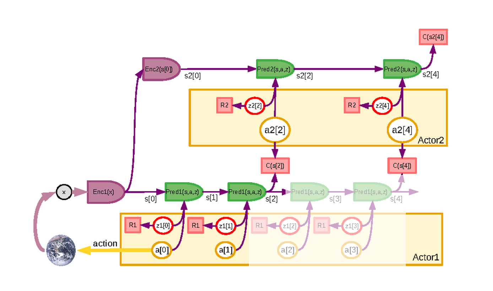

# 不确定性与风险规划，快抓还是慢抓

玻璃杯在桌边，快抓大多能迅速完成，但偶尔会滑落。慢抓稳定一些，却需要更多时间。仅用一个平均预测分数，可能看不见少数失败的代价；仅说“越保守越好”，又没有说明任务愿意为降低风险付出多少成本。风险规划要把后果分布与偏好分别写清楚。

下面使用一组构造收益。快抓有 95% 概率得 10、5% 概率得 −50，慢抓总得 6。收益已经包含人为设定的任务代价，不是论文实验或真实事故成本。

## 平均收益为什么偏爱快抓

两者期望分别为 $0.95\times10+0.05\times(-50)=7$ 和 6。最大化期望会选快抓；这不是计算错误，而是这个目标允许大多数成功补偿少数高代价失败。

如果任务要求滑落概率不超过 1%，快抓就不满足约束。约束与在奖励里减一点风险不是同一种目标。一个足够高的成功奖励仍可能让软惩罚方案选择高风险动作，而明确概率约束直接限制可行集合。

还可以比较最差 5% 回报的平均，即收益下尾 CVaR。本例快抓为 −50、慢抓为 6，会选慢抓。一般形式为

\[
\operatorname{CVaR}_{\alpha}^{\mathrm{lower}}(R)
=\max_\eta\left[\eta-\frac1\alpha\mathbb E(\eta-R)_+\right].
\]

这里 $\alpha$ 是最差尾部所占比例，与成本上尾 CVaR 的方向相反。将收益改写为损失时，最大化和最小化也要相应改变。

```python
fast_mean = 0.95 * 10.0 + 0.05 * (-50.0)
slow_mean = 6.0
fast_lower_cvar, slow_lower_cvar = -50.0, 6.0
assert fast_mean == 7.0 and fast_mean > slow_mean
assert fast_lower_cvar < slow_lower_cvar
```

方差惩罚是另一种选择，但它也惩罚有利方向的波动，未必与滑落事件一致。使用哪个风险准则取决于任务偏好，世界模型提供后果估计，不能替用户决定这个偏好。

## 5% 是环境随机，还是模型不知道

也许同一抓法在给定摩擦与姿态下本来就有随机性；也许摩擦完全决定结果，只是传感器看不到。增加力或接触观察，可能把后者变得更可预测。因此 aleatoric 与 epistemic 的区分依赖当前信息和模型假设。

Aleatoric 描述给定信息下预测分布内的变化，epistemic 描述模型或参数的不确定。多个模型可用于估计分歧。设模型索引为 $M$、未来量为 $Y$，全方差公式为

\[
\operatorname{Var}(Y)=\mathbb E_M[\operatorname{Var}(Y\mid M)]
+\operatorname{Var}_M(\mathbb E[Y\mid M]).
\]

两个模型等权、各自均值 1 和 3、内部方差都为 1，混合总方差为 $1+1=2$。第一项来自各自预测内部，第二项来自模型均值分歧。将它们解释为环境与模型不确定性还需要建模前提；一组同数据、同结构的模型可能一起忽略摩擦，分歧很小却同时预测错。

{ width="860" }

<small>图源：[A Path Towards Autonomous Machine Intelligence](https://openreview.net/forum?id=BZ5a1r-kVsf)，Figure 17，潜变量与不确定未来的规划示意。</small>

如果快抓失败主要来自未观察夹持状态，重新观察可能改变选择。若新相机仍看不到接触，等待一帧不一定增加信息。是否值得观察，要比较它改变决策的可能收益、耗时和在等待期间发生的风险。

## 概率要通过独立结果校准

“风险 0.05”应理解为在定义一致的一组条件下，模型预测该事件概率为 5%。它不能被一条成功轨迹证实，也不能被一条失败轨迹单独否定。需要在独立样本中比较预测概率与事件频率，并记录样本数。

构造四条预测风险 `[0.1,0.2,0.8,0.9]`，违反标签 `[0,1,1,1]`。Brier score 为

\[
\frac{0.1^2+(0.2-1)^2+(0.8-1)^2+(0.9-1)^2}{4}=0.175.
\]

若分成低、高两个等大桶，预测均值为 0.15、0.85，实际频率为 0.5、1，ECE 为 0.25。四条样本只是算例。分桶不同会改变 ECE，总体平均也可能隐藏某种材料上的系统性低估。

真实滑落很少时，零事故不能简单解释成零风险。应报告计数、区间、任务覆盖，以及阈值下的漏报和误报。对高代价事件，训练集和验证集还需保留明确的独立关系，不能在同一小组失败上反复选阈值后报告无偏收益。

## 风险头排错顺序时，调惩罚系数也救不了

仓库手工 fixture 中，fast 的成功/风险为 0.80/0.20，slow 为 0.62/0.32。按成功减风险，fast 得 0.60、slow 得 0.30，模型选择 fast，但标签显示 fast 滑落、slow 安全成功。

这里增加风险惩罚甚至可能更偏爱 fast，因为模型本来就把 slow 风险估得更高。先设风险阈值 0.25 也会拦住 slow、放行 fast。决策规则无法自动纠正它依赖的错误排序。

需要回到观察、动作条件预测和风险标签，区分夹持状态丢失、动力学错误与读出失准。Fixture 的“实际”标签来自手工设定，完整计算见[评测报告](world-model-efficient-training-experiment-report.md)；真实系统必须使用独立结果。

当概率可信度不足时，可以限制动作分布、请求额外观察或使用更可信的回退模块。这些都是具体系统设计，仍需测量其任务代价和失效条件。风险方法的价值最终体现为在明确约束与预算下改变动作选择，详细评测见[失败分析](evaluation-and-failure-modes.md)。
