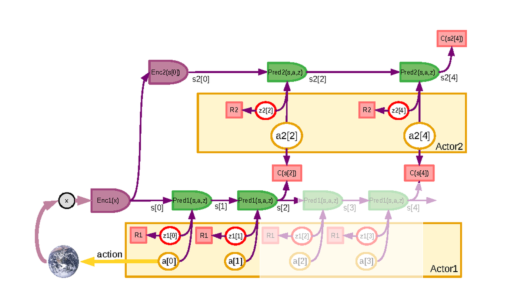
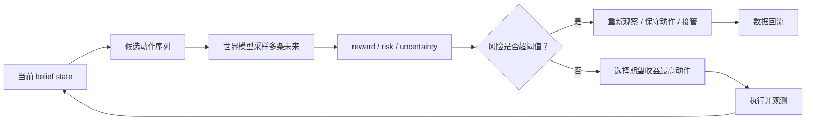

# 不确定性与风险敏感规划

世界模型如果只输出一个“最可能的未来”，在高风险决策里往往不够。机器人、自动驾驶和复杂 agent 系统真正关心的不只是平均回报最大，而是在不确定未来里哪些动作更安全，哪些动作期望高但尾部风险不可接受。

!!! note "读法定位"
    这页先回答“不确定性与风险敏感规划”在「世界模型」里的位置：它解决什么局部问题，依赖哪些前置，最后会影响哪类工程或研究判断。
    **前置**：先知道潜变量、时序预测、VLM/VLA 与训练效率；再看具体论文和工程案例。 必要时先回 [世界模型入口](index.md)、[基础知识](../foundations/index.md) 或 [术语表](../glossary/index.md)。
    **主线关系**：把表征预测、潜变量动力学、规划、rollout 服务和具身/视频应用连成“可模拟、可评估、可行动”的主线。

不确定性建模与风险敏感规划，是把世界模型从平均预测器提升为安全决策工具的关键。

!!! note "初学者先抓住"
    风险规划不是只看平均收益，而是看坏情况会不会不可接受。一个动作 90% 情况下成功、10% 情况下严重事故，平均分可能不错，但部署上不一定能接受。

!!! example "有趣例子：过马路"
    平均来看，闯黄灯可能快几秒；但如果少数情况会和车冲突，理性决策会更保守。风险敏感规划就是让模型不仅看“多数未来”，也看“尾部危险未来”。

## 硬证据模块：风险页要优先证明“不漏报危险”

风险敏感规划最需要硬证据，因为平均指标很容易掩盖尾部事故。这里的证据重点不是 reward 最高，而是高风险动作是否被正确降权、低置信状态是否触发重新观察或回退。

| 证据项 | 最小可复算例子 | 失败案例 | 验收指标 |
| --- | --- | --- | --- |
| 本页解决哪项成本 | 少做真实危险试错，提前过滤高风险候选 | 平均成功率高，但少数滑落/碰撞严重 | near-miss recall、collision rate |
| 风险校准 | 按 risk bin 统计真实 violation rate | predicted risk 0.2 的 fast grasp 实际滑落 | ECE、false negative、Brier score |
| 不确定性动作 | 高 epistemic 时选择 wait/reobserve | 模型不确定却继续执行激进动作 | reobserve trigger precision/recall |
| 候选排序 | 比较 risk-aware score 与真实安全成功动作 | top-1 选择错目标或危险动作 | top-k safe success agreement |
| 证据等级 | 离线 replay、仿真闭环、真机闭环分开写 | 只给 risk heatmap demo | hard replay + closed-loop safety |

mini-chain 中 `wm_mini_003` 就是风险页的反例：`fast_grasp` 被模型排到 top-1，但实际事件是 `slip`。这种失败不一定拉低平均视频质量，却会直接破坏部署安全。风险规划的最低门槛，是让这类 hard-negative 在离线 replay 中被抓出来。

## 平均最优不等于可部署

若只优化期望回报：

\[
\max_\pi \mathbb{E}\left[\sum_t \gamma^t r_t\right]
\]

策略可能偏向高收益但高风险动作。自动驾驶里激进并线大多数情况下节省时间，但少数情况下可能造成严重事故；机器人快速抓取平均更快，但偶尔会撞翻易碎物体。

研究问题常是“平均表现能不能更好”，部署问题常是“最坏那几次会不会出事”。世界模型一旦用于规划，这个差别必须显式建模。

## 两类不确定性

| 类型 | 含义 | 决策含义 |
| --- | --- | --- |
| Aleatoric uncertainty | 环境本身随机，即使模型完美也不能消除 | 需要保守决策、风险约束和多模态未来 |
| Epistemic uncertainty | 模型因数据不足或分布外状态而不知道 | 需要更多观察、数据回流、回退或人工接管 |

世界模型的不确定性可能来自观测编码、潜状态后验、动力学预测、奖励/成本头、多模态未来、长时 rollout 误差和规划器搜索到的分布外动作。

如果系统只输出单条未来轨迹，往往无法表达这些来源，也无法区分“未来本来就随机”和“模型自己没见过”。

## 分布而非点估计

风险敏感规划需要估计未来分布：

\[
p(s_{t+1:t+H}\mid s_t,a_{t:t+H-1})
\]

而不是只估计均值。可通过粒子采样、隐变量采样、多头模型、diffusion rollout 或 ensemble 得到多条未来。

单一均值未来会误导规划。例如：

1. 90% 概率安全通过；
2. 10% 概率撞上障碍。

均值轨迹可能生成一条“介于两者之间”的平滑未来，看起来谁也没撞，但对规划毫无帮助。多模态未来必须以分布、样本或风险边界表达，而不是压成一条平均轨迹。

{ width="860" }

<small>图源：[A Path Towards Autonomous Machine Intelligence](https://openreview.net/forum?id=BZ5a1r-kVsf)，Figure 17。原论文图意：用 latent variables 表达不可直接从当前观测确定的未来分支，规划时保留多条可能 trajectory，而不是压成单一未来。</small>

!!! note "图解：风险规划要保留未来分叉"
    图里的 latent variable 可以理解成“现在还看不见但会影响未来的因素”。如果直接取平均，危险分支可能被抹平；如果保留多个 latent trajectory，planner 才能比较平均收益、尾部风险和信息获取动作。对机器人和驾驶来说，真正有价值的不是最漂亮的未来，而是能把危险分支提前显出来。

## Ensemble 与不确定性分解

若使用模型集合 \(\{M_i\}_{i=1}^K\)，预测量为 \(Y\)，总方差可粗略拆成：

\[
\mathrm{Var}(Y)
=
\mathbb{E}_{M}\left[\mathrm{Var}(Y\mid M)\right]
+
\mathrm{Var}_{M}\left(\mathbb{E}[Y\mid M]\right)
\]

第一项更接近 aleatoric uncertainty，第二项更接近 epistemic uncertainty。实际系统未必严格分离，但这个式子提醒我们：预测发散不一定是环境随机，也可能是模型之间意见不一致。

Ensemble 的优点是实现直接、对分布外状态敏感、可同时用于风险估计和数据回流；局限是成本更高，且如果所有模型共享同样偏差，分歧也可能很小。

## 风险目标

风险敏感规划不只有一种目标。

| 目标 | 形式 | 适合场景 |
| --- | --- | --- |
| 均值减方差 | \(\max \mathbb{E}[R]-\lambda\mathrm{Var}(R)\) | 简单风险惩罚 |
| CVaR | 关注最差 \(\alpha\) 分位回报 | 尾部事故敏感系统 |
| Chance constraint | \(\max \mathbb{E}[R]\;\text{s.t.}\;P(c=1)\le\epsilon\) | 有明确安全红线 |
| Robust / min-max | \(\max_\pi \min_{\xi\in\Xi} R(\pi,\xi)\) | 高不确定或对抗扰动 |
| Risk-aware MPC | \(\mathbb{E}[R]-\lambda u-\eta\text{RiskCost}\) | 在线规划与滚动优化 |

方差简单但不一定代表事故风险；CVaR 更关注尾部；chance constraint 适合碰撞概率、违规概率这类硬约束；robust 目标更保守，但在失败代价极高时值得考虑。

## 规划器如何使用不确定性

不确定性不是观赏用指标，必须变成动作选择或回退策略。常见用法包括：

1. 对同一动作序列采样多条未来，比较平均回报、最差回报、风险分位和约束违反率；
2. 在 MPC 目标中加入 uncertainty penalty 或 risk cost；
3. 当 epistemic uncertainty 高时，选择信息获取动作，如减速、重新观察、多看一帧；
4. 当风险超过阈值时，切换保守模式、人工接管或回到安全状态；
5. 将高不确定状态写回数据引擎，作为下一轮采样重点。

如果系统没有“高不确定时怎么办”的动作，那么不确定性输出就不是决策能力，只是监控信号。

## 风险规划流程图

这张图强调：风险不是报告末尾的一个分数，而是动作选择的一部分。高 epistemic uncertainty 时，系统可能应该先获取信息；高 aleatoric risk 时，系统应该选择更保守动作；risk head 低估时，则必须触发数据回流和校准。

## 一个数字例子：均值收益会误导

| 动作 | 成功收益 | 失败代价 | 失败概率 | 期望回报 | 风险判断 |
| --- | ---: | ---: | ---: | ---: | --- |
| 快速抓取 | +10 | -80 | 8% | +2.8 | 尾部风险高 |
| 慢速接近 | +7 | -20 | 3% | +6.2 | 更适合部署 |
| 重新观察 | +3 | -2 | 1% | +2.95 | 信息不足时合理 |

如果只看“成功时收益”，快速抓取最好；如果看期望回报，慢速接近更好；如果 epistemic uncertainty 很高，重新观察可能最安全。风险敏感规划的价值就在于把这些取舍显式化。

## 长时 Rollout 与校准

即使单步预测方差小，长时 rollout 后不确定性也会扩大。规划器要关注 horizon 上的不确定性增长，而不是只看一步误差。

验收时建议看：

1. 不同 horizon 的预测误差和风险召回；
2. 不确定性是否校准，即高不确定区域是否真的更容易出错；
3. 风险头是否能提前发现 near-miss；
4. OOD 场景下 epistemic uncertainty 是否升高；
5. 加入风险目标后平均收益、尾部事故和保守程度的 tradeoff；
6. 风险阈值触发的回退是否可解释、可复现、可运营。

风险敏感世界模型的目标不是永远保守，而是在收益、风险、信息获取和回退之间做可控取舍。它真正的价值体现在少数关键分叉：平均未来看起来都还不错，但尾部风险决定系统能不能部署。

!!! tip "下一站"
    - 回到本专题入口：[世界模型](index.md)，确认这页在整条路线中的位置。
    - 按导航顺序继续：[世界模型开发路线](development-roadmap-data-simulation-and-evaluation.md)。
    - 概念或符号卡住时，先查 [术语表](../glossary/index.md)，再回到当前页。
