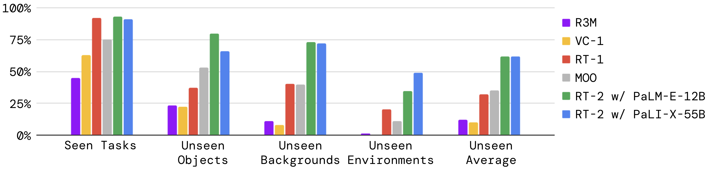
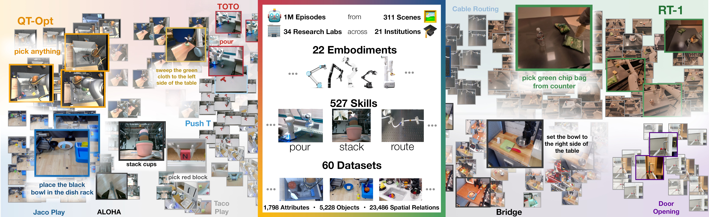

# VLA / 世界模型全链路案例：从机器人数据到闭环评测

这页把 VLA、世界模型、训练系统和评测放到同一条工程链里。它不是新论文综述，而是一个可执行的方案模板：当你要做“机器人数据 + VLA 动作 + 世界模型预测 + 闭环评测”时，每一层该省什么成本、看什么证据、不能外推什么。

!!! warning "证据边界"
    本页复用论文原图和站内 mini-chain 指标组织证据链。它不是独立复现实验，也不证明任一真实机器人系统已经达到部署标准；所有前沿 claim 仍应回到 [Claim Ledger](../references/claim-ledger.md) 和 [证据标准](../references/evidence-and-reproducibility-standard.md) 核对。

## 10 分钟版

| 阶段 | 先问什么 | 推荐入口 | 验收门槛 |
| --- | --- | --- | --- |
| 数据采集 | 是否覆盖成功、失败、恢复、near-miss | [具身数据路线](../embodied-ai/vla-data-model-and-evaluation-roadmap.md) | episode schema、failure_type、人工接管规则 |
| 状态压缩 | 多相机视频是否被压成可预测状态 | [Masked / JEPA](masked-jepa-and-latent-prediction.md) | token 数、接触/小目标保真、action sensitivity |
| 动作接口 | VLA 输出动作是否能被世界模型消费 | [动作表示](../vla/action-representation-and-interfaces.md) | 坐标系、频率、chunk 长度、单位 |
| 世界模型 | 是否学习动作条件 latent dynamics | [RSSM / Dreamer](rssm-dreamer-and-planning.md) | reward/continue、候选动作排序、model exploitation replay |
| 闭环评测 | 是否真的改善决策 | [评测失效](evaluation-and-failure-modes.md) | closed-loop success、risk ECE、cost per success |

## Evidence Snapshot

| Claim | Direct Source | Figure/Table/Setting | Evidence Type | Repro Status | Can Support | Cannot Prove |
| --- | --- | --- | --- | --- | --- | --- |
| Web-scale VLM 知识可以补机器人数据的语义泛化 | [RT-2](https://arxiv.org/abs/2307.15818) | Figure 1, Figure 4/6/8/9 | Closed-loop | Paper Only | VLA 可把视觉语言能力接到动作 token 和机器人任务 | 不能凭空获得未训练 motor skill 或真实世界安全性 |
| 多机器人数据能扩大 VLA 数据覆盖 | [Open X-Embodiment](https://arxiv.org/abs/2310.08864) | dataset overview / RT-X setting | Paper Result | Paper Only | 数据混合和 embodiment 多样性是 VLA 泛化的重要来源 | 不能保证采样比例适合任意新机器人 |
| Latent imagination 能减少真实试错 | [DreamerV3](https://arxiv.org/abs/2301.04104) | Figure 3(a)/(b), Figure 6 | Paper Result | Paper Only | RSSM + imagined actor-critic 是样本效率强路线 | 不证明高分辨率视频模拟器天然可规划 |
| Masked/JEPA 表征能降低视觉 token 和像素重建压力 | [MWM](https://arxiv.org/abs/2206.14244), [V-JEPA 2](https://arxiv.org/abs/2506.09985) | MWM Figure 1/4, V-JEPA 2 Figure 7/Table 3 | Ablation | Paper Only | 表征压缩可作为动作条件世界模型的状态层 | 不证明原始 masked 表征自带 reward/done 和闭环控制 |
| mini-chain 能展示证据链字段和失败回放 | [完整实验报告样例](world-model-efficient-training-experiment-report.md) | `episodes.jsonl`, `rollouts.jsonl`, `eval_mini_chain.py` | Toy Fixture | Toy Fixture | 如何报告 action sensitivity、risk ECE 和失败归因 | 不是任何真实模型有效性证明 |

## 链路一：数据和动作要先对齐

VLA / 世界模型项目最常见的失败，不是模型不够大，而是数据和动作接口没有对齐：视频里看得到状态变化，但动作日志缺单位、坐标系、频率或控制模式；VLA 能输出动作 token，但世界模型不知道这些 token 如何改变未来状态。

{ width="920" }

<small>图源：[RT-2: Vision-Language-Action Models Transfer Web Knowledge to Robotic Control](https://arxiv.org/abs/2307.15818)，整体结构图。原图意：把视觉语言模型的输入输出接口扩展到机器人动作 token，使 VLM 可以通过 next-token prediction 输出低层动作。</small>

!!! note "这张图怎么读"
    **输入输出**：输入是图像与语言指令，输出不只是文本答案，也包括离散化后的机器人动作 token。  
    **效率机制**：复用 web-scale VLM 预训练知识，减少每个语义概念都必须在真实机器人数据中重新学习的成本。  
    **对主线意义**：世界模型若要服务 VLA，需要知道动作 token、坐标系和控制频率怎样进入 dynamics。  
    **不能证明什么**：RT-2 的结构不能证明任意新 motor skill、长时家庭任务或安全恢复已经解决。

## 链路二：数据覆盖决定泛化上限

真实机器人数据昂贵，所以不能只收集“干净成功 demo”。全链路实验至少要记录失败、near-miss、人工接管、恢复片段和无效动作；否则世界模型会学到“看起来顺滑”的未来，却无法区分安全候选和危险候选。

{ width="920" }

<small>图源：[Open X-Embodiment: Robotic Learning Datasets and RT-X Models](https://arxiv.org/abs/2310.08864)，数据集可视化图。原图意：展示多机器人、多任务、多场景数据聚合如何扩大机器人学习的数据覆盖。</small>

!!! note "这张图怎么读"
    **输入输出**：输入是不同机器人、场景和任务的轨迹集合，输出是可用于训练泛化策略的数据池。  
    **效率机制**：用 embodiment 和任务多样性替代单平台反复采集，降低新任务冷启动数据成本。  
    **对主线意义**：世界模型的数据引擎也应按失败类型和动作分叉组织样本，而不是只堆成功轨迹。  
    **不能证明什么**：多数据集聚合不自动解决动作空间不一致、标注噪声和跨机器人安全迁移。

## 链路三：状态层先压缩，再建动作条件 dynamics

四路相机、16 帧历史、RGBD 和多模态 token 很快会把 context 撑爆。工程上通常先把视觉压成 latent 或表征，再在该状态上学习动作条件转移。

{ width="920" }

<small>图源：[Masked World Models for Visual Control](https://arxiv.org/abs/2206.14244)，Figure 1。原图意：把 masked visual representation learning 与 latent dynamics 解耦，用表征学习和控制 dynamics 分担视觉控制样本效率问题。</small>

!!! note "这张图怎么读"
    **输入输出**：输入是视觉观测和动作轨迹，输出是更适合控制的视觉表征与 latent dynamics。  
    **效率机制**：避免每次都重建像素细节，把学习压力转移到对控制有用的表示和动态上。  
    **对主线意义**：VLA 世界模型可以先学习状态层，再验证不同动作是否造成可区分未来。  
    **不能证明什么**：MWM 图不能证明任意 masked 表征都有动作因果、reward head 或真实机器人闭环收益。

{ width="920" }

<small>图源：[V-JEPA 2: Self-Supervised Video Models Enable Understanding, Prediction and Planning](https://arxiv.org/abs/2506.09985)，Figure 7。原图意：展示 action-conditioned 模块如何在 JEPA 表征空间中做目标图像规划。</small>

!!! note "这张图怎么读"
    **输入输出**：输入当前观测、目标图像和候选动作，输出候选动作在 latent space 中接近目标的程度。  
    **效率机制**：在表征空间比较未来状态，避免高成本像素 rollout 和完整视频解码。  
    **对主线意义**：这是 masked/JEPA 路线接回 planning 的关键桥梁。  
    **不能证明什么**：论文设置下的机器人规划结果不能外推到所有平台、动作空间和长时安全任务。

!!! warning "读数边界"
    V-JEPA 2 Table 3 属于论文机器人设置下的 planning 结果；它是 closed-loop 相关证据，但不是独立复现，不等于真实家庭长任务或跨硬件部署已经可靠。

## 链路四：实验报告必须把失败写出来

一个合格的全链路报告至少同时写四张账：

| 账本 | 最小字段 | 为什么重要 |
| --- | --- | --- |
| 数据账 | episode、camera、action、reward、done、failure_type | 没有字段契约就无法复盘 |
| 状态账 | raw patch tokens、compressed tokens、compression ratio | 证明压缩省了什么 |
| 决策账 | candidate action、predicted success、predicted risk、chosen action | 证明模型影响了动作选择 |
| 失败账 | slip、wrong_target、occlusion、collision、recovery | 证明下一轮数据该补哪里 |

本仓库 mini-chain 的可复算指标是：`compression_ratio=6.70x`、`action_sensitivity_pass=3/4`、`top1_safe_success_agreement=2/4`、`risk_ece_3bin=0.103`。这些数字只能证明报告形态可运行，不能证明真实模型有效。

## 交付清单

1. 先确定动作 schema：坐标系、频率、chunk 长度、归一化和单位。
2. 再确定状态压缩：视觉 token、几何状态、mask、episode boundary。
3. 训练时报告数据、显存、吞吐、loss、reward/risk head 和 checkpoint。
4. 评测时报告 action sensitivity、closed-loop success、risk ECE、failure replay 和 cost per success。
5. 写结论时必须同时给 `Can Support` 和 `Cannot Prove`。
