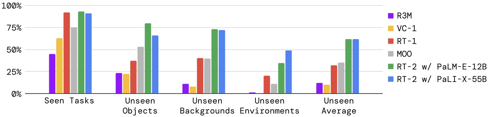
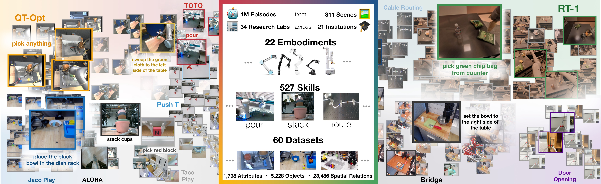
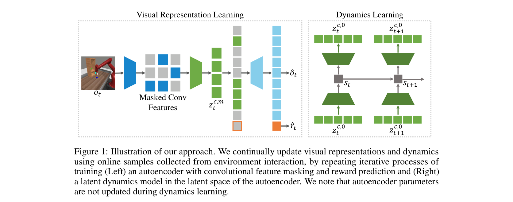
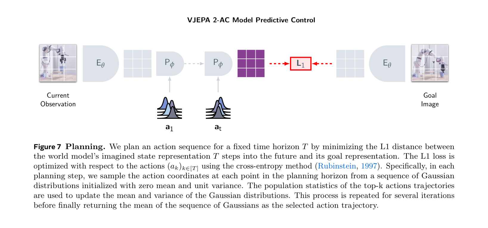

# VLA 到世界模型，跟踪一次抓取决策

机械臂要提起桌边玻璃杯。VLA 根据图像和指令提出 `fast_grasp` 与 `slow_grasp` 两个候选，世界模型预测后果，决策器选择动作，控制器执行后再接收观察。把这些模块连接起来的关键，是让每一个预测都能追溯到同一历史、同一动作和同一时间窗口。

本页沿仓库 `wm_mini_003` 的手工候选解释这个过程。其数字用于复算选择规则；当前仓库并没有执行下面的机器人系统。实际数据来源和完整计算见[评测报告](world-model-efficient-training-experiment-report.md)。

## 先给所有模块同一份当前状态

一次请求可以用 `episode_id`、决策序号和观测采集时间定位。图像拍摄后还会经历传输、预处理与排队，策略看到它时世界已经继续变化。世界模型若使用比 VLA 更新的图像，二者可能是在不同起点讨论同一动作；若时间戳相同却相机同步错误，也可能把不同位置拼成一个状态。

假设教学系统在 10 Hz 控制下预测八步动作，这段动作覆盖 0.8 秒。一个动作的七个分量可以约定为末端平移、旋转增量和夹爪命令，但必须继续说明单位、旋转参数化和坐标系。语言里的“向上”不能直接决定控制器的正轴。动作归一化的统计量和版本也要与训练一致。

{ width="920" }

<small>图源：[RT-2](https://arxiv.org/abs/2307.15818)，整体架构图。动作可以被编码成 token，但落到执行前仍要还原成指定控制接口。图示不意味着任意动作 token 可直接由任意机器人执行。</small>

VLA 输出的是提议。安全过滤器若削小了位移或替换了动作，世界模型应评价过滤后的实际候选，或明确把过滤器纳入预测过程。若预测的是快抓、执行的是受限慢抓，再把结果挂到快抓名下，就破坏了动力学监督。

## 候选动作必须真有区别，且能够执行

从随机策略采样多次不一定产生有意义的候选。温度很低时，两条 chunk 可能几乎相同；温度过高时，差异可能全是不可执行的关节跳变。候选来源可以是策略采样、动作扰动、不同技能或规划器，但都要经过同一接口和有效性检查。

这里把 fast 和 slow 理解为两段已经定义好的末端轨迹。为公平比较，二者从相同历史出发，评价相同时间范围内的目标成功与风险。若 slow 的完成时间超出评价窗口，提前把它标成失败就会偏爱快速动作。可以统一终局定义，或显式把完成时间计入代价。

多机器人数据扩大了可见动作和场景，但每种身体能执行什么仍然不同。

{ width="920" }

<small>图源：[Open X-Embodiment](https://arxiv.org/abs/2310.08864)，多机器人数据可视化。将样本合在一起之前，需要保留 embodiment、控制语义和传感器配置。</small>

同样的“抬起杯子”在另一夹爪上可能需要不同接触位置。共享任务语义不等于共享原始动作向量。动作转换与时序对齐更详细地讨论于[训练样本设计](action-conditioned-video-world-model-training-case.md)。

## 世界模型为什么既需要状态，又需要动作

历史编码器得到 $z_t$，转移模型计算每个候选下的未来 $\hat z_{t+1:t+H}^{(a)}$。若两条候选共享历史编码，能够节省重复工作；动作开始分叉以后，后续状态和缓存必须属于各自分支。

状态应保留杯子位置、目标身份和接触信息。压缩掉桌面纹理可能无碍，压缩掉手指与杯沿的相对位置则会影响滑落判断。无法只用压缩比判断两种情况。

{ width="920" }

<small>图源：[Masked World Models](https://arxiv.org/abs/2206.14244)，Figure 1。图中的表征学习与潜状态动力学分工，为检查“看漏了”还是“预测错了”提供了一个分析角度。</small>

一种设计通过 future latent 接 event/risk head，另一种设计直接比较目标图像在特征空间的距离。两者需要不同标签与校准，不能默认为同一个通用世界模型已经提供全部输出。

{ width="920" }

<small>图源：[V-JEPA 2](https://arxiv.org/abs/2506.09985)，Figure 7。它展示动作条件模型如何被 MPC 消费；本页的成功与风险双头是教学接口，不是对该图实现的逐项复述。</small>

## 一次明确的选错，比抽象成功率更能定位问题

Fixture 中 fast 的预测成功为 0.80、风险为 0.20，slow 为 0.62、0.32。按 $S=p_{\mathrm{success}}-p_{\mathrm{risk}}$，两者分数分别为 0.60 和 0.30，决策器选择 fast。

```python
candidates = {
    "fast_grasp": {"success": 0.80, "risk": 0.20},
    "slow_grasp": {"success": 0.62, "risk": 0.32},
}
chosen = max(candidates, key=lambda a: candidates[a]["success"]
             - candidates[a]["risk"])
assert chosen == "fast_grasp"
```

给定标签却是 fast 滑落、slow 安全成功。这里可以确认选择规则忠实使用了分数，问题在这些分数对本例后果的判断。仅把 planner 写得更复杂并不会自动修好。把风险惩罚系数加大也未必有帮助，因为模型反而认为 slow 更危险。

接下来需要区分，模型有没有看到夹持不稳，看到后有没有预测出滑落，预测中有滑落却是否被风险头漏读。三者对应状态、动力学、读出三个不同位置。只有最终两个数，无法可靠定位到其中某一层；应保存必要中间状态、事件预测与输入回放。

## 执行短前缀后，新的观察怎样改变判断

设两条 chunk 都预测八步，系统实际只执行前两步，再根据 0.2 秒后的新观察重规划。若新图像出现杯子相对夹爪下滑，状态估计应吸收这条证据，之前“已经稳定夹持”的预测不能继续作为事实保留。

重新观察带来修正机会，但修正本身也有时延。观察、编码、预测与下发若又耗时 0.2 秒，动作真正生效时依据的信息仍然较旧。长 chunk 与低时延模型之间的关系，需要按实际执行前缀和时间戳分析，见[具身推理中的观测年龄](../thinking-exploration/embodied-inference-observation-age-1009-2059.md)。

一次反馈循环至少应能恢复下面这条事件链。

```text
capture_42 -> history_state_42 -> fast/slow proposals
-> executed-action constraints -> candidate predictions -> chosen fast
-> execute two controls -> capture_43 -> observed slip
-> revised state -> recovery / stop -> outcome
```

这些标识是建议的应用日志结构，并非现有 fixture 内置字段。若机器人由人工接管恢复，应同时报告接管前的自主失败与辅助完成，不能把最终杯子被放好算作纯自主成功。

## 怎样证明世界模型带来了增益

保留同一 VLA、任务分布、候选集合和执行策略，比较直接使用 VLA、加入世界模型排序，以及必要的简单规则基线。若加入世界模型还同时增加候选数量和推理时间，收益中就混入了搜索预算变化。延迟导致的过期动作也需要计入最终结果。

报告应记录任务成功、风险事件、恢复、接管、完成时间与额外计算成本。Top-1 选择成功只评价该次候选决策，完整闭环还会改变后续状态分布。四条静态 fixture 不足以回答这些问题，却能帮助提前发现字段错位、指标命名和选择规则的错误。

失败回流随后才有明确目的。Fast 的滑落提示应补接触变化及相邻动作的反馈，遮挡错目标则提示身份记忆与重新观察。是否真的改善，应在保留任务上验证，具体方法见[数据引擎](data-engines-and-self-improvement.md)。

## 模型和实验依据

VLA 动作 token 和跨机器人数据的接口参考 [RT-2](https://arxiv.org/abs/2307.15818) 与 [Open X-Embodiment](https://arxiv.org/abs/2310.08864)，表示/动力学分工参考 [MWM](https://arxiv.org/abs/2206.14244)，动作条件规划的消费方式参考 [V-JEPA 2](https://arxiv.org/abs/2506.09985)。`wm_mini_003`、fast/slow 候选、八步动作、四条静态 fixture 和风险双头是本站构造的字段与算例，没有执行真实机器人系统。

最小回放固定同一历史和候选集合，逐条保存 `episode_id`、观测时间、动作版本、预测结果、选择理由和实际反馈。先验证选择规则，再比较直接 VLA、世界模型排序和简单规则基线，避免把候选数量或额外等待误归因于世界模型。
