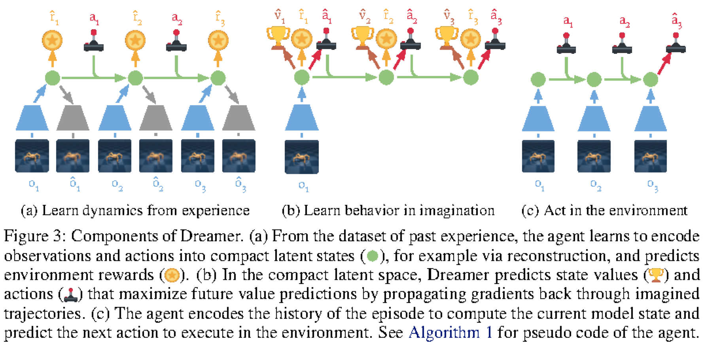

# WM / WAM / VAM：动作到底怎样进入世界模型

近两年很多论文都在把世界模型、视频模型和机器人策略揉到一起：有的给动作预测未来，有的给语言生成动作，有的让未来视频和未来动作一起生成。`WM / WAM / VAM` 不是统一标准术语，但它们很适合作为读论文的接口坐标系。

这篇只回答一个问题：**动作在模型里放在哪里，为什么会决定它能不能服务规划和控制？**

不要先问模型名字。先问四件事：输入里有没有动作，输出里有没有未来，未来是否能被动作改变，最后谁消费这个未来。一个模型能生成漂亮视频，不等于能做控制；一个模型能输出动作，也不等于理解动作后果。世界模型用于机器人时，最小门槛是：同一历史下换一条动作，模型预测的未来、风险或成功排序应该随之改变。

## 三类路线的真正差别

| 路线 | 动作在哪里 | 模型在回答什么 | 主要消费方 |
| --- | --- | --- | --- |
| WM | 动作是条件 | 如果我做 \(a\)，世界会怎样变 | planner、critic、risk checker |
| WAM | 动作和未来联合生成 | 这个目标下，什么动作和什么未来应该一起出现 | policy、trajectory generator、closed-loop controller |
| VAM | 视频预测表征服务动作 | 视频模型学到的动态先验能不能帮助选动作 | action model、data engine、robot policy |

三者不是互斥集合。一个系统可以先用 VAM 提供视频动态表征，用 WAM 生成动作 chunk，再用 WM 或 risk head 评估候选动作的后果。真正要避免的是把“视频看起来合理”“动作 token 能输出”“闭环任务能成功”混成同一个证据。

## WM：动作作为条件，未来作为评估对象

最清楚的世界模型接口是：

\[
p_\theta(z_{t+1:t+H}, r_{t:t+H}, d_{t:t+H}, u_{t:t+H}
\mid z_t, a_{t:t+H-1}, c)
\]

这里 \(z_t\) 是当前 latent state，\(a_{t:t+H-1}\) 是候选动作序列，\(r\) 是 reward 或任务进展，\(d\) 是 done / continuation，\(u\) 是 risk 或 uncertainty，\(c\) 是语言、目标图像、地图等上下文。这个式子的重点不是概率符号，而是动作在条件里：模型被要求回答“给定这串动作，未来会怎样”。

Dreamer 系列是最干净的 WM 基线。它不追求把每个未来像素画清楚，而是在 latent space 里学习 dynamics，再用 imagined rollout 训练 actor 和 critic。DreamerV3 官方摘要里强调的是：模型学习环境，随后通过想象未来来改进行为；这比“视频生成器”更接近控制所需的接口。

{ width="860" }

<small>图源：[Dream to Control: Learning Behaviors by Latent Imagination](https://arxiv.org/abs/1912.01603)，Figure 3。原图展示 representation model、transition predictor、reward predictor、value model 和 action model 的组合。本站读法：Dreamer 的世界模型不是单独预测视频，而是给 actor/critic 提供可想象的 latent future；动作进入 transition，reward/value 决定未来如何被消费。</small>

WM 的核心证据是反事实动作。固定同一个 \(z_t\)，替换 \(a_{t:t+H-1}\)，未来状态、reward、risk 或 done 应该合理变化。如果换动作后未来几乎不变，模型就只是一个惯性视频预测器；如果未来会变，但 reward/risk 不变，planner 仍然没有可靠依据。

DeepMind Genie 2 这类可交互世界模型把这个接口扩展到了更开放的 3D 环境：从单张 prompt image 生成可由键鼠动作控制的 playable world，并模拟每步动作之后的下一帧。它说明“世界模型”的范围不只限于机器人 latent dynamics，也可以是可交互生成环境。但用于机器人控制时仍要补上动作空间、风险、任务成功和真实观测刷新。

## WAM：动作和未来世界一起生成

WAM 更像把 world model 和 policy 往一个生成过程里合并。它不只是问“给定动作后未来怎样”，还问“在这个目标下，什么动作和什么未来应该一起出现”。简化接口可以写成：

\[
p_\theta(o_{t+1:t+H}, a_{t:t+H-1}\mid o_{\le t}, g)
\]

其中 \(o_{\le t}\) 是历史观测，\(g\) 是语言或目标条件，模型同时输出未来观测和未来动作。这里动作不再只是外部输入，而是和未来世界一起被建模。

{ width="920" }

<small>图源：[World Action Models are Zero-shot Policies / DreamZero](https://arxiv.org/abs/2602.15922)，Figure 2。原图展示未来视频 token 和未来动作 token 被放在同一个自回归生成过程中。本站读法：WAM 不是“视频模型旁边加动作头”，而是让动作与未来世界互相约束；真正的证据要看生成动作能否在真实机器人上闭环执行。</small>

WAM 的吸引力在于，很多机器人动作的合理性只能通过未来来判断。抓杯子不是单帧分类，拉抽屉也不是一句语言到一个动作 token 的翻译；它们要求模型理解接触、遮挡、手爪姿态、目标物移动和失败恢复。把未来视觉和未来动作联合建模，理论上能让模型从视频动态里学到更多物理约束。

但 WAM 的风险也更难排查。动作错了，未来视频可能仍然看起来合理；未来视频错了，动作又可能被错误未来“解释”得好像合理。联合生成会让归因变难：到底是语言理解错、视频动态错、动作接口错，还是闭环刷新太慢？

所以读 WAM 论文时，要把 open-loop 和 closed-loop 分开。open-loop 视频能证明模型会生成某种未来；closed-loop rollout 才证明动作在真实观测刷新后还能继续有效。DreamZero 项目页报告了 7Hz closed-loop control 和 real robot generalization，这类证据比单纯展示未来视频更接近 WAM 的核心 claim。

## VAM：视频先验不直接等于策略

VAM 可以理解成“让视频模型的动态表征帮助动作生成”。它通常不要求视频模型自己就是 planner，而是把未来预测过程中的 latent、attention 或 intermediate feature 交给 action model。

\[
\phi_{t:t+H}=F_{\mathrm{video}}(v_{\le t}, g),\qquad
a_{t:t+K}=G_{\mathrm{policy}}(o_{\le t}, g, \phi_{t:t+H})
\]

这里 \(F_{\mathrm{video}}\) 是视频模型，\(\phi\) 是预测过程中产生的动态表征，\(G_{\mathrm{policy}}\) 是动作模型。这个式子想表达的重点是：视频模型提供的不是“最终画出来的视频”，而是对未来运动、遮挡、接触和任务阶段的内部表示。

{ width="920" }

<small>图源：[Video Prediction Policy](https://arxiv.org/abs/2412.14803)，Figure 1。原图展示先训练文本条件视频预测模型，再聚合视频模型内部 predictive visual representations 来输出机器人动作。本站读法：中间表征比最终视频画质更关键；VAM 要证明视频预测学到的动态先验能提升动作成功率。</small>

VPP 的动机很直接：传统视觉 encoder 往往偏静态，能识别物体，却不一定知道“下一秒手和物体会怎样相互作用”；视频扩散模型为了预测未来帧，可能学到更强的动态表征。VAM 把这种动态表征转给 policy，让动作模型少从零学习物理变化。

这条路线的边界也要讲清。视频好看不等于动作成功，FVD 或视觉质量不等于控制质量。一个合格 VAM 实验应报告动作成功率、真实机器人 rollout、跨场景泛化、失败恢复、动作平滑度和推理延迟。视频预测只是中间机制，机器人是否完成任务才是最终证据。

## V-JEPA 2-AC：latent planning 的中间形态

V-JEPA 2-AC 很适合作为 WM 与 VAM 之间的桥。它先用大规模视频/图像做 action-free self-supervised representation，再用少量机器人轨迹后训练 action-conditioned world model。规划时，给当前观测、目标图像和候选动作序列，在 latent space 里 rollout，选让未来表示接近目标表示的动作。

{ width="900" }

<small>图源：[V-JEPA 2](https://ai.meta.com/research/publications/v-jepa-2-self-supervised-video-models-enable-understanding-prediction-and-planning/)，Figure 7。原图展示 V-JEPA 2-AC 对候选动作序列做 model predictive control，让 imagined state representation 接近 goal representation。本站读法：它不需要每次解码高清视频，而是在 latent 里比较动作后果。</small>

可以写成：

\[
\hat z_{t+1:t+H}=f_\theta(z_t,a_{t:t+H-1}),\qquad
a^\star=\arg\min_a D(\hat z_{t+H}, z_{\mathrm{goal}})
\]

这里 \(f_\theta\) 是 action-conditioned latent dynamics，\(D\) 是 latent 距离或任务代价，\(a^\star\) 是被选中的动作序列。这个公式的重点是：动作作为候选条件进入模型，未来 latent 作为比较对象，planner 选择代价最低的动作。它比纯 VLA 更强调动作后果，比完整视频生成更节省输出成本。

Meta 的 V-JEPA 2 页面还给出一个重要写作边界：大规模 action-free 视频预训练可以提供理解和预测能力，但要规划真实机器人动作，仍需要少量 interaction data 把表示接到 action-conditioned world model。也就是说，视频表征是底座，动作条件是控制接口。

## 动作放在哪里，失败就在哪里

| 动作位置 | 典型失败 | 怎么验证 |
| --- | --- | --- |
| 输入条件 | 模型忽略动作，未来只按视频惯性滚动 | 固定历史，替换动作，比较未来 latent、reward、risk |
| 输出动作 | 动作像训练集平均行为，不理解后果 | 真实观测刷新后连续执行，看是否能恢复偏差 |
| 联合输出 | 视频和动作互相“圆谎”，归因困难 | 分开评估视频预测、动作成功、失败回放和人审 |
| prompt 弱条件 | 文本说左转，模型按常见运动继续 | 构造反事实 prompt 和动作冲突案例 |
| latent planning | latent 距离不等于任务成功 | 用真实机器人或 simulator 验证 goal reach、collision、done |

这张表是写作和实验的核心。世界模型不是一个标签，而是动作、未来和消费方之间的合同。合同最薄的地方，就是最容易失败的地方。

一个机器人系统还必须处理闭环刷新。无论模型多强，真实环境都会偏离想象：物体滑动、遮挡变化、手爪接触失败、相机延迟、控制器限幅都会改变下一步输入。开环生成 2 秒动作看起来顺滑，不代表闭环执行安全。靠谱系统通常会短 horizon 执行、重新观测、重新规划，并把失败样本回流给数据引擎。

## 按消费方读证据

如果输出被 planner 消费，重点看 candidate ranking、model predictive control、closed-loop success 和 cost per success。如果输出被 policy 消费，重点看 action chunk 成功率、真实观测刷新后的稳定性和失败恢复。如果输出被 risk checker 消费，重点看 collision recall、near-miss recall 和 risk calibration。如果输出被 data engine 消费，重点看 hard-negative yield、failure replay usefulness 和新任务覆盖。

论文里最容易偷换的是证据等级。视频 demo 只能说明模型能生成可视未来；offline benchmark 只能说明某些数据分布上预测或动作接近标签；real robot closed-loop 才能说明模型输出在真实噪声、延迟和偏差下仍能完成任务。读 WM/WAM/VAM 论文时，先把证据放到对应消费方，再判断 claim 有没有越界。

## 阅读结论

WM / WAM / VAM 的核心不是缩写，而是动作接口。

1. WM 把动作作为条件，最小证据是反事实动作会改变未来、reward 或 risk。
2. WAM 把动作和未来联合生成，最小证据是真实观测刷新后的闭环执行。
3. VAM 用视频预测表征帮助动作，最小证据是机器人任务成功率和泛化，而不是视频画质。
4. 大规模视频预训练可以提供动态先验，但要服务控制，必须接上动作、目标、风险、延迟和恢复。

读相邻内容时，可以接着看 [RSSM、Dreamer 与规划](rssm-dreamer-and-planning.md)、[Masked / JEPA 与潜变量预测](masked-jepa-and-latent-prediction.md)、[VLA 动作表示与控制接口](../vla/action-representation-and-interfaces.md) 和 [世界模型评测与失效模式](evaluation-and-failure-modes.md)。

## 外部精读

- [DreamerV3](https://arxiv.org/abs/2301.04104)：理解 latent world model 如何通过 imagined future 训练行为。
- [Genie 2 DeepMind blog](https://deepmind.google/blog/genie-2-a-large-scale-foundation-world-model/)：理解 action-controllable world model 和可交互生成环境的边界。
- [V-JEPA 2 Meta research page](https://ai.meta.com/research/publications/v-jepa-2-self-supervised-video-models-enable-understanding-prediction-and-planning/)：理解 action-free 视频预训练如何接到 action-conditioned planning。
- [DreamZero / World Action Models](https://dreamzero0.github.io/)：理解 WAM 为什么强调联合预测未来视频和动作，以及为什么要看 closed-loop control。
- [Video Prediction Policy](https://video-prediction-policy.github.io/)：理解 VAM 如何把视频模型内部的 predictive visual representation 接到机器人动作。
- [RT-2 DeepMind blog](https://deepmind.google/blog/rt-2-new-model-translates-vision-and-language-into-action/)：对比 VLA 直接输出动作与 WM/WAM/VAM 预测动作后果之间的差异。
