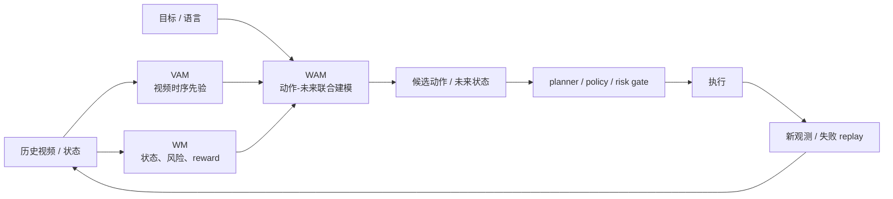

# WM / WAM / VAM：动作条件建模

世界模型、动作模型、视频模型在近两年越来越纠缠：有的论文预测未来视频，有的生成动作，有的把动作和未来一起建模。`WM / WAM / VAM` 不是社区唯一标准术语，但它们很适合做阅读坐标系。

<!-- [补充] -->
| 读者 | 建议读法 | 工程落点 |
| --- | --- | --- |
| 初学者 | 先抓“WM / WAM / VAM：动作条件建模”要解决的问题、关键术语和最小例子；公式只看变量方向。 | 能说清输入、输出和常见失败信号。 |
| 工程师 | 直接对照结构、指标、成本和边界条件，必要时回到前置页补概念。 | 落到数据、算力、延迟、显存、评测和回滚检查。 |

!!! note "读法定位"
    这页先回答“WM / WAM / VAM：动作条件建模”在「世界模型」里的位置：它解决什么局部问题，依赖哪些前置，最后会影响哪类工程或研究判断。
    **前置**：先知道潜变量、时序预测、VLM/VLA 与训练效率；再看具体论文和工程案例。 必要时先回 [世界模型入口](index.md)、[基础知识](../foundations/index.md) 或 [术语表](../glossary/index.md)。
    **主线关系**：把表征预测、潜变量动力学、规划、rollout 服务和具身/视频应用连成“可模拟、可评估、可行动”的主线。

这页不争论缩写归属，只回答三个问题：

1. 模型输入是什么。
2. 模型输出是什么。
3. 输出最后被谁消费。

!!! note "初学者先抓住"
    `WM` 更像“给动作，预测世界”；`WAM` 更像“给目标和历史，同时生成动作与未来世界”；`VAM` 更像“把视频时序先验接到动作建模”。真正要看的是接口，而不是缩写本身。

## 先用输入/输出/消费方区分

| 路线 | 典型输入 | 典型输出 | 消费方 | 最小判断 |
| --- | --- | --- | --- | --- |
| WM | 状态/观测 + 候选动作 | 未来状态、reward、risk、done | planner、value、risk checker | 动作改变未来了吗 |
| WAM | 历史观测 + 目标/语言 + 轨迹上下文 | 未来动作 + 未来观测/状态 | policy、planner、trajectory generator | 动作和未来是否对齐 |
| VAM | 视频历史 + 目标/动作条件 | 视频 latent、未来视频、动作特征 | action model、data engine、simulator | 视频先验是否提升动作成功率 |

三者不是互斥集合。一个真实系统可能用 VAM 提供视频动态先验，用 WAM 生成动作候选，再用 WM 预测风险和成功概率。

## WM：给动作，预测世界

`WM` 是最广义的 world model。它的核心接口是：

$$
p_\theta(z_{t+1:t+H}, r_{t:t+H}, d_{t:t+H}, u_{t:t+H}
\mid z_t, a_{t:t+H-1}, c)
$$

<!-- [补充：符号说明] -->
| 符号 | 含义 | 取值范围 / 常见值 |
| --- | --- | --- |
| \(\theta\) | 模型或策略参数 | 实值张量，形状由模型结构决定 |
| \(p\) | 概率、转移分布或预测量 | 概率分布或任务定义的张量 |
| \(z_{t+1:t+H}\) | 样本、状态或 latent 变量 | 张量空间，形状由数据表示决定 |
| \(r_{t:t+H}\) | 奖励、回报或时间索引相关量 | 实数标量或上下文定义的索引范围 |
| \(d_{t:t+H}\) | 公式中的变量或中间量 | 按上下文定义 |
| \(u_{t:t+H}\) | 公式中的变量或中间量 | 按上下文定义 |

其中 \(z\) 是 latent state，\(a\) 是动作，\(r\) 是奖励或进展，\(d\) 是终止，\(u\) 是风险或不确定性，\(c\) 是目标、地图、语言等上下文。

| WM 要回答 | 例子 |
| --- | --- |
| 未来状态怎么变 | 夹爪向左移动后，杯子会不会滑到桌边 |
| reward / success 是否上升 | 这条轨迹是否更接近目标 |
| 是否终止或失败 | 是否已经撞墙、掉落、任务失败 |
| 风险是否可接受 | 是否接近碰撞、遮挡或不可恢复状态 |

经典 RSSM/Dreamer 属于最清晰的 WM 基线：world model 负责 latent dynamics，policy 或 planner 负责动作选择。

## WAM：动作和未来世界联合建模

`WAM` 可以理解成从经典 `WM + policy` 往前走一步：动作不只是外部输入，也可能和未来世界一起生成。

一种简化形式是：

$$
p_\theta(o_{t+1:t+H}, a_{t:t+H-1}\mid o_{\le t}, g)
$$

<!-- [补充：符号说明] -->
| 符号 | 含义 | 取值范围 / 常见值 |
| --- | --- | --- |
| \(\theta\) | 模型或策略参数 | 实值张量，形状由模型结构决定 |
| \(p\) | 概率、转移分布或预测量 | 概率分布或任务定义的张量 |
| \(o_{t+1:t+H}\) | 公式中的变量或中间量 | 按上下文定义 |
| \(a_{t:t+H-1}\) | 动作、优势或系数 | 动作空间/实数标量，依上下文而定 |
| \(o_{t}\) | 公式中的变量或中间量 | 按上下文定义 |
| \(g\) | return、组大小或缩放系数 | 按任务定义；组大小通常为正整数 |

其中 \(g\) 是目标、语言指令或任务条件。这个式子和 WM 的差别在于：WAM 不只是“给定动作后预测未来”，还尝试建模“什么动作和什么未来会一起出现”。

{ width="920" }

<small>图源：[World Action Models are Zero-shot Policies / DreamZero](../paper-deep-dives/embodied-ai/dreamzero.md)，Figure 2。原论文图意：把未来视频和未来动作放到同一个生成过程里建模，让动作序列必须和视觉未来对齐。</small>

!!! note "图解卡：DreamZero 作为 WAM 入口"
    **输入输出**：输入历史观测和任务条件，输出未来视频与未来动作。 
    **关键模块**：未来视觉和动作共享上下文，动作不能只是单独的行为克隆标签。 
    **公式对应**：\(p(o_{t+1:t+H},a_{t:t+H-1}\mid o_{\le t},g)\)。 
    **容易误读**：WAM 不是“视频模型旁边加动作头”，而是要证明动作与未来世界互相约束，并且执行后能用真实新观测刷新。

WAM 对机器人很有吸引力，因为动作是否合理往往要通过未来状态判断。抓杯子、拉抽屉、绕障、重定位都不是单帧动作分类问题，而是动作和未来状态强耦合的问题。

## VAM：视频先验服务动作

`VAM` 更强调视频表示。它关心的是：视频模型学到的时空先验、物体运动、遮挡、接触和交互模式，能不能迁移到动作生成或控制中。

一个粗略形式是：

$$
p_\theta(v_{t+1:t+H}, a_{t:t+H-1}\mid v_{\le t}, g)
$$

<!-- [补充：符号说明] -->
| 符号 | 含义 | 取值范围 / 常见值 |
| --- | --- | --- |
| \(\theta\) | 模型或策略参数 | 实值张量，形状由模型结构决定 |
| \(p\) | 概率、转移分布或预测量 | 概率分布或任务定义的张量 |
| \(v_{t+1:t+H}\) | value、速度场或向量量 | 实数标量/向量，依上下文而定 |
| \(a_{t:t+H-1}\) | 动作、优势或系数 | 动作空间/实数标量，依上下文而定 |
| \(v_{t}\) | value、速度场或向量量 | 实数标量/向量，依上下文而定 |
| \(g\) | return、组大小或缩放系数 | 按任务定义；组大小通常为正整数 |

这里 \(v\) 可以是视频帧、视频 token 或视频 latent。VAM 的价值不一定来自完整解码清晰视频，而是来自视频模型内部保留了动态上下文。

{ width="920" }

<small>图源：[Video Prediction Policy](../paper-deep-dives/embodied-ai/video-prediction-policy.md)，Figure 1。原论文图意：先让文本条件视频预测模型学习操作过程中的未来视觉，再用预测表征作为动作生成条件。</small>

!!! note "图解卡：VAM 不等于直接执行视频"
    **输入输出**：视频预测模型先产生未来视觉表征，下游动作模型再利用这些表征生成动作。 
    **关键模块**：中间的 predictive representation 比最终视频画质更关键。 
    **公式对应**：视频 latent \(v\) 作为动作模型的动态上下文。 
    **容易误读**：视频看起来好，不等于动作成功率会上升；必须看闭环动作评测。

## 三者放在同一套系统里

这张图的意思是：VAM、WAM、WM 更像三个功能维度，而不是互斥标签。视频先验可以帮助动作模型泛化，动作-未来联合建模可以产生候选轨迹，结构化 world model 可以给风险、reward 和终止判断。

## 动作条件到底放在哪里

| 放法 | 看起来像 | 优点 | 风险 |
| --- | --- | --- | --- |
| 动作作为输入条件 | \(p(z_{t+1}\mid z_t,a_t)\) | 最清楚，适合规划和反事实 | 需要动作数据对齐 |
| 动作作为输出 | \(p(a_t\mid o_{\le t},g)\) | 适合 policy / VLA | 不一定预测动作后果 |
| 动作和未来联合输出 | \(p(o_{future},a_{future}\mid history,g)\) | 动作与未来互相约束 | 归因复杂，安全验证更难 |
| 动作作为 prompt 弱条件 | 文本里写“向左走” | 接入简单 | 模型可能仍靠视频惯性生成平均未来 |

世界模型最小门槛是：固定同一历史，替换动作，未来状态、风险或成功排序应该合理变化。如果换动作后输出几乎不变，它可能只是带动作标签的视频续写器。

## 评测要按消费方来设计

| 消费方 | 该看什么指标 | 不够的指标 |
| --- | --- | --- |
| Planner | candidate ranking agreement、closed-loop success、cost per success | 只看 next-frame loss |
| Policy | action chunk success、真实观测刷新后的稳定性 | 只看行为克隆误差 |
| Risk checker | collision recall、near-miss recall、risk ECE | 只看平均 reward |
| Data engine | hard-negative yield、failure replay usefulness | 只看生成数量 |
| Human review | 可解释反事实、错误归因质量 | 只看视频美观 |

工程上最小可复算检查是 `candidate ranking agreement`：世界模型预测最安全/最成功的 top-1 动作，是否与真实安全成功动作一致。没有这项，闭环规划收益很难成立。

## 常见误区

| 误区 | 为什么错 | 正确问法 |
| --- | --- | --- |
| WM 等同于视频生成 | 视觉逼真不等于动作因果 | 动作改变未来了吗 |
| WAM 等同于行为克隆 | 行为克隆只拟合动作，不一定预测未来 | 动作和未来状态是否联合约束 |
| VAM 等同于视频模型加动作标签 | 标签弱可能被模型忽略 | 视频 latent 是否提升动作成功率 |
| Open-loop 好就是闭环好 | planner 会放大模型误差 | 接入 policy/planner 后是否变好 |
| 统一模型一定优于分层模型 | 联合目标归因更难 | 哪一层的输入输出和证据更清楚 |

## 何时选哪条

| 场景 | 更需要什么 | 原因 |
| --- | --- | --- |
| Model-based RL | WM | 需要 imagined rollout、reward/value learning |
| 机器人长任务 | WAM + WM | 动作、目标和未来状态强耦合 |
| 自动驾驶 | WM + 结构化场景表示 | 风险、占用、轨迹和反事实更关键 |
| 视频数据引擎 | VAM + WM | 需要生成可筛选、可对比的未来 |
| 具身泛化 | VAM + WAM | 需要从视频先验迁移到动作 |
| 安全规划 | WM + risk head | 需要保守、可解释、可回退的未来预测 |

## Claim Ledger

| Claim | Source | Evidence Type | Can Support | Cannot Prove |
| --- | --- | --- | --- | --- |
| WM 的核心接口是给定状态和动作预测未来状态、奖励、风险或终止 | [RSSM/Dreamer](rssm-dreamer-and-planning.md) | Paper Result | latent dynamics 是可规划世界模型的经典形态 | 所有视频生成模型都天然满足 WM 接口 |
| WAM 把未来视频和未来动作联合建模，可让动作预测与未来视觉变化对齐 | [DreamZero 专题](../paper-deep-dives/embodied-ai/dreamzero.md) | Closed-loop | DreamZero 类系统展示 WAM 作为 policy 的潜力 | WAM 一定优于单独 policy 或所有 VLA |
| VAM 使用视频时序先验支撑动作泛化 | [Video Prediction Policy](../paper-deep-dives/embodied-ai/video-prediction-policy.md) | Paper Result | 视频 latent 可作为动作模型动态上下文 | 视频质量指标能替代动作成功率 |

## 阅读建议

读一篇声称自己是 world model、world-action model 或 video-action model 的论文时，先填这张小表：

| 问题 | 你的答案 |
| --- | --- |
| 输入是什么 | observation、latent、video、goal、action 中哪些 |
| 输出是什么 | future state、video、action、reward、risk、done 中哪些 |
| 动作在哪里 | 输入、输出、联合变量、prompt、标签 |
| 谁消费输出 | planner、policy、risk checker、data engine、人审 |
| 最强证据 | closed-loop、ablation、benchmark、demo、system throughput |
| 不能证明什么 | 长 horizon、真实机器人、安全部署、跨任务泛化 |

填完再看模型名，很多混乱会自然消失。

!!! tip "下一站"
    - 回到本专题入口：[世界模型](index.md)，确认这页在整条路线中的位置。
    - 按导航顺序继续：[规划即推理与潜在动作](planning-as-inference-and-latent-actions.md)。
    - 概念或符号卡住时，先查 [术语表](../glossary/index.md)，再回到当前页。
