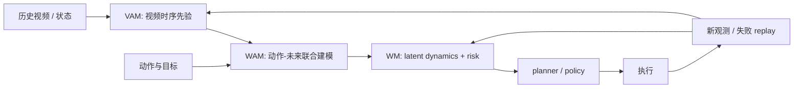

# WM / WAM / VAM：动作条件建模

近两年世界模型讨论里，很多论文都在谈未来预测、动作建模、视频生成、控制和仿真，但它们强调的对象并不完全相同。`WM / WAM / VAM` 不是社区唯一标准术语，却很适合做阅读地图：`WM`（World Model）强调世界动态，`WAM`（World-Action Model）强调动作和世界未来的联合建模，`VAM`（Video-Action Model）强调视频表示与动作建模的统一。

这页的目标不是争论术语，而是帮助你快速判断一篇工作到底在建模什么、接口是什么、适合什么应用、容易在哪里失效。

!!! note "初学者先抓住"

    `WM` 更像“给动作，预测世界”，`WAM` 更像“动作和未来世界一起建模”，`VAM` 更像“把视频时序先验接到动作建模”。读论文时先看输入输出接口，而不是被缩写本身带跑。

!!! example "有趣例子：三种导演视角"

    `WM` 像场景模拟师，关心世界会怎么变；`WAM` 像动作导演，关心角色该怎么动以及动完画面怎样；`VAM` 像视频导演，先抓住时序画面规律，再把它用于行动。

{ width="920" }

<small>图源：[DreamZero](../paper-deep-dives/embodied-ai/dreamzero.md)，Figure 2。原论文图意：把未来视频和未来动作放到同一个生成过程里建模，让动作序列必须和视觉未来对齐。</small>

!!! note "图解：为什么这张图适合作为 WAM 入口"
    传统世界模型常是“给定动作，预测未来”；普通 VLA 常是“给定观测，输出动作”。DreamZero 这张图把两件事绑在一起：未来视频不再只是展示用的 rollout，动作也不再只是行为克隆标签。读 WAM 时要看三件事：动作 token 在哪里进入模型，未来视觉和动作是否共享上下文，执行后是否用真实新观测刷新，而不是一直相信自己生成的未来。

## 硬证据模块：先证明动作真的改变未来

WM/WAM/VAM 的共同硬证据，是同一历史下动作改变时，模型输出的未来、风险和动作排序也要合理改变。没有这项证据，模型可能只是一个带动作标签的视频续写器。

| 证据项 | WM 要看 | WAM 要看 | VAM 要看 |
| --- | --- | --- | --- |
| 本页解决哪项成本 | 用 imagined rollout 少上真实环境试错 | 用联合建模减少单独 policy 数据需求 | 用视频先验减少机器人视频标注 |
| 最小可复算例子 | 固定 \(z_t\)，替换 3 个动作，比较 \(z_{t+H}\) | 同时输出未来动作和未来观测，检查对齐 | 用 one-step 视频 latent 训练动作头 |
| 失败案例 | 长时 latent 漂移，reward/risk 不可信 | 动作看似合理但未来视频不支持 | 视频预测好看但动作成功率不升 |
| 证据等级 | Dreamer 类 benchmark / RSSM ablation | DreamZero 类闭环 + 系统吞吐 | VPP 类 benchmark + 真实机器人 |
| 验收指标 | action sensitivity、risk calibration、closed-loop gain | action chunk success、real observation refresh 后稳定性 | predictive representation ablation、cost per success |

对工程读者来说，最小门槛是 `candidate ranking agreement`：世界模型按预测风险和成功率选出的 top-1 动作，是否与真实安全成功动作一致。mini-chain fixture 里这个数只有 `2/4`，所以它暴露的是“不合格 WAM 该怎么被评测抓出来”，而不是证明某个方法有效。

## 统一问题

三条路线都围绕同一个基本问题：

\[
\text{给定历史观测、动作和目标，未来会怎样演化？}
\]

区别在于建模对象不同：

| 路线 | 更关注什么 | 典型形式 |
| --- | --- | --- |
| WM | 世界状态或潜状态如何随动作演化 | \(p(z_{t+1:t+H}\mid z_t,a_{t:t+H-1})\) |
| WAM | 动作未来和世界未来如何联合生成 | \(p(o_{t+1:t+H},a_{t:t+H-1}\mid o_{\le t},g)\) |
| VAM | 视频时序表示如何支撑动作泛化 | \(p(v_{t+1:t+H},a_{t:t+H-1}\mid v_{\le t},g)\) |

三者不是互斥集合，更像坐标系。一篇工作可能同时有 latent dynamics、动作联合生成接口和视频 latent。

## WM：世界动态建模

`WM` 是范围最大的词。只要模型在学习世界如何随动作、时间和任务条件变化，并且这种预测能被规划、控制或数据闭环消费，就可以归入广义 world model。

典型目标包括学到可 rollout 的环境动态，在不直接上真实环境试错的情况下做 imagined planning，支持 reward、value、risk、termination 等辅助预测，并为 planner、policy 和数据回流提供内部环境表征。

典型实现包括 `RSSM / Dreamer` 一类 latent dynamics、未来观测生成模型、带 reward/risk head 的环境预测器，以及结合 occupancy、object state 或 BEV 的结构化世界表示。

WM 的核心问题不是“动作应该怎么生成”，而是世界的最小可决策表示是什么，如何稳定长时 rollout，如何把环境模型和 planner 接起来，以及在部分可观测下如何维护 belief state。

## WAM：动作与世界联合建模

`WAM` 可以理解成从经典 `WM + policy` 往前走一步：不再只先学世界模型、再单独学 policy，而是直接学习动作和未来世界的联合分布。

它的直觉是：世界如何演化和动作如何生成本来就强耦合，好动作常常必须通过未来世界状态来判断，复杂控制中的动作先验本身就是世界结构的一部分，而机器人和驾驶数据天然就是观测与动作交织的轨迹。

这让 WAM 对机器人特别有吸引力。抓杯子、拉抽屉、绕障、重定位这类动作是否合理，不能只看当前帧，而要看动作执行后的未来状态。

WAM 和经典 WM 的区别可以简单记为：经典 WM 更强调“给动作，预测世界”，WAM 更强调“给目标和历史，同时生成动作与世界未来”。

## VAM：视频先验进入动作建模

`VAM` 更明确地把视频表示放在中心位置。它关心的是：能否把视频模型学到的时空先验、物体运动、遮挡、接触和交互模式，迁移到动作生成和控制中。

VAM 的吸引力来自几个事实：视频包含丰富的时序和交互信息，视频数据规模通常远大于机器人动作数据，视频预训练可能比静态图像更利于动作泛化，视频 latent 也可以作为动作模型的动态上下文。

{ width="920" }

<small>图源：[Video Prediction Policy](../paper-deep-dives/embodied-ai/video-prediction-policy.md)，Figure 1。原论文图意：先让文本条件视频预测模型学习操作过程中的未来视觉，再用预测表征作为动作生成条件。</small>

!!! note "图解：VAM 不是把视频生成结果直接拿去执行"
    这张图的重点在中间表征：视频预测模型学到的是“接下来会怎样动”的动态上下文，下游动作模型再利用这些表征生成机器人动作。也就是说，VAM 的价值不一定来自完整解码清晰视频，而是来自视频模型内部保留了物体运动、遮挡、接触和任务阶段信息。

但 VAM 不等于“会生成视频”。真正要验证的是视频 latent 是否有利于动作生成，视频未来是否帮助筛掉危险动作，视频历史是否帮助理解 affordance，以及生成能力是否能转化为闭环控制收益。

如果只看视频逼真度，而不看动作成功率、恢复能力和风险控制，就会高估 VAM 的实际价值。

## 接口与目标函数差异

三者在系统接口和目标函数上的差异，会直接影响部署价值。

| 维度 | WM | WAM | VAM |
| --- | --- | --- | --- |
| 输入 | 状态/观测 + 候选动作 | 历史观测 + 目标 | 视频历史 + 目标/动作条件 |
| 输出 | 未来状态、reward、risk、termination | 未来动作 + 未来观测 | 未来视频 latent + 动作 |
| 训练目标 | 重建、dynamics、reward/risk | 联合序列建模、动作一致性 | 视频预测、视频-动作对齐 |
| 消费方 | planner、value、risk module | policy、planner、trajectory generator | action model、data engine、simulator |
| 主要风险 | rollout 漂移、预测对控制无用 | 动作偏差、训练归因复杂 | 视频好看但控制无收益 |

更偏 WM 的模型常适合规划与风险评估；更偏 WAM 的模型适合统一动作生成和未来模拟；更偏 VAM 的模型适合利用大规模视频做泛化和数据合成。

## 应用中的取舍

不同应用对三者的偏好不同：

| 场景 | 更需要什么 | 原因 |
| --- | --- | --- |
| Model-based RL | WM | 需要大量 imagined rollout 和 value learning |
| 机器人长任务 | WAM + WM | 动作、目标和未来状态强耦合 |
| 自动驾驶 | WM + 结构化场景表示 | 风险、占用、轨迹和反事实更关键 |
| 视频数据引擎 | VAM + WM | 需要生成可筛选、可对比的未来 |
| 具身泛化 | VAM + WAM | 需要从视频先验迁移到动作 |
| 安全规划 | WM + risk head | 需要保守、可解释、可回退的未来预测 |

实际系统往往不会纯用一种路线，而是组合：例如用视频模型提供动态先验，用结构化 WM 提供风险和可通行性，用 WAM 或 policy head 输出可执行动作。

## 组合系统图

这个图说明 WM、WAM、VAM 更像组合坐标，而不是互斥标签。VAM 提供视频动态先验，WAM 把动作和未来绑在一起，WM 把未来状态、risk、reward 和 planner 接起来。系统设计时要问的是哪一层最弱，而不是争论缩写归属。

## 一个阅读判断表

| 论文声称 | 你要追问 | 如果答不上来 |
| --- | --- | --- |
| 视频世界模型 | 动作是否改变未来 | 可能只是视频生成 |
| 动作模型 | 未来状态是否参与训练或评测 | 可能只是行为克隆 |
| 联合建模 | 执行时如何用新观测刷新 | 可能会自我滚动漂移 |
| 低成本 rollout | token、KV、视频 latent 成本怎么算 | 可能无法部署 |
| 闭环提升 | 是否有失败桶和恢复率 | 可能只提升开环指标 |

## 常见误区

最常见的误读有五类。第一是把 WM 等同于视频生成，但视觉逼真不等于对动作敏感，也不等于能改善规划。第二是把 WAM 等同于行为克隆，而 WAM 的重点是动作和世界未来联合建模，不只是拟合下一步动作。第三是把 VAM 等同于视频模型加动作标签，实际上核心是视频 latent 是否真的服务控制。第四是只看 open-loop 指标，开环预测好不代表闭环任务成功。第五是忽略动作接口，因为动作表示、频率、控制层级和执行约束会决定模型能否落地。

判断一篇工作时，建议固定问：动作条件放在哪一层，未来预测最终被谁消费，评测是否包含闭环收益，失败是来自表示、规划、动作接口还是数据偏差，系统成本是否允许它进入真实控制循环。

## 阅读建议

建议按一条由基础到验收的路径读本专题：先读 [世界模型路线图](index.md) 建立广义但面向决策的定义，再读 [RSSM、Dreamer 与规划](rssm-dreamer-and-planning.md) 理解经典 latent dynamics；随后进入 [生成式模拟与视频世界模型](generative-simulation-and-video.md)，看视频路线为什么会进入世界模型；再读 [规划即推断与潜在动作](planning-as-inference-and-latent-actions.md)，理解动作、目标和规划接口；最后用 [世界模型评测与失效模式](evaluation-and-failure-modes.md) 判断这些模型是否真的改善决策。

WM、WAM、VAM 最适合作为阅读坐标系，而不是硬标签。真正重要的是模型学习了什么动态结构，这些结构如何进入动作决策，以及闭环收益是否足以覆盖训练和推理成本。
