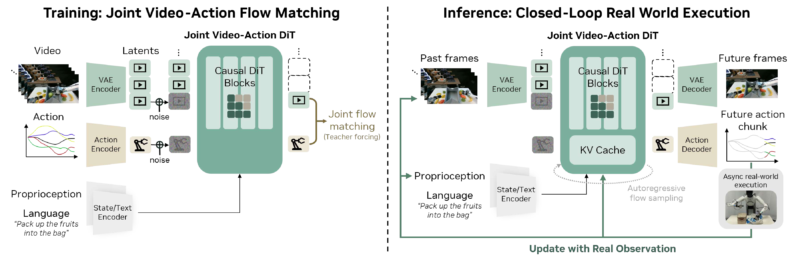
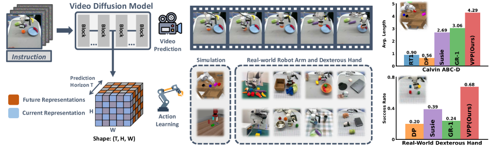

# WM、WAM、VAM 与动作条件建模

机械臂要把红杯子放进托盘。一个模型可以直接输出抓取动作，另一个可以回答“如果先松开夹爪会怎样”，还有一个同时生成未来视频和动作。要判断它们能否互换，先看动作在概率分解中的位置。动作作为条件时，模型预测给定行动的后果；动作作为输出时，模型产生行为；动作与未来一起生成时，还需要解释二者怎样一致且可执行。WM、WAM、VAM 的名称并非统一标准，接口比缩写更可靠。

## 条件预测与策略输出是不同任务

记历史为 $h$，目标为 $g$，未来观察为 $o'$，动作序列为 $a$。四种接口可以写成

| 接口 | 概率形式 | 模型可以直接回答什么 |
| --- | --- | --- |
| 动作条件世界预测 | $p(o'\mid h,a)$ | 这组动作会产生什么未来 |
| VLA policy | $\pi(a\mid h,g)$ | 为这个目标应该做什么 |
| 联合 world-action model | $p(o',a\mid h,g)$ | 生成一组相互配对的未来与动作 |
| 视频表示驱动的 policy | $\pi(a\mid h,g,f_{\mathrm{video}})$ | 如何利用视频预测先验选择动作 |

拥有一个 $p(o'\mid h,a)$ 并不会自动给出最优动作，还需要枚举、搜索或 actor。相反，一个动作策略即使学会成功抓取，也未必能对任意指定动作预测后果。两项能力可以共享表示，但不能互相替代。

## 同一目标下，查询方式怎样改变

对红杯子任务，给策略输入目标，它会输出某种抓取动作；给条件世界模型指定“松开夹爪”，它应预测该动作后果，即使后果不符合目标。若模型无论输入什么动作都生成成功放置视频，它可能是在遵循目标先验，尚未提供可查询的动力学。

构造一个两动作例子。策略选择快抓、慢抓的概率为 0.8 和 0.2，模型预测两者成功概率为 0.5 和 0.9。按这条策略平均的成功概率为 $0.8\times0.5+0.2\times0.9=0.58$。动作条件模型则允许 planner 比较两者，在不考虑其他代价时选慢抓，模型预测成功率变为 0.9。这里的 0.58 和 0.9 都是构造概率的计算，实际是否成功还需要独立执行。

这个差异说明，联合样本分布既受策略偏好影响，也受动作后果影响。只观察大量生成样本中的成功比例，无法单独确定某个指定动作的可靠性。

## 联合生成中，动作与未来如何配对

联合分布可形式化分解为

\[
p(o',a\mid h,g)=p(a\mid h,g)p(o'\mid h,a,g).
\]

模型也可能通过共同去噪同时生成两类变量，而没有显式按这个顺序采样。关键仍是得到一组配对样本。如果独立生成一条“杯子已经放入托盘”的未来和一条只会抬起夹爪的动作，它们各自合理，组合却不能执行。

[DreamZero](https://arxiv.org/abs/2602.15922)将未来视频与动作联合建模，原始论文与[项目页](https://dreamzero0.github.io/)给出其具体结构和闭环设置。它不代表所有使用 WAM 名称的方法都采用相同动作表示、时间尺度或训练目标。

{ width="920" }

<small>图源：World Action Models are Zero-shot Policies，DreamZero 架构图。</small>

联合生成还面临自洽但错误的问题。模型生成“成功夹住”的视频并同时生成“抬起”动作，实际却抓空。未来视频与动作互相支持，无法作为独立验证证据；必须回到真实后继观察检查。

## 视频先验怎样帮助动作模型

视频预训练可提供物体运动、遮挡和任务阶段的表征，再由动作模块映射到机器人控制量。[Video Prediction Policy](https://arxiv.org/abs/2412.14803)以预测视觉表示支持动作学习，具体接口可对照其[项目页](https://video-prediction-policy.github.io/)。这种路线不必在每次控制时把所有未来帧解码成人眼可见的视频。

{ width="920" }

<small>图源：Video Prediction Policy，整体方法图。</small>

人类视频中的“手伸向杯子”与机器人动作空间之间仍有映射问题。相机角度、手臂长度、夹爪形状和控制器都改变可执行动作。视频先验扩大可学习的信息来源，不能直接提供每个机器人的力矩或关节目标。[RT-2](https://deepmind.google/blog/rt-2-new-model-translates-vision-and-language-into-action/)则展示另一种把视觉语言表示接到动作 token 的接口。

## 动作必须对应一段真实时间

假设视频为 10 Hz，关节控制为 50 Hz，每两个视频帧之间有五个控制周期。如果动作记录的是速度，需要按每个周期积分；若已经记录位移增量，则应直接累加。动作块长度为 8、控制频率 10 Hz 时覆盖 0.8 秒，不能无说明地拿来预测 1.6 秒后果。

若需要 1.6 秒预测，应提供两个连续动作块、规定第二段默认控制，或明确只预测第一块后的 0.8 秒。缺少后半段动作却把未来当成条件确定，会把采集策略的行为先验混入动力学。候选动作评分时，模型可能继续“替用户做”训练数据里常见的后续动作。

## 条件预测何时能解释为干预后果

观察数据给出 $p(o'\mid h,a)$，规划真正关心的是改变动作后的结果。若历史 $h$ 已控制影响动作与后果的共同因素，且数据覆盖候选动作，两者才有机会对齐。隐藏接触力同时影响示范者动作和物体滑落时，模型可能把动作相关性误当成动作因果。

因此反事实检查需要固定相同起点，改变动作，同时控制其他条件。可重置模拟器或重复的受控实验比任意日志中的“相似画面”更接近这个要求。[V-JEPA 2-AC](https://ai.meta.com/research/publications/v-jepa-2-self-supervised-video-models-enable-understanding-prediction-and-planning/)在表示空间接入动作条件规划，仍需要在其具体机器人与目标设置中解释证据。

模型选择可按缺口进行。需要候选评分时关注可查询的动作条件动力学，需要直接控制时关注可执行策略与延迟，需要合成环境时关注持续交互、状态一致性和重置接口。Latent imagination 可对照 [DreamerV3](https://arxiv.org/abs/2301.04104)，交互视频可对照 [Genie 2](https://deepmind.google/blog/genie-2-a-large-scale-foundation-world-model/)与 [Genie 系列](https://deepmind.google/models/genie/)。接口评测方法见[评测页](evaluation-and-failure-modes.md)。

## 用最小可辨识实验区分三种接口

不要先根据模型名称决定它是什么。可以用同一批固定起点和三组查询做接口验收：

| 查询 | WM 应给出 | WAM 应给出 | VLA / policy 应给出 |
| --- | --- | --- | --- |
| 指定动作 A | $p(o'mid h,A)$ 或状态分布 | 与动作 A 配对的未来与动作轨迹 | 不一定回答，可能只输出策略动作 |
| 指定动作 B | 与 A 不同的后果分布 | 与 B 配对的未来和动作 | 仍可能输出同一个最优动作 |
| 不给动作、给目标 | 需要 planner 或 actor 才能选动作 | 可联合生成候选 | 直接给动作是其主要接口 |

最小数据集可以只有 20 个起点、每个起点 2 个相反动作和一个不动作对照。验收先看动作响应，再看长期任务。若模型对 A、B 的预测几乎相同，却在目标条件下生成漂亮视频，应把它归为“目标条件生成”而不是已验证的动作条件世界模型。

## 风险敏感规划不能只取最大成功率

设候选动作 $a_i$ 的模型预测成功率为 $hat p_i$，碰撞概率为 $hat c_i$，执行延迟为 $d_i$。一个教学用目标可以写成

\[
J(a_i)=\hat p_i-\lambda_c\hat c_i-\lambda_d d_i,
\]

但这个分数只有在三项量纲、校准方式和时间窗口一致时才有意义。对模型不确定度较大的候选，可以使用下置信界或把不确定度作为额外惩罚。最终仍需在真实环境或独立模拟器里执行 top-1 和若干低分对照，因为联合生成的未来与动作可能彼此“互相证明”。

实验报告至少应给出：候选数量、搜索深度、每个候选的模型调用次数、成功率置信区间、碰撞与人工接管分母，以及模型预测和真实结果的混淆矩阵。没有这些信息，不能把 planner 选择的成功归因于世界模型本身。

## 动作表示的三个隐藏契约

WAM 或 VLA 的接口在跨机器人迁移时，最容易漏掉以下契约：

1. **坐标系**：动作是相机坐标、基座坐标还是末端局部坐标，旋转采用欧拉角、轴角还是四元数。
2. **时间尺度**：一个 action token 对应一个控制周期、一个 action chunk，还是一段高层技能；执行时是否允许提前终止。
3. **安全范围**：速度、加速度、夹爪开合和工作空间边界由谁裁剪，裁剪后是否把实际动作回写给模型。

把这些字段写入 trajectory schema，并在离线重放中验证“模型动作 → 安全层 → 执行动作”的差异。若安全层经常大幅修改动作，训练分布和真实执行分布已经不一致，应单独评估安全层，而不是继续调大模型。

## 继续读

继续看[世界模型论文综述](../paper-deep-dives/world-models/world-models-embodied-ai-survey.md)和[具身推理中的观测年龄](../thinking-exploration/embodied-inference-observation-age-1009-2059.md)。

## 来源怎样支持具体主张

[DreamerV3](https://arxiv.org/abs/2301.04104)适合支持 latent imagination 与策略学习的接口说明；[RT-2](https://deepmind.google/blog/rt-2-new-model-translates-vision-and-language-into-action/)适合说明视觉语言表示到动作 token 的一种路线；[Video Prediction Policy](https://arxiv.org/abs/2412.14803)适合说明视频预测表示可作为策略输入。它们的成功率、机器人配置和数据规模不能直接迁移到本地实验。

阅读论文或项目页时，把“方法定义”“作者任务上的结果”“本地可复现实验”分成三栏。只有第三栏包含固定数据、配置、日志和独立执行结果时，才可以写成本项目的证据。
