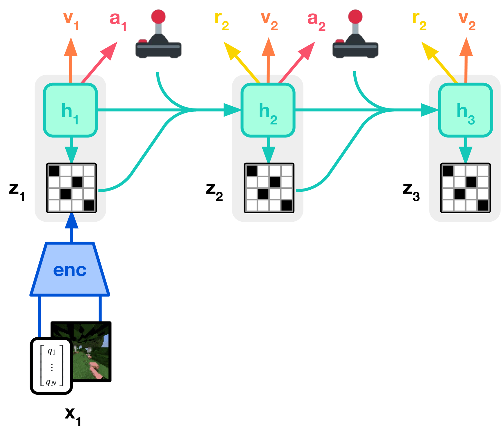
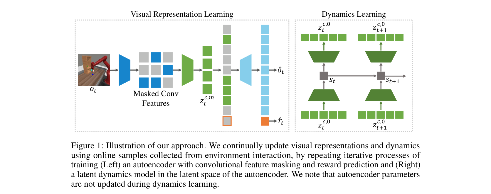
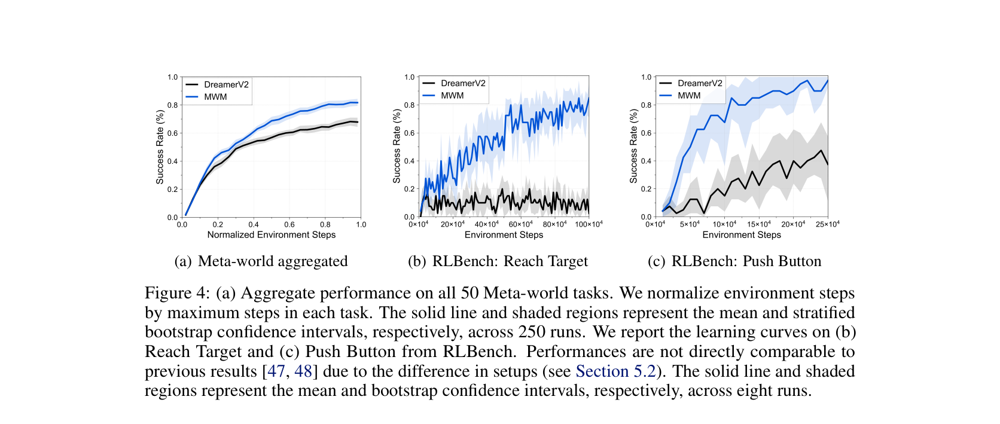
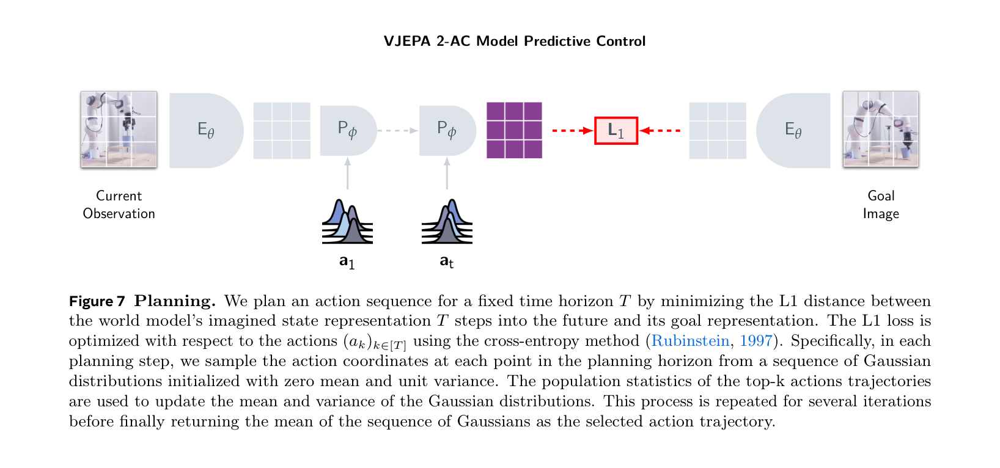
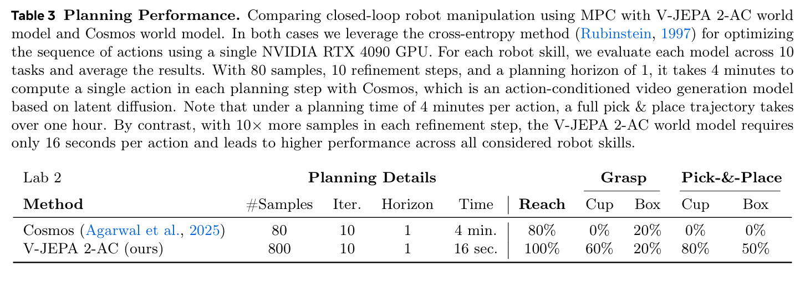

# 世界模型评测报告，逐项复算一份最小示例

一个报告同时出现 `compression_ratio=6.70x`、风险 ECE `0.103` 和安全成功 `2/4`，应该怎样理解？前三个数分别描述表示长度、概率与标签的分桶差异、最终选择的结果，不能互相替代。下面从仓库文件逐项复算，展示报告需要怎样写清证据来源。

这里使用四条 episode 和十二条候选 rollout，所有预测与结果标签都是手工 fixture。[评测脚本](../assets/examples/world-model-mini-chain/eval_mini_chain.py)只读取 JSONL 并计算指标，没有训练、没有模型推理、没有运行机器人。因此，这份报告验证的是计算口径，不能证明某个世界模型达到相应性能。

## 从输入文件确认每个数的来源

[`episodes.jsonl`](../assets/examples/world-model-mini-chain/episodes.jsonl)记录相机帧数、每帧 token、额外状态 token 和 episode 描述。[`rollouts.jsonl`](../assets/examples/world-model-mini-chain/rollouts.jsonl)为每条 episode 写三个候选动作，包含预测成功、预测风险、latent 差异和人工结果标签。`actual_` 字段在这个示例中只是标签名称，不意味着真实机器人测量。

[`training-config.yaml`](../assets/examples/world-model-mini-chain/training-config.yaml)列出训练设计，但脚本没有解析它。修改其中的 `risk_ece_max` 不会改变评测输出，也不会触发发布判定。动作敏感性阈值实际来自 `rollout_metrics` 的默认参数 `8.0`。种子、优化器、学习率等字段同样没有在此脚本中生效。

在仓库根目录运行

```bash
python3 files/assets/examples/world-model-mini-chain/eval_mini_chain.py
```

应得到下表。这些是对当前静态输入的确定性计算。

| 输出 | 结果 |
| --- | ---: |
| episode 数 | 4 |
| raw patch tokens | 82368 |
| compressed state tokens | 12292 |
| compression ratio | 6.70x |
| action sensitivity pass | 3/4 |
| top1 safe success | 2/4 |
| risk ECE，三个固定区间 | 0.103 |

## 6.70 倍压缩的分子和分母是什么

以第一条 episode 为例，手腕相机 16 帧、每帧 256 个 patch；另外两路各 8 帧、每帧 888 个 patch。原始视觉 token 为

\[
16\times256+2\times8\times888=18304.
\]

压缩侧分别使用每帧 64、96、96 个 token，再加 memory 128、language 24、proprioception 16、action 8。

\[
16\times64+2\times8\times96+128+24+16+8=2736.
\]

因此第一条为 $18304/2736\approx6.69$。四条的原始数依次是 18304、22880、13728、27456，压缩后依次为 2736、3380、2064、4112。报告使用总数之比 $82368/12292\approx6.70$，并非四个比值的未加权均值。

分子只含原始视觉 patch，分母还含其他状态 token，这是一种明确的记账口径。它不能直接推导训练快 6.70 倍。不同 token 可能来自不同模块，encoder 与 resampler 自身要计算，attention、MLP、通信的时间也不会都按同一比例缩短。当前文件没有 wall time、显存峰值或实际图像保真度，因而只能报告 token 账。

## 模型分数怎样选出了两条失败动作

脚本为每个候选计算

\[
S(a)=p_{\mathrm{success}}(a)-p_{\mathrm{risk}}(a),
\]

并选最大值。权重相等是本示例的决策规则，不是一般任务的最优安全准则。

| episode | 选中动作 | 分数 | fixture 标签 |
| --- | --- | ---: | --- |
| 001 | `grasp_center` | $0.82-0.12=0.70$ | 成功、无违反 |
| 002 | `open_then_place` | $0.74-0.22=0.52$ | 成功、无违反 |
| 003 | `fast_grasp` | $0.80-0.20=0.60$ | 滑落、有违反 |
| 004 | `grasp_visible_decoy` | $0.76-0.16=0.60$ | 抓错目标、无违反 |

第二条尤其能说明分数差的含义。`place_front` 的分数为 $0.68-0.18=0.50$，仅比选中的动作低 0.02；微小预测误差就可能翻转选择。第三条中 `slow_grasp` 的分数只有 $0.62-0.32=0.30$，但标签为安全成功，表明给定的分数方向已与该组结果冲突。

字段 `top1_safe_success_agreement` 实际计数的是“选中的候选在标签中是否成功且无违反”。它没有比较全部候选的真实排序，也没有计算 rank correlation，因此正文称它为 top-1 安全成功率。对同一初始状态取得所有候选的真实结果，在真实机器人上还需要可重复重置或其他有效实验设计，日志并不会天然提供这些反事实。

## 动作敏感性通过，为何仍可能选错

脚本对每条 episode 取 `latent_delta_to_noop` 的最大值，再判断是否至少为 8。四条最大值为 12.0、9.5、11.2、6.5，前三条通过。

第三条的 fast 和 slow 都产生了很大的 latent 变化，但变化方向是否真实、事件是否预测对，都不在这个指标里。模型若只是因动作输入改变背景纹理，也可能通过。第四条低于阈值，只能说其人工填写的 latent 差异较小，不能据此定位为“遮挡记忆必然失败”。尺度换一倍，阈值含义也会改变。

动作对照要继续检查任务变量。对抓取来说，可以看杯子位置、夹持状态、滑落事件和目标身份。用真实对照确认这些变量的变化，才能建立动作条件预测的有效性；单一 embedding 距离不能代替这一步。

## 为什么风险 ECE 看起来不大

脚本把十二个风险分数分到 $[0,0.33)$、$[0.33,0.66)$、$[0.66,1.01)$，对每桶计算平均预测风险与违反比例之差，再按桶样本量加权。

\[
\mathrm{ECE}=\sum_b\frac{|B_b|}{N}
\left|\frac1{|B_b|}\sum_{i\in B_b}p_i-
\frac1{|B_b|}\sum_{i\in B_b}y_i\right|.
\]

第一桶有十一条，平均预测风险约 0.15364，只有一次违反，实际比例为 $1/11\approx0.09091$。第二桶只有 `push_left` 一条，预测 0.45，违反标签为 1。第三桶为空，不贡献误差。

\[
\mathrm{ECE}=\frac{11}{12}|0.15364-0.09091|
+\frac1{12}|0.45-1|
\approx0.10333.
\]

这个均值没有告诉我们 `fast_grasp` 的风险被低估，而且抓错目标是任务失败却不是 `actual_violation`。因此 ECE 较小与 top-1 成功较低可以同时发生。粗分桶、十二条样本和人工标签也不足以证明部署概率校准良好。

## 报告怎样从算例升级为模型实验

真实实验先要把预测字段连接到指定 checkpoint 的输出，并记录输入数据、模型版本、随机种子和采样条件。结果标签则应来自独立的真实执行或明确说明假设的模拟器。需要同时保留未参与训练与调参的任务，避免只修正这四个例子后宣布泛化。

训练报告还要区分世界模型学习和决策器学习。下面两张 DreamerV3 原图展示这一区别，不能作为本 fixture 已完成这些训练的证据。

{ width="900" }

{ width="900" }

<small>图源：[DreamerV3](https://arxiv.org/abs/2301.04104)，world model learning 与 actor-critic learning 示意。真实经验校准模型，想象轨迹为行为学习提供信号。</small>

表征压缩同样需要连接控制任务。MWM 将视觉表示与动力学分开训练，报告任务曲线才能判断中间表示是否帮助控制。

{ width="920" }

{ width="920" }

<small>图源：[Masked World Models](https://arxiv.org/abs/2206.14244)，Figure 1 与 Figure 4。图中的任务曲线来自原论文实验，与本页手工数据无关。</small>

如果模型交给 planner 使用，候选数量、预测 horizon、搜索轮数、目标函数和等待时间也属于实验条件。更多搜索预算本身就可能改变结果，不能全部归因于模型更好。

{ width="920" }

{ width="920" }

<small>图源：[V-JEPA 2](https://arxiv.org/abs/2506.09985)，Figure 7 与 Table 3。阅读时把动作条件模型、MPC 调用和论文中的具体机器人任务放在一起比较。</small>

本示例能确定的是计算过程及字段解释，能提出的是快抓滑落与遮挡错目标两个诊断方向。要判断增添失败数据、调整风险头或改善状态记忆是否有效，还需要真正训练后的独立比较。下一步实验如何定位，见[开发与评测](development-roadmap-data-simulation-and-evaluation.md)；每种指标的用法见[世界模型评测](evaluation-and-failure-modes.md)。
