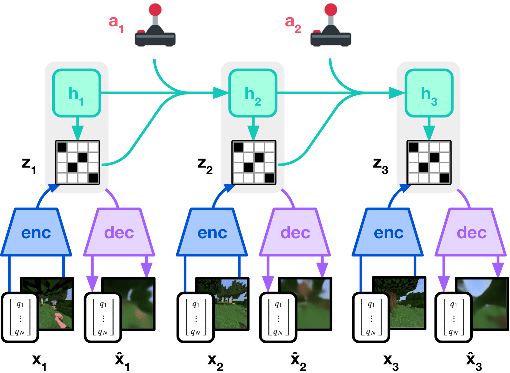
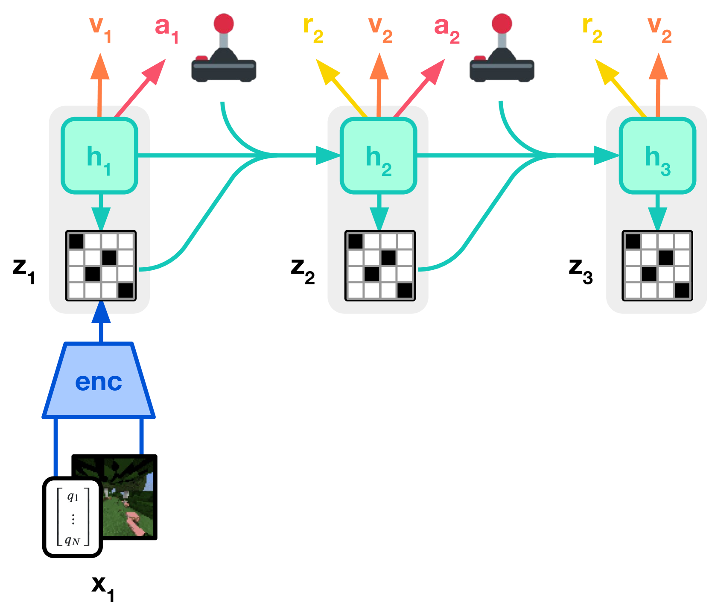
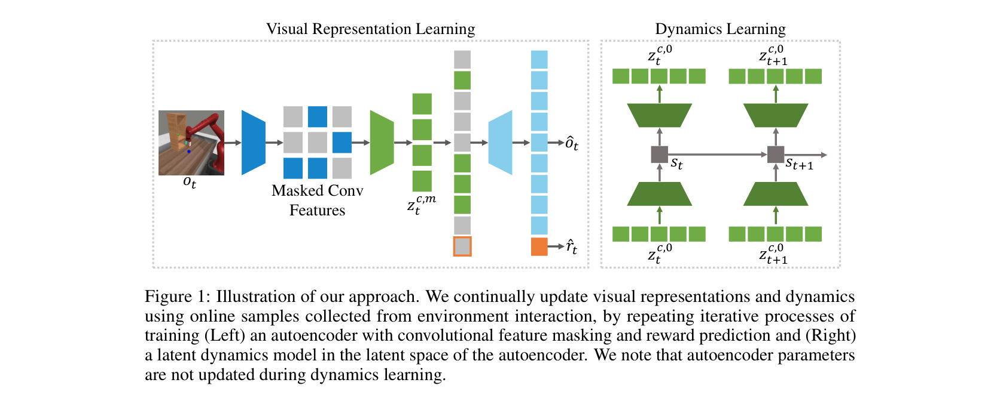
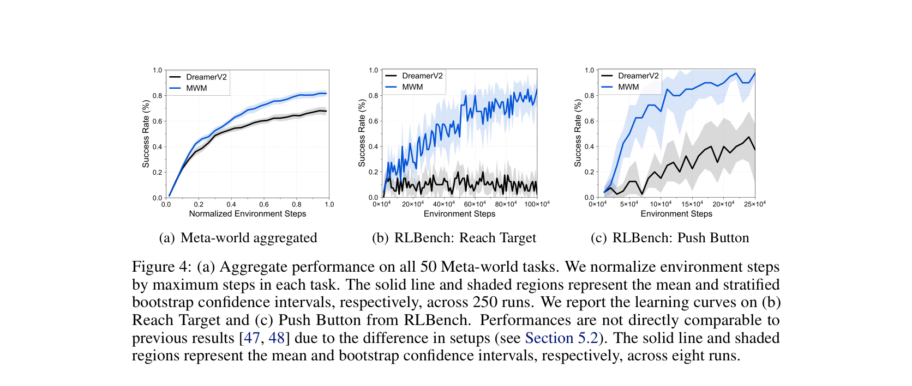
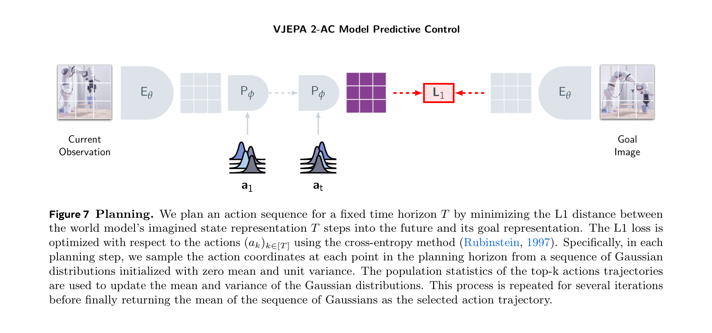
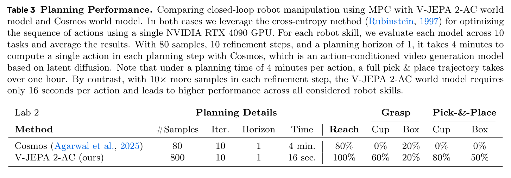

# 世界模型高效训练完整实验报告样例

这页用仓库里的 `world-model-mini-chain` fixture 写成一份小型论文式实验报告。它的目标不是证明某个真实模型有效，而是给全站提供一个**证据链模板**：数据、训练配置、系统成本、闭环指标、失败归因和改进计划应该怎样放到同一页里。

!!! warning "证据等级"
    本页是 `Toy Fixture`。它可以证明“实验报告应该如何组织”，不能证明任何真实世界模型、机器人策略或论文方法已经有效。

## 摘要

任务是桌面机器人动作条件世界模型的最小评测：给定多相机历史、语言目标、本体状态和候选 action chunk，模型要预测不同动作下的未来风险和成功概率。当前 fixture 暴露两个关键问题：`top1_safe_success_agreement=2/4` 过低，说明候选动作排序会选错；`action_sensitivity_pass=3/4` 说明遮挡任务中动作分叉仍不稳。

| 报告项 | 内容 |
| --- | --- |
| 数据规模 | 4 条 episode，12 条候选 rollout |
| 成本瓶颈 | 多相机 token、候选动作排序、失败 replay |
| 主要指标 | compression ratio、action sensitivity、top-1 agreement、risk ECE |
| 结论 | 证据格式完整，但模型门禁不合格；需要补 hard negatives、risk calibration 和 action counterfactuals |

## 数据

数据位于 `files/assets/examples/world-model-mini-chain/`：

```text
episodes.jsonl
rollouts.jsonl
training-config.yaml
eval_mini_chain.py
```

`episodes.jsonl` 记录任务、相机 token、压缩 token、语言/本体/动作 token 和结果标签。4 条 episode 里有 2 条成功样本、2 条 hard negative：`slip_after_fast_grasp` 和 `wrong_target_after_occlusion`。

| episode | split | task | result | failure_type |
| --- | --- | --- | --- | --- |
| `wm_mini_001` | mini_eval | pick red mug and place on rack | success | none |
| `wm_mini_002` | mini_eval | put sponge in drawer | success | none |
| `wm_mini_003` | mini_hard_negative | lift glass near table edge | failure | slip_after_fast_grasp |
| `wm_mini_004` | mini_hard_negative | pick occluded red mug | failure | wrong_target_after_occlusion |

## 训练配置

`training-config.yaml` 是 toy config，不是生产训练配方。它定义了 4 秒上下文、1.6 秒 rollout horizon、10Hz 控制频率、8-step delta end-effector pose + gripper action chunk，以及 action sensitivity、event head、risk head 等损失权重。

| 字段 | 当前设置 | 读法 |
| --- | --- | --- |
| `context_seconds` | `4.0` | 当前状态来自短历史，不覆盖长任务记忆 |
| `rollout_horizon_seconds` | `1.6` | 只测短 horizon 动作后果 |
| `latent_dim` | `1024` | toy latent，不代表真实模型容量 |
| `attention` | `block_causal` | 需要保持 episode boundary 和动作时间戳 |
| `risk_ece_max` | `0.15` | 小样本校准门禁，仅用于格式示范 |

## 系统账

运行：

```bash
python3 files/assets/examples/world-model-mini-chain/eval_mini_chain.py
```

当前输出：

| Metric | Value |
| --- | ---: |
| episodes | 4 |
| raw_patch_tokens | 82368 |
| compressed_state_tokens | 12292 |
| compression_ratio | 6.70x |
| action_sensitivity_pass | 3/4 |
| top1_safe_success_agreement | 2/4 |
| risk_ece_3bin | 0.103 |

这个系统账说明视觉压缩有数量级收益，但也暴露出关键边界：token 省下来以后，候选动作排序仍然会错。世界模型评测不能只报告 compression ratio 或 token/s。

## 原图证据：报告应该怎么写机制

{ width="900" }

{ width="900" }

<small>图源：[DreamerV3: Mastering Diverse Domains through World Models](https://arxiv.org/abs/2301.04104)，Figure 3(a)/(b)。原图意：Figure 3(a) 展示 world model learning，Figure 3(b) 展示 actor-critic 在 imagined latent trajectories 上学习。</small>

!!! note "这张图怎么读"
    **输入输出**：world model 从真实经验中学习 latent、reward 和 continuation；actor/critic 在 imagined latent trajectories 上学习动作和价值。<br>
    **效率机制**：策略更新大量发生在 latent imagination 中，从而减少真实环境试错。<br>
    **对本实验报告的意义**：报告要分开写 world model 训练指标和 policy/planning 消费指标，不能只报视频预测。<br>
    **不能证明什么**：这张图不能证明本页 toy fixture 有真实控制收益，也不能证明视频生成器可直接规划。

{ width="920" }

{ width="920" }

<small>图源：[Masked World Models for Visual Control](https://arxiv.org/abs/2206.14244)，Figure 1 与 Figure 4。原图意：Figure 1 展示 masked visual representation learning 与 latent dynamics learning 的解耦；Figure 4 展示 Meta-world / RLBench 设置中的 success rate 学习曲线。</small>

!!! note "这张图怎么读"
    **输入输出**：MWM 先学 masked visual representation，再在 latent space 中训练 dynamics。<br>
    **效率机制**：把视觉表征学习和 dynamics 学习拆开，减少像素细节对控制学习的干扰。<br>
    **对本实验报告的意义**：报告应同时给 representation 成本账和 dynamics / control 指标。<br>
    **不能证明什么**：MWM 图不能证明本页 toy fixture 的视觉压缩一定保留接触、遮挡和小目标状态。

!!! warning "读数边界"
    Figure 4 是论文设置下的 Meta-world / RLBench visual control 结果，有 closed-loop control 曲线，但不是本页 toy fixture 的结果，也不是任意真实机器人部署结果。

{ width="920" }

{ width="920" }

<small>图源：[V-JEPA 2: Self-Supervised Video Models Enable Understanding, Prediction and Planning](https://arxiv.org/abs/2506.09985)，Figure 7 与 Table 3。原图意：Figure 7 展示用 V-JEPA 2-AC 做 model predictive control；Table 3 比较 V-JEPA 2-AC 与 Cosmos world model 在机器人操作任务中的规划性能与时间。</small>

!!! note "这张图怎么读"
    **输入输出**：输入当前观测、目标图像和候选动作；输出是在 representation space 中 rollout 后与目标表示的距离。<br>
    **效率机制**：用 latent / representation planning 评估候选动作，而不是为每个动作生成完整未来视频。<br>
    **对本实验报告的意义**：closed-loop planning 报告必须同时写成功率和每步规划时间。<br>
    **不能证明什么**：V-JEPA 2-AC 的论文表不能证明本页 toy fixture 已经有真实机器人闭环能力。

!!! warning "读数边界"
    Table 3 是论文中的 closed-loop robot manipulation planning 设置，使用目标图像、MPC/CEM 和单张 RTX 4090；它不是独立复现，也不是系统级长时部署报告。

## 评测

| 指标 | 当前值 | 解释 | 门禁判断 |
| --- | ---: | --- | --- |
| compression ratio | `6.70x` | raw patch token 到 compressed state token 的压缩 | 格式可用，但需看状态是否保真 |
| action_sensitivity_pass | `3/4` | 固定历史下换动作，latent 是否有足够变化 | 不合格，遮挡任务仍需补 |
| top1_safe_success_agreement | `2/4` | 预测 top-1 安全成功动作是否真实成功 | 不合格，排序会选错 |
| risk_ece_3bin | `0.103` | 三桶风险校准误差 | 小样本下仅作格式示范 |

## 失败归因

| episode | top_candidate | predicted_risk | predicted_success | actual_event | 归因 |
| --- | --- | ---: | ---: | --- | --- |
| `wm_mini_003` | `fast_grasp` | 0.20 | 0.80 | slip | 风险头低估快速抓取导致的滑落 |
| `wm_mini_004` | `grasp_visible_decoy` | 0.16 | 0.76 | wrong_target | 遮挡后对象身份漂移，模型把可见干扰物当目标 |

失败归因比平均分更重要。`risk_ece_3bin=0.103` 看起来不糟，但 top-1 排序仍然会选错动作，说明校准指标必须按 hard-negative 桶拆开看。

## 改进计划

| 问题 | 下一步改进 | 验收 |
| --- | --- | --- |
| 快速抓取滑落 | 增加 slip hard negatives、接触状态 probe、risk head 权重 | near-miss recall 提升，top-1 不选高风险动作 |
| 遮挡后 wrong target | 增加多相机 object permanence 标签和反事实动作 | occlusion bucket 的 action sensitivity 通过 |
| 排序不可靠 | 加 candidate ranking loss 或 pairwise preference eval | top1_safe_success_agreement 达到门禁 |
| 证据仍是 toy fixture | 替换为真实 checkpoint、固定 seed、真实 rollout 日志 | 报告升级为 Paper Result 或 Closed-loop |

## 结论

本页给的是实验报告形状，不是模型胜利宣言。一个合格的世界模型高效训练报告，必须同时报告：省了什么成本、预测是否动作敏感、闭环或候选排序是否变好、失败是否能回放、证据等级和复现状态是什么。
